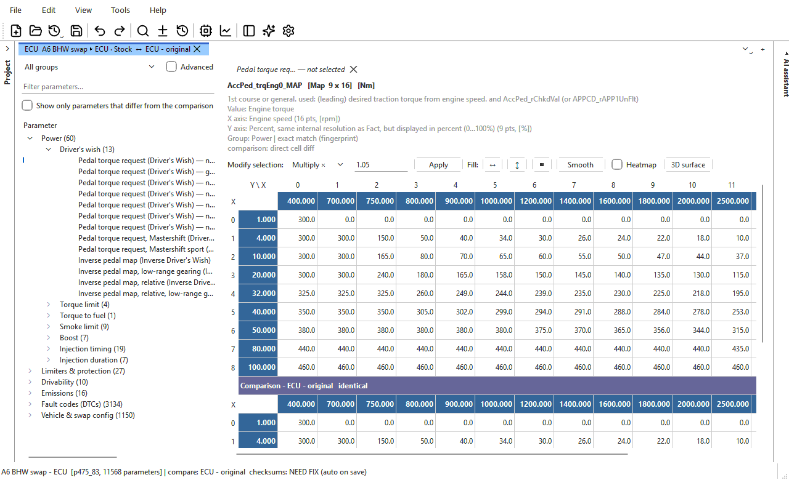
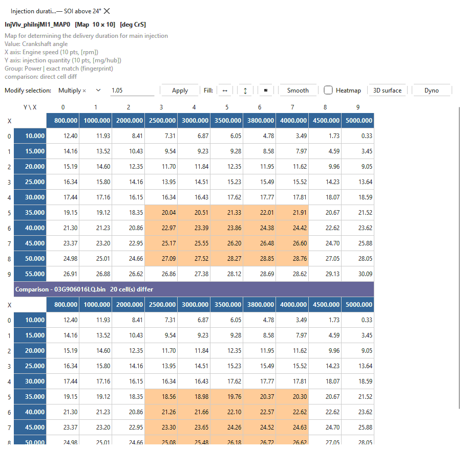
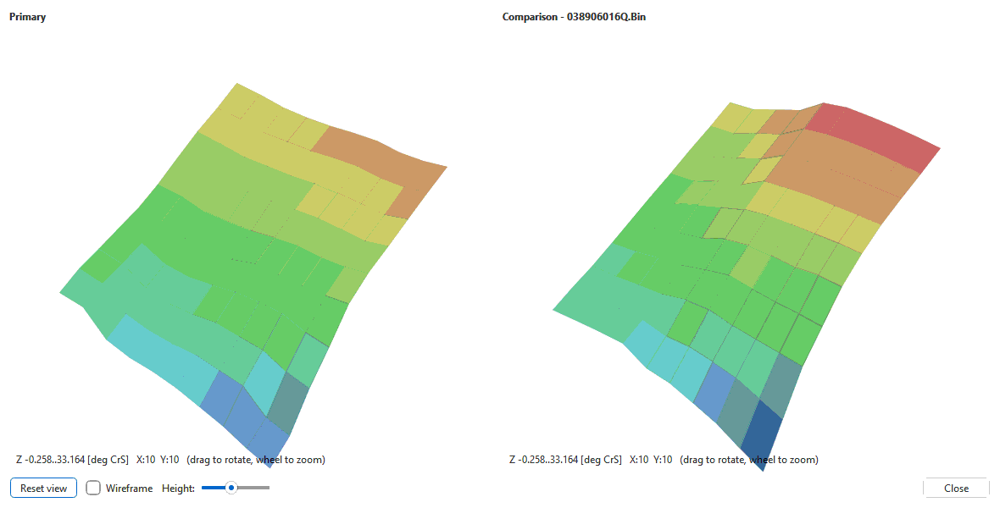
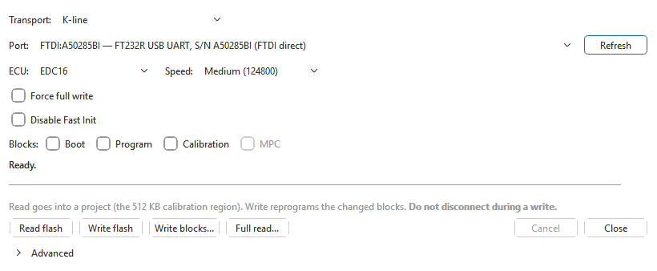
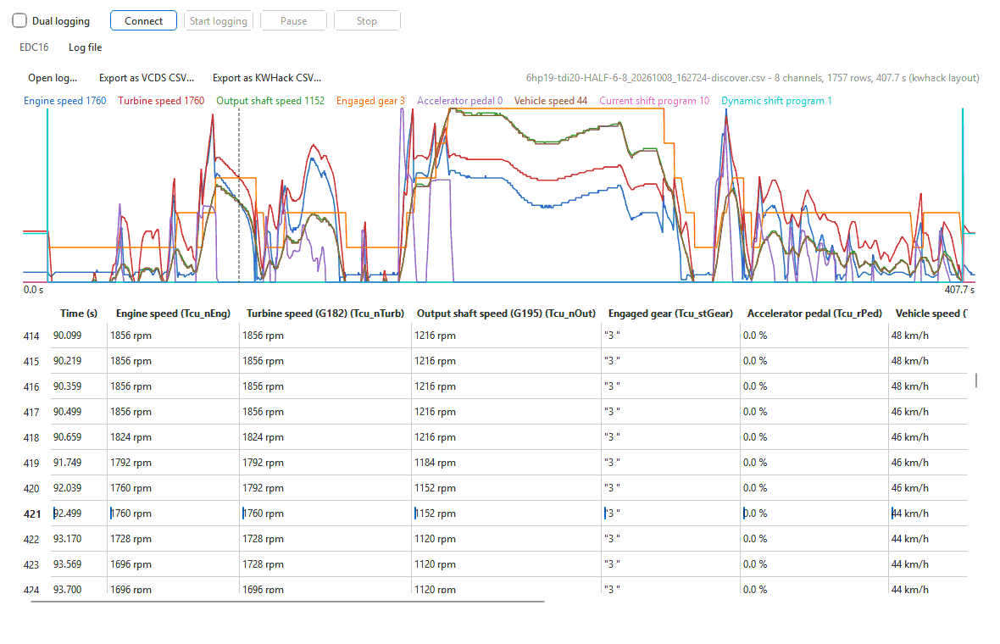
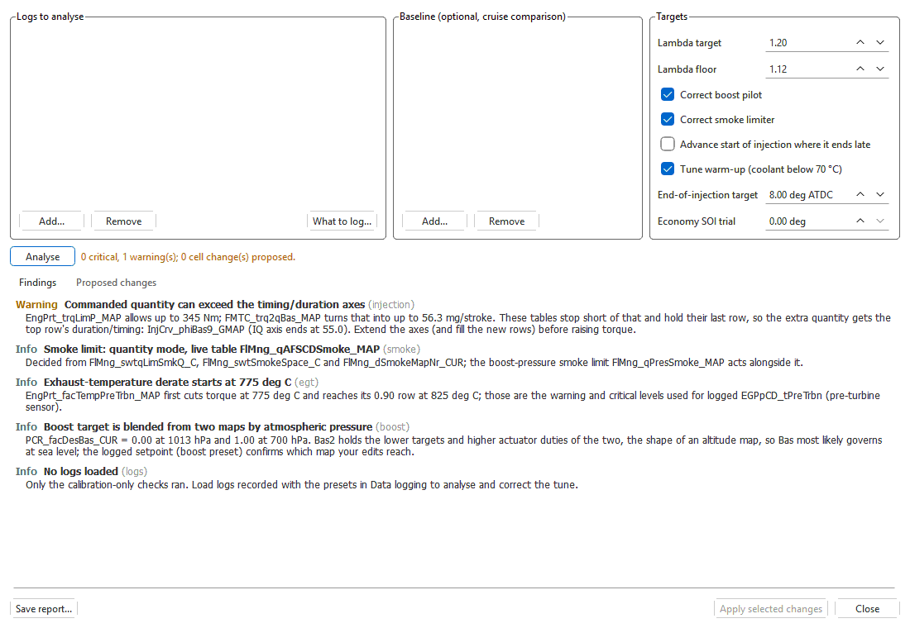
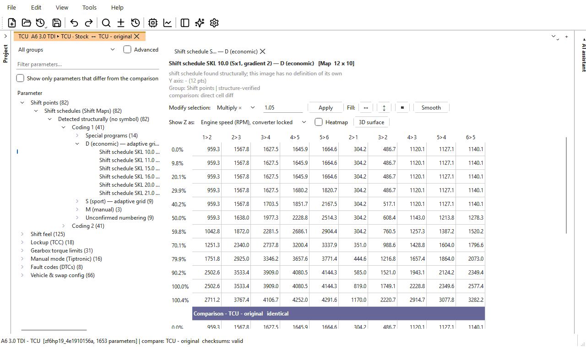
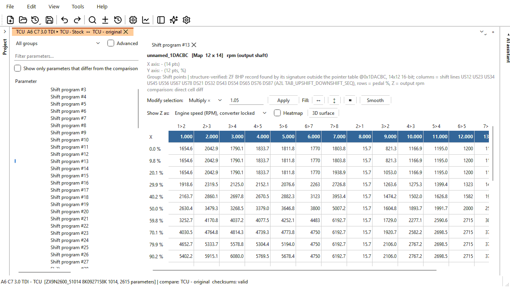
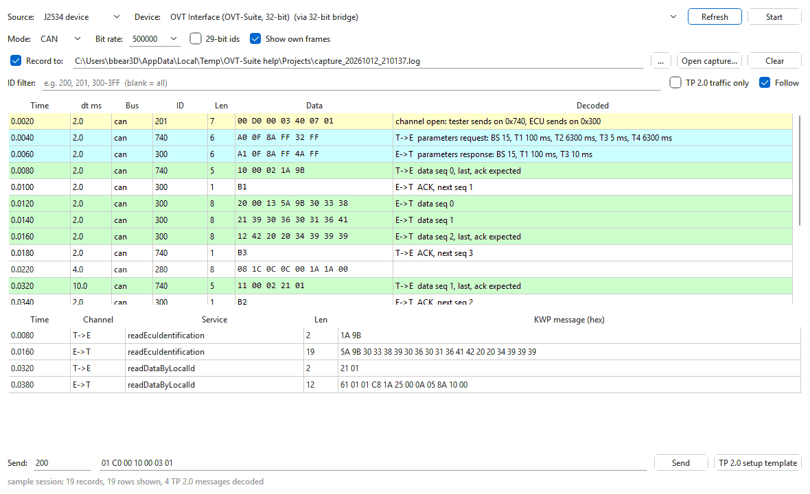

# OVT-Suite

**Old VAG Tuner Suite**: one desktop app to read, edit, compare, log and flash
the control units of older VW-group cars. It covers Bosch EDC16 and EDC15
diesel ECUs, ZF 6HP and 8HP and Aisin gearboxes, VDO instrument clusters, and
the Audi A6/Q7 Climatronic.

[](LICENSE)


<p align="center">
  
</p>

You don't need a definition file to open a binary. OVT-Suite identifies the
file from its own structure. It places about 10,000 named parameters on a
typical EDC16 (11,568 on the file above), each with a record of how it was
found. Values are shown in real units. Checksums are corrected every time you
save. Two files compare **map by map, even across different software versions** of
the same ECU, where every table sits at another address. The same window has
the flasher, a two-ECU data logger, a CAN/K-line bus sniffer, an ECU simulator
and an AI assistant that proposes changes but never makes them on its own.

> **Status:** active development, version 0.4.6. The base app is free and open
> source. Editing and checksum support for each kind of control unit comes from
> a **module**. See [Supported control units](#supported-control-units) and
> [Tested on real hardware](#tested-on-real-hardware) before you trust a write
> to a car.

### Download

| | Windows | Linux / any platform |
|---|---|---|
| **OVT-Suite app 0.4.6** | [OVTSuite-Base-0.4.6-setup.exe](https://github.com/bbear3d/ovtsuite/releases/download/v0.4.6/OVTSuite-Base-0.4.6-setup.exe) | [ovtsuite_0.4.6-1_amd64.deb](https://github.com/bbear3d/ovtsuite/releases/download/v0.4.6/ovtsuite_0.4.6-1_amd64.deb), [ovtsuite-0.4.6-1.x86_64.rpm](https://github.com/bbear3d/ovtsuite/releases/download/v0.4.6/ovtsuite-0.4.6-1.x86_64.rpm) |
| **Bosch EDC16 module 1.0.10** (free) | [OVTSuite-BoschEDC16-1.0.10-setup.exe](https://github.com/bbear3d/ovtsuite/releases/download/v0.4.6/OVTSuite-BoschEDC16-1.0.10-setup.exe) | [edc16-1.0.10.ovtmod](https://github.com/bbear3d/ovtsuite/releases/download/v0.4.6/edc16-1.0.10.ovtmod), [ovtsuite-module-edc16_1.0.10-1_all.deb](https://github.com/bbear3d/ovtsuite/releases/download/v0.4.6/ovtsuite-module-edc16_1.0.10-1_all.deb) |
| **Bosch EDC15 module 1.0.10** (free) | [OVTSuite-BoschEDC15-1.0.10-setup.exe](https://github.com/bbear3d/ovtsuite/releases/download/v0.4.6/OVTSuite-BoschEDC15-1.0.10-setup.exe) | [edc15-1.0.10.ovtmod](https://github.com/bbear3d/ovtsuite/releases/download/v0.4.6/edc15-1.0.10.ovtmod), [ovtsuite-module-edc15_1.0.10-1_all.deb](https://github.com/bbear3d/ovtsuite/releases/download/v0.4.6/ovtsuite-module-edc15_1.0.10-1_all.deb) |
| **VDO Cluster module** (open source) | [bbear3d/ovtsuite-vdo](https://github.com/bbear3d/ovtsuite-vdo) | [bbear3d/ovtsuite-vdo](https://github.com/bbear3d/ovtsuite-vdo) |

Install the app first, then the modules you need. Every release is on the
[Releases](https://github.com/bbear3d/ovtsuite/releases) page; see
[Download and install](#download-and-install).

> **Support the project.** OVT-Suite and the EDC15 / EDC16 modules are free.
> If they save you time or a trip to a tuner, you can support development
> with a donation through [PayPal](https://paypal.me/bbear3d). Thank you!

---

## Contents

- [What makes it different](#what-makes-it-different)
- [Supported control units](#supported-control-units)
- [Tested on real hardware](#tested-on-real-hardware)
- [Feature tour](#feature-tour)
- [Cables and interfaces](#cables-and-interfaces)
- [Download and install](#download-and-install)
- [Running from source and the command line](#running-from-source-and-the-command-line)
- [Building](#building)
- [Repository layout](#repository-layout)
- [Licence, trademarks and legal use](#licence-trademarks-and-legal-use)
- [Support](#support)
- [Credits](#credits)

---

## What makes it different

- **No XDF needed.** A file is recognised by its own structure: a
  descriptor, a signature or a layout anchor. Size and file name are never
  used. Parameters are placed from knowledge bases built from the
  manufacturer's own descriptions, and every placement has to be proven
  against this exact file: a structure fingerprint, the ECU's own pointer
  table, or verified anchors. Each map shows how it was found, from
  *exact match* down to *projected – check before writing*.
- **Reads the firmware, not a lookup table.**
  - The EDC15 checksum ranges come from the checksum routine inside the
    image, so software the app has never seen is handled too.
  - ZF 6HP shift and lock-up schedules that no definition names are found by
    their structure.
  - The ZF 8HP layout is taken from the calibration's own pointer table.
  - EDC16 maps are labelled with when they are active (for example
    "— 41.8–53.5 °C", "— gears 1–6"), read live from the selector curves in
    your file.
- **Plain English.** Parameters are grouped by job: Power, Limiters &
  protection, Drivability, Emissions, Fault codes, Shift points, Lock-up and
  so on. Each has a readable name next to its A2L symbol. German
  descriptions from DAMOS and WinOLS files are translated, and units are
  shown in English.
- **Projects, not loose files.** One `.ovt` file holds a car:
  - every control unit;
  - branches (*Stock*, *Stage 1*, *Economy*);
  - full version history with a 500-step undo that reaches back past saves;
  - data logs, patches and attachments.
  The first read is kept untouched for good.
- **Compare across software versions.** Most tools compare two binaries
  byte by byte, which only works when both are the same software. OVT-Suite
  places every named parameter in each file separately and then compares
  them by name. So a stock 03G906016LQ lines up against a tuned 03G906016HQ,
  or a donor ECU against your own, map for map. That works even though their
  tables sit at different addresses and some have different sizes. Tables of
  different sizes are resampled onto your axes, and gearbox tables are
  matched by column label. Differing cells are highlighted, and the tree can
  show only the parameters that differ. The same name-based matching lets you
  copy a map from one version into another, and apply a patch made on one
  version to another.
- **Patches that move between software versions.** A patch stores each
  change by parameter name in physical units. It can apply to a different
  software version of the same ECU, and it can be removed again later
  without the original patch file.
- **Safe flashing.** Only the blocks or sectors that changed are written.
  Checksums are corrected on the copy that is sent. The write is verified by
  the unit's own checksum routine or by reading it back. Blocks that already
  match are skipped, so an interrupted write can simply be run again.
- **More than a tuner.** The same app includes:
  - a two-ECU data logger that logs engine and gearbox at once on one clock;
  - a TP 2.0 / KWP2000 bus sniffer;
  - an ECU simulator for testing read and write sequences before you move
    to real hardware;
  - parameter tools for fault codes, EEPROM/immobiliser, gear ratios,
    measuring blocks and speedometer correction.
- **An AI assistant that can't change anything without you.**
  - It sees the open calibration, the comparison, the version history and
    your logs.
  - Every change it suggests is a *proposal* that has passed the same safety
    checks as the auto-tune. You preview it as a comparison, then accept or
    reject it.
  - It works with local models (Ollama, LM Studio) or online services
    (Claude, OpenAI, Gemini, Groq, OpenRouter, DeepSeek).
  - VINs, immobiliser data and SKCs are never sent.
  - An MCP server lets your own AI app work with OVT-Suite projects.

---

## Supported control units

The **base app** works without any module. It recognises every supported
file and names the module that adds full support. It also has the hex editor,
compare, patches, version history, the flasher, the logger, the sniffer and
the simulator. Each **module** adds definitions (the named parameter tree),
checksum correction and that unit's tools.

| Module | Control units | What the module adds | Version | Licence |
|---|---|---|---|---|
| **Bosch EDC16** | EDC16U31 / U34 (2 MB) VW PD TDI ECUs. Families P350 (038906016…, 038997016…), P475 and P447 (03G906016…), P529, P213. EDC16U1 (1 MB) is untested and may not be compatible. | About 10,000 named parameters per file; all checksums (block/span, prog/boot, header, signatures, digests); MPC and 4 KB EEPROM/immobiliser editor; Tune from logs; `.sgo` / `.dim` round-trip; XDF export | 1.0.10 (stable) | Free, closed source |
| **Bosch EDC15** | EDC15VM+ (VP37, e.g. 1.9 TDI ALH 038906012…) and EDC15P (PD, 038906019…). | Per-dataset parameter tree (manual / automatic); V4.1 checksum chain read from the image's own routine; 512-byte EEPROM editor (immobiliser, SKC, odometer, DSV coding, trims, virginize) | 1.0.10 (stable) | Free, closed source |
| **ZF 6HP** | 6HP19A (09L/0AT), 6HP26A (09E), 6HP28AF (T04/0B6) TCUs. | Shift points, shift feel, lock-up (TCC), Tiptronic limits, shift programs and state tables; schedules found by structure; Z shown as output, engine or road speed; ZF fault-code editor; shift torque report; CRC-16 checksum; Stage 1 auto-tune (command line) | 1.0.9 (stable) | Closed source |
| **ZF 8HP** | Gen1 (8K0/8K1/8R0927158…) and Gen2 VW-group TCUs. | Every parameter's location and shape taken from the calibration's pointer table; shift programs and converter-clutch tables; per-block CRC-32 | 0.1.6 (early) | Closed source |
| **Aisin TR-xx** | TR-60SN (09D) and TR-80SD (0C8 / 09G). | Identification and the 09D checksum. No parameter tree yet. | 0.1.5 (early) | Closed source |
| **VDO Cluster** | Mk4-era VDO clusters: VWK501, VWK503, VMMJ08 (verified); VQMJ07, K5MJ07 (extrapolated). | 2 KB EEPROM definitions (K-value, needle maps, coding, SKC); gauge checksum; needle / LED / DSG-needle sweep patches for the exact ROM build; speed and distance correction | 0.1.8 (early) | MPL-2.0, [bbear3d/ovtsuite-vdo](https://github.com/bbear3d/ovtsuite-vdo) |
| **4F/4L HVAC** | Audi A6 C6 (4F0910043, 4F0910043B) and Q7 (4L0910043, 4L0910043D) Climatronic. Only the post-facelift (2009+) C6 has been tested. | Heated-seat tables, A/C compressor bypass and cutouts, sensor curves; checksum; `.sgo` repack | 0.1.6 (early) | Closed source |

**What the built-in flasher can do with each unit**

| Unit | Link | Read | Write |
|---|---|---|---|
| EDC16 | K-line or CAN (TP 2.0) | Calibration; full read (2 MB + MPC) | Calibration; boot, program and MPC blocks individually |
| EDC15 | K-line | 512 KB flash, EEPROM, full backup | Changed sectors, EEPROM, flash + EEPROM; boot mode on the bench |
| ZF 6HP19 / 6HP26 | KWP2000 over TP 2.0 | Calibration window | Calibration areas |
| ZF 6HP28 | UDS over ISO-TP | Calibration | Calibration, or program + calibration |
| Audi 4F/4L Climatronic | CAN | Not possible over OBD | From a factory `.sgo`; changed sectors only |
| VDO cluster | K-line (KW1281) | 2 KB EEPROM | Whole EEPROM, read back and verified |
| Aisin 09D | CAN (TP 2.0) | 1 MB flash | Disabled in this version |
| C6 ESP8 ABS / C6 CAN cluster | CAN | Flash dump (cluster: experimental) | No |

The ZF 8HP and the Aisin TR-80SD have no flasher entry yet.

---

## Tested on real hardware

The app has a large automated test suite: about 2,600 tests across the base app
and modules, 1,356 of them in this repository. Those tests can't stand in for a
car, though. This is what has been done on **real control units**, in cars or on
the bench:

| Unit / feature | Real hardware |
|---|---|
| Bosch EDC16 (U31/U34): read and write | ✅ Tested |
| Bosch EDC16U1 | ⚠️ Untested; may not be compatible |
| Bosch EDC15 (VM+/P): read and write | ✅ Tested |
| ZF 6HP19 / 6HP26: read and write | ✅ Tested |
| ZF 6HP28: read and write | ✅ Tested |
| Audi 4F Climatronic, post-facelift (2009+) C6: write | ✅ Tested (the unit can't be read over OBD) |
| Climatronic on a pre-facelift C6 or a Q7 (4L) | ⚠️ Not tested |
| EDC16 data logging | ✅ Tested |
| ZF 6HP19 logging, and dual engine + gearbox logging | ✅ Tested |
| J2534 on Windows | ✅ Tested |
| Tactrix OpenPort 2.0 direct over USB (Linux) | ⚠️ Not yet confirmed |
| VDO cluster EEPROM read/write | ⚠️ Not yet tested on hardware |
| Aisin 09D read | ⚠️ Not yet tested on hardware (write is disabled) |
| C6 ESP8 ABS and C6 CAN cluster dumps | ⚠️ Not yet tested on hardware |
| EDC15 / EDC16 fault-code (DTC) editor | ⚠️ Alpha: switching codes off is not yet confirmed working |
| ZF 8HP, Aisin TR-80SD | No flasher; file editing only |
| macOS | ⚠️ Untested |

Keep the original read, which every project stores. Have a recovery route
before you write anything: bench or boot mode, or a BDM for EDC16 boot and
program blocks.

---

## Feature tour

### Editor

<p align="center">
  
</p>

- **Physical units:** type Nm, mg/stroke, °, rpm. The app converts the value
  and clamps it to what the cell can hold. Axis breakpoints can be edited.
- **Selection tools:** Set/Add/Subtract/Multiply/Divide, interpolating fill
  (row, column, or from four corners), smoothing, heatmap shading,
  axis swap, and copy/paste that round-trips with spreadsheets.
- **Copy from another file:** copy a table from another tab or project.
  The table is found by identity, not by address.
- **Find panel:** fuzzy parameter search, value search (`10..20`, `>5`,
  `!=0`), address lookup that resolves to the exact cell, and byte search
  with wildcards, integers or floats. **Ask AI** finds a map from a
  description.
- **Hex editor:** works on every binary, including ones no module supports.
  It colours bytes that belong to identified parameters, that you changed,
  or that differ from the comparison.
- **3D surface:** with a comparison open, both surfaces turn and zoom
  together on one colour scale.

<p align="center">
  
</p>

### Files in and out

- **Formats it opens:**
  - plain images: `.bin`, `.ori`, `.hex`, `.mpc`;
  - Dimsport `.dim`;
  - factory `.sgo` and `.frf`;
  - WinOLS projects `.ols` (OLS 4 and 5).
  The file type is recognised by content, not by extension.
- **Outside definitions:** TunerPro `.xdf`, ASAP2 `.a2l`, WinOLS `.kp` and
  Bosch DAMOS `.dam` attach to a binary. They can show beside the module's
  tree or replace it, and a binary no module knows opens with that
  definition's tables.
- **Exports:**
  - the binary, any part of it;
  - the original container (`.sgo` / `.dim`), rebuilt with your changes;
  - a TunerPro XDF made to match this binary;
  - CSV logs and `.patch` files.

### Projects, history and patches


- **What a project holds:** one `.ovt` per car. Inside it, a set for each
  control unit (including the MPC and EEPROM), branches, a full version
  history, data logs, patches, and attachments such as dyno sheets and
  photos.
- **Version history:** name, merge, compare with or revert to any saved
  version. A revert is a single undo step.
- **Several projects at once:** you can have several open. If another
  program (the standalone flasher, a script, an AI app) changes a project
  you have open, OVT-Suite notices and offers to reload and merge, never
  silently overwriting.
- **Crash safety:** saves are atomic, unsaved work is recovered after a
  crash, and every version flashed to a car is marked as such.
- **Patches:** made from the comparison or from any two versions in the
  history. Applying one shows each entry as *established*, *not
  established* or *not found*.

<br clear="right">

### Reading and writing

<p align="center">
  
</p>

- **Two ways to run it:** **Tools > ECU read / write** in the main app, or
  the standalone **OVT Flasher**.
- **No module needed:** reading and writing work without one. A module is
  needed only to correct checksums.
- **Fast K-line:** EDC16 K-line runs at up to 244,898 baud on an FTDI cable.
- **Automatic gearbox protocol:** the ZF 6HP transport (TP 2.0 or UDS) is
  chosen for you, and can be overridden.
- **Tools for unusual cases:**
  - EDC15 soft-brick detection and boot mode;
  - EDC16 diagnostic probes;
  - an optional EDC16 boot-sector database for full reads.
- **Planned:** reading and writing through a KW-Dash head unit that holds
  the cable in the car while the PC connects over Wi-Fi or Bluetooth. This is
  planned for a future release.

### Data logging

<p align="center">
  
</p>

- **Named cells:** EDC16 cells take their names from the calibration's own
  measuring-block map, and the 6HP19 has a built-in catalogue.
- **Presets:** 8 engine and 8 gearbox presets. Each picks the fewest
  measuring blocks that cover what an analysis needs and comes with driving
  instructions.
- **Dual logging:** engine on K-line and gearbox on CAN at the same time, on
  one clock.
- **Live view and connection:** a live chart, keep-alive while paused, and
  automatic reconnect.
- **Log files:** logs are kept in the project, and VCDS CSV logs can be read
  and exported.
- **Fault codes:** EDC15/EDC16 fault codes can be read and cleared. Stored
  codes are highlighted in the DTC editor (alpha).

<p align="center">
  
</p>

**Tune from logs** (EDC16) reads your logs and proposes cell changes for the
boost pilot (N75), the smoke limiter (aimed at a lambda target) and,
optionally, start of injection. The changes are applied as one undoable
edit, and the report is saved as text or HTML.

### Gearboxes

<p align="center">
  
</p>

- **Shift and lock-up schedules:** ZF 6HP schedules are shown by gear change
  and pedal position, as output-shaft speed, engine speed (converter locked)
  or road speed from your final drive and tyre size. You can type values in
  any of these.
- **Schedules no definition names:** these are found by structure and
  checked against the TCU's own state tables. That is the case for most
  6HP19 files.
- **Shift feel and banks:** slip times, clutch pressures and fill offsets;
  coding banks with *copy to other bank*.
- **Fault codes:** a ZF fault-code editor that warns when one switch covers
  a whole fault class.
- **Shift torque report:** compares the torque cut the TCU asked for with
  what the engine delivered.
- **ZF 8HP:** shift programs and converter-clutch tables, with the same
  speed views.

<p align="center">
  
</p>

### Clusters and Climatronic


- **VDO Mk4 cluster EEPROMs:**
  - K-value, needle maps, coding with drop-downs, SKC;
  - speedometer correction from tyre size, GPS speed or odometer distance;
  - needle, LED and DSG-needle sweep patches built for the cluster's exact
    ROM build, each credited with its author and licence.
- **Audi 4F/4L Climatronic:** heated-seat on/off tables, the A/C compressor
  bypass and cutouts, and sensor curves. The result is written back as a
  factory `.sgo`. Only the post-facelift (2009+) A6 C6 has been tested so far,
  not the pre-facelift C6 or the Q7.

<br clear="right">

### Parameter tools

- **DTC / Fault-Path editor** (EDC15 / EDC16, **alpha**: switching codes off
  is not yet confirmed working on a car):
  - switch codes off and on;
  - restore all from stock;
  - copy the differences from the comparison;
  - highlight the codes read from the ECU.
- **EEPROM editor (EDC15 / EDC16):** VIN, immobiliser on/off, SKC, odometer
  and trims, with checksums corrected. EDC15 can also be virginized.
- **Measuring blocks:** reassign what each block reports, so a log needs
  fewer blocks and runs faster.
- **Gear ratios and V/N gear recognition:** shown per coding variant, with
  automatic generation from ratios and tyre size.
- **VSS pulse settings:** tyre-size rescaling and correction against GPS
  speed.

### Bus sniffer and ECU simulator

<p align="center">
  
</p>

- **Sniffer:**
  - decodes VW TP 2.0 channels and the KWP2000 inside them on CAN, and
    KWP2000/KW1281 on K-line;
  - captures through a J2534 device, or through a passive K-line tap made
    with a second cable;
  - saves, replays and decodes candump-style captures.
- **Simulator:** test read and write sequences on the bench before you
  move to real hardware.
  - A J2534 device or K-line cable answers as a ZF 6HP28, a ZF 8HP
    (Gen1 AL551, Gen2 ALX52), an Aisin TR-80SD or TRx, or a generic UDS unit.
  - The flasher, or another tool, runs its whole sequence against it,
    including a complete write. The written blocks are decoded so you can
    check what would have reached the unit.
  - Real-car timing, latency and dropped frames can be simulated, so timing
    problems show up before a real control unit is involved.

### AI assistant

<p align="center">
  
</p>

- **What it can see:** the open calibration with real units, the comparison,
  the version history, the checksum state, your logs (as summaries) and the
  help pages.
- **What it can do:**
  - open and highlight the tables it is talking about;
  - explain a parameter or a change;
  - summarise a log;
  - build multi-step plans such as a stage 1.
- **Proposals, never direct changes:**
  - every change is checked against the same safety rules as the auto-tune:
    no out-of-range values, platform rules such as a 6HP upshift too close to
    its downshift, and no VIN/immobiliser/SKC changes;
  - you preview the proposal as a comparison, then accept or reject it;
  - an accepted proposal is one undo step and is saved as its own version.
- **Providers:**
  - local and free: Ollama or LM Studio, which also work offline;
  - free tiers: Groq, OpenRouter, Google Gemini;
  - paid: Claude, OpenAI, DeepSeek;
  - any OpenAI-compatible server.
  Keys are kept in the system keyring.
- **Privacy:**
  - AI is off until you turn it on;
  - whole binaries and whole logs are never sent;
  - VIN, immobiliser and SKC data are never sent;
  - **What was sent...** shows every request exactly as it went out.
- **MCP server** (`OVTMcp.exe` / `ovtsuite mcp`): Claude, ChatGPT, Cursor,
  VS Code or any MCP app can open your projects read-only and send proposals
  to the same queue.

### And also

- A built-in help browser: F1 opens the page for whatever window you're in.
- Remappable shortcuts, a customisable toolbar, and light/dark themes.
- Standalone **OVT Flasher**, **OVT Logger**, **OVT Sniffer** and
  **OVT Simulator** apps, each with its own taskbar entry.

---

## Cables and interfaces

| Interface | Notes |
|---|---|
| **FTDI K-line (KKL) cable** | Recommended. Driven directly for low latency; the only kind that holds EDC16 High speed (244,898 baud). The Windows installer can download FTDI's driver from Microsoft's driver catalog when it is missing. |
| **CH340 / CH341 K-line cable** | Works, capped at Medium speed. |
| **J2534 pass-through (Windows)** | Every registered device is listed. 32-bit-only devices (e.g. Scanmatik 2 PRO) work through a bundled 32-bit bridge. J2534 devices can also do K-line. |
| **Tactrix OpenPort 2.0** | The tested J2534 device. On Linux it is driven directly over USB, with no vendor driver (not yet confirmed on hardware). |

On Linux, the package installs a udev rule that gives the logged-in user the
OpenPort, FTDI and CH34x cables without root or group membership.

---

## Download and install

### The app

The Windows installer and the Linux `.deb` / `.rpm` packages are published on
the [Releases](https://github.com/bbear3d/ovtsuite/releases) page.

- **Windows:**
  - installs per user, without administrator rights, or for all users;
  - optionally downloads FTDI's USB driver.
- **Linux:** installs to `/opt/ovtsuite` with a menu entry, the `.ovt` file
  type and the udev rule.

### Modules

Modules are signed `.ovtmod` packages. The app checks the signature and every
file both at install time and at every start. Install a module with its own
installer, or from **Tools > Modules... > Install from file**.

| Module | Windows | Linux, or any platform |
|---|---|---|
| Bosch EDC16 1.0.10 (free) | [OVTSuite-BoschEDC16-1.0.10-setup.exe](https://github.com/bbear3d/ovtsuite/releases/download/v0.4.6/OVTSuite-BoschEDC16-1.0.10-setup.exe) | [edc16-1.0.10.ovtmod](https://github.com/bbear3d/ovtsuite/releases/download/v0.4.6/edc16-1.0.10.ovtmod), [ovtsuite-module-edc16_1.0.10-1_all.deb](https://github.com/bbear3d/ovtsuite/releases/download/v0.4.6/ovtsuite-module-edc16_1.0.10-1_all.deb) |
| Bosch EDC15 1.0.10 (free) | [OVTSuite-BoschEDC15-1.0.10-setup.exe](https://github.com/bbear3d/ovtsuite/releases/download/v0.4.6/OVTSuite-BoschEDC15-1.0.10-setup.exe) | [edc15-1.0.10.ovtmod](https://github.com/bbear3d/ovtsuite/releases/download/v0.4.6/edc15-1.0.10.ovtmod), [ovtsuite-module-edc15_1.0.10-1_all.deb](https://github.com/bbear3d/ovtsuite/releases/download/v0.4.6/ovtsuite-module-edc15_1.0.10-1_all.deb) |
| VDO Cluster (open source) | Build it from [bbear3d/ovtsuite-vdo](https://github.com/bbear3d/ovtsuite-vdo) | Same |

A `.ovtmod` file works on every platform: open it, or use **Tools > Modules...
> Install from file**, or run `ovtsuite install-module <file>`. On Linux the
`.deb` installs the module for all users
(`sudo apt install ./ovtsuite-module-edc16_….deb`), and the app asks you to
accept the module's licence agreement the first time it starts.

The EDC15 and EDC16 modules are free to use but not open source: they are
licensed under the [module licence agreement](ovtsuite/modules/EULA.txt). A
module installer needs OVT-Suite (or OVT Tools) installed first.

---

## Running from source and the command line

Python 3.10 or newer:

```
pip install -e .
pip install PySide6 pyserial pyusb pyftdi cryptography numpy
ovtsuite gui                       # the editor
ovtsuite --flasher | --logger | --sniffer | --simulator
```

The command line works on any file the installed modules support:

```
ovtsuite identify <bin>            # platform, variant, calibration region
ovtsuite diff <stock> <mod>        # named, physical-unit differences
ovtsuite export <bin> out.xdf      # a TunerPro XDF for this binary
ovtsuite checksum <bin> [--fix]    # verify / correct checksums
ovtsuite modules                   # installed modules
ovtsuite install-module <file.ovtmod>
ovtsuite mcp [--print-config]      # the MCP server for AI apps
```

A source checkout has no closed-source modules. To use one, install its
`.ovtmod`. To load a module you built yourself (unsigned), tick **Allow
unsigned modules (development)** in Tools > Modules, or set
`OVT_ALLOW_UNSIGNED=1`.

---

## Building

Windows, with version stamping and the Inno Setup installers:

```
.\build.ps1                 # dist\OVTSuite\OVTSuite.exe, plus installers if Inno Setup is present
.\build.ps1 -NoInstaller    # skip the installers
.\build.ps1 -FastInstaller  # quicker, bigger installers for testing
.\build.ps1 -Clean          # start from scratch
```

Linux, as a `.deb` (and optionally an `.rpm`):

```
./build_linux.sh                  # dist/ovtsuite_<ver>-1_<arch>.deb
./build_linux.sh --docker --rpm   # build in Ubuntu 20.04: runs on any distro with glibc 2.31+
```

`build.ps1` finds Python 3.10+, provisions an isolated build venv, freezes the
app with PyInstaller (`packaging/ovtsuite.spec`) and builds the installers.
Repeat builds are incremental.

**Tests:** `python -m pytest tests/<file>.py -q`. The GUI tests are marked
slow and run offscreen (`--slow`, `QT_QPA_PLATFORM=offscreen`). See
`AGENTS.md`.

---

## Repository layout

This repository is the **base app**. The control-unit modules are not in it:
the VDO Cluster module is published in its own repository, and the others are
closed source.

- `ovtsuite/`: the package. A Qt-free core (`session`, `model`, `match`,
  `layout`, `structure`, `kb`) plus `gui.py`, behind one `TunerSession` seam
  and one `Entity` model.
  - `platforms/` identifies every supported file, whether or not its module
    is installed.
  - `modules/` finds, checks and loads the modules (`docs/MODULES_PLAN.md`,
    `docs/MODULE_SDK_DESIGN.md`).
  - `flash/`, `datalog/`, `sniff/` and `logtune/` are the flasher, logger,
    sniffer and log-based tuning tools, which work without any module.
  - `ai/`, `autotune/`, `project/` and `definitions/` are the AI assistant,
    the plan/target/validate spine, `.ovt` projects, and user definition
    files.
  - `data/` holds the help pages, icons, licence texts and the base app's
    data.
  - `branding.py` holds every product and package name.
- `tools/`: build helpers. `build_modules.py` handles the base/module split
  and module packages. The others are `collect_licenses.py`,
  `help_screenshots.py`, `build_wiki.py`, `make_file_icons.py`,
  `rename_package.py` and `export_public.py` (licence headers).
- `tests/`: the base app's tests (pytest).
- `packaging/`: the PyInstaller spec, the Inno Setup installers and the Linux
  packaging.
- `addons/`: optional downloads the installers offer.
- `docs/`: design notes for help pages, modules, containers and search.

---

## Licence, trademarks and legal use

The OVT-Suite base app is free software under the
[Mozilla Public License 2.0](LICENSE). Contributions are accepted under the
same licence; see [CONTRIBUTING.md](CONTRIBUTING.md). Modules carry their own
licences, and third-party code and libraries keep theirs; the app lists them
all under **Help > Credits & licences**.

OVT-Suite is an independent project. It is not affiliated with or endorsed by
Volkswagen, Audi, Bosch, ZF, Aisin, VDO/Continental or any other maker whose
names and part numbers it uses to describe compatibility.

Modifying a control unit can damage the vehicle. Defeating emissions controls
on a road vehicle is illegal in many countries, and changing a vehicle's
recorded mileage is illegal in most. Use this software only where and how the
law allows. It comes with no warranty. See [LEGAL.md](LEGAL.md).

---

## Support

OVT-Suite is developed independently. If it's useful to you, a donation through [PayPal](https://paypal.me/bbear3d) helps pay for
test hardware and keeps development going. Bug reports with logs (see
**Help > About > Copy**) help just as much.

---

## Credits

OVT-Suite includes code ported from:

- [kw1281test](https://github.com/gmenounos/kw1281test): KW1281/KWP2000
  dialogs, the FTDI K-line interface, EDC15 flash, the VDO cluster unlock.
- [j2534](https://github.com/NikolaKozina/j2534): the OpenPort 2.0 USB
  protocol.
- [VW_Flash](https://github.com/bri3d/VW_Flash): `.frf` decryption.

The ZF 6HP support began as a port of the VAG-6HP-Tuner project. The VDO sweep
patches are by Bodie Royle, Feche, hayperek, gmenounos and SigurdMyhre, each
under their own licence. OVT-Suite is built on Python, Qt / PySide6, pySerial,
PyUSB, PyFtdi and cryptography. Full notices are in the app and in
`THIRD-PARTY-NOTICES.txt`.
