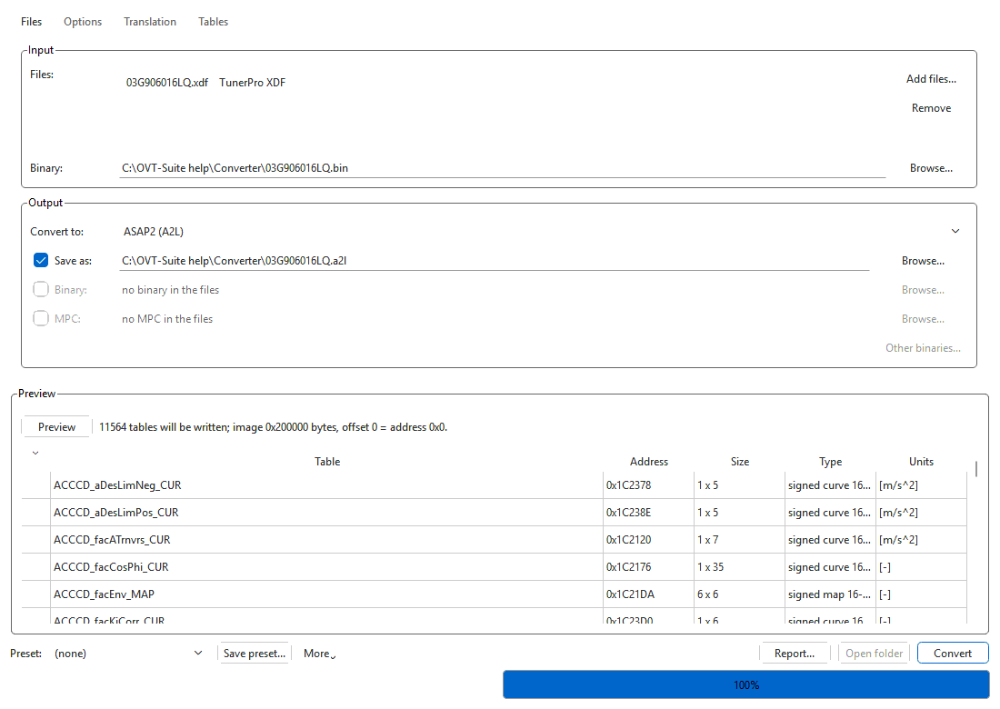
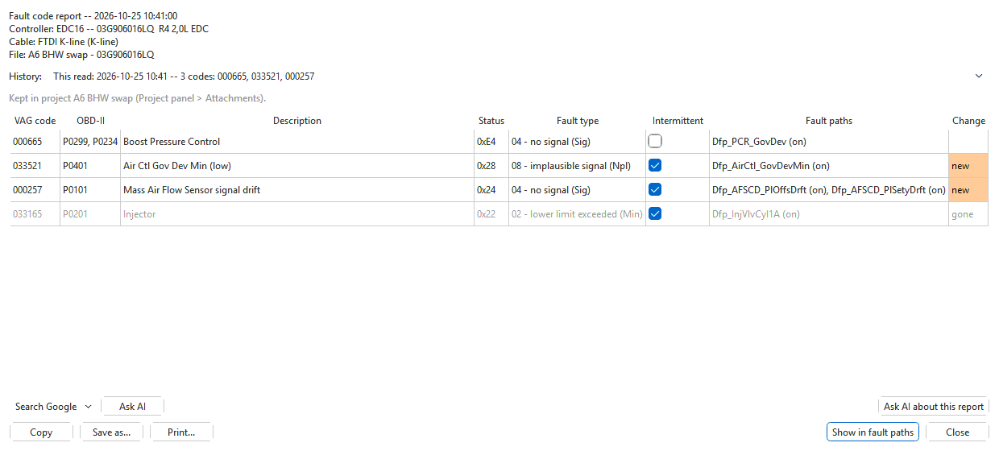
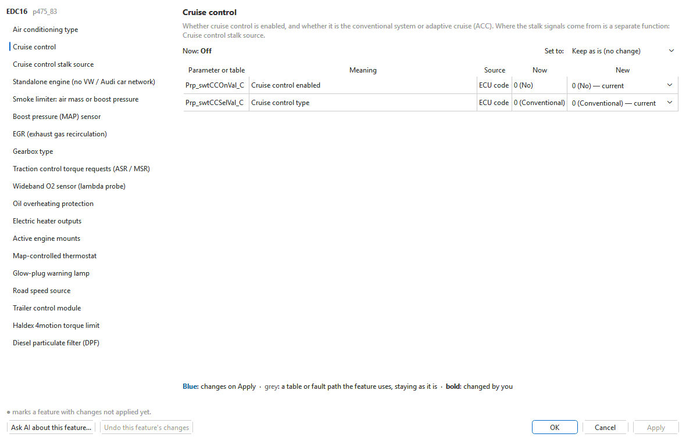
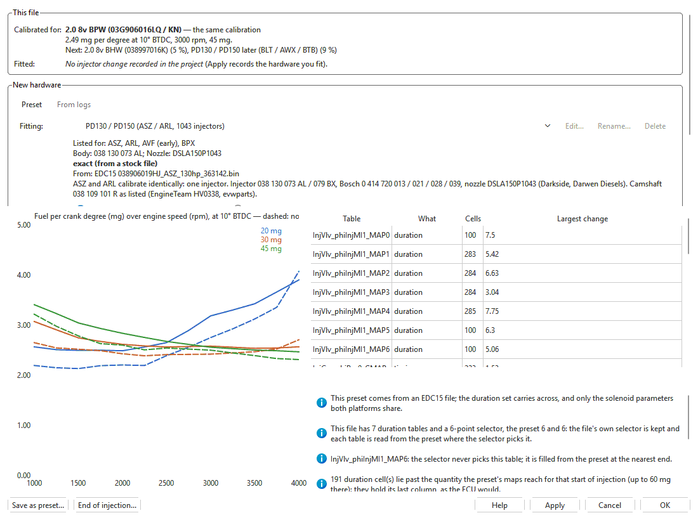
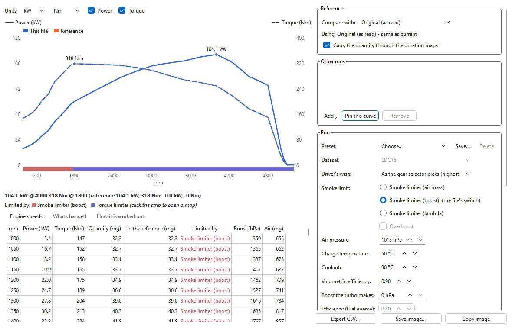

# OVT-Suite

**Old VAG Tuner Suite**: one desktop app to read, edit, compare, log and flash
the control units of older VW-group cars. It covers Bosch EDC16 and EDC15
diesel ECUs, ZF 6HP, 8HP and 5HP and Aisin gearboxes, VDO instrument clusters,
and the Audi A6/Q7 Climatronic.

[](LICENSE)


<p align="center">
  
</p>

You don't need a definition file to open a binary. OVT-Suite identifies the
file from its own structure. It places about 10,000 named parameters on a
typical EDC16, each with a record of how it was found. Values are shown in
real units, and checksums are corrected on every save and before every write.
Two files compare **map by map, even across different software versions** of
the same ECU, where every table sits at another address.

Around the editor are the tools a tune needs: feature switches, injector setup,
a dyno chart, fault-code editing and reports, a flasher, a two-ECU data logger
with optimised logging blocks, a converter between definition and binary
formats, a CAN/K-line bus sniffer, an ECU simulator, and an AI assistant that
proposes changes but never makes them on its own.

> **Status:** active development, version 0.5.1. The base app is free and open
> source. Editing and checksum support for each kind of control unit comes from
> a **module**. See [Supported control units](#supported-control-units) and
> [Tested on real hardware](#tested-on-real-hardware) before you trust a write
> to a car.

### Download

| | Windows | Linux |
|---|---|---|
| **OVT-Suite app 0.5.1** | [OVTSuite-Base-0.5.1-setup.exe](https://github.com/bbear3d/ovtsuite/releases/download/v0.5.1/OVTSuite-Base-0.5.1-setup.exe) | [ovtsuite_0.5.1-1_amd64.deb](https://github.com/bbear3d/ovtsuite/releases/download/v0.5.1/ovtsuite_0.5.1-1_amd64.deb), [ovtsuite-0.5.1-1.x86_64.rpm](https://github.com/bbear3d/ovtsuite/releases/download/v0.5.1/ovtsuite-0.5.1-1.x86_64.rpm) |
| **Bosch EDC16 module 1.1.0** (free) | [OVTSuite-BoschEDC16-1.1.0-setup.exe](https://github.com/bbear3d/ovtsuite/releases/download/v0.5.1/OVTSuite-BoschEDC16-1.1.0-setup.exe) | [ovtsuite-module-edc16_1.1.0-1_amd64.deb](https://github.com/bbear3d/ovtsuite/releases/download/v0.5.1/ovtsuite-module-edc16_1.1.0-1_amd64.deb) |
| **Bosch EDC15 module 1.1.0** (free) | [OVTSuite-BoschEDC15-1.1.0-setup.exe](https://github.com/bbear3d/ovtsuite/releases/download/v0.5.1/OVTSuite-BoschEDC15-1.1.0-setup.exe) | [ovtsuite-module-edc15_1.1.0-1_amd64.deb](https://github.com/bbear3d/ovtsuite/releases/download/v0.5.1/ovtsuite-module-edc15_1.1.0-1_amd64.deb) |
| **ZF 5HP module 0.1.0** (free, open source) | [OVTSuite-ZF5HP-0.1.0-setup.exe](https://github.com/bbear3d/ovtsuite/releases/download/v0.5.1/OVTSuite-ZF5HP-0.1.0-setup.exe) | [ovtsuite-module-zf5hp_0.1.0-1_all.deb](https://github.com/bbear3d/ovtsuite/releases/download/v0.5.1/ovtsuite-module-zf5hp_0.1.0-1_all.deb) |
| **VDO Cluster module** (open source) | [bbear3d/ovtsuite-vdo](https://github.com/bbear3d/ovtsuite-vdo) | [bbear3d/ovtsuite-vdo](https://github.com/bbear3d/ovtsuite-vdo) |

Install the app first, then the modules you need. The bare `.ovtmod`
packages, checksums and the in-app update package are on the
[Releases](https://github.com/bbear3d/ovtsuite/releases) page; see
[Download and install](#download-and-install). On Windows, an installed 0.4.9
updates itself to 0.5.1 from **Help > Check for Updates...**.

> **Support the project.** OVT-Suite and the EDC15 / EDC16 modules are free.
> If they save you time or a trip to a tuner, you can support development
> with a donation through [PayPal](https://paypal.me/bbear3d). Thank you!

---

## Contents

- [What's new in 0.5.1](#whats-new-in-051)
- [What makes it different](#what-makes-it-different)
- [Supported control units](#supported-control-units)
- [Tested on real hardware](#tested-on-real-hardware)
- [Feature tour](#feature-tour)
- [Cables and interfaces](#cables-and-interfaces)
- [Download and install](#download-and-install)
- [Running from source and the command line](#running-from-source-and-the-command-line)
- [Building](#building)
- [Repository layout](#repository-layout)
- [Licence, trademarks and legal use](#licence-trademarks-and-legal-use)
- [Support](#support)
- [Credits](#credits)

---

## What's new in 0.5.1

Everything since 0.4.9, the last published release (0.5.0 was not published
on its own).

**New tools**

- **Feature switches** (EDC15 / EDC16, [more](#engine-tools)): turn cruise
  control, EGR, the particulate filter, the wideband O2 sensor, the MAP
  sensor (1 to 6 bar), the smoke limiter's input, the gearbox type and more
  on or off. Each function is changed as one undo step with a preview of
  every value, table and fault path it touches. On EDC15 also *Auto to
  Manual Conversion*.
- **Injector setup** (EDC15 / EDC16, **experimental**: not yet tested on a
  car): fit other PD injectors or nozzles, or
  set a VP37 pump head and nozzles up, from presets, your own presets or
  your logs. The start (cranking) maps are retimed with the duration change.
- **Fitted hardware** in projects: what injectors or pump each version was
  made for. The dyno, the Project panel, the version history and the flasher
  all show it, and a write warns when it differs from what the car has.
- **Dyno chart** (EDC15 / EDC16): full-load power and torque from the
  calibration's limiter chain, against the original, the comparison, saved
  versions, other projects or a data log, with what changed between runs.
- **Fault code report** after every read or clear: decoded status, matching
  fault paths, what is new or gone since the last read, every read kept in
  the project, web search and **Ask AI**.
- **Optimised logging blocks** (EDC15 / EDC16): lay the measuring blocks out
  so each logger preset reads as few blocks as possible, and log faster.
- **Converter** (in the app, or the standalone **OVT Converter**):
  definitions, calibration values and binaries between XDF, A2L, DAMOS,
  WinOLS, EcuFlash/RomRaider, DCM/CDFX, BIN, HEX and S-record, with watch
  folders and a right-click menu.
- **Gearboxes:** full-load shift points from the engine ECU's torque,
  part-load strategies with log replay, and fault-code editors for the ZF 6HP
  and 8HP.

**Also new**

- Comparison shown below, beside or in the same grid as the table (Ctrl+J),
  with cells copied either way.
- Logger: your own presets, a live readings-a-second readout and *Log every
  cell of this group*.
- WinOLS map pack export is no longer experimental: the packs open in WinOLS.
- Other usability and UI improvements throughout.

**Improvements and fixes**

Various bug fixes and improvements to the EDC15 / EDC16 flasher (K-line, CAN
and J2534, with checksums corrected before every write), data logging, the
fault-code and measuring-block editors, comparisons, patches and projects.

The full list of changes is in each release's notes on the
[Releases](https://github.com/bbear3d/ovtsuite/releases) page.

---

## What makes it different

- **No XDF needed.** A file is recognised by its own structure: a
  descriptor, a signature or a layout anchor. Size and file name are never
  used. Parameters are placed from knowledge bases built from the
  manufacturer's own descriptions, and every placement has to be proven
  against this exact file: a structure fingerprint, the ECU's own pointer
  table, the code that reads the table, or verified anchors. Each map shows
  how it was found, from *exact match* down to *projected – check before
  writing*.
- **Reads the firmware, not a lookup table.**
  - The EDC15 checksum ranges come from the checksum routine inside the
    image, so software the app has never seen is handled too.
  - ZF 6HP shift and lock-up schedules that no definition names are found by
    their structure.
  - The ZF 8HP layout is taken from the calibration's own pointer table.
  - EDC16 maps are labelled with when they are active (for example
    "— 41.8–53.5 °C", "— gears 1–6"), read live from the selector curves in
    your file.
- **Plain English.** Parameters are grouped by job: Power, Limiters &
  protection, Drivability, Emissions, Fault codes, Shift points, Lock-up and
  so on. Each has a readable name next to its A2L symbol. German
  descriptions from DAMOS and WinOLS files are translated, and units are
  shown in English.
- **Functions, not single values.** A feature switch or an injector change
  edits every value, table and fault path that belongs to it, together, as
  one undo step, after showing you each one.
- **Projects, not loose files.** One `.ovt` file holds a car:
  - every control unit;
  - branches (*Stock*, *Stage 1*, *Economy*);
  - full version history with a 500-step undo that reaches back past saves;
  - the hardware fitted to the car;
  - data logs, fault-code reads, patches and attachments.
  The first read is kept untouched for good.
- **Compare across software versions.** Most tools compare two binaries
  byte by byte, which only works when both are the same software. OVT-Suite
  places every named parameter in each file separately and then compares
  them by name. So a stock 03G906016LQ lines up against a tuned 03G906016HQ,
  or a donor ECU against your own, map for map. That works even though their
  tables sit at different addresses and some have different sizes. Tables of
  different sizes are resampled onto your axes, and gearbox tables are
  matched by column label. Differing cells are highlighted, and the tree can
  show only the parameters that differ. The same name-based matching lets you
  copy a map from one version into another, and apply a patch made on one
  version to another.
- **Patches that move between software versions.** A patch stores each
  change by parameter name in physical units. It can apply to a different
  software version of the same ECU, and it can be removed again later
  without the original patch file.
- **Safe flashing.** Only the blocks or sectors that changed are written.
  Checksums are corrected on the copy that is sent, and a write whose
  checksums can't be settled never starts. The write is verified by the
  unit's own checksum routine or by reading it back. Blocks that already
  match are skipped, so an interrupted write can simply be run again.
- **More than a tuner.** The same app includes:
  - a two-ECU data logger that logs engine and gearbox at once on one clock;
  - a converter between definition, calibration-value and binary formats;
  - a TP 2.0 / KWP2000 bus sniffer;
  - an ECU simulator for testing read and write sequences before you move
    to real hardware;
  - parameter tools for fault codes, EEPROM/immobiliser, gear ratios,
    measuring blocks and speedometer correction.
- **An AI assistant that can't change anything without you.**
  - It sees the open calibration, the comparison, the version history, the
    fitted hardware, fault-code reads and your logs.
  - Every change it suggests is a *proposal* that has passed the same safety
    checks as the auto-tune. You preview it as a comparison, then accept or
    reject it.
  - It works with local models (Ollama, LM Studio) or online services
    (Claude, OpenAI, Gemini, Groq, OpenRouter, DeepSeek).
  - VINs, immobiliser data and SKCs are never sent.
  - An MCP server lets your own AI app work with OVT-Suite projects.

---

## Supported control units

The **base app** works without any module. It recognises every supported
file and names the module that adds full support. It also has the hex editor,
compare, patches, version history, the converter, the flasher, the logger,
the sniffer and the simulator. Each **module** adds definitions (the named
parameter tree), checksum correction and that unit's tools.

| Module | Control units | What the module adds | Version | Licence |
|---|---|---|---|---|
| **Bosch EDC16** | EDC16U31 / U34 (2 MB) VW PD TDI ECUs. Families P350 (038906016…, 038997016…), P475 and P447 (03G906016…), P529, P213. EDC16U1 (1 MB) is untested and may not be compatible. | About 10,000 named parameters per file; all checksums (block/span, prog/boot, header, signatures, digests); MPC and 4 KB EEPROM/immobiliser editor; feature switches; injector setup (experimental) and end of injection (PD); dyno chart; fault-code status decoding; optimised logging blocks; Tune from logs; `.sgo` / `.dim` round-trip; XDF export | 1.1.0 (stable) | Free, closed source |
| **Bosch EDC15** | EDC15VM+ (VP37, e.g. 1.9 TDI ALH 038906012…), EDC15P (PD, 038906019…), EDC15M (2.5 V6 TDI, 8E0907401…), and the older MSA15 / EDC15V (256 KB, 028906021…, 038906018…). | Per-dataset parameter tree (manual / automatic); V4.1 checksum chain read from the image's own routine; 512-byte EEPROM editor (immobiliser, SKC, odometer, DSV coding, trims, virginize); feature switches including Auto to Manual Conversion; injector setup (PD injectors, VP37 pump head and nozzles; experimental) and end of injection (PD); dyno chart; fault-code status decoding; optimised logging blocks | 1.1.0 (stable) | Free, closed source |
| **ZF 6HP** | 6HP19A (09L/0AT), 6HP26A (09E), 6HP28AF (T04/0B6) TCUs. | Shift points, shift feel, lock-up (TCC), Tiptronic limits, shift programs and state tables; schedules found by structure; Z shown as output, engine or road speed; shift map and lock-up editors; ZF fault-code editor; shift torque report; full-load shift points from the engine's torque and part-load strategy with log replay; CRC-16 checksum; Stage 1 auto-tune (command line) | 1.0.12 (stable) | Closed source |
| **ZF 8HP** | Gen1 (8K0/8K1/8R0927158…) and Gen2 VW-group TCUs. | Every parameter's location and shape taken from the calibration's pointer table; shift programs and converter-clutch tables; fault-code editor; per-block CRC-32 | 0.1.9 (early) | Closed source |
| **ZF 5HP** | ZF 5HP19 (VW 01V) and 5HP24 (01L) TCUs. | Identification, CRC-16 checksum, the calibration's tables found by their structure; byte-swapped bench reads; K-line flashing (experimental, off) | 0.1.0 (early) | Free, open source ([bbear3d/ovtsuite-zf5hp](https://github.com/bbear3d/ovtsuite-zf5hp)) |
| **Aisin TR-xx** | TR-60SN (09D) and TR-80SD (0C8 / 09G). | Identification and the 09D checksum. No parameter tree yet. | 0.1.5 (early) | Closed source |
| **VDO Cluster** | Mk4-era VDO clusters: VWK501, VWK503, VMMJ08 (verified); VQMJ07, K5MJ07 (extrapolated). | 2 KB EEPROM definitions (K-value, needle maps, coding, SKC); gauge checksum; needle / LED / DSG-needle sweep patches for the exact ROM build; speed and distance correction | 0.1.8 (early) | MPL-2.0, [bbear3d/ovtsuite-vdo](https://github.com/bbear3d/ovtsuite-vdo) |
| **4F/4L HVAC** | Audi A6 C6 (4F0910043, 4F0910043B) and Q7 (4L0910043, 4L0910043D) Climatronic. Only the post-facelift (2009+) C6 has been tested. | Heated-seat tables, A/C compressor bypass and cutouts, sensor curves; checksum; `.sgo` repack | 0.1.6 (early) | Closed source |

**What the built-in flasher can do with each unit**

| Unit | Link | Read | Write |
|---|---|---|---|
| EDC16 | K-line or CAN (TP 2.0), on a K-line cable or J2534 | Calibration; full read (2 MB + MPC) | Calibration; boot, program and MPC blocks individually |
| EDC15 | K-line, on a K-line cable or J2534 | 512 KB flash, EEPROM, flash + EEPROM together | Changed sectors, EEPROM, flash + EEPROM; boot mode on the bench |
| ZF 6HP19 / 6HP26 | KWP2000 over TP 2.0 | Calibration window | Calibration areas |
| ZF 6HP28 | UDS over ISO-TP | Calibration | Calibration, or program + calibration |
| Audi 4F/4L Climatronic | CAN | Not possible over OBD | From a factory `.sgo`; changed sectors only |
| VDO cluster | K-line (KW1281) | 2 KB EEPROM | Whole EEPROM, read back and verified |
| Aisin 09D | CAN (TP 2.0) | 1 MB flash | Disabled in this version |
| C6 ESP8 ABS / C6 CAN cluster | CAN | Flash dump (cluster: experimental) | No |

The ZF 8HP and the Aisin TR-80SD have no flasher entry yet.

---

## Tested on real hardware

The app has a large automated test suite: about 3,700 tests across the base
app and modules. Those tests can't stand in for a car, though. This is what
has been done on **real control units**, in cars or on the bench:

| Unit / feature | Real hardware |
|---|---|
| Bosch EDC16 (U31/U34): read and write over K-line | ✅ Tested |
| Bosch EDC16 (U31/U34): read and write over CAN (TP 2.0, J2534), at the fastest write pacing | ✅ Tested end to end |
| Bosch EDC16U1 | ⚠️ Untested; may not be compatible |
| Bosch EDC15 (VM+/P): read and write, K-line cable | ✅ Tested |
| Bosch EDC15 (VM+/P): read and write over J2534 K-line (Scanmatik 2 PRO) | ✅ Tested |
| ZF 6HP19 / 6HP26: read and write | ✅ Tested |
| ZF 6HP28: read and write | ✅ Tested |
| Audi 4F Climatronic, post-facelift (2009+) C6: write | ✅ Tested (the unit can't be read over OBD) |
| Climatronic on a pre-facelift C6 or a Q7 (4L) | ⚠️ Not tested |
| EDC16 data logging | ✅ Tested |
| EDC15 data logging, K-line cable and J2534 | ✅ Tested |
| EDC15 / EDC16 measuring-block editing (reassigning blocks) | ✅ Tested |
| ZF 6HP19 logging, and dual engine + gearbox logging | ✅ Tested |
| J2534 on Windows (Tactrix OpenPort 2.0; Scanmatik 2 PRO through the 32-bit bridge) | ✅ Tested |
| Tactrix OpenPort 2.0 direct over USB (Linux) | ⚠️ Not yet confirmed |
| VDO cluster EEPROM read/write | ⚠️ Not yet tested on hardware |
| Aisin 09D read | ⚠️ Not yet tested on hardware (write is disabled) |
| C6 ESP8 ABS and C6 CAN cluster dumps | ⚠️ Not yet tested on hardware |
| EDC15 / EDC16 fault-code (DTC) editor: switching codes off | ✅ Tested |
| Fault code report (status decoding worked out from the EDC15 / EDC16 firmware) | ⚠️ Not yet checked against a car's codes |
| Injector setup: PD injectors and nozzles, VP37 pump head and nozzles (experimental) | ⚠️ Not tested on a car |
| Feature switches, end of injection, optimised logging blocks | ⚠️ File changes only, not yet confirmed on a car |
| EDC15 map sets resized together | ⚠️ Not bench-tested |
| ZF 8HP, Aisin TR-80SD | No flasher; file editing only |
| macOS | ⚠️ Untested |

Keep the original read, which every project stores. Have a recovery route
before you write anything: bench or boot mode, or a BDM for EDC16 boot and
program blocks.

---

## Feature tour

### Editor

<p align="center">
  
</p>

- **Physical units:** type Nm, mg/stroke, °, rpm. The app converts the value
  and clamps it to what the cell can hold. Axis breakpoints can be edited.
- **Selection tools:** Set/Add/Subtract/Multiply/Divide, interpolating fill
  (row, column, or from four corners), smoothing, heatmap shading,
  axis swap, and copy/paste that round-trips with spreadsheets.
- **The comparison where you want it:** below the table, beside it, or in
  the same grid (Ctrl+J). Both scroll and select together whatever their
  sizes, and selected cells copy either way: **Copy selected cells from
  comparison** or **Copy cells to primary**.
- **Copy from another file:** copy a table from another tab or project.
  The table is found by identity, not by address.
- **Resize maps:** give a table more breakpoints, in place or moved to free
  space, with every pointer to it updated. EDC15 map sets that share one
  pair of axes resize as one.
- **Find panel:** fuzzy parameter search, value search (`10..20`, `>5`,
  `!=0`), address lookup that resolves to the exact cell, and byte search
  with wildcards, integers or floats. **Ask AI** finds a map from a
  description.
- **Hex editor:** works on every binary, including ones no module supports.
  It colours bytes that belong to identified parameters, that you changed,
  or that differ from the comparison. The right-click menu copies and pastes
  bytes, copies from or to the comparison, reverts to the read or the last
  save, and jumps to the table a byte belongs to.
- **3D surface and dyno panels:** with a comparison open, both surfaces turn
  and zoom together on one colour scale. **View > Table panels** stacks the
  3D surface and the dyno chart above the table, side by side, or beside it.

<p align="center">
  
</p>

### Files in and out

- **Formats it opens:**
  - plain images: `.bin`, `.ori`, `.hex`, `.mpc`;
  - Dimsport `.dim`;
  - factory `.sgo` and `.frf`;
  - WinOLS projects `.ols` (OLS 4 and 5).
  The file type is recognised by content, not by extension.
- **Outside definitions:** TunerPro `.xdf`, ASAP2 `.a2l`, WinOLS `.kp` and
  Bosch DAMOS `.dam` attach to a binary. They can show beside the module's
  tree or replace it, and a binary no module knows opens with that
  definition's tables.
- **Exports:**
  - the binary, any part of it;
  - the original container (`.sgo` / `.dim`), rebuilt with your changes;
  - a TunerPro XDF, an ASAP2 A2L or a WinOLS map pack made to match this
    binary;
  - CSV logs and `.patch` files.

### Converter

<p align="center">
  
</p>

**Tools > Converter**, or the standalone **OVT Converter**, converts with no
project or binary open:

- **Definitions** between TunerPro XDF, ASAP2 A2L, Bosch DAMOS, WinOLS
  projects (read) and map packs, EcuFlash / RomRaider XML and OVT-Suite's own
  JSON and CSV. WinOLS maps keep their titles, folders, decimals and units,
  and WinOLS map packs open in WinOLS.
- **Calibration values** as DCM and CDFX, read from or written into a binary.
- **Binaries** between BIN, Intel HEX and Motorola S-record; the images and
  MPC embedded in a WinOLS project can be extracted.
- **Porting and translation:** carry a definition onto another software
  version, translate German titles and descriptions, and convert only the
  tables you pick.
- **Batch work:** many files at once, watch folders, a right-click
  **Convert with OVT Converter** entry in Explorer, Dolphin and GNOME Files,
  and `ovtsuite convert` on the command line.

### Projects, history and patches


- **What a project holds:** one `.ovt` per car. Inside it, a set for each
  control unit (including the MPC and EEPROM), branches, a full version
  history, data logs, fault-code reads, patches, and attachments such as dyno
  sheets and photos.
- **Fitted hardware:** record the injectors, nozzles or pump each version is
  made for. The Project panel, the version history, the dyno and the flasher
  show it, and the AI assistant knows it.
- **Version history:** name, merge, compare with or revert to any saved
  version. A revert is a single undo step.
- **Several projects at once:** you can have several open. If another
  program (the standalone flasher, a script, an AI app) changes a project
  you have open, OVT-Suite notices and offers to reload and merge, never
  silently overwriting.
- **Crash safety:** saves are atomic, unsaved work is recovered after a
  crash, and every version flashed to a car is marked as such.
- **Patches:** made from the comparison or from any two versions in the
  history, resized tables included. Applying one shows each entry as
  *established*, *not established* or *not found*.

<br clear="right">

### Reading and writing

<p align="center">
  
</p>

- **Two ways to run it:** **Tools > ECU read / write** in the main app, or
  the standalone **OVT Flasher**.
- **No module needed:** reading and writing work without one. A module is
  needed only to correct checksums; without it the flasher asks before
  writing an image whose checksums it can't correct.
- **Checksums before every write:** the copy sent is corrected with the
  file's own options, as Save does, before anything connects. A correction
  that fails stops the write with the reason.
- **Fast K-line:** EDC16 K-line runs at up to 244,898 baud on an FTDI cable.
- **J2534 for both ECUs:** EDC15 and EDC16 read and write over a J2534
  device's K-line as well as a KKL cable, and EDC16 also over CAN (TP 2.0).
  The CAN write paces itself from the timing the ECU advertises and backs
  off for the session if the ECU can't keep up.
- **Reads that don't lie:** a damaged or short upload is read again, never
  padded; only ranges the ECU refuses are filled, and the log says so.
- **Stops cleanly:** a block the ECU refuses ends the write with the reason,
  and Cancel works while the flasher polls the ECU.
- **Fitted hardware warning:** before a write, the flasher says if the
  injectors or pump recorded for the version you are writing differ from what
  the project records as fitted to the car.
- **Automatic gearbox protocol:** the ZF 6HP transport (TP 2.0 or UDS) is
  chosen for you, and can be overridden.
- **Tools for unusual cases:**
  - EDC15 soft-brick detection and boot mode;
  - EDC16 erase signature chosen from what the ECU reports, with the other
    candidates offered if the ECU refuses one;
  - EDC16 diagnostic probes;
  - an optional EDC16 boot-sector database for full reads.
- **Planned:** reading and writing through a KW-Dash head unit that holds
  the cable in the car while the PC connects over Wi-Fi or Bluetooth.

### Data logging

<p align="center">
  
</p>

- **Named cells:** EDC15 and EDC16 cells take their names from the
  calibration's own measuring-block map and a catalogue built from many
  files, and the 6HP19 has a built-in catalogue.
- **Presets:** engine and gearbox presets that each pick the fewest
  measuring blocks covering what an analysis needs, with driving
  instructions. Your own presets (save the ticked cells, then edit, rename or
  delete them) sit beside them, per controller.
- **Live rate:** the logger shows how many readings a second it gets while
  connected, browsing or logging.
- **Dual logging:** engine on K-line and gearbox on CAN at the same time, on
  one clock. Each tab's own Start/Stop keeps its log.
- **Live view and connection:** a live chart, keep-alive while paused, and
  automatic reconnect.
- **Log files:** logs are kept in the project, and VCDS CSV logs can be read
  and exported.

<p align="center">
  
</p>

**Optimised logging blocks** (EDC15 / EDC16): **Tools > Build logging
blocks...** lays the file's measuring blocks out so each preset reads as few
blocks as possible, often doubling or tripling the rows a second. The file's
own cells are never changed; new cells go into empty groups or empty cells.
Write the file to the ECU and the presets log faster. Every change is one
undo step and can be removed again.

<p align="center">
  
</p>

**Fault codes:** EDC15/EDC16 fault codes can be read and cleared. Each read
opens a **fault code report**:

- codes, P-codes and descriptions, with the status byte decoded as the ECU
  builds it (worked out from the EDC15 and EDC16 firmware): fault type,
  intermittent, present now, lamp;
- which fault paths in your file can set each code, and whether each is on;
- what is new or gone since the last read, with every read kept in the
  project and reopened from the Project panel;
- Copy, Save and Print; web search on a choice of sites; **Ask AI** for one
  code or the whole history;
- **Show in fault paths** opens the DTC editor at the codes the ECU stored.

<p align="center">
  
</p>

**Tune from logs** (EDC16) reads your logs and proposes cell changes for the
boost pilot (N75), the smoke limiter (aimed at a lambda target) and,
optionally, start of injection, in the dynamic set the engine actually used.
The changes are applied as one undoable edit, and the report is saved as
text or HTML.

### Engine tools

<p align="center">
  
</p>

- **Feature switches** (EDC15 / EDC16): turn functions on and off, such as
  cruise control, A/C type, EGR (on, cut when warm, off), the particulate
  filter, the wideband O2 sensor, the smoke limiter's input, MAP sensors from
  1 to 6 bar, traction-control torque requests, electric heater outputs and
  the gearbox type. On EDC15 also *Auto to Manual Conversion*. A function is
  several values that must change together: the window shows every value,
  table and fault path first, per coding variant or dataset, and writes every
  feature you changed as one undo step. Functions a file can't offer are
  listed with the reason.

<p align="center">
  
</p>

- **Injector setup** (**experimental**: the injector, pump and nozzle
  changes have not yet been tested on a car):
  - unit injectors (EDC15P / EDC16): fit other injectors or nozzles. The
    duration maps, start of injection and the start (cranking) maps are
    converted so the engine gets the fuel it asks for, from presets, your
    own presets, or learned from your logs;
  - VE pump (EDC15 VP37): set the pump voltage map up for a pump head and
    nozzles, and correct it from logs.
  What is fitted is recorded in the project, and the dyno, the history and
  the flasher show it.
- **End of injection** (EDC15P / EDC16 PD): shows when injection ends,
  worked out from the start-of-injection and duration tables as the ECU does,
  with the fuel-quantity corrections it applies, and lets you set it.

<p align="center">
  
</p>

- **Dyno chart** (EDC15 / EDC16, **Tools > Dyno chart** or the Ctrl+4
  panel): the power and torque the calibration asks for at full load, rpm by
  rpm, and which limiter governs each band (click it to open the map).
  - Against the original, the comparison, another tab, any version or branch
    of an open project, a file, a pinned curve or a data log's measured
    full-load points; any run can be the reference.
  - *What changed* between two runs: the bands where the governing limit
    moves, and the maps behind it.
  - Conditions presets, road speed in any gear from a catalogue of VAG
    gearboxes, and CSV and image export with the conditions.
  - Runs on different fitted hardware are marked as such.
  It is a calculation, not a measurement.

### Gearboxes

<p align="center">
  
</p>

- **Shift and lock-up schedules:** ZF 6HP schedules are shown by gear change
  and pedal position, as output-shaft speed, engine speed (converter locked)
  or road speed from your final drive and tyre size. You can type values in
  any of these.
- **Shift map and lock-up editors:** **Tools > Shift map editor** and
  **Lock-up (TCC) editor** draw every line of a program on a chart you can
  edit, with the comparison as ghost lines and a table below, and copy cells
  or whole lines from the comparison.
- **Schedules no definition names:** these are found by structure and
  checked against the TCU's own state tables. That is the case for most
  6HP19 files.
- **Shift feel and banks:** slip times, clutch pressures and fill offsets;
  coding banks with *copy to other bank*.
- **Fault codes:** ZF 6HP and 8HP fault-code editors that warn when one
  switch covers a whole fault class, with Apply, Cancel and OK.
- **Shift torque report:** compares the torque cut the TCU asked for with
  what the engine delivered.
- **Full-load and part-load shift points:** full-throttle upshifts set from
  the torque of the engine ECU in the same project, and an economy / sport
  strategy for the part-load rows. **Replay** shows what an edit does to fuel
  and response on the drives you have logged.
- **ZF 8HP:** shift programs and converter-clutch tables, with the same
  speed views.
- **ZF 5HP:** identification, checksum and the calibration's tables found by
  structure, byte-swapped bench reads included (open-source module).

<p align="center">
  
</p>

### Clusters and Climatronic


- **VDO Mk4 cluster EEPROMs:**
  - K-value, needle maps, coding with drop-downs, SKC;
  - speedometer correction from tyre size, GPS speed or odometer distance;
  - needle, LED and DSG-needle sweep patches built for the cluster's exact
    ROM build, each credited with its author and licence.
- **Audi 4F/4L Climatronic:** heated-seat on/off tables, the A/C compressor
  bypass and cutouts, and sensor curves. The result is written back as a
  factory `.sgo`. Only the post-facelift (2009+) A6 C6 has been tested so far,
  not the pre-facelift C6 or the Q7.

<br clear="right">

### Parameter tools

<p align="center">
  
</p>

- **DTC / Fault-Path editor** (EDC15 / EDC16):
  - switch codes and their lamps off and on, per dataset or coding copy;
  - find a code by either VAG numbering or its P-code;
  - restore all from stock;
  - copy the differences from the comparison;
  - highlight the codes read from the ECU.
- **EEPROM editor (EDC15 / EDC16):** VIN, an immobiliser on/off switch,
  SKC, odometer and trims, with checksums corrected. EDC15 can also be
  virginized.
- **Measuring blocks:** reassign what each block reports, so a log needs
  fewer blocks and runs faster. Edits apply to every dataset by default, and
  cells can be copied from the comparison.
- **Gear ratios and V/N gear recognition:** shown per coding variant, with
  automatic generation from ratios and tyre size.
- **VSS pulse settings:** tyre-size rescaling and correction against GPS
  speed.

The fault-code, measuring-block, EEPROM and injector windows have Apply,
Cancel and OK: each Apply is one undo step, and Cancel puts the bytes back
exactly as they were.

### Bus sniffer and ECU simulator

<p align="center">
  
</p>

- **Sniffer:**
  - decodes VW TP 2.0 channels and the KWP2000 inside them on CAN, and
    KWP2000/KW1281 on K-line;
  - captures through a J2534 device, or through a passive K-line tap made
    with a second cable;
  - saves, replays and decodes candump-style captures.
- **Simulator:** test read and write sequences on the bench before you
  move to real hardware.
  - A J2534 device or K-line cable answers as a ZF 6HP28, a ZF 8HP
    (Gen1 AL551, Gen2 ALX52), an Aisin TR-80SD or TRx, or a generic UDS unit.
  - The flasher, or another tool, runs its whole sequence against it,
    including a complete write. The written blocks are decoded so you can
    check what would have reached the unit.
  - Real-car timing, latency and dropped frames can be simulated, so timing
    problems show up before a real control unit is involved.

### AI assistant

<p align="center">
  
</p>

- **What it can see:** the open calibration with real units, the comparison,
  the version history, the checksum state, the fitted hardware, fault-code
  reads, your logs (as summaries) and the help pages.
- **What it can do:**
  - open and highlight the tables it is talking about;
  - explain a parameter, a change, a feature switch or a fault code;
  - summarise a log;
  - plan injector changes, feature switches and gearbox shift points;
  - build multi-step plans such as a stage 1.
- **Proposals, never direct changes:**
  - every change is checked against the same safety rules as the auto-tune:
    no out-of-range values, platform rules such as a 6HP upshift too close to
    its downshift, and no VIN/immobiliser/SKC changes;
  - you preview the proposal as a comparison, then accept or reject it;
  - an accepted proposal is one undo step and is saved as its own version.
- **Providers:**
  - local and free: Ollama or LM Studio, which also work offline;
  - free tiers: Groq, OpenRouter, Google Gemini;
  - paid: Claude, OpenAI, DeepSeek;
  - any OpenAI-compatible server.
  Keys are kept in the system keyring.
- **Privacy:**
  - AI is off until you turn it on;
  - whole binaries and whole logs are never sent;
  - VIN, immobiliser and SKC data are never sent;
  - **What was sent...** shows every request exactly as it went out.
- **MCP server** (`OVTMcp.exe` / `ovtsuite mcp`): Claude, ChatGPT, Cursor,
  VS Code or any MCP app can open your projects read-only and send proposals
  to the same queue.

### And also

- A built-in help browser: F1 opens the page for whatever window you're in.
- The Tools menu shows only the tools the active tab can use.
- Remappable shortcuts, a customisable toolbar, and light/dark themes.
- Standalone **OVT Flasher**, **OVT Logger**, **OVT Converter**, **OVT
  Sniffer** and **OVT Simulator** apps, each with its own taskbar entry.

---

## Cables and interfaces

| Interface | Notes |
|---|---|
| **FTDI K-line (KKL) cable** | Recommended. Driven directly for low latency; the only kind that holds EDC16 High speed (244,898 baud). The Windows installer can download FTDI's driver from Microsoft's driver catalog when it is missing. |
| **CH340 / CH341 K-line cable** | Works, capped at Medium speed. |
| **J2534 pass-through (Windows)** | Every registered device is listed. 32-bit-only devices (e.g. Scanmatik 2 PRO) work through a bundled 32-bit bridge. J2534 devices can also do K-line, for EDC15 and EDC16 reads, writes and logging. |
| **Tactrix OpenPort 2.0** | The tested J2534 device. On Linux it is driven directly over USB, with no vendor driver (not yet confirmed on hardware). |

On Linux, the package installs a udev rule that gives the logged-in user the
OpenPort, FTDI and CH34x cables without root or group membership.

---

## Download and install

### The app

The Windows installer and the Linux `.deb` / `.rpm` packages are published on
the [Releases](https://github.com/bbear3d/ovtsuite/releases) page.

- **Windows:**
  - installs per user, without administrator rights, or for all users;
  - optionally downloads FTDI's USB driver.
- **Linux:** installs to `/opt/ovtsuite` with a menu entry, the `.ovt` file
  type and the udev rule.

The app checks for a newer version once a day (Tools > Options > General) and
on **Help > Check for Updates...**. On Windows it can download, verify and
install the update and your modules' updates for you, after asking about
unsaved work, using a small delta package where one is published; elsewhere
it links to the release.

### Modules

Modules are signed `.ovtmod` packages. The app checks the signature and every
file both at install time and at every start. Install a module with its own
installer, from **Tools > Modules... > Install from file**, or with
`ovtsuite install-module <file>`.

| Module | Windows | Linux |
|---|---|---|
| Bosch EDC16 1.1.0 (free) | [OVTSuite-BoschEDC16-1.1.0-setup.exe](https://github.com/bbear3d/ovtsuite/releases/download/v0.5.1/OVTSuite-BoschEDC16-1.1.0-setup.exe), or [edc16-1.1.0-cp313-win_amd64.ovtmod](https://github.com/bbear3d/ovtsuite/releases/download/v0.5.1/edc16-1.1.0-cp313-win_amd64.ovtmod) | [ovtsuite-module-edc16_1.1.0-1_amd64.deb](https://github.com/bbear3d/ovtsuite/releases/download/v0.5.1/ovtsuite-module-edc16_1.1.0-1_amd64.deb), or [edc16-1.1.0-cp311-linux_x86_64.ovtmod](https://github.com/bbear3d/ovtsuite/releases/download/v0.5.1/edc16-1.1.0-cp311-linux_x86_64.ovtmod) |
| Bosch EDC15 1.1.0 (free) | [OVTSuite-BoschEDC15-1.1.0-setup.exe](https://github.com/bbear3d/ovtsuite/releases/download/v0.5.1/OVTSuite-BoschEDC15-1.1.0-setup.exe), or [edc15-1.1.0-cp313-win_amd64.ovtmod](https://github.com/bbear3d/ovtsuite/releases/download/v0.5.1/edc15-1.1.0-cp313-win_amd64.ovtmod) | [ovtsuite-module-edc15_1.1.0-1_amd64.deb](https://github.com/bbear3d/ovtsuite/releases/download/v0.5.1/ovtsuite-module-edc15_1.1.0-1_amd64.deb), or [edc15-1.1.0-cp311-linux_x86_64.ovtmod](https://github.com/bbear3d/ovtsuite/releases/download/v0.5.1/edc15-1.1.0-cp311-linux_x86_64.ovtmod) |
| ZF 5HP 0.1.0 (free, open source) | [OVTSuite-ZF5HP-0.1.0-setup.exe](https://github.com/bbear3d/ovtsuite/releases/download/v0.5.1/OVTSuite-ZF5HP-0.1.0-setup.exe), or [zf5hp-0.1.0.ovtmod](https://github.com/bbear3d/ovtsuite/releases/download/v0.5.1/zf5hp-0.1.0.ovtmod) | [ovtsuite-module-zf5hp_0.1.0-1_all.deb](https://github.com/bbear3d/ovtsuite/releases/download/v0.5.1/ovtsuite-module-zf5hp_0.1.0-1_all.deb) |
| VDO Cluster (open source) | Build it from [bbear3d/ovtsuite-vdo](https://github.com/bbear3d/ovtsuite-vdo) | Same |

On Linux the `.deb` installs the module for all users
(`sudo apt install ./ovtsuite-module-edc16_….deb`), and the app asks you to
accept the module's licence agreement the first time it starts.

The EDC15 and EDC16 modules are free to use but not open source: they are
licensed under the [module licence agreement](ovtsuite/modules/EULA.txt). A
module installer needs OVT-Suite (or OVT Tools) installed first.

---

## Running from source and the command line

Python 3.10 or newer:

```
pip install -e .
pip install PySide6 pyserial pyusb pyftdi cryptography numpy
ovtsuite gui                       # the editor
ovtsuite --flasher | --logger | --sniffer | --simulator | --converter
```

The command line works on any file the installed modules support:

```
ovtsuite identify <bin>            # platform, variant, calibration region
ovtsuite diff <stock> <mod>        # named, physical-unit differences
ovtsuite export <bin> out.xdf      # a TunerPro XDF (or .a2l / .kp) for this binary
ovtsuite convert <in> --to kp      # definitions, values and binaries between formats
ovtsuite checksum <bin> [--fix]    # verify / correct checksums
ovtsuite modules                   # installed modules
ovtsuite install-module <file.ovtmod>
ovtsuite mcp [--print-config]      # the MCP server for AI apps
```

A source checkout has no closed-source modules. To use one, install its
`.ovtmod`. To load a module you built
yourself (unsigned), tick **Allow unsigned modules (development)** in
Tools > Modules, or set `OVT_ALLOW_UNSIGNED=1`.

---

## Building

Windows, with version stamping and the Inno Setup installers:

```
.\build.ps1                 # dist\OVTSuite\OVTSuite.exe, plus installers if Inno Setup is present
.\build.ps1 -NoInstaller    # skip the installers
.\build.ps1 -FastInstaller  # quicker, bigger installers for testing
.\build.ps1 -HelpShots      # regenerate the help screenshots first
.\build.ps1 -Clean          # start from scratch
```

Linux, as a `.deb` (and optionally an `.rpm`):

```
./build_linux.sh                  # dist/ovtsuite_<ver>-1_<arch>.deb
./build_linux.sh --docker --rpm   # build in Ubuntu 20.04: runs on any distro with glibc 2.31+
```

`build.ps1` finds Python 3.10+, provisions an isolated build venv, freezes the
app with PyInstaller (`packaging/ovtsuite.spec`) and builds the installers.
Repeat builds are incremental.

Both builds also write `dist/SHA256SUMS.txt` and its signature
`dist/SHA256SUMS.txt.sig` (the module signing key); upload them with every
release, as the in-app updater checks its downloads against them
(`tools/build_modules.py release-sums`). A signed Windows build also makes
`dist/OVTSuite-Update-<previous>-to-<version>.zip`, a delta update package
against the newest *published* release older than it (versions built but
never published are skipped), kept in `Reference/AppReleases`: upload the
package with the release too ([docs/UPDATES.md](docs/UPDATES.md)).
`.\build.ps1 -CodeSign` (with `OVT_CODESIGN_ARGS`) also Authenticode-signs the
executables and installers.

**Screenshots:** the pictures in the help and in this README are made from
the real windows by `python tools/help_screenshots.py` (recipes in
`tools/help_shots/`), so they follow the interface.

**Tests:** `python -m pytest tests/<file>.py -q`. The GUI tests are marked
slow and run offscreen (`--slow`, `QT_QPA_PLATFORM=offscreen`). See
`AGENTS.md`.

---

## Repository layout

This repository is the **base app**. The control-unit modules are not in it:
the VDO Cluster and ZF 5HP modules are published in their own repositories,
and the others are closed source.

- `ovtsuite/`: the package. A Qt-free core (`session`, `model`, `match`,
  `layout`, `structure`, `kb`) plus `gui.py`, behind one `TunerSession` seam
  and one `Entity` model.
  - `platforms/` identifies every supported file, whether or not its module
    is installed.
  - `modules/` finds, checks and loads the modules (`docs/MODULES_PLAN.md`,
    `docs/MODULE_SDK_DESIGN.md`).
  - `flash/`, `datalog/`, `sniff/` and `logtune/` are the flasher, logger,
    sniffer and log-based tuning tools, which work without any module.
  - `convert/` is the converter; `ai/`, `autotune/`, `project/` and
    `definitions/` are the AI assistant, the plan/target/validate spine,
    `.ovt` projects, and user definition files.
  - The generic tool windows (feature switches, injector setup, dyno, fault
    codes, logging blocks) are base files; what they know about a platform
    comes from its module.
  - `data/` holds the help pages, icons, licence texts and the base app's
    data.
  - `branding.py` holds every product and package name.
- `tools/`: build helpers. `build_modules.py` handles the base/module split
  and module packages. The others are `collect_licenses.py`,
  `help_screenshots.py`, `build_wiki.py`, `make_file_icons.py`,
  `rename_package.py` and `export_public.py` (licence headers).
- `tests/`: the base app's tests (pytest).
- `packaging/`: the PyInstaller spec, the Inno Setup installers and the Linux
  packaging.
- `addons/`: optional downloads the installers offer.
- `docs/`: design notes for help pages, modules, containers and search.

---

## Licence, trademarks and legal use

The OVT-Suite base app is free software under the
[Mozilla Public License 2.0](LICENSE). Contributions are accepted under the
same licence; see [CONTRIBUTING.md](CONTRIBUTING.md). Modules carry their own
licences, and third-party code and libraries keep theirs; the app lists them
all under **Help > Credits & licences**.

OVT-Suite is an independent project. It is not affiliated with or endorsed by
Volkswagen, Audi, Bosch, ZF, Aisin, VDO/Continental or any other maker whose
names and part numbers it uses to describe compatibility.

Modifying a control unit can damage the vehicle. Defeating emissions controls
on a road vehicle is illegal in many countries, and changing a vehicle's
recorded mileage is illegal in most. Use this software only where and how the
law allows. It comes with no warranty. See [LEGAL.md](LEGAL.md).

---

## Support

OVT-Suite is developed independently. If it's useful to you, a donation
through [PayPal](https://paypal.me/bbear3d) helps pay for test hardware and
keeps development going. Bug reports with logs (see **Help > About > Copy**)
help just as much.

---

## Credits

OVT-Suite includes code ported from:

- [kw1281test](https://github.com/gmenounos/kw1281test): KW1281/KWP2000
  dialogs, the FTDI K-line interface, EDC15 flash, the VDO cluster unlock.
- [j2534](https://github.com/NikolaKozina/j2534): the OpenPort 2.0 USB
  protocol.
- [VW_Flash](https://github.com/bri3d/VW_Flash): `.frf` decryption.

The ZF 6HP support began as a port of the VAG-6HP-Tuner project. The VDO sweep
patches are by Bodie Royle, Feche, hayperek, gmenounos and SigurdMyhre, each
under their own licence. OVT-Suite is built on Python, Qt / PySide6, pySerial,
PyUSB, PyFtdi and cryptography. Full notices are in the app and in
`THIRD-PARTY-NOTICES.txt`.
