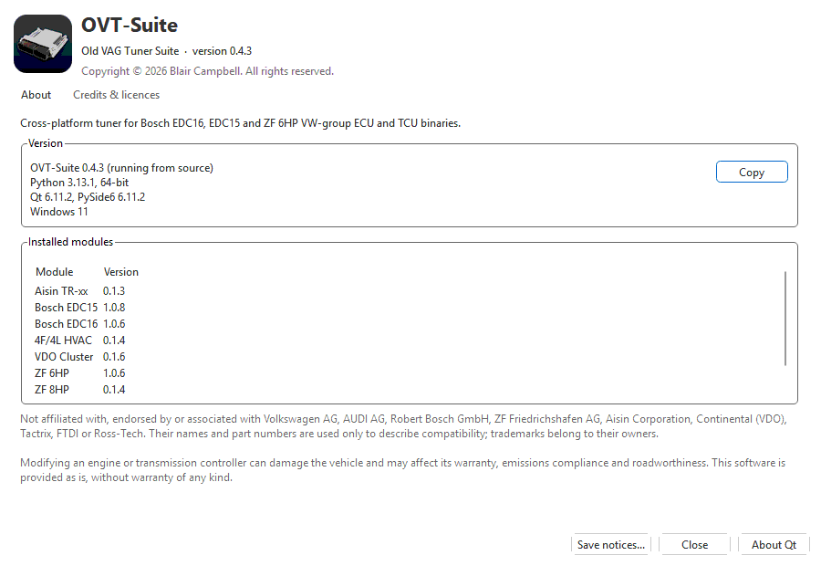
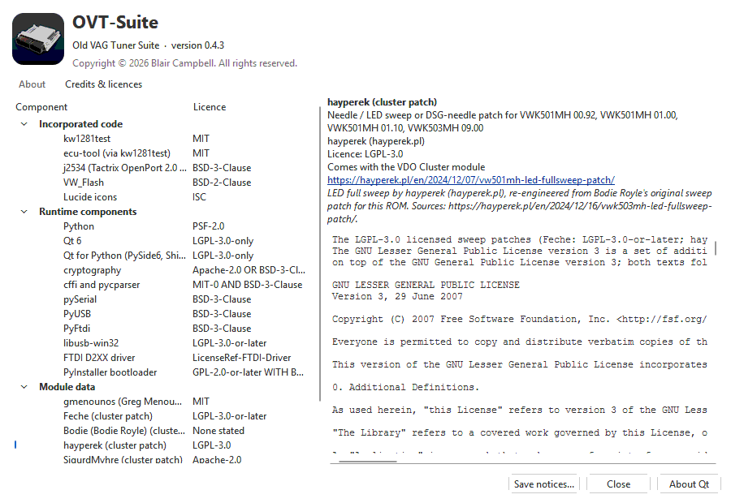

# About and credits

**Help > About OVT-Suite...** shows which version you are running and which
modules are installed — what to include in a bug report. **Help > Credits &
licences...** opens the same window on its second tab: every project and
component OVT-Suite is built on, with its licence.

In the standalone tools (OVT Flasher, Logger, Sniffer, Simulator) the
**About...** button beside **Close** opens the same window, titled with the
tool's name.

## The About tab

| Part | Shows |
|---|---|
| Header | The app's name, its full name (*Old VAG Tuner Suite*), the version, the copyright, and the licence: OVT-Suite itself is free software under the Mozilla Public License 2.0, with a link to its source code. |
| Description | What the app is for. |
| **Version** | The app's version and whether this is an *installed build* or *running from source*; the Python version (and 32- or 64-bit); the Qt and PySide6 versions; the operating system. |
| **Copy** | Copies those lines, plus the installed modules with their versions, to the clipboard — paste them into a bug report. |
| **Installed modules** | Each installed module, its version, and *checksum only* for a checksum-only variant. With none: *No modules installed (Tools > Modules... installs one).* See [Modules](modules.md). |
| Disclaimer | OVT-Suite is not affiliated with or endorsed by the makers whose names, trademarks and part numbers it uses to describe compatibility. Modifying an engine or transmission controller can damage the vehicle and affect its warranty, insurance, emissions compliance and roadworthiness, and defeating emissions controls on a road vehicle is illegal in many countries: use the software only where and how the law allows. It is provided as is, without warranty. See [Licences and legal use](legal.md). |

### Reporting a problem

1. **Help > About OVT-Suite...**, **Copy**.
2. Paste that into the report, and say what you did, what you expected and
   what happened — including any message, word for word.
3. If the app hung or crashed, attach `diagnostics.log` and
   `ovtsuite-fault.log` from your settings folder (see
   [Installing](installing.md#where-the-app-keeps-things)).
4. For a flashing problem, attach the read / write dialog's log; for a CAN
   problem with the C6 cluster or the ABS, a CAN traffic log (see
   [Advanced and diagnostic tools](flashing/advanced.md#cluster-and-abs)).

## The Credits & licences tab

The list on the left is grouped:

| Group | What is in it |
|---|---|
| **Incorporated code** | Source code from other projects that was ported or copied into OVT-Suite — for example kw1281test (the KW1281 / KWP2000 dialogs, the FTDI K-line interface, the EDC15 flash and the VDO cluster unlock), the Linux OpenPort 2.0 driver, and the `.frf` decryption from VW_Flash. Their licences require their copyright notice and licence text to travel with the program. |
| **Runtime components** | Libraries the program ships and runs on: Python, Qt and PySide6, cryptography, pySerial, PyUSB, PyFtdi, libusb-win32, the PyInstaller bootloader. (FTDI's D2XX driver is not shipped; the Windows installer can download it.) |
| **Module data** | Third-party data a module brings — the VDO cluster sweep patches, one entry per author and licence. Listed only while that module is installed. |
| **Acknowledgements** | Projects that were cross-checked but from which no code was taken. |

Pick an entry to see, on the right, what it is used for, its copyright, its
licence, which module it comes with (for module data), a link to its source,
any note, and below that the **full licence text**.

The licence column shows the licence identifier (for example *MIT*,
*LGPL-3.0-only*); *None stated* marks work published freely without a
licence and credited to where it was published.

## Save notices...

**Save notices...** writes everything on the Credits tab — every entry, the
disclaimer, and every licence text in full — to one text file,
`THIRD-PARTY-NOTICES.txt` by default, in your Documents folder unless you
pick another.

### What third-party notices are

Most open-source licences allow their code to be used in another program on
one condition: that the program carries the original copyright notice and
licence text. The notices file is that obligation, in one document. It also
carries OVT-Suite's own licence (MPL-2.0); modules have their own, see
[Licences and legal use](legal.md).

The same file comes with every installed copy:

- **Windows:** `THIRD-PARTY-NOTICES.txt` in the program's folder.
- **Linux:** `/usr/share/doc/ovtsuite/copyright` (and
  `/opt/ovtsuite/THIRD-PARTY-NOTICES.txt`).

**Save notices...** writes the version that matches what is installed right
now, including the modules' data credits.

## About Qt

**About Qt** shows Qt's own about box: the Qt version and Qt's licensing. It
is also on the **Help** menu as **About Qt...**.
