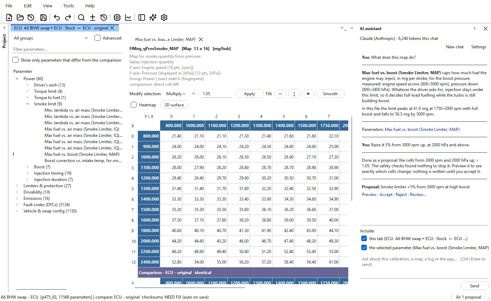

# AI assistant

OVT-Suite can work with an AI: you ask in your own words — *"what does this
map do?"*, *"what changed against the original?"*, *"why does it hesitate
pulling away?"* — and the AI reads the open calibration, your data logs and
these help pages to answer. It can pull up the tables it talks about and
**propose** changes, but it never changes a file itself: every change it
suggests waits for you to preview, accept or reject.

There are two ways to use it, and they can be used together:

- **The assistant panel** on the right of the main window. The app talks to
  an AI service you choose — a free model running on this PC, or an online
  service with your own key. See [The assistant panel](ai/assistant.md).
- **Your own AI app** — Claude, ChatGPT, Cursor, VS Code, LM Studio or any
  other app that supports **MCP** (Model Context Protocol) — connected to
  OVT-Suite, so you can work from that app instead. See [Connecting an AI
  app](ai/ai-apps.md).

## Quick start

1. Open **Tools > AI > Settings...**, tick **Use AI inside OVT-Suite** and
   choose a **Service**. The free choices are a model on this PC (Ollama or
   LM Studio) or a free key from Groq or OpenRouter; see [AI settings and
   privacy](ai/settings.md#choosing-a-service). Paste a key if the service
   needs one, then click **Test connection** and **OK**.
2. Open a project, select a parameter, and press **Ctrl+Shift+A** to open the
   assistant panel.
3. Type a question and press **Ctrl+Enter** (or click **Send**).
4. If the answer ends in a **Proposal**, click **Preview** to see the cells it
   would change in the table, then **Accept** or **Reject**. See [Proposals
   and plans](ai/proposals.md).

## What the AI can and cannot do

| It can | It cannot |
|---|---|
| Read the open tabs: parameters with their axes, units and values, comparisons, version history, checksum state, the **File information** facts | Save, write checksums, flash, or change a file in any way |
| Read the data logs kept in a project, through summaries (ranges, averages, when the extremes happened) and short windows | Read a VIN, immobiliser ID, SKC or PIN: they are withheld from it |
| Use what each module's own tools show: fault codes, measuring blocks, shift schedules, a cluster's K-value and sweep patches ... ([what it knows](ai/what-it-knows.md)) | Propose a change to identity or immobiliser data |
| Pull up a table and select the cells it means, open a category of the parameter tree, filter the tree | Edit a table directly: every change is a proposal |
| Propose a change, or a plan of several steps, after it has passed the same safety checks as the auto-tune | File a proposal that breaks those checks |
| Answer questions about the app from these help pages | |

Like any AI, it can be wrong — the app says so when you first turn AI on. Treat its answers as a knowledgeable second
opinion, check what it proposes with **Preview**, and keep the usual habits:
a saved read of the unit before you change anything, and a test drive with a
log after.

## Pages in this section

| Page | Covers |
|---|---|
| [The assistant panel](ai/assistant.md) | Opening and folding the panel, asking, what it shows you, **Ask AI** from the tree, the table, the Find panel, the Project panel and the Help menu. |
| [Proposals and plans](ai/proposals.md) | **Tools > AI > Proposals...**: previewing, accepting, rejecting; multi-step plans; the safety checks; fault-code and patch changes. |
| [What the AI knows](ai/what-it-knows.md) | What it can read for every file, and what each module adds. |
| [AI settings and privacy](ai/settings.md) | Services (free and paid), keys, models, VIN and immobiliser redaction, **What was sent...**, token usage. |
| [Connecting an AI app](ai/ai-apps.md) | Using OVT-Suite from Claude, ChatGPT, Cursor, VS Code or LM Studio over MCP, and sharing the open tabs with it. |
