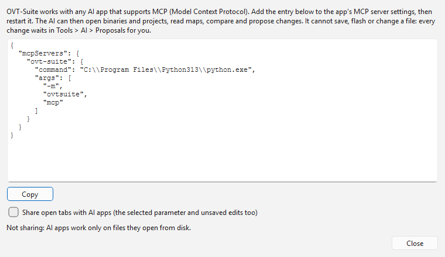

# Connecting an AI app

If you already use an AI app — Claude, ChatGPT, Cursor, VS Code, LM Studio
or any other app that supports **MCP** (Model Context Protocol) — you can
connect it to OVT-Suite and work from that app. It gets the same abilities
as the [assistant panel](assistant.md): it can open binaries and projects,
find and read maps, compare them, read logs and these help pages, and
propose changes. It cannot save, flash or change a file; its proposals wait
in **Tools > AI > Proposals...** like any other (see [Proposals and
plans](proposals.md)).

The AI app uses its own AI service and its own account — nothing in [AI
settings](settings.md) applies to it, and OVT-Suite does not need a key.

## Setting it up

1. Open **Tools > AI > Connect an AI app...**. It shows the entry to add to
   the AI app's MCP server settings, already filled in for this computer.
2. Click **Copy**.
3. In the AI app, open its MCP server settings (often a JSON file, under
   *Settings > Developer*, *MCP* or *Tools*; see the app's own help) and
   paste the entry in. If the file already has other servers, add the
   `"ovt-suite"` part inside its existing `"mcpServers"` section.
4. Restart the AI app. OVT-Suite now appears among its tools or connectors.

The AI app starts OVT-Suite's server itself whenever it needs it. On Windows
that is `OVTMcp.exe` in the program folder; elsewhere it is `ovtsuite mcp`.
The entry for this computer can also be printed from a terminal with
`ovtsuite mcp --print-config`.

## Using it

Ask the AI app about a file by its path — *"open
C:\Cars\A6\A6 BHW swap.ovt and tell me what differs from the original"* — and
it opens it read-only, whether or not the OVT-Suite window is open. A project
opens on its active branch, one handle for each set (ECU, TCU ...).

When it proposes a change, **AI: 1 proposal** appears in the main window's
status bar once that file or project is open. The proposal's heading says
which app made it.

## Sharing open tabs

**Tools > AI > Share open tabs with AI apps** (also in the **Connect an AI
app** window) is off until you turn it on. The first time, the same notice as
for the assistant says that AI can make mistakes and that its changes are
always reviewed before flashing. While it is on and the main
window is open, a connected AI app also sees:

- the open tabs, with their unsaved edits;
- the parameter selected in the active tab, so you can ask about *"this
  map"*;
- the comparison each tab is using;

and it can show you a parameter's table, open a category of the parameter
tree or filter the tree, the same as the assistant panel.

Only programs running on this computer, as you, can connect: the connection
is local to this computer and needs a key that only your user account can
read. Turn sharing off again from the same menu; it stays the way you left
it.

Without sharing, the AI app works only on files it opens from disk — saved
versions, not what is open in your tabs.
