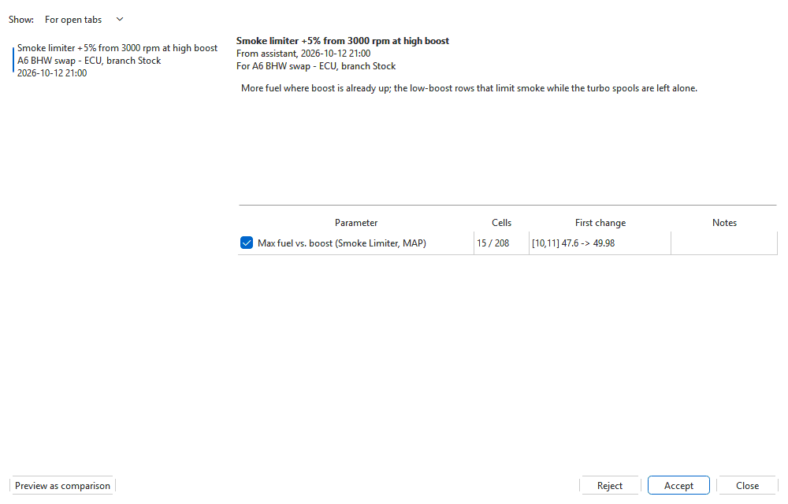

# Proposals and plans

The AI never changes a file. When it suggests a change — from the assistant
panel or from an AI app connected over MCP — the change is filed as a
**proposal** and waits for you. You can preview it in the table, accept it,
or reject it.

## Where proposals show up

- **Under the answer** in the [assistant panel](assistant.md#what-it-shows-you),
  with **Preview**, **Accept**, **Reject** and **Review...**.
- **In the status bar**: **AI: 1 proposal** (or *N proposals*) appears at the
  right while proposals are waiting for the open tabs. Click it to open the
  list.
- **Tools > AI > Proposals...** — the full list, below.

## The Proposals window

| Part | What it shows |
|---|---|
| **Show** | **For open tabs** — proposals for the files and projects open now. **All pending** lists the rest too, with a note to open their file or project first. |
| List | One line per proposal: its title, what it is for, when it was made. |
| Heading | The title; which app made it (**assistant** for the assistant panel, otherwise the AI app's name) and when; the file or project, set and branch it is for. A note says when it was made for another branch or an earlier version, or when the file has changed since. |
| Rationale | The AI's reasons and the risks it sees, the plan's goal for a plan step, and the safety checks' remarks, if any. |
| Parameters | Each parameter it changes, ticked; **Cells** changed out of the total; the **First change** (cell, old value -> new value); and **Notes**. Double-click a row to show that parameter in its tab. |

Notes in the parameter list:

- **placement not established - asks before writing** — the parameter's
  address in this file was inferred rather than anchored. You are asked
  before it is written.
- **N value(s) outside the allowed range, held at its limit** — the AI asked
  for more than the cell can hold, so the limit is used instead.

Values are always rounded to what the cell can store, the same as when you
type them.

## Previewing

**Preview as comparison** (or **Preview** in the panel) shows the tab
compared against the result of the proposal: the table marks every cell it
would change, with the new values beside yours, and **Edit > Show
differences...** lists them. Nothing is written. Click it again, or close the
window, to get your own comparison back.

## Accepting

Untick any parameter you want to leave out, then click **Accept**:

- The ticked parameters are applied as **one undo step**.
- On a **project** tab with no other unsaved edits, the result is saved
  straight away as its own version named **AI: <title>**. It shows in the
  version history and the **Project** panel like any other version, so you
  can compare against it or go back to the version before it.
- On a tab with unsaved edits, or a tab that is not a project, it stays an
  unsaved edit: **Edit > Undo** takes it back, **File > Save** keeps it.
- Checksums are corrected when the version is saved, as for any edit.

A proposal holds the whole new table of each parameter it changes. If you
have edited one of those tables since it was made (the heading then says it
was made against an earlier version), accepting replaces your later edit in
that table — preview it first. A parameter this file does not have, or has in
another shape, is skipped, and the message after accepting says which.

**Reject** removes the proposal from the list. Accepted and rejected
proposals are kept as a record in the `ai/proposals` folder of the app's
settings folder.

## Plans

For a goal that spans several maps — a stage 1, a smoother pull-away, firmer
shifts — the AI works in steps: it reads the maps involved, tries its changes
against the safety checks, and files a **plan**: ordered steps, each with its
own title and reasons, where later steps build on earlier ones.

In the assistant panel a plan shows as **Plan: <title> (N steps)**:

- **Preview result** shows the tab compared against the whole plan applied.
- **Accept plan** applies every step in order. On a project tab with no
  other unsaved edits each step is saved as its own version (**AI: Stage 1 -
  1/3: ...**), so you can compare or go back one step at a time.
- **Reject plan** drops every pending step.
- **Review steps...** opens the Proposals window, with one line per step.

In the Proposals window, the heading of a step says **Step 2 of 3 of the plan
...**. **Accept steps 1-2** accepts the step selected together with the
pending steps before it, because later steps build on earlier ones; **Accept
plan** and **Reject plan** act on every pending step.

## Safety checks

Every proposal and plan goes through the same checks as the auto-tune before
it reaches you:

- a value outside what a cell can hold is refused;
- anything breaking the platform's own rules is refused — on a ZF 6HP, for
  example, an upshift that would sit too close to its downshift;
- VIN, immobiliser and SKC data cannot be changed at all.

The AI is told why a change was refused and has to correct it, so a
proposal that reaches you has passed. Remarks that do not block (warnings and
notes) are listed under the rationale. The checks are a safety net, not a
guarantee that a tune is good for the car: preview it, and log a test drive.

## Fault codes and patches

Some changes are not values in a named parameter:

- **EDC15 / EDC16 fault codes** are switched off or back on through their
  fault class, as the fault-code editor does. Switching one back on restores
  the comparison's (stock) class when there is one.
- **ZF 6HP fault codes** are switched through their class priority byte, so
  every code in the same class changes with it. The AI lists every code
  affected, and the proposal shows the change as bytes at an address.
- **VDO cluster sweep patches** (needle and LED sweep at start-up) are
  proposed only when the patch fits the cluster's exact ROM build. The
  proposal shows the bytes it changes; the patch's credit and licence travel
  with it.

These byte changes are computed by the module's own code, the same as its
tool windows make them, so the map safety checks do not apply to them; the
rationale says so. A change to bytes is listed as **N bytes at 0x...**. When you accept it,
each block is written only if the bytes in the file are still the ones it
was made from; if they changed since, that part is skipped with **these
bytes changed since it was proposed**.
