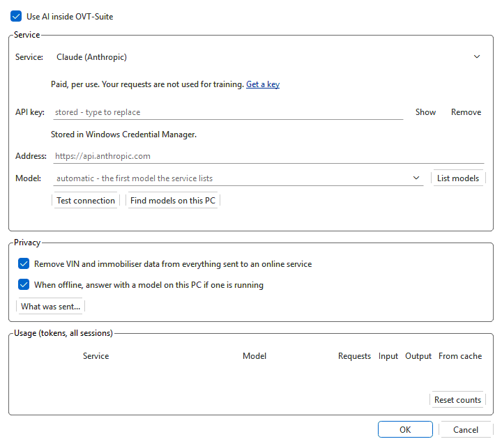

# AI settings and privacy

**Tools > AI > Settings...** chooses the AI service the app itself uses for
the [assistant panel](assistant.md), with its key and model, and what may be
sent to it. An AI app connected over MCP uses its own service and settings,
not these (see [Connecting an AI app](ai-apps.md)).

**Use AI inside OVT-Suite** is off until you tick it. While it is off, the
app sends nothing to any AI service.

The first time you turn AI on, a notice says that **AI can make mistakes**
and that every change an AI makes or proposes must be reviewed by you before
it is flashed. Click **I understand** to go on; **Cancel** leaves AI off. It
is shown once (and again only if its wording changes), and also before the
first question if AI was already on from an earlier version.

## Choosing a service

| Service | Cost | Key | Notes |
|---|---|---|---|
| **Automatic: a model on this PC** | Free | None | Uses [Ollama](https://ollama.com/download) or [LM Studio](https://lmstudio.ai) when one is running. Works offline; nothing leaves the PC. Pick a model that supports tools; a capable PC helps. |
| Ollama (on this PC), LM Studio (on this PC) | Free | None | The same, always using that one. In LM Studio, start its local server with a model loaded. |
| Groq | Free tier | Free key, no card | Daily request limits. |
| OpenRouter | Free models | Free key, no card | One key for many models. Tick **Free models only**: models ending in `:free` cost nothing (a small daily request limit). |
| Google Gemini | Free tier | Free key | Google uses free-tier content to improve its products, so your calibrations would be part of that. The paid tier does not. |
| Claude (Anthropic), OpenAI | Paid, per use | Your key | |
| DeepSeek | Paid, per use | Your key | DeepSeek stores what you send in the People's Republic of China and may use it to train its models; you can ask privacy@deepseek.com to opt out. |
| Other OpenAI-compatible server | — | If it needs one | Any server that speaks OpenAI's Chat Completions API. Give its **Address**, ending in `/v1`. |

There is no key built into the app: until you set up a service, the
assistant uses a model on this PC if it finds one running, and otherwise
tells you to choose a service.

Which to choose:

- **To try it for free and keep everything on this PC**: install Ollama or
  LM Studio, download a model that supports tools, and leave the service on
  **Automatic**. Small models are quick but miss more; for plans and log
  analysis use the largest model the PC runs comfortably.
- **For the best answers**: a paid service with a current large model. It
  is billed by the tokens each question uses: a question about one map
  reads little, a plan or a log analysis reads much more. The **Usage**
  table counts them.
- **For free online answers**: Groq or OpenRouter's free models, with their
  daily limits.

## Key, address and model

- **API key** — get one from the service (the **Get a key** link opens its
  page), paste it, and click **OK**. It is kept in Windows Credential Manager,
  the macOS Keychain or the Linux keyring — never in the settings file; the
  line under it says where. Where there is no keyring it is kept in a private
  file in your settings folder that only your user account can read.
  **Show** shows what you typed; **Remove** deletes the stored key.
- A key in the usual environment variable (`ANTHROPIC_API_KEY`,
  `OPENAI_API_KEY`, `GEMINI_API_KEY`, `GROQ_API_KEY`, `OPENROUTER_API_KEY`,
  `DEEPSEEK_API_KEY`)
  is used when none is stored.
- **Address** — leave it empty for the service's own; change it for a server
  elsewhere on your network or a proxy.
- **Model** — leave it empty to use the first model the service lists, or
  type or pick one. **List models** asks the service which models it offers.
- **Test connection** checks the key and the address and asks the service
  for its models.
- **Find models on this PC** looks for a running Ollama or LM Studio,
  selects it and lists its models.

A change of service or model applies to the next question, also in a chat
already under way: the conversation so far is carried over to the new
service. (While an answer is being written, the change waits until it is
done.)

Answers appear in the panel as they are written. A service or server that
cannot do that answers all at once instead, without any setting to change.

## Privacy

- **Remove VIN and immobiliser data from everything sent to an online
  service** (on by default) replaces VINs and immobiliser, SKC and PIN
  values with a placeholder in every request to an online service — your
  questions included. A model on this PC gets the text as it is, since it
  never leaves the PC. Separately from this setting, those values are never
  read out of a file for any AI (see [What it is never
  given](what-it-knows.md#what-it-is-never-given)).
- **When offline, answer with a model on this PC if one is running** — when
  the online service cannot be reached, the assistant answers with Ollama or
  LM Studio instead and says so in the panel.
- **What was sent...** (also **Tools > AI > What was sent...**) lists every
  request sent to an AI service this session, newest first, exactly as sent:
  pick one on the left to see the whole request — the question, what the AI
  looked up, and the answer's status. API keys are never shown or logged.
  An AI app connected over MCP sends its own requests; see that app. The
  list keeps the last 60 requests, fewer when they are large (each request of
  a long chat carries the whole conversation); a very large one is shown cut
  short.

What goes to the service is what the AI reads to answer: the question, what
**Include** shares, and the results of what it looks up — parameter values,
log summaries, help text. Whole binaries and whole logs are never sent.

## Usage

The **Usage** table counts, across sessions, the requests and tokens each
service and model has used: **Input** (what was sent), **Output** (the
answers) and **From cache** — the part of the input the service re-used from
earlier requests at a lower price. **Reset counts** starts again from zero.
The assistant panel's top line shows the tokens of the current chat.
