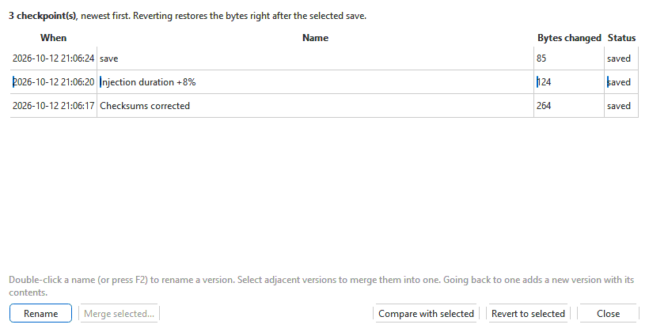

# Editing and saving

This page covers what happens to your changes: undoing them, saving them
with corrected checksums, and **Edit > Version history...**, which keeps
every save of a branch so you can name it, compare against it or go back to
it. How to change values in a table is on [Tables and editing
values](editor/tables-and-editing.md).

## The usual cycle

1. Open the project (**File > Open project...**, Ctrl+O), or import the
   binary into one (**File > Import > Into a new project...**, Ctrl+Shift+I).
2. Change values in the tables — typed, with **Modify selection**, pasted or
   copied from another file.
3. Check your changes against the original — a project tab is compared with
   the original as read from the start — and tick **Show only parameters
   that differ** (see [Comparing files](editor/comparison.md)).
4. **File > Save** (Ctrl+S). The checksums are corrected and the save is
   kept as a version.
5. Flash the saved version (see [ECU read / write](flashing.md)). It is
   marked in the project as last flashed.

## Undo and redo

**Edit > Undo** (Ctrl+Z) takes back the last change; **Edit > Redo** (Ctrl+Y)
puts it back. Every kind of change goes on the same list: values typed or
pasted, **Modify selection**, **Fill** and **Smooth**, values copied from
another tab, bytes typed in the hex editor, changes made in tool windows,
an applied patch (one step for the whole patch) and a version revert (one
step).

The list runs from when the tab was opened and is not cleared by saving,
so you can still undo past a save; the tab is then marked as changed again.
It holds the last 500 changes, and is cleared when the tab is closed.

On the toolbar, the arrow beside **Undo** and **Redo** drops down the list of
steps, newest first, named by the parameter they changed. Pick one to undo (or
redo) every step down to it at once. Hover over either button to see the step
it would take next; they are greyed out when there is nothing to undo or redo.

## Saving

Everything is saved as an **OVT project** (`.ovt`): see
[Projects](projects.md).

- **File > Save** (Ctrl+S) saves the whole project -- every edited tab of it
  becomes a new version on its branch. **File > Save this branch only** (Ctrl+Alt+S)
  saves just this tab. **Save As...** saves the project under a new name.
- A new, untitled project (a binary imported into a new project, or a read)
  asks where to save the `.ovt`, and for the vehicle details, on its first
  **Save**. An imported file as it was on disk is the set's first version,
  and your edits the next. The imported file itself is never written.

Plain `.bin` files and the other formats are made with **File > Export**.
See [Exporting](editor/export.md).

Every save:

1. **corrects the checksums**, when the file's module supports them (see
   [Checksums](#checksums));
2. records a **version** -- every byte that changed since the last save
   (see [Version history](#version-history));
3. writes the project safely: the new file is written beside the old one and
   swapped in only when complete, so an interruption cannot leave half a
   file.

The status bar confirms the save and names the checksums that were
corrected, for example
`Saved 03G906016LQ.bin - EDC16 checksums corrected (...), image ready to flash`.
The `*` disappears from the tab.

If the project cannot be written (no permission, disk full, file open in
another program), a **Not saved** message says why, and your changes stay
open and unsaved.

A read from a control unit goes into a project from the start, with the
read as its original; **Save** asks for the project's name the first time.

Before a tab or the app closes, any unsaved changes are offered for saving;
see [Tabs and sessions](editor/tabs-and-sessions.md#closing-the-app).

## Checksums

An ECU or TCU checks its own flash with checksums; a file whose checksums do
not match the data will not run, or not be accepted by the flasher. OVT-Suite
corrects them for you whenever you save, for every platform whose module
provides checksum support.

The end of the status bar shows the state of the file in front of you:

| Shown | Meaning |
|---|---|
| `checksums: valid` | All checksums match the data. |
| `checksums: NEED FIX (auto on save)` | At least one does not — expected after any edit, and common in files from other tools. Saving corrects them; there is nothing to do by hand. |
| `checksums: CANNOT VERIFY` | The checksum layout of this image could not be worked out. The app does not know whether they are right, and will not write checksums it cannot derive. |
| *(nothing)* | No installed module can check this kind of file. It is saved exactly as edited. |

**Tools > Verify checksums...** checks them without saving:

- **All ... checksums are valid** — with the details.
- **Checksums need correction** — the details, and **Correct them now?
  (Save also corrects automatically.)** **Yes** corrects them in memory;
  save to write them. **No** leaves them.
- **Checksums cannot be verified** — why not.
- If no installed module can check this file, or the image is not one with
  a supported checksum, a message says so.

> **Exports come from the last saved version.** **File > Export** makes its
> files from the project's last save, whose checksums were corrected when it
> was saved; you are offered to save first. See
> [Exporting](editor/export.md).

### ZF 6HP program-area checksums

**ZF 6HP: also correct the program-area checksums**, in **Tools > Options...**
on the **Projects and saving** page (see [Options](options.md#projects-and-saving)),
is a switch, off by default, shown while the ZF 6HP module is installed. When
it is on, a save or flash of a ZF 6HP file also rewrites the self-checks of
the program and boot area, not just the calibration checksum. A calibration
tune never changes those areas; turn it on only when you edit program or boot
bytes, or a descriptor's identity. The setting is remembered and applies to
every open tab at once. See the [ZF 6HP](modules/zf6hp/index.md) module's
help.

## Version history

Every save is kept as a **checkpoint**: a record of exactly which bytes it
changed. **Edit > Version history...** lists the branch's checkpoints since
the original, newest first, so you can name the important ones, merge them,
compare against an earlier state, or go back — all without keeping numbered
copies of the file. (The original itself is in the Project panel and in
**File > Compare with saved version**.)

| Column | Meaning |
|---|---|
| **When** | When it was saved (for merged versions, the first and last save). |
| **Name** | Your name for it, or the automatic one, such as `save`, `patch: ...`, `revert to version ...` or `merge`. |
| **Bytes changed** | How many bytes that save changed. |
| **Status** | `saved`, or `pending (unsaved)` for a checkpoint made since the last save (by a revert). |

Hover over a row for its automatic label, which other areas it changed
(the EEPROM or internal flash, for instance) and, for merged versions, how
many saves it holds.

| Button | What it does |
|---|---|
| **Rename** | Name the selected checkpoint — for example `Stage 1, smoke limit +10%`. You can also double-click the name, or press F2. Clear the name to go back to the automatic one. |
| **Merge selected...** | Make two or more adjacent checkpoints one (select them with Shift or Ctrl). You are asked for its name. Only the history changes: the newest keeps its place, and going back to it gives the same bytes. A `pending (unsaved)` checkpoint cannot be merged until it is saved; see [Where the history is kept](#where-the-history-is-kept) for the others that cannot. |
| **Compare with selected** | Make that version this tab's comparison, and close the window. The file itself is not changed. |
| **Revert to selected** | Put the file back to how it was right after that save. |
| **Close** | Close the window. |

### Going back to an earlier version

1. **Edit > Version history...**
2. Select the save to go back to.
3. **Revert to selected**, and confirm (**Every checkpoint after this one will
   be undone.**).

The file is put back to how it was right after that save, as **one undo
step** — Ctrl+Z restores what you had. A message says how many checkpoints
were undone and how many bytes restored, with a warning for any place that
was changed again after the checkpoint being undone (it is restored to the
older value all the same).

The revert is itself recorded as a new checkpoint, `revert to version ...`,
so it can be reverted in turn. It is `pending (unsaved)` until you save —
**save to keep the result**.

### Comparing with an earlier version

**File > Compare with saved version** lists the branch's newest 25
versions (the first one marked `(original)`) and makes the one you pick the
tab's comparison, rebuilt from the history; **Project panel...** at the
bottom opens the panel, which lists every version.
Every difference since then is highlighted, and **Show only parameters that
differ** lists what changed. The comparison is remembered with the tab.

### Where the history is kept

The history is kept in the project, one per branch. Versions are never
deleted, but adjacent ones can be merged -- here, or by selecting them in the
Project panel (Ctrl-click or Shift-click) and right-clicking **Merge N
versions into one...**. The original (the first version) is never merged,
and a version another branch starts from, the head of a branch, or the
version an original file or a flash record refers to cannot be merged away.
Merging is a change to the project: save it to keep it. A binary imported
with the *name*`.log` change log of an earlier version of the app beside it
brings that history along as versions. A checkpoint records changes only, so
the history takes little space.

To turn the changes between two versions into a patch for another file, see
[Patches](editor/patches.md#making-a-patch-from-this-files-history).
