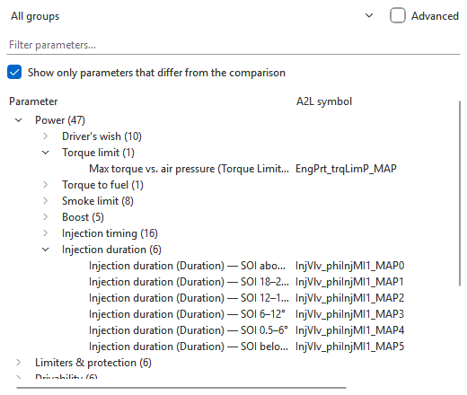
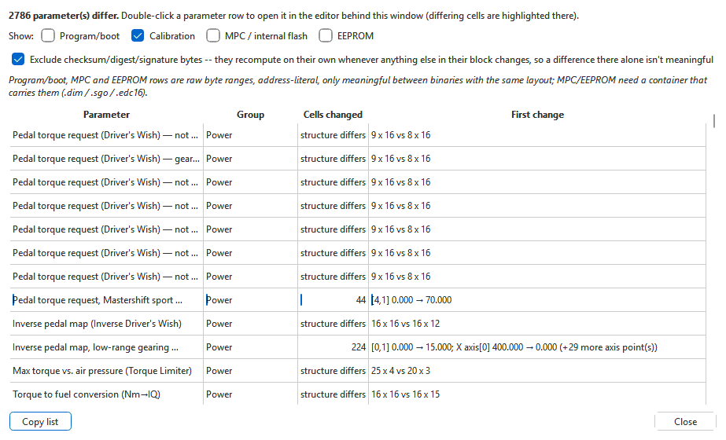

# Comparing files

A **comparison** is a second binary shown beside the one you edit — the
original as read beside a tune, last week's version beside today's, another
branch, or another software version of the same ECU. It is read-only. The
app pairs the two binaries parameter by parameter through their definitions,
not by address, so a table is compared with the same table even when the two
keep it in different places.

Each tab has its own comparison. It must be the **same platform** as the
tab's binary (an EDC16 against an EDC16, a ZF 6HP against a ZF 6HP);
different software versions and sizes of the same platform are fine.

**A project tab opens with the original as read as its comparison** (the
first version of its set — the read, shown as *ECU - as read*, or the file
as it was imported, shown as *ECU - original*), so
what shows as different is what you changed. Pick another comparison at any
time; **File > Close comparison** drops it.

## Opening a comparison

Use one of the **File** menu items:

| Item | Use it for |
|---|---|
| **Import as comparison...** | Pick a binary, or a project (`.ovt`) — this one or another. For a project you are asked which binary (set), branch and version to compare against; sets of another kind of unit are listed but cannot be picked, and nothing is asked when there is only one possible choice. If that branch is open in a tab and you picked its latest version, the comparison follows that tab live. |
| **Import recent as comparison** | A binary or project version compared against lately. **Clear comparison history** empties the list. |
| **Compare with open tab** | Another tab. The comparison then **follows that tab**: its unsaved edits show here as you make them. Tabs of another platform are listed but greyed out. |
| **Compare with saved version** | A saved version of this tab's branch, newest first, the original marked `(original)`. The newest 25 are listed; **Project panel...** at the bottom opens the Project panel, which lists them all. |

In the **Project panel**, double-click a version (or right-click it >
**Compare with this version**): it becomes the comparison of its own
branch's tab, which is opened first if it is not open. To compare this tab
with a version of *another* branch, use **Import as comparison...** and pick
this project.

A binary can also be dropped on the window: the menu that appears offers
**Compare with this tab**.

A binary of another platform is refused with a message saying what each one
is. You are offered **Import it into a new project** instead.

When a comparison is loaded from a file, a summary of what it was identified
as is shown — the same as **File > Comparison information...** shows later.

### What happens to the comparison later

- **Closing the tab a live comparison follows** freezes the comparison as it
  last was. The tab label then ends in `(closed tab)` and the status bar
  shows `(tab closed)`.
- **File > Close comparison** drops it and keeps the tab's binary.
- A project reopened later (from **Restore project from history** or at
  start-up) brings back each tab's comparison.

## How differences show

In the **grid**, the comparison's copy of the table is drawn under the
primary's, below a dark banner such as
**Comparison - 03G906016LQ.bin   20 cell(s) differ**. Both copies scroll
together. Cells whose values differ have an orange outline in both copies (a
frame, so the cell keeps its heat-map shade or tint). Hover over a
primary cell to read the comparison's value, or over a comparison cell to
read the primary's.

A selection stays on one side of the banner: cells are selected in the
primary's copy or in the comparison's, never both at once. A drag that crosses
the banner stops at it, and clicking in the other copy starts a new selection
there -- so **Copy** takes cells from one table only.

### Scrolled together

With a tall map the comparison's copy is far down the grid. **Tools >
Options > Editor > Comparison table** can put it in a read-only grid of its
own instead, **below** the table or **beside** it, the way the Measuring
blocks dialog shows its comparison. The heading over it is the banner's
text. The two grids are kept in step, whichever one you use:

- scrolling, up and down and sideways;
- column widths and row heights;
- the current cell and the selection -- the matching cells are selected in
  the other grid.

The comparison's copy is on the primary's grid in every case (see below), so
row for row and column for column the two grids show the same operating
point -- also when the two tables are different sizes and the comparison's
values were resampled. **Ctrl+C** in the comparison grid copies its selected
cells. The default, **In the same grid, under the table**, is the layout
described above.

### Showing the difference

Instead of values, the cells can show how the **primary** (the file you are
editing) differs from the **comparison**. Pick it in the **Difference view**
button on the table's edit bar, beside **3D surface** and **Dyno** (available
while a comparison is loaded), in **View > Difference view**, or in **Tools >
Options > Editor**. The same menu can be a button on the toolbar: **Tools >
Options > Toolbar**, *View ▸ Difference view*. It names the two files at the
top, then asks two things.

**Show as:**

| View | Each cell shows |
| --- | --- |
| **Values** | the value itself (the default; the view is off) |
| **Difference: primary - comparison** | what you changed: positive where the primary is higher |
| **Difference: comparison - primary** | the same, the other way round |
| **Percent change of the primary from the comparison** | the difference as a percentage of the comparison's value |
| **Ratio: primary / comparison** | the primary's value divided by the comparison's |

**Show it in:** **the comparison block** (the default: the primary keeps its
values, so it stays editable), **the primary table** (read only while it shows
differences -- typing, pasting and the modify bar do nothing and the status
bar says why; set it back to **Values** to edit), or **both**. The banner says
what is on.

Values are in the units the table shows. A comparison value of 0 has no
percentage or ratio, so that cell shows `-`. A cell that does not differ
shows 0 (percent 0%, ratio 1).

A cell that differs always has an **orange outline**, whatever the table
shows, so it can sit over a heat map or a tint. Two options:
**Blank the cells that do not differ** leaves only the changes on screen;
**Tint by direction** fills a differing cell **red where the primary is the
higher** and **blue where it is the lower**, whether the table shows values or
a difference and whichever way round the difference is taken (the same light
fill with dark text in both themes, so the numbers always read). With the
heat map on, the heat map has the fill and the tint is not shown. Both
options apply wherever the difference view does.

Hover a cell for both absolute values. **Copy** always copies the real
values, never the differences. Hex tables show a difference as a signed
hex byte (`+0A`, `-04`); a percentage or ratio stays decimal. Text and
list-valued tables stay as they are.

**In the same grid, matching cells marked** keeps that one grid, and frames
the cells matching the selection in the other copy: select primary cells and
their comparison cells are framed below the banner, select comparison cells
and the primary's are framed. The frame is an outline, so the orange of a
differing cell still shows.

**Ctrl+J** jumps to the matching cells: it selects them in the other copy
(or the other grid, below or beside) and scrolls to them. Press it again to
come back. It does nothing in the default layout.

The comparison's copy is laid out on the primary's grid, which depends on how
the two tables match. The banner and the **comparison:** line in the notes
above the grid say which case it is:

| Shown | Meaning |
|---|---|
| `comparison: direct cell diff` | Same size, same axes: cell compared with cell. |
| `comparison: same size, AXES DIFFER - cells are at different operating points` (banner: `· axes differ`) | Same size but different breakpoints. Each value is shown in the cell it is stored in, and the comparison's own axis band shows its own breakpoints. Two cells in the same place are **not** the same operating point. |
| `comparison: the comparison is 8x16, this table 8x6 -- resampled onto this table's axes` (banner: `· resampled`) | Different sizes -- also a table [resized](resizing-tables.md) in this project shown against a version from before the resize: the comparison's values are interpolated onto the primary's breakpoints, so they can be read cell for cell. They are calculated, not stored, values. |
| `comparison matched column by column from ...` | Gearbox tables whose columns are labels rather than measurements: columns are matched by label; a column the comparison does not have is left blank. |

When the comparison has no copy of the table at all, the title line ends
with `- no match in <file>` and no comparison block is drawn.

In the **tree**, tick **Show only parameters that differ from the
comparison** to keep only the parameters whose data differs. The counts in
brackets then count differing parameters.

With **Heatmap** ticked, both copies are shaded on one scale and differing
cells are shown in bold.

The [hex editor](hex-editor.md) shows bytes that differ from the comparison,
and the [3D surface](3d-surface.md) draws both surfaces side by side.

## Edit > Show differences...

**Edit > Show differences...** lists every parameter that differs, in one
window. It stays open beside the main window while you work.

| Column | Meaning |
|---|---|
| **Parameter** | The parameter's name. |
| **Group** | Its tree group. |
| **Cells changed** | How many cells differ, or `structure differs` when the two copies are different sizes. |
| **First change** | The first differing cell, primary value → comparison value (for a different size: the two sizes). |

Double-click a row to open that parameter in the main window, with its
differing cells highlighted.

**Show:** picks what is listed:

| Box | Lists |
|---|---|
| **Calibration** (ticked) | The parameters, as above. |
| **Program/boot** | Raw byte ranges that differ in the program and boot area. |
| **MPC / internal flash** | Raw byte ranges in the internal flash, when both sets hold it (a `.dim`, `.sgo`, `.edc16` or a full read). |
| **EEPROM** | Raw byte ranges in the EEPROM, when both sets hold it. |

Raw byte rows show the area and address, `raw bytes`, the length and the
first byte that differs. They compare address by address, so they only mean
something between files with the same layout.

**Exclude checksum/digest/signature bytes** (ticked) leaves out the bytes
that change by themselves whenever anything in their block changes.

**Copy list** copies the whole list as tab-separated text for a spreadsheet
or a note.

If no parameter differs, a message says so — and, if the program/boot area,
internal flash or EEPROM do differ, it says that too, and the window opens so
you can tick those boxes.

## Tips

- To see what a tune changed, open its tab — it starts out compared with the
  original as read — tick **Show only parameters that differ**, and step
  through the tree, or use **Show differences...**.
- To keep a reference without keeping copies of the file, save as you go and
  use **File > Compare with saved version**; another branch's version is one
  **Import as comparison...** of this project away.
- The Find panel's **This tab + comparison** scope searches both binaries; see
  [The Find panel](search.md).
- The differences between two binaries can be saved as a patch and applied
  to another binary: see [Patches](patches.md).
