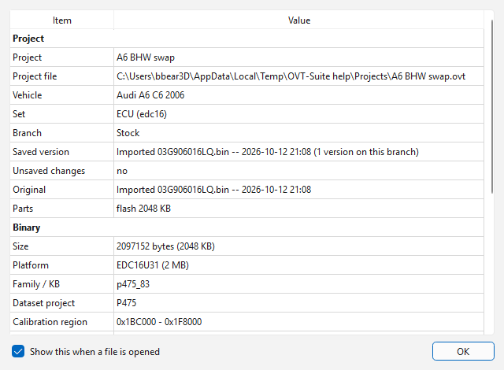

# Files and formats

OVT-Suite identifies a binary from its **contents**, not from its name or
extension, so a binary is recognised whatever it is called. Everything you
work on lives in an **OVT project** (`.ovt`) -- see [Projects](../projects.md).
This page lists what can be brought into a project, what it becomes there,
and what can be exported again.

## Opening a project

**File > Open project...** (Ctrl+O) opens a `.ovt`; **File > Open Recent**
lists the projects opened lately. See
[Projects](../projects.md#opening-a-project).

## Importing

Any other file is **imported** into a project. **File > Import** has:

| Item | Does |
|---|---|
| **Into a new project...** (Ctrl+Shift+I) | A new, untitled project. Its first **Save** asks for a name and the vehicle details. |
| **Into this project...** | The project of the tab in front. |
| **Into a new project, in this tab...** | As **Into a new project...**, but opens where the tab in front was. |
| **Into this project, in this tab...** | As **Into this project...**, but opens where the tab in front was. |
| **Definition file for this binary (XDF, A2L, KP, OLS, DAM)...** | Attaches a definition to the binary in the tab in front. |

Each imported binary becomes a **set** of the project and opens in a **new
tab**. The two **in this tab** entries close the tab in front first (asking
about its unsaved changes), and the import opens in its place. A `.ovt`
picked in Import simply opens. The file picker's filters are only a
convenience — **All files** shows everything.

**Drag and drop** works too: drop files on the window. A project opens. Any
other file goes into a new project when no project is open; with a project
tab in front, a small menu asks: **Import into <project>**, **Import into a
new project**, or **Compare with this tab** (one binary).

**An EDC16 calibration-only file** (exactly 512 KB, with the calibration
descriptor in it) is a window of the 2 MB flash, so it is imported -- or read
from the car over K-line -- as the full 2 MB image: the 512 KB at `0x180000`
over `0xFF`, the image the flasher writes. The set records that it was
padded. A 1 MB file is more likely an EDC16U1's whole flash and is never
padded; neither is anything else. Exporting a raw binary from an older
project that still holds a 512 KB file gives the 2 MB image too.

While a binary loads, a progress window shows each step; identifying the
software and placing every parameter can take a few seconds on a large
image. Then:

- If the binary's module is installed, the parameter tree fills and a summary
  of what was found is shown (the same as **File > File information...**),
  unless you unticked **Show this when a file is opened** in it.
- If no installed module supports it, a **Limited support** message says what
  the binary is and what would support it — with **Install module...** when a
  module for it exists but is not installed — and it opens in the
  [hex editor](hex-editor.md). Comparing, patches, version history and the
  flasher still work. See [Modules](../modules.md).

## What can be imported

| File | What it is | In the project it becomes |
|---|---|---|
| `.bin`, `.ori`, `.hex`, `.mpc` and other plain images | A straight copy of the control unit's memory (a read, or a file from another tool). | A set holding the image, with its `.log` history beside it migrated into versions. A definition beside it with the same name (`x.bin` + `x.xdf`) is attached to it. |
| `.edc16`, `.edc15`, `.6hp`, `.8hp`, `.hvac`, `.vdo` | The files of earlier versions of the app. **Import only:** the app no longer writes them. | A set with every part of it (flash, MPC, EEPROM) and its version history. |
| `.dim` | A Dimsport dump: external flash, internal flash (MPC), EEPROM. | A set with all three; the `.dim` itself is kept byte for byte (Export rebuilds it). |
| `.sgo` | A factory flash file (SGML Object File). | A set holding its sections decoded into one image; the `.sgo` itself is kept byte for byte (Export re-encodes only the sections you changed). |
| `.frf` | A newer factory flash file (UDS gearboxes such as the 6HP28, and the 8HP). | A set holding the image assembled from its blocks (a note in the status bar says what was assembled); the `.frf` itself is kept. |
| `.edc15bak` | A KWHack EDC15 backup: flash and EEPROM together. | A set with flash and EEPROM. Import only: the format is never written. |
| `.ols` | A WinOLS project: a binary and its map definitions (OLS 4 and 5). | A set holding the binary (split into flash and MPC for an EDC16), with WinOLS's maps as its definition and the vehicle details as the project information. |
| `.xdf`, `.a2l`, `.kp`, `.dam` | A definition (TunerPro, ASAP2, WinOLS map pack, DAMOS): parameters, but no binary. | The definition of a binary's set: picked together with one binary, it attaches to that binary; alone, it attaches to the binary of the tab in front, or (into a new project) asks which binary. |

The set's first version is the file **as it is on disk**; your edits are the
next version on top. A read from a control unit goes straight into a project,
with the read as its original.

**Other formats are exports** (**File > Export**): one part of a set as a
plain `.bin`, or the original `.sgo` / `.dim` with your changes in it (a
`.frf` only while unchanged). See
[Exporting](export.md).

> **Note:** a `.sgo` whose sections could not all be decoded shows those
> sections as `FF` bytes, and a warning on importing lists them. An EDC16
> `.sgo` needs the EDC16 module to decode at all.

## Definitions

A project stores the definition the app worked out for each set, so it opens
again without being identified from scratch. It is stored when you save, and
when a project you have not changed is closed (nothing else is written then).
A definition worked out by an older version of the app is worked out again
once, the first time the project is opened in the new one.

A **third-party definition** -- an XDF, A2L, KP, WinOLS project (OLS) or
DAMOS (DAM) -- is packaged in the project with a binary. Attach one with
**File > Import > Definition file for this binary (XDF, A2L, KP, OLS,
DAM)...** (also on the **+** beside the tabs), by right-clicking the set in
the Project panel, by dropping the file on the window, or by importing it
together with the binary (a definition of the same name beside a `.bin` is
attached by itself).

- A binary **no module recognises** then opens in the main view with that
  definition's tables and values, instead of only the hex editor.
- A binary **a module defines** keeps the module's tree, and the file's
  tables are added to it in a group of their own, **From <file name>** --
  with the file's categories under it, in English. Attaching one asks
  whether to **Show them beside the module's** (the default, and what an
  imported WinOLS project does) or **Use them instead** (the module still
  corrects the checksums; its tuning tools that rely on its own map list are
  unavailable meanwhile). Switch between the two later with **Hide the
  module's built-in maps** on the set's menu in the Project panel; removing
  the definition there goes back to the module's alone.

Each of the definition's tables is placed where evidence in the binary
confirms it -- also when the definition was made for another software
version, whose tables have moved -- and what nothing confirms is left out
unless you ask for it. When not every table is where the file says,
attaching it shows what was found first. See [Placing a definition
file](definitions.md).

German texts in a definition -- descriptions, axis names, categories -- are
shown in English: a description of the Bosch EDC15 DAMOS the app ships
translations for gets its checked English, anything else is translated word
by word (compounds are split into their parts; *ue*/*ae*/*oe* spellings and
inflected forms are recognised), and units are always shown in English. A
German word left in an otherwise English text -- *Schwere counter limit*,
*CARB specific Fehlercode* -- is translated as well, while English words that
happen to be German too (*also*, *not*, *fast*) and code words such as
*MOT7* or *Dfp_BrkCD* are left as they are. A category such as *ARMD: 10.40 Momentenbasierte Antiruckelfunktion*
reads *Torque-based anti-jerk function (ARMD 10.40)*.

Saving is safe against interruptions: the new file is written next to the
old one and swapped in only when it is complete, so a crash or a full disk
leaves the previous file intact. Unsaved work is also kept aside every minute
while a project is open, and offered back after a crash (see
[Projects](../projects.md#recovering-after-a-crash)).

## File information

**File > File information...** (Ctrl+I) shows what the binary in the tab
was identified as. For a tab of a project it starts with a **Project**
section: the project and its file (or *not saved yet*), the vehicle, the set
and its platform, the branch, the version last saved on it (and how many
versions the branch has), whether the tab has unsaved changes, the original
(the as-read or imported version) and any original file kept with it, a
definition file attached to it, its parts and their sizes, when it was last
flashed, and how many logs, patches and attachments the project keeps.

It also appears by itself when a file is opened -- an import, a project
opened from **File > Open project** or **Open Recent**, a read from a
control unit. Untick **Show this when a file is opened** to stop that; the
choice is remembered, and Ctrl+I still shows it. **Project information...**
shows the project's vehicle
details (see [Projects](../projects.md#project-information)), and
**Comparison information...** what the comparison was identified as.

What is listed depends on the platform. For an EDC16, for example: size,
platform and flash size, the definition family, the part number and software
version, the system, the Bosch software number, the dataset, the layout and
pointer table, how many parameters were found of each kind and how they
were placed, and the checksum state. A container also lists what it holds
and whether its stored definition was used; a file without its module lists
what the base app recognised and why there is no parameter tree.

## Reads from a control unit

A read made with **Tools > ECU read / write...** goes into a project, with
the read itself as the set's original. With a project tab in front you are
asked: **Add to <project>** (as a new set, or a new branch of a set of the
same kind) or **New project**. It is not on disk until you **Save**, which
asks for the project's name the first time -- but it is in the crash-recovery
store at once.
See [ECU read / write](../flashing.md).
