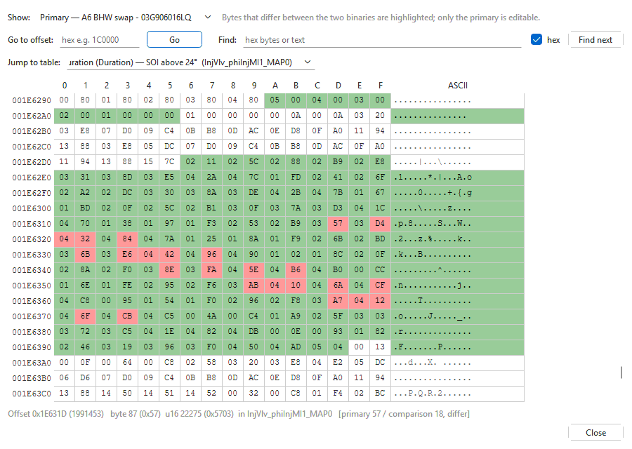

# Hex editor

**Tools > Hex editor...** (Ctrl+H) shows the raw bytes of the tab's binary.
It works on every binary, including one no installed module supports — such
a binary opens straight in the hex editor. Edits made here are ordinary edits: they
can be undone with **Edit > Undo** in the main window, they show in the
table view, and the checksums are corrected when you save.

To go straight to a parameter's bytes, right-click it in the parameter tree
> **Show in hex editor** and pick its data or an axis: the editor opens with
exactly those bytes selected. See [The parameter menu and
Properties](parameter-menu.md).

The editor belongs to its tab: it stays open beside the main window,
hides while another tab is active and closes with the tab. It follows edits
made elsewhere (in the grid, by undo, by a patch) while it is open.

## Reading the bytes

Each row is 16 bytes: the offset on the left, the bytes in hex, and the same
bytes as text in the **ASCII** column (a dot for a byte that is not a
printable character).

| Colour | Meaning |
|---|---|
| Green | The byte belongs to a parameter the module identified (its values or its axes). |
| Orange | You changed the byte (shown only when no comparison is open). |
| Red | The byte differs from the comparison (when one is open). |

A project tab starts out compared with the original as read, so red usually
marks every byte changed since the read. Close the comparison (**File >
Close comparison**; an open hex editor follows) to see the bytes you changed in
this tab in orange instead.

Click a byte to read it in the line at the bottom: its offset in hex and
decimal, its value, the 16-bit value of it and the next byte (this byte
high), the parameter
it belongs to, and — with a comparison — both binaries' bytes. Hover over a
byte for the parameter name and its address range. The main window's
status bar shows the picked byte's offset at its right (the first and last
of several picked bytes, and how many), until the hex editor closes.

## Moving around

| Control | What it does |
|---|---|
| **Go to offset:** | Type a hex offset (for example `1C0000`) and press Enter or **Go**. |
| **Find:** | Type bytes in hex separated by spaces (`DE AD BE EF`) with **hex** ticked, or text with **hex** cleared; press Enter or **Find next**. The search starts after the selected byte and wraps round to the start; **Not found** is shown when there is no match. |
| **Jump to table:** | Pick a parameter (type to filter the list) to go to its first byte. Moving through the bytes shows here which parameter you are in. |
| **Ctrl + mouse wheel**, **Ctrl+=** / **Ctrl+-** | Make the bytes bigger or smaller; **Ctrl+0** goes back to the normal size. The size is remembered. |

## Editing bytes

Click a byte and type two hex digits: the byte is written and the cursor
moves to the next one, so a run of bytes can be typed without the mouse.
Double-click or press F2 to change the byte that is there.

| Key | Does |
|---|---|
| Ctrl+C | Copies the selected bytes as hex, separated by spaces. |
| Ctrl+V | Writes hex from the clipboard (spaced or not, `0x` and commas allowed) starting at the selected byte. |

**Find**, Ctrl+C and Ctrl+V work on the bytes on screen: the region
selected in **Region:**, and the comparison's bytes when **Show:** is on
**Comparison**. Ctrl+V writes into the region on screen, like typing; only
the primary is editable, so with the comparison shown, or a view-only
region, it writes nothing and the line under the bytes says why.

## The right-click menu

Right-click the bytes for a menu that works on the selected bytes (the byte
under the mouse when nothing is selected). Selecting in the **ASCII**
column stands for all 16 bytes of that row.

| Item | Does |
|---|---|
| **Copy** | As Ctrl+C: the selected bytes as hex. |
| **Copy as text** | The selected bytes as text, a dot for each byte that is not a printable character. |
| **Paste** | As Ctrl+V. Shown only when the bytes on screen can be edited. |
| **Copy selected bytes from comparison** | With a comparison open and the primary shown: the selected bytes take the comparison's values. |
| **Copy bytes to primary** | With **Show:** on **Comparison**: the selected comparison bytes are written into the primary at the same offsets. |
| **Revert to as-read values** | The selected bytes go back to the image as read (in a project) or as opened. |
| **Revert to last saved values** | The selected bytes go back to how they were when the file was last saved. |
| **Go to table: *name*** | When the byte under the mouse belongs to a parameter: shows that table in the main window. |
| **Select all** / **Find next** | Selects every byte; finds the next match of the **Find:** text (shown when there is one). |

Each copy, paste or revert is one edit: one **Edit > Undo** puts all of it
back. An item that would change nothing — the selected bytes already match
the comparison, or already have the values to revert to — is greyed out;
hover over it to see why. The comparison and revert items work on the main
flash only.

> **Caution:** a byte outside every identified parameter may be code, a
> pointer or a count. Change one only when you know what it is; checksum
> correction on save does not make a wrong byte right.

## With a comparison

**Show:** switches the view between **Primary** and **Comparison**. Bytes
that differ are red in both. Only the primary can be edited.

## Regions

When the set holds more than the main flash — the internal flash (MPC) or
the EEPROM, as a `.dim`, an EDC16 `.sgo` or `.edc16`, an EDC15 backup or a
full read brings in — **Region:** switches between them. The note beside it says whether
that region is **editable — saved with the rest of the set** or **view
only — use Export to edit this region**. **Jump to table** only works
in the main flash, where the parameters are.

To export a region as its own file (**File > Export > Binary (.bin)...**),
see [Exporting](export.md).
