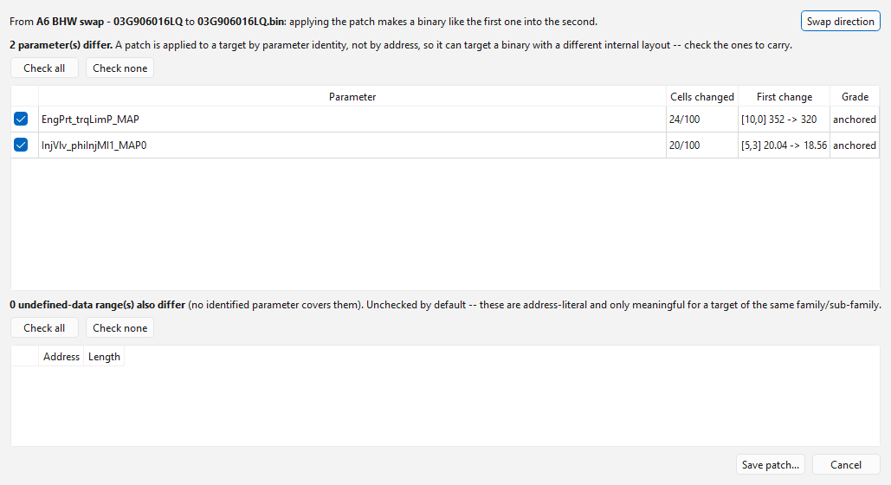
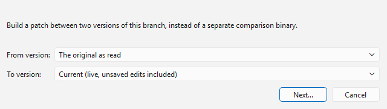
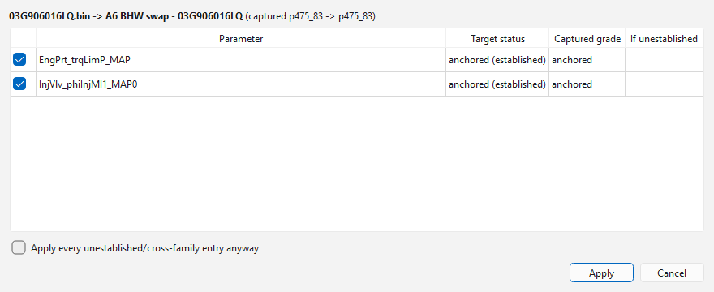
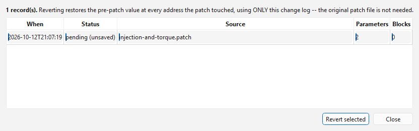

# Patches

A **patch** is a set of changes, kept in the project or saved as a `.patch`
file, so they can be applied to another binary: the same tune onto another
car's read, a set of fixes onto a newer software version, or a change you
want to be able to take back out later.

A patch carries each changed parameter **by name**, with its values in
physical units — not as bytes at addresses. When it is applied, each entry
is looked up in the target file's own definition and written at the target's
own address, in the target's own format. That is what lets one patch apply
to a different software version of the same ECU, whose tables sit
elsewhere. Where the target's table is a different size, the values are
fitted onto its axes the same way the [comparison view](comparison.md)
lines them up.

The **Edit** menu has:

| Menu item | Does |
|---|---|
| **Edit > Generate patch...** | Makes a patch of the differences between the tab's binary and its comparison, and of any tables you add whole. |
| **Edit > Generate patch from history...** | Makes a patch of the differences between two saved versions of this branch. |
| **Edit > Apply patch...** | Applies one of the project's patches, or a patch file, to the tab's binary. |
| **Edit > Remove patch...** | Takes out a patch applied earlier, without needing the patch itself. |

## Making a patch from two binaries

A patch goes **from** one binary **to** another: applied, it changes a
binary like the first into the second. It carries the values of the second.

1. Open the tune's tab. A project tab starts out compared with the original
   as read; to compare with something else — another branch, another
   project, a binary — use **File > Import as comparison...**, **Compare
   with open tab** or **Compare with saved version**.
2. **Edit > Generate patch...**. It opens the Differences window on **Make
   patch** (switch to **List** to read the differences instead -- see
   [Comparing files](comparison.md#edit--show-differences)).

The line at the top says which way the patch goes. By default it carries
**this tab's values over the comparison's**: applying it makes a binary like
the comparison into this tab (against the tab's own original, that is the
tab's changes). **Swap direction** turns it round, so it carries the
comparison's values instead.

The list has every parameter that differs, then the undefined data that
differs (`Undefined data @ 0x...`, unticked) and, when ticked under
**Show:**, the program/boot area, MPC and EEPROM ranges -- those are shown
only: a patch does not carry them, so their rows have no tick box.

| Column | Meaning |
|---|---|
| (tick box) | Whether this parameter goes into the patch. All are ticked to start with. |
| **Parameter** | The parameter. |
| **Cells changed** | Changed cells out of the total, or `structure differs` when the two copies are different sizes. |
| **First change** | The first changed cell: its value in the binary the patch goes from → in the one it goes to. |
| **Group** | Its tree group. |
| **Grade** | How firmly the parameter was located in the binary the patch goes to (for example `anchored`). |

**Swap direction** turns the patch round in the same window. Undefined data
is address-literal -- it means something only for a target of the same family
and layout -- so tick those rows only for such a target.

A file with **coding variants** (an EDC16 that holds a second copy of the
gear ratios, the heater outputs and other values for the other codings) is
listed copy by copy: a changed second copy is its own line, shown with the
coding that selects it — `Gearbx_rTrans1_C [coding 150031/158031 (5-speed
manual)]`. Each copy is compared with the copy the same coding selects in
the other binary, and applied to the copy the target's coding selects, so
an edit made for one transmission does not land on the other's.

Untick the parameters you do not want to carry; **Check all** and **Check
none** set every box.

### Adding whole tables

A patch normally carries what differs. **Add tables...** puts any table in
whole -- every cell and breakpoint, changed or not -- with its value from the
file the patch carries the values of (this tab by default). Applying it writes
the whole table, breakpoints included, into the target, which is how to carry
a table that is already the same in the two files, or to pin a table to
these values whatever the target holds.

The list that opens has every parameter of the file, grouped as the
parameter tree groups them. Type in the **search box** to narrow it: a name,
a symbol, part of the description or a group, and every word you type must
match, so `boost limit` finds the tables that mention both. **Check shown**
ticks everything the search leaves, **Uncheck all** clears the ticks, and OK
adds the ticked tables to the list, marked `whole table` in the **Cells
changed** column (with how many cells would change in the comparison, if it
has the table). A table already in the list because it differs is offered
too, with how much of it changed in the **In the patch** column (`17/64
changed`); ticking it makes its row whole, in place -- the same values, and
now its breakpoints go in as well. Tables already in the list whole are not
offered again.

A table found changed already carries every cell. What taking it whole adds
is its **breakpoints**: as found, they are written only where they changed;
whole, always. To switch rows without the list, select them in the window,
right-click and choose **Take whole (every cell and breakpoint)**, or **As
found (breakpoints only where changed)** to turn a table made whole back.
(A table you added whole was never found changed, so it has no "as found".)

You can also start from the parameter tree: **Ctrl-** or **Shift-click**
several parameters, right-click, and choose **Create patch from the
selected tables...**. With a comparison open that is this window with those
tables already added; without one it is a window of just those tables, whose
values come from this tab. From the command line, `patch-diff --table NAME`
(repeatable) adds a table whole.

The lower list has **undefined-data ranges**: bytes that differ where no
identified parameter lies. These have no name to be looked up by, so they
are carried as raw bytes at a fixed address — they only mean anything on a
target of the same software family, and they are **unticked** to start
with. Checksum bytes are never listed. A ticked range carries the bytes of
the binary the patch goes to, like the parameters.

Click **Save patch...**. You are asked where it goes:

- **Keep in the project** (the default) — it is listed under **Patches**
  in the Project panel and saved with the project;
- **Save as a file...** — a `.patch` file; the default name is
  *from*`_to_`*to*`.patch`.

## Making a patch from the branch's history

To capture what changed between two versions of the branch you are working
on — without a second binary:

1. **Edit > Generate patch from history...**. The Differences window opens
   with **Compare:** set to **Two versions of this file's history** (you
   can also pick that in a window already open).
2. Pick **From version:** and **To version:**. Both list the branch's saved
   versions, oldest first; **From version:** starts with **The original as
   read**, and **To version:** ends with **Current (live, unsaved edits
   included)**. Those two are picked to begin with: everything this branch
   changed since the read. The list follows as you change them.

See [Version history](../editing.md#version-history) for the versions
themselves.

## Applying a patch

1. Open the target binary in a tab.
2. **Edit > Apply patch...**. The project's own patches are offered first;
   **From a file...** picks a `.patch` file instead. In the Project panel,
   double-click a patch (or right-click it > **Apply to this tab...**) to do
   the same.

The line at the top names the two files the patch was made from and their
software families. Each entry is listed with:

| Column | Meaning |
|---|---|
| (tick box) | Whether to apply it. |
| **Parameter** | The parameter (or `block@0x...` for an undefined-data range, with its length). |
| **Target status** | How the parameter was located **in this file**: `(established)` when its place is certain, `(NOT established)` when it was placed by a guess, or `not found in this binary`. For a range: `same family`, or which family it was captured from and which this file is. |
| **Captured grade** | How firmly it was located in the file the patch was made from. |
| **If unestablished** | For an entry that is not established, or a range from another family: **Discard** (the default) or **Apply anyway**. |

**Apply every unestablished/cross-family entry anyway** sets all those
choices to **Apply anyway** at once.

3. Click **Apply**.

A summary says how many entries were applied and skipped, why each skipped
one was skipped, and how many collided with changes already made to this
file in this session. The whole apply is **one undo step**: Ctrl+Z takes it
all back out.

> **Caution:** **Apply anyway** writes to a place the app could not confirm
> in this file. Check those tables (for example in the [hex
> editor](hex-editor.md), or against a known file) before you flash.

4. Save. Saving corrects the checksums, and records the patch in the
   branch's history so that it can be removed later.

## Removing a patch

**Edit > Remove patch...** lists every patch applied to this branch, from
its versions in the project — the patch itself is not needed. (To take a
patch kept in the project out of the project's list, see [Patches kept in
the project](#patches-kept-in-the-project).)

| Column | Meaning |
|---|---|
| **When** | When it was applied. |
| **Status** | `saved`, or `pending (unsaved)` for one applied since the last save. |
| **Source** | The patch file's name. |
| **Parameters** / **Blocks** | How many entries and ranges it wrote. |

Select one and click **Revert selected**, then confirm. Every byte the patch
wrote goes back to the value it had before. If something wrote to the same
place after the patch, the patch's old value is restored anyway, and a
warning says so.

The removal is itself recorded, as `revert of ...`, so it can be reverted in
turn (which puts the patch back). Save to keep the result.

The record of a patch lives in the project, with the version it was saved
in, so a patch applied and saved is listed whenever the project is opened
again. A patch applied but never saved is listed only until the tab is
closed.

## Patches kept in the project

Patches kept in a project are listed under **Patches** in the Project panel,
and offered first by **Edit > Apply patch...**. A patch made with **Generate
patch...** or **Generate patch from history...** is kept there unless you
pick **Save as a file...**; right-click the **Patches** heading > **Add
patch...** to keep a `.patch` file in the project. Right-click a patch for:

- **Apply to this tab...** (or double-click it) — apply it to the tab in
  front;
- **Export...** — save it as a `.patch` file (also **File > Export >
  Patch...**);
- **Remove** — take it out of the project. This does not undo it anywhere it
  was applied: that is **Edit > Remove patch...**.

Kept patches are written to the `.ovt` when the project is saved.

## Relative entries: a change instead of values

An ordinary entry carries the values a table should end up with, and writes
every cell. A **relative** entry carries a *change* to make to the target's
own values, such as "+1° timing at 55 mg and above, 1750–3500 rpm". Use one
when software versions share a tune but their stock tables differ. Each
version keeps its own values wherever the change does not reach.

How a relative entry works:

- Cells are picked by axis value (rpm, mg, hPa), not by position. A target
  with other breakpoints is still changed in the right place.
- Only the cells whose value changes are written.
- The change also reaches every coding-variant copy of the table, unless the
  entry says otherwise. An entry can be limited to the copies one kind of
  coding reads, such as `automatic (TC)`, `DSG` or `manual`.

### Making one in Generate patch

In **Make patch**, select rows and use **Carry as**:

| Choice | Goes into the patch as |
|---|---|
| **Values** | The table set to this file's values: the usual entry. |
| **Change by difference** | The difference between the two files, cell by cell. The same number of degrees, Nm or hPa is added to whatever the target holds. |
| **Change by percentage** | The ratio between the two files, cell by cell. A target with larger stock values gets a proportionally larger change. |

The **Cells changed** column shows **change, +/-** or **change, %** for a
row carried as a change. **Values** turns it back. A change needs both
files to hold the table at the same size, and at least one cell to differ.
A table whose only change is in its breakpoints has no change to carry.

### Applying one

**Edit > Apply patch...** shows two extra columns:

- **Change:** "values", or the change in words, such as `add +1 @ x
  1750..3500, y 55..`.
- **Copies here:** how many tables of this file the entry writes. A relative
  entry can reach several coding-variant copies.

Select a row to see, below the list, which cells it would change in this
file and from what to what.

If the patch has already been applied to this file and has entries that add
or multiply, **Apply** asks before applying it again.

### Operations

| Operation | Does |
|---|---|
| `add` | Adds a number (`--value -0.5` takes away). |
| `scale` | Multiplies (`--value 1.05` is +5 %). |
| `floor` | Raises any cell below the number up to it. |
| `cap` | Lowers any cell above the number down to it. |
| `set` | Sets the cell to the number. |

The number can vary along an axis: `--curve 1000:330,2000:370` gives 330 at
1000 rpm, 370 at 2000 rpm, a straight line between them, and holds the end
values beyond them.

### From the command line

To add an operation (this creates the patch file and the entry if they do
not exist yet):

    ovtsuite patch-add-op stage2.patch InjCrv_phiBas8_GMAP --op add --value 1 --x 1750:3500 --y 55:

`--x` and `--y` take a `LO:HI` range in axis units, with either side left
empty for open-ended. `--no-variants` leaves the coding-variant copies
alone. `--only-coding "automatic (TC)"` changes only the copies that kind of
coding reads; `ovtsuite coding FILE` lists a file's codings.

To capture a change from two binaries instead of values:

    ovtsuite patch-diff stock.bin tuned.bin out.patch --relative phiBas
    ovtsuite patch-diff stock.bin tuned.bin out.patch --relative-pct trqLim

`--relative` carries the difference. `--relative-pct` carries the
percentage. Either way, only cells that differ are changed.

**Caution:** `add`, `scale` and both kinds of captured change apply again
each time the patch is applied. Applying the same patch twice adds twice.
`floor`, `cap` and `set` give the same result however often they are
applied. To take a relative entry back out, use
[Remove patch](#removing-a-patch) as usual.

## Tips

- Keep the stock read of every car you work on: a patch made from stock to
  tune can be re-applied after a dealer update, or to the next car.
- A patch only carries what you tick. Leave out parameters that belong to
  one car (coding, immobilizer, VIN-related settings).
- After applying, use **File > Import as comparison...** with the binary the
  patch came from, and **Show only parameters that differ**, to check the
  result.
