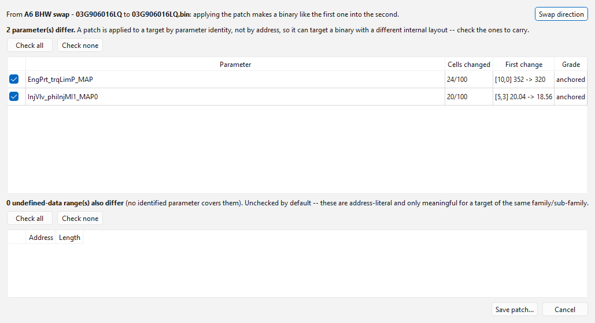
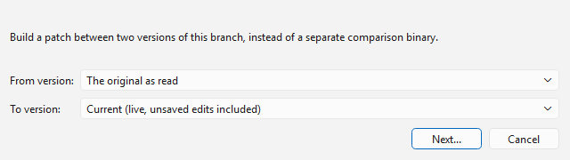
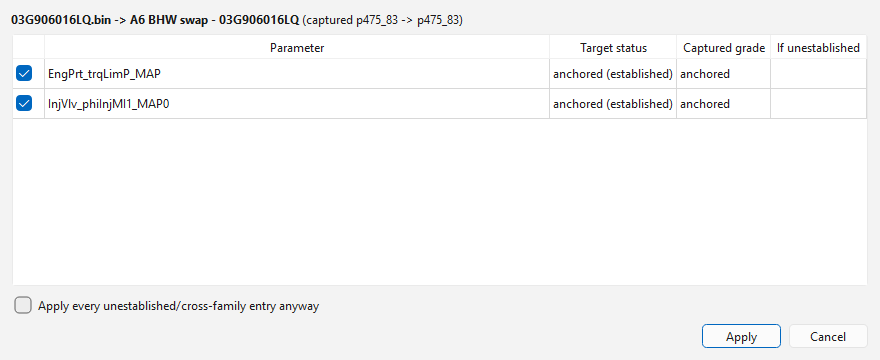
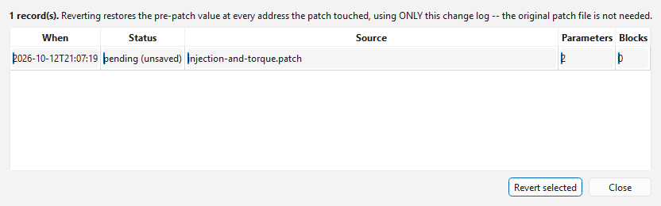

# Patches

A **patch** is a set of changes, kept in the project or saved as a `.patch`
file, so they can be applied to another binary: the same tune onto another
car's read, a set of fixes onto a newer software version, or a change you
want to be able to take back out later.

A patch carries each changed parameter **by name**, with its values in
physical units — not as bytes at addresses. When it is applied, each entry
is looked up in the target file's own definition and written at the target's
own address, in the target's own format. That is what lets one patch apply
to a different software version of the same ECU, whose tables sit
elsewhere. Where the target's table is a different size, the values are
fitted onto its axes the same way the [comparison view](comparison.md)
lines them up.

The **Edit** menu has:

| Menu item | Does |
|---|---|
| **Edit > Generate patch...** | Makes a patch of the differences between the tab's binary and its comparison. |
| **Edit > Generate patch from history...** | Makes a patch of the differences between two saved versions of this branch. |
| **Edit > Apply patch...** | Applies one of the project's patches, or a patch file, to the tab's binary. |
| **Edit > Remove patch...** | Takes out a patch applied earlier, without needing the patch itself. |

## Making a patch from two binaries

A patch goes **from** one binary **to** another: applied, it changes a
binary like the first into the second.

1. Open the tune's tab. A project tab starts out compared with the original
   as read; to compare with something else — another branch, another
   project, a binary — use **File > Import as comparison...**, **Compare
   with open tab** or **Compare with saved version**.
2. **Edit > Generate patch...**.

The line at the top says which way the patch goes. When the comparison is
one of the tab's own versions (the original as read, or a saved version) it
goes **from the comparison to this tab** — the tab's changes. Against any
other comparison it goes **from this tab to the comparison**. **Swap
direction** turns it round.

The top list has every parameter that differs:

| Column | Meaning |
|---|---|
| (tick box) | Whether this parameter goes into the patch. All are ticked to start with. |
| **Parameter** | The parameter. |
| **Cells changed** | Changed cells out of the total, or `structure differs` when the two copies are different sizes. |
| **First change** | The first changed cell: its value in the binary the patch goes from → in the one it goes to. |
| **Grade** | How firmly the parameter was located in the binary the patch goes to (for example `anchored`). |

A file with **coding variants** (an EDC16 that holds a second copy of the
gear ratios, the heater outputs and other values for the other codings) is
listed copy by copy: a changed second copy is its own line, shown with the
coding that selects it — `Gearbx_rTrans1_C [coding 150031/158031 (5-speed
manual)]`. Each copy is compared with the copy the same coding selects in
the other binary, and applied to the copy the target's coding selects, so
an edit made for one transmission does not land on the other's.

Untick the parameters you do not want to carry; **Check all** and **Check
none** set every box.

The lower list has **undefined-data ranges**: bytes that differ where no
identified parameter lies. These have no name to be looked up by, so they
are carried as raw bytes at a fixed address — they only mean anything on a
target of the same software family, and they are **unticked** to start
with. Checksum bytes are never listed. A ticked range carries the bytes of
the binary the patch goes to, like the parameters.

Click **Save patch...**. You are asked where it goes:

- **Keep in the project** (the default) — it is listed under **Patches**
  in the Project panel and saved with the project;
- **Save as a file...** — a `.patch` file; the default name is
  *from*`_to_`*to*`.patch`.

## Making a patch from the branch's history

To capture what changed between two versions of the branch you are working
on — without a second binary:

1. **Edit > Generate patch from history...**.
2. Pick **From version:** and **To version:**. Both list the branch's saved
   versions, oldest first; **From version:** starts with **The original as
   read**, and **To version:** ends with **Current (live, unsaved edits
   included)**. Those two are picked to begin with: everything this branch
   changed since the read.
3. **Next...** opens the same list as above, between those two versions.

See [Version history](../editing.md#version-history) for the versions
themselves.

## Applying a patch

1. Open the target binary in a tab.
2. **Edit > Apply patch...**. The project's own patches are offered first;
   **From a file...** picks a `.patch` file instead. In the Project panel,
   double-click a patch (or right-click it > **Apply to this tab...**) to do
   the same.

The line at the top names the two files the patch was made from and their
software families. Each entry is listed with:

| Column | Meaning |
|---|---|
| (tick box) | Whether to apply it. |
| **Parameter** | The parameter (or `block@0x...` for an undefined-data range, with its length). |
| **Target status** | How the parameter was located **in this file**: `(established)` when its place is certain, `(NOT established)` when it was placed by a guess, or `not found in this binary`. For a range: `same family`, or which family it was captured from and which this file is. |
| **Captured grade** | How firmly it was located in the file the patch was made from. |
| **If unestablished** | For an entry that is not established, or a range from another family: **Discard** (the default) or **Apply anyway**. |

**Apply every unestablished/cross-family entry anyway** sets all those
choices to **Apply anyway** at once.

3. Click **Apply**.

A summary says how many entries were applied and skipped, why each skipped
one was skipped, and how many collided with changes already made to this
file in this session. The whole apply is **one undo step**: Ctrl+Z takes it
all back out.

> **Caution:** **Apply anyway** writes to a place the app could not confirm
> in this file. Check those tables (for example in the [hex
> editor](hex-editor.md), or against a known file) before you flash.

4. Save. Saving corrects the checksums, and records the patch in the
   branch's history so that it can be removed later.

## Removing a patch

**Edit > Remove patch...** lists every patch applied to this branch, from
its versions in the project — the patch itself is not needed. (To take a
patch kept in the project out of the project's list, see [Patches kept in
the project](#patches-kept-in-the-project).)

| Column | Meaning |
|---|---|
| **When** | When it was applied. |
| **Status** | `saved`, or `pending (unsaved)` for one applied since the last save. |
| **Source** | The patch file's name. |
| **Parameters** / **Blocks** | How many entries and ranges it wrote. |

Select one and click **Revert selected**, then confirm. Every byte the patch
wrote goes back to the value it had before. If something wrote to the same
place after the patch, the patch's old value is restored anyway, and a
warning says so.

The removal is itself recorded, as `revert of ...`, so it can be reverted in
turn (which puts the patch back). Save to keep the result.

The record of a patch lives in the project, with the version it was saved
in, so a patch applied and saved is listed whenever the project is opened
again. A patch applied but never saved is listed only until the tab is
closed.

## Patches kept in the project

Patches kept in a project are listed under **Patches** in the Project panel,
and offered first by **Edit > Apply patch...**. A patch made with **Generate
patch...** or **Generate patch from history...** is kept there unless you
pick **Save as a file...**; right-click the **Patches** heading > **Add
patch...** to keep a `.patch` file in the project. Right-click a patch for:

- **Apply to this tab...** (or double-click it) — apply it to the tab in
  front;
- **Export...** — save it as a `.patch` file (also **File > Export >
  Patch...**);
- **Remove** — take it out of the project. This does not undo it anywhere it
  was applied: that is **Edit > Remove patch...**.

Kept patches are written to the `.ovt` when the project is saved.

## Tips

- Keep the stock read of every car you work on: a patch made from stock to
  tune can be re-applied after a dealer update, or to the next car.
- A patch only carries what you tick. Leave out parameters that belong to
  one car (coding, immobilizer, VIN-related settings).
- After applying, use **File > Import as comparison...** with the binary the
  patch came from, and **Show only parameters that differ**, to check the
  result.
