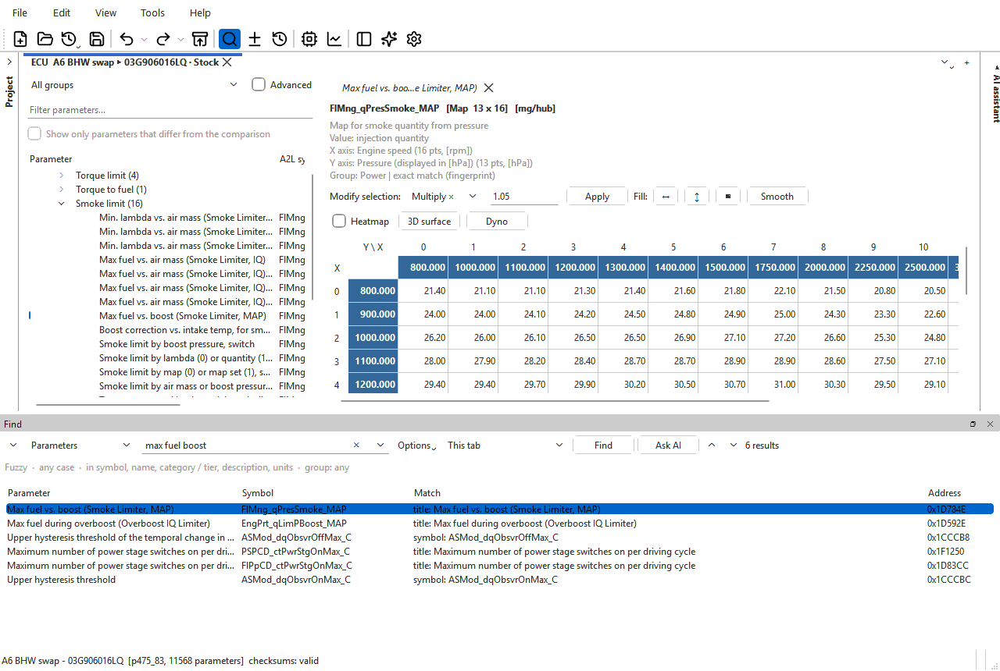
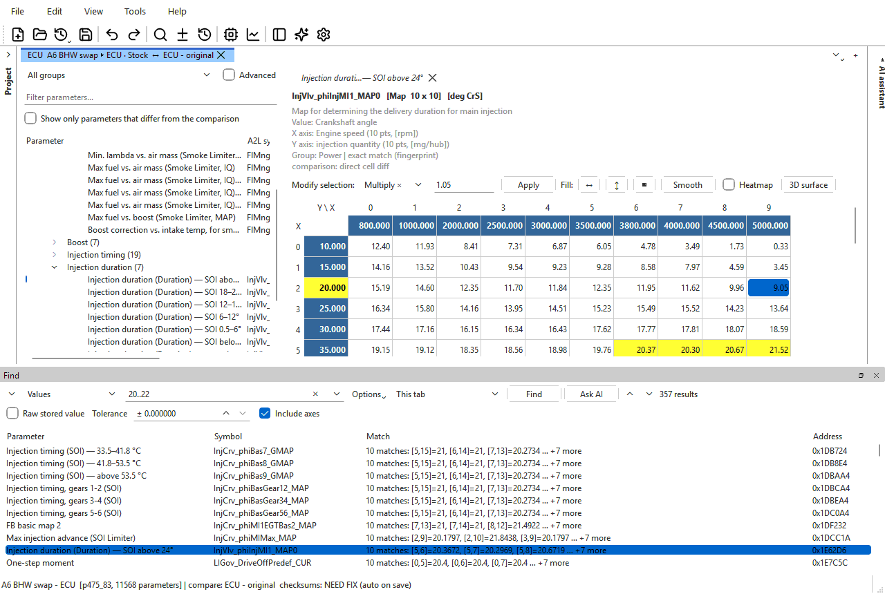

# The Find panel

The Find panel searches the parameters of the open tabs four ways: by
**name and description**, by the **values** they hold, by **address**, and
for a **byte pattern** inside one table. Picking a result opens that table
and highlights the cells that matched.

Open it with **Edit > Find...** (Ctrl+F). It appears along the bottom of the
main window, and one panel serves every tab. The toolbar's Find button (the
magnifying glass) shows the panel and hides it again: it stays pressed while
the panel is open. Ctrl+F and **Edit > Find...** always open the panel and put
the cursor in the query, open already or not.

## Finding a parameter by name

1. Press Ctrl+F.
2. Leave the first drop-down on **Parameters** and type a few words, for
   example `max fuel boost`. Results appear as you type.
3. Click a result (or use the arrow keys) to show it in the tree and the
   table; double-click to open it in a table tab of its own.

With the default **Fuzzy** matching, the words can be in any order and each
can be a part of a word; every word must be found somewhere in the
parameter's symbol, name, category, description or units. The best matches
come first.

### Find in definition

**Edit > Find in definition...** (Ctrl+Shift+F) opens the panel set to search
only the maps of the tab's **definition file** -- an imported WinOLS
project, or an XDF, A2L, KP or DAMOS attached to the binary (the **From the
definition file** group of the tree). It is **Options > Group** set to that
group; choose **Any group** there to search everything again. The menu item
is greyed out when the tab has no definition file.

## The panel

From left to right along the top:

| Control | What it does |
|---|---|
| Arrow | Collapses the panel to its top row, or expands it again. The search stays as it is. |
| Search type | **Parameters**, **Values**, **Address** or **Bytes in parameter** — see below. Each type remembers its own last query. |
| Query box | What to look for. The drop-down holds your recent searches of this type. |
| **Options** | How text is matched, which fields are searched, and which group — see [Options](#options). |
| Scope | **This tab**, **This tab + comparison** (only when the tab has a comparison) or **All open tabs**. |
| **Find** | Runs the search. While a search runs it reads **Stop**. |
| ▲ / ▼ | Previous / next result (Shift+F3 / F3). |
| Status | How many results, or why there are none. |

The row under it changes with the search type; for **Parameters** it
summarises the options in force.

The results list has the columns **Parameter**, **Symbol**, **Match** (what
matched, and where), **Address** and — when the scope covers more than one
binary — **File**. At most 2000 results are listed; the count then shows a
`+`.

The panel is an ordinary dockable panel: drag its title bar to move it or
float it as a window, and close it with its **×**, Esc or the toolbar's Find
button. Closing it keeps the query, options and results; Ctrl+F brings them
back.

## Search types

### Parameters

Searches the text of each parameter. Results are listed as you type.

The **Match** column says which field matched — `symbol:`, `title:` (the
name shown in the tree), `category:`, `description:` or `units:` — with the
matching text.

### Values

Finds the parameters whose data holds a value. Type, then press Enter or
**Find**.

| Query | Finds cells that are |
|---|---|
| `1500` | equal to 1500 (within the tolerance) |
| `10..20` | from 10 to 20, inclusive |
| `>5`, `<5`, `>=5`, `<=5` | greater than, less than, at least, at most 5 |
| `=5` or `==5` | equal to 5 |
| `!=0` | anything but 0 |
| `nan` | not a number (an empty floating-point value) |

A number can also be written in hex as `0x...`.

| Option | What it does |
|---|---|
| **Raw stored value** | Compares the number as stored in the file, before the table's scaling (for example the raw 16-bit count rather than Nm). |
| **Tolerance** | How close an exact value must be. 0 means essentially exact. |
| **Include axes** | Also looks in the axis breakpoints. |

Results are listed with the most matching cells first. The **Match** column
shows how many cells matched and the first few, as `[row,column]=value`
(`X[i]` / `Y[i]` for axis points). Picking a result highlights every
matching cell in yellow.

Text parameters (part numbers and the like) are not searched by value.

### Address

Tells you which parameter owns an address — including an address in the
middle of a table, which resolves to the exact cell or axis point. Results
are listed as you type.

| Query | Means |
|---|---|
| `0x1A2B3C`, `$1A2B3C` | One address, in hex. (`1A2B3Ch` too, when **Numbers are** is on hex.) |
| `1A2B3C` | One address, read in the base set by **Numbers are** (**Hex (default)** or **Decimal**). |
| `1A2B3C-1A2BFF` or `1A2B3C..1A2BFF` | A range, both ends included. |
| `0x1A2B3C+16` | A start and a length in bytes. |

Several addresses or ranges can be typed separated by spaces or commas. The
**Match** column reads like `0x1D7850 is in data [1,4], byte 40 of 416
(0x1D7828..0x1D79C7)` — the area of the parameter (`data`, `X axis` or
`Y axis`), the cell, and where the byte falls in it. When nothing covers the address, the status says which parameter is
nearest and how far away it is.

### Bytes in parameter

Looks for a byte pattern inside the table showing in the grid — the label
after the options reads **inside:** and that table's name (open a table
first). To search the whole file, use the [hex editor](hex-editor.md).

| Pattern type | Query |
|---|---|
| **Hex bytes** | Two hex digits per byte, `??` for any byte: `DE AD ?? EF`. |
| **ASCII text** | Characters as stored. **Match case** applies. |
| **Integer** | A whole number, with its width (**8-bit** to **64-bit**), **Signed**, and byte order. |
| **Float** | A decimal number as an IEEE-754 **32-bit** or **64-bit** float, with byte order. |

The byte order is **Endian: as file** (the file's own order), **Big** or
**Little**. **Include axes** also searches the axis data. Each match is
listed with its address and the cells it covers, which are highlighted when
picked.

With **This tab + comparison** or **All open tabs**, the same parameter is
searched in each file.

## Options

The **Options** menu:

| Item | What it does |
|---|---|
| **Fuzzy -- words in any order, best first** | The default for **Parameters**. |
| **Exact text** | The text exactly as typed, anywhere in a field. |
| **Regular expression** | A regular expression. An invalid one is reported in the status. |
| **Match case** | Upper and lower case must match. For **Parameters**, and for ASCII byte patterns. |
| **Whole words only** | Each word must be a whole word. An underscore separates words, so `InjCrv` is a whole word in `InjCrv_tPreTrbn_C`. |
| **Search in** | **Symbol**, **Name**, **Category / tier**, **Description**, **Units** — the fields **Parameters** searches. At least one stays ticked. |
| **Group** | **Any group**, or only one tree group. Applies to every type but **Bytes in parameter**. |
| **Clear search history** | Empties the recent-search lists. |

The options are remembered between sessions.

## Using the results

| Action | Result |
|---|---|
| Click a result, or move to it with the arrow keys | Shows it in the tree and the preview table tab, and highlights the matching cells. |
| Double-click a result, or press Enter in the list | Opens it in a table tab of its own. |
| Right-click a result | **Show in tree** or **Open in new table tab**. |
| F3 / Shift+F3 (or ▼ / ▲) | Next / previous result, from anywhere in the window. |

A result found in another tab switches to that tab. A result found in the
**comparison** opens the primary's copy of that parameter; if the primary
has none, the status says so.

The highlight stays until you show another table or close the panel.

## Ask AI

When you know what a parameter does but not what it is called, type a
description — *the map that limits torque in first gear* — and click **Ask
AI**, beside **Find**. The [AI assistant](../ai/assistant.md) opens and
searches the open tab with several phrasings, then answers with a short list
of the parameters that match, each with a line on why. Click one under the
answer to open its table. It needs the assistant to be
set up (see [AI settings](../ai/settings.md)); with the box empty, **Ask AI**
just opens the assistant.

## Keys in the query box

| Key | Does |
|---|---|
| Enter | Runs the search; once results are listed for that query, moves to the next result. |
| Shift+Enter | Previous result. |
| Ctrl+Enter | Opens the selected result in its own table tab. |
| Down / Up | Next / previous result. |
| Esc | Closes the panel. |

In the results list, Enter opens the selected result in its own table tab and
Esc returns to the query box.

## When results go stale

- **Parameters** and **Address** searches run again by themselves when you
  switch tabs (with the scope on **This tab** or **This tab + comparison**).
- **Values** and **Bytes** searches do not. After switching tabs the status
  reads **These results are for another tab -- press Find to search this
  one.**; after an edit to a file the results came from, it reads **The file
  was edited since this search -- press Find to refresh.**
