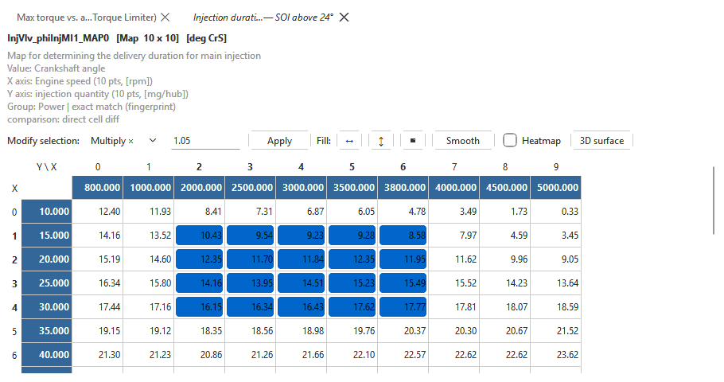
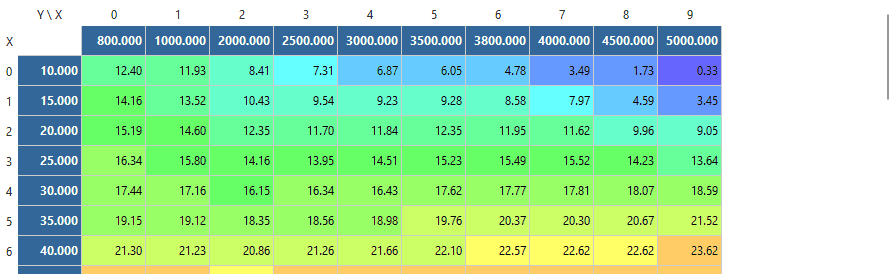

# Tables and editing values

This page covers the table area on the right of the main window: reading a
table, changing its values one at a time or in blocks, and moving values
between tables and tabs. Saving, checksums and undo are on [Editing and
saving](../editing.md).

## Reading a table

### The lines above the grid

The first line, in bold, names the table and says what it is:

`InjVlv_phiInjMI1_MAP0   [Map  10 x 10]   [deg CrS]`

- the symbol (or the parameter's name when it has no symbol);
- for a text parameter (a part number, say), the text it holds, in quotes;
- the kind — **Map** (two axes), **Curve** (one axis, or a single row or
  column of values) or **Value** (a single number) — and its size as shown,
  rows x columns;
- the units of the values;
- `- no match in <file>` when a comparison is open but has no copy of this
  table (see [Comparing files](comparison.md)).

The grey lines under it are the notes:

| Line | Meaning |
|---|---|
| First line | What the table does, from its definition. |
| **Value:** | What the cells hold. |
| **X axis:** / **Y axis:** | What each axis is, with its number of points and units. |
| **Group:** | The tree group it is filed under, then how it was located in this file. |
| **comparison:** | Only with a comparison open: how the comparison's copy lines up. |

How the table was located matters before you change it:

| Shown | Meaning |
|---|---|
| exact match (fingerprint) | Found by a byte pattern unique to it. |
| structure-verified | Its structure in the file confirms it. |
| value-verified | Its bytes equal the reference file's at that place. |
| placed by the ECU's pointer table | Found through the software's own table of addresses. |
| bracketed (layout unchanged around it) | Placed because its neighbours did not move. Check it before writing. |
| PROJECTED - offset model only; check before writing | Placed by calculation only. Check it, for example in the [hex editor](hex-editor.md), before relying on it. |

### The grid

- The **X axis** runs across the top in a dark band and the **Y axis** down
  the left, both in bold white. The corner header reads **Y \ X**.
- The grey header numbers (0, 1, 2 ...) are cell positions, counted from 0.
  Some gearbox tables label their columns and rows instead.
- Values are shown in physical units (Nm, mg, °, rpm ...), with as many
  decimals as the table's resolution allows.
- A curve (one row or one column of values) is shown along X whichever way
  the file stores it.
- With a comparison open, the comparison's copy of the table is underneath,
  below a dark banner. A project tab starts out compared with the original
  as read, so the cells you have changed since the read show in orange. See
  [Comparing files](comparison.md).

Hover over a value to see the comparison's value for that cell, when a
comparison is open.

Cell colours:

| Colour | Meaning |
|---|---|
| Dark blue band, white bold text | Axis breakpoints. |
| Orange | This cell differs from the comparison. |
| Yellow | A cell the [Find panel](search.md) is pointing at. |
| Blue to red | **Heatmap** shading (see below). |

### Swap X and Y axes

**View > Swap X and Y axes** (Ctrl+T) turns every table round, in every
tab: X down the left, Y across the top, and curves shown downwards. It
changes the display only — each value keeps the cell it is stored in, and an
edit lands in the same place either way. The setting is remembered.

### Heatmap

Tick **Heatmap** to shade each cell by its value, from blue (lowest) through
green and yellow to red (highest). With a comparison open, both copies are
shaded on one scale, so equal values get equal colours, and cells that
differ are shown in bold instead of orange. Each table tab remembers its own
heatmap setting; a newly opened table starts with the setting you used last.

The **3D surface** button (Ctrl+3) draws the map as a surface you can
rotate; see [3D surface](3d-surface.md).

**Zoom:** hold Ctrl and turn the mouse wheel over the table, or press
**Ctrl+=** / **Ctrl+-**, to make the cells bigger or smaller; **Ctrl+0** goes
back to the normal size. The size is the same for every tab and table tab,
and is remembered for next time.

## Changing a value

1. Click the cell.
2. Type the new value (typing replaces what is there), or press F2 or
   double-click to change the value that is there.
3. Press Enter to keep it, or Esc to leave the cell as it was.

Values are typed in the units shown. The app converts them to the stored
number, so the cell then shows the value as it was actually stored — rounded
to the table's resolution, and held at the lowest or highest number the
cell can store if you typed something outside that range.

You can also edit the **axis breakpoints**: click a value in the X or Y band
and type, the same way. An axis is often shared by several tables, and
moving a breakpoint changes where every value along it applies, so change
axes deliberately.

Some cells are not numbers:

- **Text** (part numbers, identifiers) is shown one character per cell. Type
  several characters into a cell to fill it and the cells after it; type
  `0x` and two hex digits (for example `0x00`) to store a raw byte.
- **Hex bytes** (patch sites) are shown and typed as two hex digits, such as
  `6C`.
- **Named values** (codings, options) show their name with the stored number
  in brackets, and offer a drop-down list of the names when edited.

The comparison's copy is read-only, and so are the few parameters a
definition marks as not to be edited by hand (such as a cluster's
odometer).

An edit through the grid keeps its table tab open (the preview tab stops
being a preview).

## Changing many cells at once

Select the cells first: drag across them, Shift+click to extend, Ctrl+click
to add single cells, or click a row or column header to take the whole row
or column.

### Modify selection

The **Modify selection** bar applies one operation to every selected value
cell, as one step you can undo:

| Operation | Effect |
|---|---|
| **Set =** | Every selected cell becomes the number. |
| **Add +** | The number is added. |
| **Subtract −** | The number is taken away. |
| **Multiply ×** | Each cell is multiplied by the number (the default, 1.05 = +5%). |
| **Divide ÷** | Each cell is divided by the number (dividing by 0 leaves the cells as they were). |

1. Select the cells.
2. Pick the operation and type the number.
3. Click **Apply**, or press Enter in the number box.

- With **nothing selected**, the operation applies to the **whole table**.
- Only value cells change. Axis cells in the selection are left alone.
- **Set**, **Add** and **Subtract** use the units shown, so `Add + 20` on a
  torque map adds 20 Nm.
- The status bar says how many cells changed, or **No editable cells in
  selection.**

**Edit > Scale selection...** does the same as **Multiply ×** through a
small dialog (**Multiply selected cells by:**), on the table on screen.

### Fill

The **Fill** buttons replace values with a straight-line blend between the
edges of the selection — for smoothing out a step, or filling a region
between two values you have set:

| Button | Fills |
|---|---|
| **↔** | Each row, from the selection's left edge to its right edge. |
| **↕** | Each column, from the selection's top edge to its bottom edge. |
| **▦** | The whole block, from its four corner values. |

**↔** and **↕** keep the values in the selection's edge columns or rows
and recalculate the cells between them; **▦** keeps only the four corner
values and recalculates everything else in the block. Select at least two
cells; a selection with gaps is filled as the rectangle around it. One undo
step.

### Smooth

**Smooth** replaces each selected cell with the average of itself and its
neighbours (up to eight), once. Cells next to the selection are used for the
average but not changed. Press it again for more smoothing; undo if it went
too far. Select at least two cells.

## Copying and pasting

**Edit > Copy cells** (Ctrl+C) copies the selected cells as text, one line
per row with the values separated by tabs, exactly as shown. It pastes
straight into a spreadsheet, and back.

**Edit > Paste cells** (Ctrl+V) pastes such text into the table, with its
top-left value in the top-left selected cell (or the current cell). Values
are read in the units shown. Pasted text that runs past the table's edge is
ignored. Values pasted over axis cells change the breakpoints.

The same **Copy** and **Paste** are on the grid's right-click menu.

### Copying a table from another tab

To copy a table from another open tab — for example to carry a map from one
branch to another, or from another car's project:

1. Open both, each in its own tab (another branch of the same set, or a set
   of another project).
2. In the tab you want to change, open the table.
3. To copy only part of it, select those cells; otherwise select nothing.
4. Use **Edit > Copy values from tab**, or right-click the grid and use
   **Copy selected cells from tab** / **Copy whole table from tab**, and pick
   the other tab.

The other tab's copy of the same parameter is used, found by identity, not
by address. A tab is listed but greyed out when it cannot be used, with the
reason: a different platform, no such parameter there, or a table of a
different size (for example `1 x 16 there, 1 x 12 here`).

When the whole table is copied and the two tabs have different axis
breakpoints, you are asked whether to copy the axes as well:

- **Yes** — the values and their breakpoints, so each value stays at the
  operating point it was calibrated for.
- **No** — the values only, onto this tab's breakpoints.
- **Cancel** — nothing is copied.

The copy is one undo step, and the status bar says how many cells were
copied.

## Undo

Every change — typed, pasted, filled, copied from another tab — can be
undone with **Edit > Undo** (Ctrl+Z) and redone with **Edit > Redo**
(Ctrl+Y). See [Editing and saving](../editing.md#undo-and-redo).

## Gearbox tables

ZF 6HP shift, lockup and tip maps store output-shaft speed. On those tables
the edit bar gains **Show Z as:** (shows the values as output-shaft speed,
engine speed or road speed in km/h or mph — display only; what you type is
converted back), **Vehicle…** (the final drive and tyre
size used for road speed) and, where a table has a second coding bank,
**Copy to other bank**. See the [ZF 6HP](../modules/zf6hp/index.md) module's
help.
