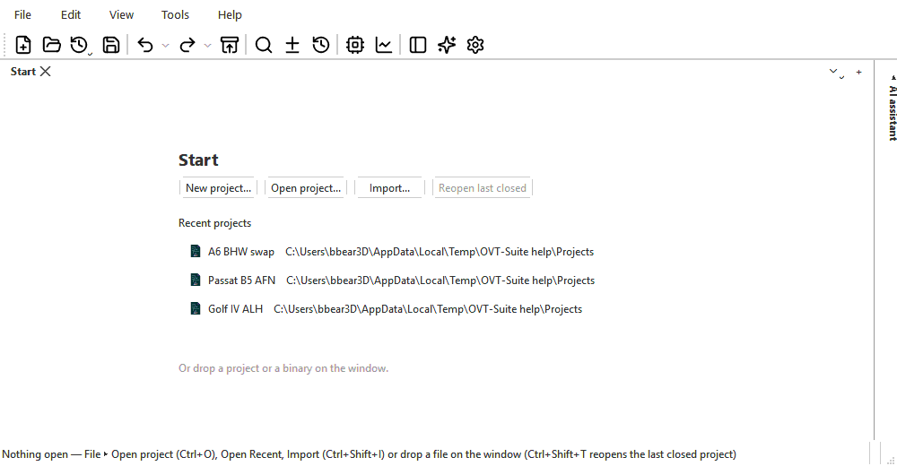
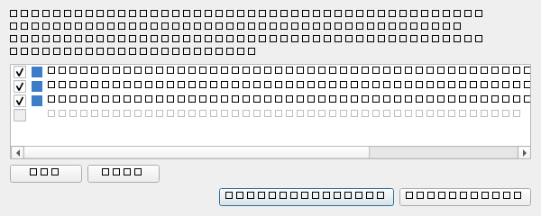
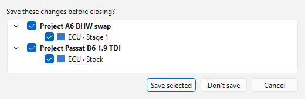

# Tabs and sessions

Everything you work on is a [project](../projects.md), and each part of a
project you open gets a **tab** across the top of the main window. A tab
holds one branch of one set (*A6 ▸ ECU · Stage 1*), its comparison if it has
one, the table tabs you opened in it, and its own tool windows. Several tabs
-- of one project or of several -- can be open at once, and the app
remembers them between sessions.

## Reading a tab

The current tab stands out from the rest: its label is **bold**, its
background is the window's, and a thick bar of its colour runs along its
top. The other tabs have only a thin line of their colour and slightly
dimmed labels.

A tab's label shows:

- a badge for the kind of unit — **ECU**, **TCU**, **HVAC**, **CLU**
  (cluster) or **BIN** (a binary no module recognised) — and a colour to
  match, as a line along the tab's top: engine ECUs blue, gearboxes amber,
  orange or red, Climatronic green, clusters purple, unrecognised binaries
  grey;
- the project, set and branch (*A6 ▸ ECU · Stage 1*), with `*` when it has
  unsaved changes;
- `↔` and the comparison's name, shortened in the middle when it is long —
  a project tab opens with the original as read as its comparison — followed
  by `(closed tab)` when that comparison was another tab and the tab has
  since been closed.

Hover over a tab for the full names, the definition used, whether the
comparison is live, and when the set was last flashed (*Last flashed
<date> (<branch>, saved version | unsaved edits)*).

The window title names the tab in front the same way, with the project's
file name -- *Project [file.ovt] ▸ Set · Branch* -- and `*` when its project
has unsaved changes.

## Opening, switching and closing

| To | Do |
|---|---|
| Start a project | **File > New project...** (Ctrl+N). |
| Open a project | **File > Open project...** (Ctrl+O), **File > Open Recent**, or drop the `.ovt` on the window. |
| Bring a binary into a project | **File > Import** — see [Files and formats](files-and-formats.md#importing). |
| Open a set or branch of an open project | **File > Open from project**, or double-click it in the Project panel. |
| Import a binary, project or definition | The **+** at the right of the tabs: it opens the **File > Import** menu. |
| Switch tabs | Click it, or **View > Next tab** / **Previous tab** (Ctrl+Tab / Ctrl+Shift+Tab). |
| Find a tab when they no longer all fit | The **▾** button beside the **+** lists every open tab. |
| Reorder tabs | Drag them. |
| Close a tab | Its **×**, a middle-click on it, or **File > Close tab** (Ctrl+W). |
| Close a whole project | **File > Close project**. |

An imported binary opens in a **new tab**. **File > Import > Into a new
project, in this tab...** and **Into this project, in this tab...** close the
tab in front first (asking about its unsaved changes) and open the import
where it was.

Closing a tab with unsaved changes asks about that tab (**Save**,
**Discard** or **Cancel**). A project stays open while any of its tabs is,
and closes with the last one: closing a project's last tab is **File > Close
project** -- one question about everything unsaved in the project (that
tab's edits and the project's own changes, such as a new branch or a log),
and **Save** saves the whole project. The window always keeps at least one tab:
closing the last leaves the **start page**.

## The start page

A tab with nothing open shows the start page: **New project...**, **Open
project...**, **Import...** and **Reopen last closed**, and the list of
**Recent projects** -- click one to open it (hover for its full path). You
can also drop a project or a binary anywhere on the window.

Tool windows — the hex editor, the fault-code editor, measuring blocks and
the like, and the differences list — belong to their tab. They hide when you
switch to another tab, come back when you return, and close with the tab.

## One window

OVT-Suite runs in one window. Double-clicking a project (or starting the app
again) while it is running hands the file to the window already open.

**File > New window** starts another, separate window (from a command line:
`gui --new-instance`). A project open in one window cannot be opened in
another — the second window says so — so two windows never overwrite each
other's saves.

## Bringing projects back

### Restore project from history

Closing a project — **File > Close project**, or closing its last tab —
puts it in the history as one entry, with the tabs it had.
**File > Restore project from history** lists the projects closed most
recently (up to 15), newest first, each with its vehicle, the tabs it had,
and when it was closed — just the time for today, the date and time before
that. Pick one to reopen it with:

- its tabs and their comparisons — re-linked live where the other tab is
  open, the same saved version where a tab compared against its own history;
- their table tabs, kept and preview, with their heatmap settings.

A tab closed while its project stays open is not listed: the Project panel
reopens any branch. A project whose file has gone is greyed out and cannot be
picked. **Clear history** empties the list.

**File > Reopen last closed project** (Ctrl+Shift+T) reopens the newest one
that still exists and is not open already.

### Reopening last session's projects

When the app starts without a file to open, it offers the **projects** that
were open when it last closed -- one line each, with the vehicle and the
tabs it had (*A6 -- Audi A6 (C6) 2006 (ECU · Stage 1, TCU · Stock)*).

Every project that still exists is ticked. Loading takes a few seconds per
tab, so untick the ones you do not need now. **All** and **None** tick or
untick every one. A project that is missing, or one that was never saved, is
listed greyed out and cannot be ticked.

- **Reopen selected** -- reopens each ticked project with the tabs it had,
  their comparisons (re-linked to each other where both tabs came back),
  their table tabs, and the tab that was active.
- **Start empty** -- opens none of them.

This question (and **Recover unsaved work**, after a crash) comes before
anything else, on the screen the window was on last time. Then a small window
with the app's icon and version says what it is doing -- loading the modules,
then which project it is reopening (*A6 BHW swap (1 of 3)*) -- and closes
when the app is ready.

To reopen them all without being asked, or never to be offered them, change
**At start-up, last session's projects** in **Tools > Options... > General**
(see [Options](../options.md#general)).

The list is saved again each time the app closes, so projects you chose not
to reopen are not offered next time unless you open them again. A project
opened later by hand (**File > Open Recent**) still opens with the tabs it
last had.

## Recent projects

**File > Open Recent** lists the projects you opened, newest first; hover
over one for its full path. Projects that no longer exist are left out, and
one that fails to open is taken off the list. **Clear list** empties it. It
keeps 12 projects; **Recent files listed** in **Tools > Options... >
General** changes that.

**File > Import recent as comparison** lists the binaries and project
versions you compared against lately. **Clear comparison history** empties
it.

The file pickers start in the folder you last picked a file from.

## Closing the app

If any project has unsaved changes, closing the window lists them: each
project, with its edited tabs under it — and **The project's own changes
(branches, logs, ...)** when it has any.

Everything is ticked to be saved. Tick a project to save all of it, or tick
only some of its tabs; each project is written once.

- **Save selected** — saves what is ticked (correcting checksums, as any save
  does) and discards the rest. If a save needs a name and you cancel, or a
  save fails, the window stays open.
- **Don't save** — closes without saving any of them.
- **Cancel** — keeps the window open.

The open projects are then remembered for next time.
