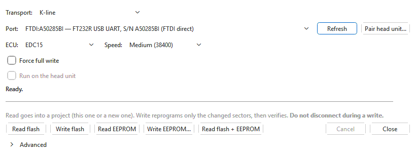
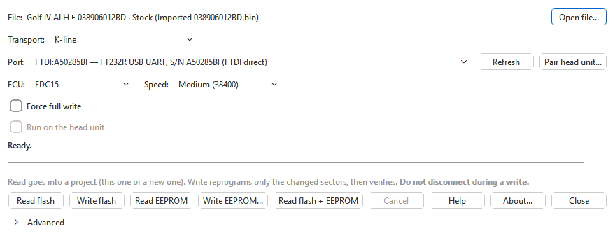

# ECU read / write

The flasher reads a control unit's memory into a project and writes an
edited binary back to it, over a K-line cable or a CAN (J2534) interface. It handles Bosch
EDC16 and EDC15 engine ECUs, ZF 6HP and Aisin transmission units, Audi 4F/4L
Climatronic, instrument clusters and the C6 ESP8 ABS unit — what each one can
do differs, see [the control units](#what-each-control-unit-can-do) below.

> **Writing is the one thing in this app that can leave a car undriveable.**
> Read [Before you start](flashing/before-you-start.md) before your first
> write, and always keep a read of the unit, saved, from before you change
> anything.

## Opening the flasher

- In the main window: **Tools > ECU read / write...** (Ctrl+E). A write sends
  the binary in the **active tab**; every read goes into a project and opens
  in a tab (see [Reading](flashing/reading.md)).
- On its own, without the main window: the **OVT Flasher** shortcut that the
  Windows installer adds, or `ovtsuite --flasher` (optionally followed by a
  file name) from a terminal. The OVT Flasher has a **File** row to choose
  what to write — an `.ovt` project, or a binary — and saves every read as an
  `.ovt` project by default, or as the raw image. After a write from a
  project it marks the version written as last flashed in that `.ovt`. Its
  **Help** button opens this page.

The OVT Flasher is the same dialog with a **File** row added and **Help** /
**About...** buttons:

The dialog picks the **ECU** entry for the binary in the active tab by itself
(EDC16, EDC15, ZF 6HP, Climatronic or VDO cluster); otherwise it starts with
the selections you used last time.

## Reading a control unit — the short version

1. Connect the cable to the car (or bench) and the computer, ignition on,
   engine off.
2. Choose the **ECU** first. Units that only talk over CAN switch
   **Transport** to **CAN / TP 2.0** by themselves, and EDC15 and the VDO
   cluster switch it to **K-line**. Changing **Transport** to one a unit
   cannot use selects **EDC16**, the one entry that works on both.
3. Pick the cable in **Port** (K-line) or **Device** (CAN). Click **Refresh**
   if you plugged it in after opening the dialog.
4. Click **Read flash**. (The Climatronic cannot be read over OBD; it only
   offers **Write flash**.)
5. The read goes into a project: save it straight away — it is your backup.

Details: [Reading](flashing/reading.md).

## Writing — the short version

1. Open (or read) the project and make your changes in the main window.
2. Open the flasher; check **ECU**, **Transport** and the cable.
3. Click **Write flash**. If the tab has unsaved changes you are asked to
   **Save, then write**, **Write without saving** or **Cancel**. When the
   version is set up for other hardware than the project records as fitted
   (see [Fitted hardware](projects.md#fitted-hardware)) you are warned first:
   **Write anyway** or **Cancel**. Read the confirmation carefully before
   answering **Yes**.
4. Do not touch the car, the cable or the computer until the dialog says the
   write is complete. Then follow what the final message says (an EDC16, for
   example, asks you to switch the ignition off for 5 seconds). The version
   written is marked in the project as last flashed.

The flasher writes only the parts that differ from what is in the unit
(where the unit can tell), has the unit check each part afterwards, and
corrects the binary's checksum first when the module for that unit is
installed; when it cannot, it asks before writing. Details:
[Writing](flashing/writing.md).

## The dialog, control by control

| Control | What it does |
|---|---|
| **File** / **Open file...** | OVT Flasher only: what a write sends (**No file chosen** until you open one) — an `.ovt` project, or a binary or container (`.bin`, `.ori`, `.sgo`, `.dim`, `.frf`, `.hvac`, and the older `.edc16`, `.edc15`, `.6hp`, `.edc15bak`). A project with several binaries, branches or versions asks which to write; the label then shows *project ▸ set · branch (version)*. An EDC15 file with an EEPROM — an `.edc15`, an old KWHack `.edc15bak`, or an EDC15 set of a project — loads both its flash and its EEPROM. |
| **Transport** | **K-line**, or **CAN / TP 2.0 (J2534 / OpenPort)**. Next to it on CAN: the CAN bit rate (500000 bit/s unless you have a reason to change it). |
| **Port** / **Device** | The cable or interface. K-line lists serial cables, FTDI cables driven directly, J2534 devices (marked **(J2534)**) and paired head units; CAN lists J2534 devices, an OpenPort on USB and CAN-capable head units. See [Cables and interfaces](cables.md). |
| **Refresh** | Scans for cables again. The list says **Scanning for devices...** while it looks. |
| **Pair head unit...** | Adds a KW-Dash head unit, so the cable plugged into it appears in the list. See [Head units](flashing/head-unit.md). |
| **ECU** | The kind of control unit. This decides which buttons and options appear. |
| **Speed** | K-line speed for EDC16 and EDC15; greyed out on CAN and for units with a fixed speed. See [Speed](#speed-and-init). |
| **Force full write** | Rewrite everything the write covers, without first asking the unit which parts already match. |
| **Run on the head unit** | Only with a paired head unit and an EDC16 or EDC15: the head unit runs the whole job by itself, so a dropped connection does not stop it. |
| **Disable Fast Init** | K-line, EDC16 only: use the 5-baud slow init instead of fast init. |
| **Blocks:** | EDC16 only: which regions **Write blocks...** writes. See [EDC16](flashing/edc16.md). |
| Status line, timer and bar | What the flasher is doing now, the elapsed time, and the progress. |
| Grey note | A short summary of what Read and Write do for the selected unit. |
| **Cancel** | Asks a running job to stop. Do not use it during a write unless something is clearly wrong — see [Writing](flashing/writing.md#cancel-during-a-write). |
| **Close** | Closes the dialog (not while a job runs). Your selections are remembered. |
| **Advanced** | Rarely needed diagnostics and recovery: EDC15 boot mode and internal-ROM read; the EDC16 probes (boot read-level, checksum-range, security level, RAM / coding, immo / coding, Find EEPROM) and GPT crank/cam test; for the Cluster and ABS, the CAN-traffic log and bus probe; and the ZF6HP **Transport:** override. See [Advanced and diagnostic tools](flashing/advanced.md). |

Buttons and options that appear only for some units (the EDC15 EEPROM and
backup buttons, EDC16 **Write blocks...** and **Full read...**, the ZF6HP's
**Calibration only** for a 6HP28, the Climatronic's **Write changed sectors only**) are
described on the page for that unit.

## What each control unit can do

| ECU entry | Transport | Read | Write | Page |
|---|---|---|---|---|
| **EDC16** | K-line or CAN | Calibration (top 512 KB); full read (whole flash + MPC) | Calibration blocks; boot / program / MPC blocks (armed, high risk) | [EDC16](flashing/edc16.md) |
| **EDC15** | K-line | Whole 512 KB flash; EEPROM; flash + EEPROM | Changed sectors; EEPROM; flash + EEPROM; boot mode | [EDC15](flashing/edc15.md) |
| **Climatronic** | CAN | No (it cannot be read over OBD) | The Climatronic set in the active tab, or a `.sgo` / `.hvac` file | [Other units](flashing/other-units.md#climatronic) |
| **Cluster** | CAN | Experimental flash dump | No | [Other units](flashing/other-units.md#cluster-can) |
| **Cluster (VDO K-line)** | K-line | 2 KB EEPROM | The whole 2 KB EEPROM, read back and verified (no automatic backup) | [Other units](flashing/other-units.md#cluster-vdo-k-line) |
| **ABS** | CAN | Flash dump | No | [Other units](flashing/other-units.md#abs) |
| **ZF6HP** | CAN (TP 2.0 or UDS, picked for you) | Calibration window (6HP19 / 6HP26); calibration (6HP28) | Calibration areas (6HP19 / 6HP26); calibration, or program + calibration (6HP28) | [Transmissions](flashing/transmissions.md#zf6hp) |
| **Aisin TRx** | CAN | Whole 1 MB flash | No (disabled in this version) | [Transmissions](flashing/transmissions.md#aisin-trx) |

Reading and writing never need a module: the flasher supports every unit on
its own. A [module](modules.md) is needed to correct the checksum of an edited
binary before it is written, and to show its tables.

## Speed and init

**Speed** applies to K-line only:

| ECU | Low | Medium | High |
|---|---|---|---|
| EDC16 | 38400 | 124800 | 244898 |
| EDC15 | 10400 | 38400 | 124800 |

- Start with **Medium**. Use **Low** if the connection drops or a transfer
  fails part-way.
- For EDC16, **High** is offered only for cables that can hold it: it is
  removed for CH340/CH341 cables and for J2534 devices (both are limited to
  Medium), and for a head unit whose cable cannot do it.
- EDC15 EEPROM reads and writes always run at the low speed, whatever you
  choose.

**Disable Fast Init** (K-line, EDC16): by default the flasher wakes the ECU
with the ISO 14230 fast init, which the later EDC16 ECUs need, and falls back
to the 5-baud slow init if fast init gets no answer. Tick it to use only the
slow init, for older ECUs that want it. With a J2534 device the box is greyed
out: the device does the fast init in hardware. EDC15 and the VDO cluster
always use the slow init, so the box is not shown for them.

## Remembered settings

Each ECU entry keeps **its own** settings: the transport, the speed, the CAN
rate, the EDC16 block ticks and the ZF 6HP transport choice -- and the cable
you last used **for each combination of ECU and transport**. Opening the
flasher from an engine tab and then from a gearbox tab brings back each
one's own setup, not whichever was used last; so does picking another entry
in **ECU** (the one you leave is remembered first). With no file open, the
entry used last is selected. Whether **Advanced** was open is remembered
too.

## More

- [Before you start](flashing/before-you-start.md) — battery, power, backups.
- [Reading](flashing/reading.md) and [Writing](flashing/writing.md).
- [Backups and recovery](flashing/backups-and-recovery.md) — what to do if a
  write is interrupted.
- [Troubleshooting the flasher](flashing/troubleshooting.md).
- [Cables and interfaces](cables.md).
