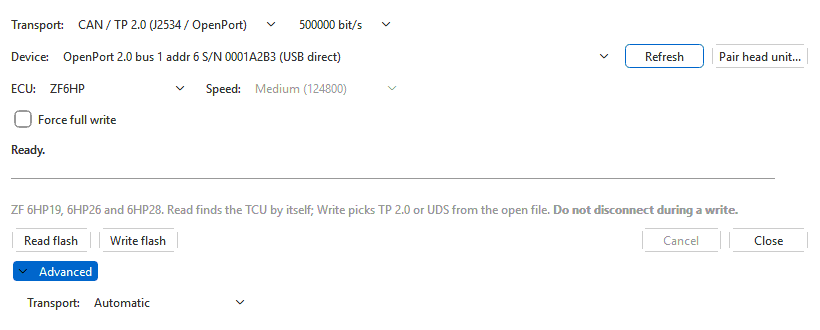

# Advanced and diagnostic tools

Besides reading and writing, the flasher has buttons for diagnosis and
recovery. You do not need any of these for an ordinary read, write or backup.
Most are read-only probes used while support for a unit is worked out; they
are safe but of no use unless you know what they report.

## The Advanced section

The **Advanced** disclosure at the bottom hides the controls that are rarely
the right answer: EDC15 **Boot mode** and **Read internal ROM**, the
Cluster and ABS troubleshooting aids ([below](#cluster-and-abs)), and the
ZF6HP **Transport:** override ([below](#zf6hp)). Its tooltip
says *Diagnostics and recovery. Nothing here is needed for an ordinary read,
write or backup.* It is always on screen, so the window keeps its
shape, but it is greyed out (with a tooltip saying so) for a unit with nothing
in it; only EDC15, Cluster, ABS, the VDO cluster and ZF6HP have something.
Opening it makes the window taller, never wider, and closing it brings the
window back to exactly the size it had. Whether it is open is remembered.
While EDC15 **Boot mode** or **Probe the bus instead of reading** is ticked,
or the ZF6HP **Transport:** is not **Automatic**, the section will not
collapse, so a setting that changes what Read or Write does is never out of
sight.

## EDC15

- **Read internal ROM** reads the processor's own 32 KB boot ROM over the
  normal K-line session (no boot pin, no boot mode). It is checked for the
  silent every-other-byte-doubled failure before it is saved, and you are
  warned to re-read if the dump looks suspect — a bad read of this ROM can
  look like a good one. With a project in front you are asked whether to
  keep the dump in it, as an attachment, or save it as a file. Greyed out
  while **Boot mode** is ticked.
- **Boot mode** is on the [EDC15 page](edc15.md#boot-mode).

## EDC16

EDC16 has nothing in its **Advanced** section. **Read full...** and **Write full...**
are on the main button row (see [EDC16](edc16.md#blocks)).

The research probes that were once in this section are switched off. They
were built to answer questions about the ECU while EDC16 support was worked
out: whether any security level reads the boot area (none does), which ranges
the ECU's checksum routine verifies, which security levels exist, RAM, coding
and immobiliser reads, finding the EEPROM, and a crank/cam signal test with a
Scanmatik SM2. Those questions are answered, and none of the probes is needed
to read, write or tune an ECU.

## Cluster and ABS

With **Cluster** or **ABS** selected, the **Advanced** section has a
troubleshooting aid. It is not offered for any other unit. (To capture the
CAN frames of a Cluster or ABS read, for a security exchange say, turn on the
[flash trace](#tracing-a-session); it covers every unit.)

- **Probe the bus instead of reading** turns **Read flash** into a probe: it
  sends one TP 2.0 setup to the unit's address at the chosen CAN rate and
  reports every frame seen for about two seconds — to find out whether the
  unit answers, and on which CAN id. Nothing is read or changed. Set the CAN
  rate to **100000** to test the C6 comfort CAN. While it is ticked the
  **Advanced** section stays open.

## Tracing a session

When a read or write fails and the message does not say why, the **flash
trace** keeps what the cable carried, for you to look at or to send with a
report. It is one setting for the whole flasher, in **Tools > Options >
Flasher** (see [Options](../options.md#flasher)); it is **off** until you turn
it on, and it never changes what is sent.

While it is on, every read and write of any unit, over any cable, writes to
one file:

- the CAN frames (each marked as sent by you or by the unit) and, on a K-line,
  the bytes each way;
- the flasher's own status messages and the result, or the error message, as
  comment lines with the time.

The file is **added to** from one session to the next (each starts with a
header line naming the unit and the job). It loads straight into the
[Bus Sniffer](../sniffer.md); the comment lines are skipped there. By default
it is `flash-trace.log` in the **Flash trace** folder of a folder named for the app in your Documents folder;
set another file in the options, or **Default** to go back.

The file never grows past the **largest trace file** you set (25 MB to start
with). When it reaches it, it is renamed `flash-trace.log.1`, an older
`.1` becomes `.2`, and so on, a new file starts, and only the newest
**older trace files kept** are kept (3 to start with; 0 just empties a full
file). So the most it can take is the limit times one more than that.

Through a 32-bit J2534 driver the CAN frames are written by the helper
program that runs the driver, so while the read or write runs they are in a
second file beside the first (`flash-trace-bridge.log`, with the same limit).
When the job ends they are added to the trace, after its status messages
(the sniffer sorts by time), and that file is deleted, so one file is left.
If the app closes in the middle of a job, the frames stay in the second file
and are added at the end of the next traced job.

## ZF6HP

**Transport:** chooses how the flasher talks to a ZF 6HP:

| Choice | Read flash | Write flash |
|---|---|---|
| **Automatic** (default) | TP 2.0 first; UDS only when nothing answers over TP 2.0 | TP 2.0 or UDS, from the open file |
| **TP 2.0 (6HP19 / 6HP26)** | TP 2.0 only | TP 2.0 |
| **UDS (6HP28)** | UDS only | UDS |

Leave it on **Automatic** unless a write's confirmation says the transport
was guessed and the guess is wrong, or you know the automatic read picks the
wrong way for your TCU. The choice is remembered. See
[Transmissions](transmissions.md#which-transport) for how Automatic decides.
