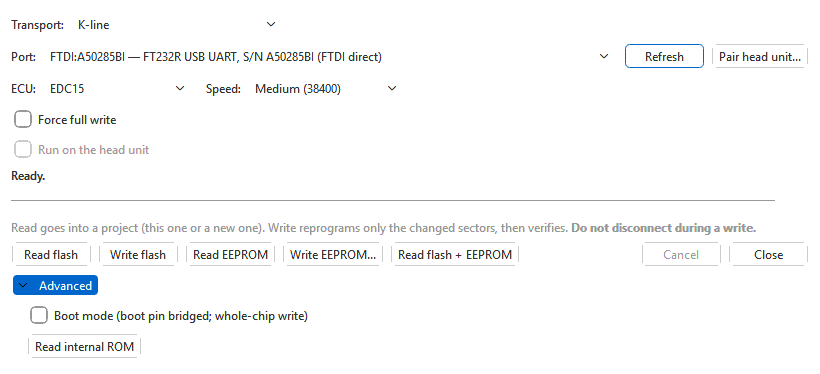

# EDC15 engine ECUs

Choose **EDC15** for Bosch EDC15 TDI ECUs (EDC15VM+, EDC15P). They are
**K-line only**: use a KKL cable or a J2534 device on the **K-line**
transport. The ECU is always woken with the 5-baud slow init, so **Disable
Fast Init** is not shown. The [EDC15 module](../modules/edc15/index.md) adds
the tables, the checksum correction and the EEPROM editor.

**Speed**: **Low (10400)**, **Medium (38400)**, **High (124800)**. EEPROM
reads and writes always run at the low speed.

## Flash

**Read flash** reads the whole 512 KB flash into a project (see
[Reading](reading.md#where-the-read-goes)).

**Write flash** writes the binary in the active tab. The flasher loads a small program into
the ECU's RAM, has it compute a checksum of each of the 11 flash sectors, and
erases and programs only the sectors that differ from the file. Afterwards
every written sector is checked again; a mismatch stops with an error naming
the sector. **Force full write** skips that comparison and rewrites all 11
sectors.

The image must be exactly 512 KB and recognisable as an EDC15 image. With the
EDC15 module installed its checksums are corrected first, and a file whose
checksum ranges cannot be read is refused rather than written with guessed
ones.

### An ECU that no longer starts normally

If a previous write was interrupted, the ECU may answer in a recovery state
instead of its normal one. The flasher recognises this when it connects —
the status line says *ECU is soft-bricked (KWP2000 boot stub) -- switching to
recovery mode...* — and carries on, so **Write flash** with your backup is
the first thing to try. See [Backups and recovery](backups-and-recovery.md#edc15).

## EEPROM

The EEPROM (512 bytes) holds the immobiliser data, the VIN and the odometer
among others.

- **Read EEPROM** reads it into a project. With an EDC15 project in front you
  are asked **Add to <project>** — a new branch of its ECU set, named
  *EEPROM read <date>*: the flash of the version in front plus the EEPROM
  just read — or **New project** (or **Export to file...** to save it
  without opening it). Opened, the EEPROM editor then shows it (with the
  EDC15 module). The OVT Flasher saves the read as an `.ovt`
  project (or the raw 512 bytes).
- **Write EEPROM...** asks for a 512-byte EEPROM file (`.bin`, `.eep`,
  `.rom`) and writes it. When an EEPROM is already loaded — the set in the
  active tab holds one (a **Read flash + EEPROM**, an EEPROM read, an imported `.edc15`
  that carries one), or it was opened from the EEPROM editor — the button
  reads **Write EEPROM** and writes that one instead.

Before writing, the confirmation shows what the EEPROM file contains: VIN,
immobiliser on/off, immobiliser ID, SKC and odometer. Only the bytes that
differ from the ECU's EEPROM are written; the EEPROM is then read back and
compared, and the result is shown decoded.

> An EEPROM from another ECU or car carries that car's immobiliser data.
> Check the values in the confirmation before you answer **Yes**.

## Read flash + EEPROM

**Read flash + EEPROM** reads the flash, waits 10 seconds while the ECU restarts,
then reads the EEPROM, and puts both into a project as one set — the flash
for editing, the EEPROM held for the EEPROM editor. In the OVT Flasher it is
saved as an `.ovt` project by default; save it that way, because the other
choice, a raw `.bin`, keeps only the flash.

The app never writes KWHack's `.edc15bak` backups. It still imports them —
see [Files and backups](../modules/edc15/backups.md).

When the set in the active tab holds an EEPROM — a **Read flash + EEPROM**, an EEPROM
read, an imported `.edc15` or `.edc15bak` (in the OVT Flasher, the file
chosen with **Open file...**) — **Write flash + EEPROM** appears: it writes
the changed flash sectors, waits 10 seconds, then writes the EEPROM.

## Boot mode

**Advanced > Boot mode (boot pin bridged; whole-chip write)** talks to the
flash chip through the processor's own bootstrap loader instead of the ECU's
software. It is for the bench, for an ECU whose software no longer runs at
all:

1. Power the ECU up **with its boot pin bridged**. Where that pin is depends
   on the ECU's board; this help does not cover opening the ECU.
2. Tick **Boot mode**. **Speed**, **Force full write**, the EEPROM buttons,
   **Read flash + EEPROM** and **Read internal ROM** are greyed out — boot mode
   cannot reach the EEPROM.
3. **Read flash** reads the whole chip. **Write flash** erases the **whole
   chip** and then writes every block; the confirmation says so.

While **Boot mode** is ticked the **Advanced** section stays open, so the
setting is never hidden. Untick it to go back to normal reads and writes.

## Through a head unit

With a paired head unit, **Run on the head unit** is offered for flash reads
and writes, EEPROM reads and writes, **Read flash + EEPROM**, **Write flash +
EEPROM** and boot mode. See [Head units](head-unit.md).

## See also

- **Read internal ROM** — in [Advanced and diagnostic
  tools](advanced.md#edc15).
- [Backups and recovery](backups-and-recovery.md#edc15).
