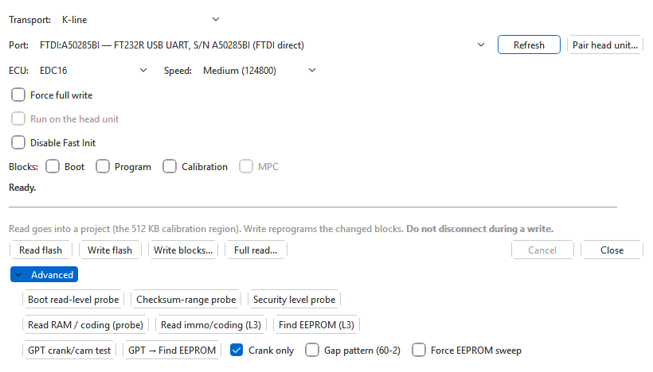

# EDC16 engine ECUs

Choose **EDC16** for Bosch EDC16 TDI ECUs. They talk over **K-line** (a KKL
cable or a J2534 device) or, the later ones, over **CAN / TP 2.0** (a J2534
device or an OpenPort 2.0). Both transports offer the same buttons. The
[EDC16 module](../modules/edc16/index.md) adds the tables and the checksum
correction.

With EDC16 selected the button row holds **Read flash**, **Write flash**,
**Write blocks...** and **Full read...**. The
diagnostic probes and the GPT test are in the **Advanced** section (shown
expanded above; described in [Advanced and diagnostic
tools](advanced.md#edc16)).

## Everyday use: the calibration

**Read flash** reads the 512 KB calibration region (0x180000–0x1FFFFF) — the
part of the flash that holds the maps — and puts it into a project as a 2 MB
image with everything below the calibration filled with 0xFF.

**Write flash** writes the calibration of the binary in the active tab back. It covers the
two calibration blocks (0x180000–0x1BFFFF and 0x1C0000–0x1FDFFF); the boot
and program areas are not touched. For each block the ECU first checks
whether it already holds the file's data; a matching block is skipped, the
others are erased, written and checked by the ECU. Tick **Force full write**
to rewrite both blocks regardless.

The file may be 512 KB, 1 MB or 2 MB; its last 512 KB must be a recognisable
EDC16 calibration. With the EDC16 module installed the checksums are
corrected before the write.

When it finishes: **Turn off the ignition for 5 seconds.** The ECU does not
restart itself after a write; the ignition cycle does that.

> If the ECU rejects its own check after a block, the write still completes
> but leaves a warning in the status line, which is easily overwritten. Read
> the ECU again after every write and compare — see
> [Writing](writing.md#verification).

### K-line: speed and init

- **Speed**: **Low (38400)**, **Medium (124800)**, **High (244898)**. High is
  offered only for cables that can hold it (not CH340/CH341, not J2534).
- The way the ECU is woken for a **write** is chosen from the file: ECUs of
  families that accept a cold 5-baud init get one; the later CAN-init
  families are first woken with a fast init; for a family the app does not
  know, it tries the 5-baud init and falls back to the fast-init wake-up if
  that is ignored. You normally leave **Disable
  Fast Init** unticked; tick it only for an older ECU that answers the 5-baud
  init alone.

### CAN

Over CAN the speed box is greyed out and the read is made in 64 KB pieces.
Leave the CAN rate at **500000 bit/s**.

## Full read

**Full read...** reads the **whole** 2 MB external flash and the ECU's
internal (MPC) flash and opens both as one set of a project (see
[Reading](reading.md#where-the-read-goes)). It writes nothing. It takes much longer than a calibration read.

The boot area cannot be read over the diagnostic port. When the optional
**EDC16 boot-sector database** add-on has a match for the ECU's software, the
read carries that boot area (a message says whether the
match was exact or approximate); otherwise the boot area is left as 0xFF and
the message says so. See the [EDC16 module](../modules/edc16/index.md) for
the add-on.

## Blocks and Write blocks

> **High risk.** This writes the ECU's code, not only its maps. A failed or
> interrupted erase of the boot or program area can leave the ECU unable to
> start, and the app's own warning says recovery is then by BDM (a bench
> programmer). Use it only if you know why you need it.

The **Blocks:** row chooses what **Write blocks...** erases and rewrites:

| Box | Region |
|---|---|
| **Boot** | The boot block (0x10000–0x3FEFF). Highest risk; written first when ticked. |
| **Program** | The program area. |
| **Calibration** | The two calibration blocks. |
| **MPC** | The internal flash. Needs a set that holds it (a **Full read...**, or an imported `.dim`, `.edc16` or `.sgo` that carries it). |

A box can only be ticked when the set in the tab actually contains data for that
region — a blank region is never offered, so it cannot be written over a good
one. Your ticks are remembered.

Each ticked block is first checked by the ECU and skipped if it already
matches, unless **Force full write** is ticked. The confirmation, **Write
blocks — ARM**, lists the blocks and repeats the warning; with **Boot** ticked
it says so in capitals. Afterwards: ignition off for 5 seconds; if the ECU
does not start, restore it via BDM.

## Through a head unit

With a paired head unit selected, **Run on the head unit** is available and
ticked by default for reads and writes: the head unit runs the whole job and
the computer only watches. The head unit has jobs for **Read flash** and
**Write flash** only: untick the box before using **Write blocks...**,
**Full read...** or a diagnostic button in **Advanced**, or the flasher stops with a
message asking you to. See [Head units](head-unit.md).

## See also

- [Advanced and diagnostic tools](advanced.md#edc16) — what the extra
  EDC16 buttons are, and why you do not need them for tuning.
- [Backups and recovery](backups-and-recovery.md#edc16).
