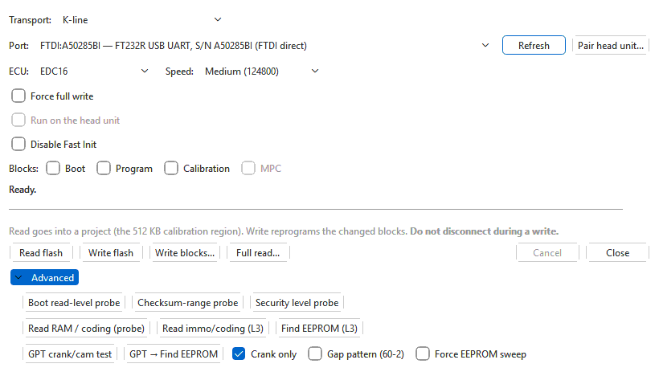

# EDC16 engine ECUs

Choose **EDC16** for Bosch EDC16 TDI ECUs. They talk over **K-line** (a KKL
cable or a J2534 device) or, the later ones, over **CAN / TP 2.0** (a J2534
device or an OpenPort 2.0). Both transports offer the same buttons. The
[EDC16 module](../modules/edc16/index.md) adds the tables and the checksum
correction.

With EDC16 selected the button row holds **Read calibration**, **Write
calibration**, **Read full...** and **Write full...**. The two full
operations ask which blocks to use when you choose them (see
[Blocks](#blocks)). EDC16's **Advanced** section is empty (greyed out): the research probes that used to be
there are switched off (see [Advanced and diagnostic tools](advanced.md#edc16)).

## Everyday use: the calibration

**Read calibration** reads the 512 KB calibration region (0x180000–0x1FFFFF) — the
part of the flash that holds the maps — and puts it into a project as a 2 MB
image with everything below the calibration filled with 0xFF.

**Write calibration** writes the calibration of the binary in the active tab back. It covers the
two calibration blocks (0x180000–0x1BFFFF and 0x1C0000–0x1FDFFF); the boot
and program areas are not touched. For each block the ECU first checks
whether it already holds the file's data; a matching block is skipped, the
others are erased, written and checked by the ECU. Tick **Force full write**
to rewrite both blocks regardless.

The file may be 512 KB, 1 MB or 2 MB; its last 512 KB must be a recognisable
EDC16 calibration. With the EDC16 module installed the checksums are
corrected before the write, content digest included (the digest is always
checked and written; it is not an option). An image the editor has already
found correct, or that you saved with its checksums corrected, is not worked
out again when you press Write.

When it finishes: **Turn off the ignition for 5 seconds.** The ECU does not
restart itself after a write; the ignition cycle does that.

> If the ECU rejects its own check after a block, the write still completes
> but leaves a warning in the status line, which is easily overwritten. Read
> the ECU again after every write and compare — see
> [Writing](writing.md#verification).

### K-line: speed and init

- **Speed**: **Low (38400)**, **Medium (124800)**, **High (244898)**. High is
  offered only for cables that can hold it (not CH340/CH341, not J2534).
- The way the ECU is woken for a **write** is chosen from the file: ECUs of
  families that accept a cold 5-baud init get one; the later CAN-init
  families are first woken with a fast init; for a family the app does not
  know, it tries the 5-baud init and falls back to the fast-init wake-up if
  that is ignored. You normally leave **Disable
  Fast Init** unticked; tick it only for an older ECU that answers the 5-baud
  init alone.

### CAN

Over CAN the speed box is greyed out and the read is made in 64 KB pieces.
Leave the CAN rate at **500000 bit/s**.

## Blocks

**Read full...** and **Write full...** first open a small window with a box
for each block:

| Box | Region | Read | Write |
|---|---|---|---|
| **Boot** | The boot block (0x10000–0x3FEFF) | Not over the diagnostic port: filled from the boot database (below) | Highest risk; written first when ticked |
| **Program** | The program area (0x40000–0x17FFFF) | Yes | Yes |
| **Calibration** | The two calibration blocks (0x180000–0x1FFFFF) | Yes | Yes |
| **MPC** | The processor's internal flash | Yes (0x404000–0x47FFFF) | Needs a set that holds it (a **Read full...**, or an imported `.dim`, `.edc16` or `.sgo` that carries it) |

- **Read full...** offers **Program**, **Calibration** and **MPC**, and
  **Boot** when the boot database is installed. The first time, every block
  that can be read is ticked.
- **Write full...** offers only the blocks the file or project in the tab
  holds; the others are greyed out. The first time, every block it holds is
  ticked, **Boot** included -- a warning under the boxes says so, and the
  confirmation repeats it in capitals. Untick it unless you mean to rewrite
  the boot.
- After that, each window opens with what you ticked the last time (less any
  block it cannot offer now).

## Read full

**Read full...** reads the ticked blocks and opens them as one set of a
project (see [Reading](reading.md#where-the-read-goes)): the external flash as
a 2 MB image, 0xFF wherever a block was not ticked, and the internal flash
when **MPC** is ticked. It writes nothing. With every readable block ticked
it takes much longer than a calibration read.

The boot area cannot be read over the diagnostic port, so the ECU is never
asked for it. With **Boot** ticked, the read fills it from the optional
**EDC16 boot-sector database** add-on when that has a match for the ECU's
software (a message says whether the match was exact or approximate);
otherwise the boot area is left as 0xFF and the message says so. The match
comes from the program, so tick **Program** with **Boot**. See the
[EDC16 module](../modules/edc16/index.md) for the add-on.

Only the parts of each block that exist on the ECU are asked for: the boot
area is never requested, and the internal flash is read from 0x404000 up to
its end at 0x47FFFF (the image keeps 0xFF before and after it, as every
`.mpc` does). If the ECU still refuses part of a block, that part is left as
0xFF and the message counts the refused ranges (the log names them). If the ECU stops answering,
the read stops with an error instead of handing back a partial image.

## Write full

> **High risk.** This writes the ECU's code, not only its maps. A failed or
> interrupted erase of the boot or program area can leave the ECU unable to
> start, and the app's own warning says recovery is then by BDM (a bench
> programmer). Use it only if you know why you need it.

**Write full...** erases and rewrites the ticked blocks, in the order boot,
program, MPC, calibration. Only blocks the set in the tab holds can be ticked, so a blank region is
never written over a good one.

Each ticked block is first checked by the ECU and skipped if it already
matches, unless **Force full write** is ticked. The confirmation, **Write
full — ARM**, lists the blocks and repeats the warning; with **Boot** ticked
it says so in capitals.

Each block is erased before it is written, and the bar stays still while the
ECU erases: about 30 seconds for the program, a few seconds for the MPC and
each half of the calibration. The status line says which block is being
erased; the clock keeps counting. A whole write of every block takes about
8 minutes.

Afterwards: ignition off for 5 seconds; if the ECU
does not start, restore it via BDM.

## Through a head unit

With a paired head unit selected, **Run on the head unit** is available and
ticked by default for reads and writes: the head unit runs the whole job and
the computer only watches. The head unit has jobs for **Read calibration** and
**Write calibration** only: untick the box before using **Read full...**
or **Write full...**, or the flasher stops with a message asking you to. See [Head units](head-unit.md).

## See also

- [Advanced and diagnostic tools](advanced.md#edc16) — the EDC16 research
  probes, and why they are switched off.
- [Backups and recovery](backups-and-recovery.md#edc16).
