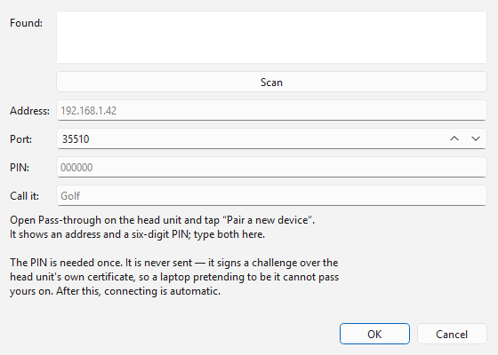

# Head units (KW-Dash pass-through)

A KW-Dash head unit can hold the cable in the car while this computer reaches
it over Wi-Fi or Bluetooth. Once paired, the head unit's cable is one more
entry in the **Port** / **Device** list, and you use it like any other.

## Pair head unit...

Click **Pair head unit...** to add one. You pair a head unit once; after that
the computer connects to it by itself.

1. On the head unit, open **Pass-through** and tap **Pair a new device**. It
   shows an address and a six-digit PIN.
2. In this dialog, either press **Scan** to find head units on the network and
   pick one from the **Found** list, or type the **Address** and **Port** by
   hand.
3. Type the **PIN** from the head unit's screen, and a name in **Call it** so
   you recognise it later.
4. Click **OK**.

The PIN is needed only this once. It is never sent — it signs a challenge over
the head unit's own certificate, so a laptop pretending to be the head unit
cannot pass yours on. Pairing again replaces the key, which is what to do if a
head unit stops connecting (for example after it was reinstalled).

After pairing, the new head unit is selected in the list. It is shown even
when it is not on the network yet, so selecting it is what reports the
problem.

> If connecting later says the head unit offered a different certificate, it
> is not the one you paired with — it was reinstalled (pair again), or
> something on the network is impersonating it.

## Run on the head unit

With a head unit selected, **Run on the head unit** becomes available. When it is ticked the head unit runs the
whole job itself and reports progress; this computer only watches, so closing
the laptop lid or losing Wi-Fi mid-job costs nothing — the job carries on and
this end picks up the result when it reconnects.

- It is offered for **EDC16** and **EDC15** jobs — flash reads and writes,
  and (EDC15) EEPROM reads and writes, **Read flash + EEPROM**, **Write flash +
  EEPROM** and boot mode.
- For reads and writes it is **ticked by default** when a head unit is
  selected: surviving a dropped link is the reason it exists.
- It is not available for the other units, or for the EDC16 block write,
  full read and diagnostic buttons. Untick it before using one of those.

When no head unit is selected the box is greyed out, and its tooltip says why
(for example *Only a paired head unit can run a job on its own.*).

## Which cable the head unit has

What a head unit can do depends on the cable plugged into **it**, which it
reports when you pair and connect: whether it can do CAN, whether its cable
can hold the High K-line speed, and so on. That is why **High** or a CAN unit
may be offered or not for a head unit regardless of the cable on this
computer.
