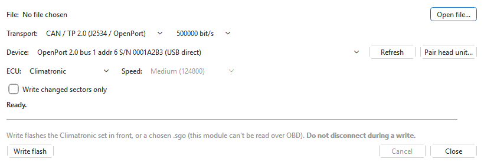
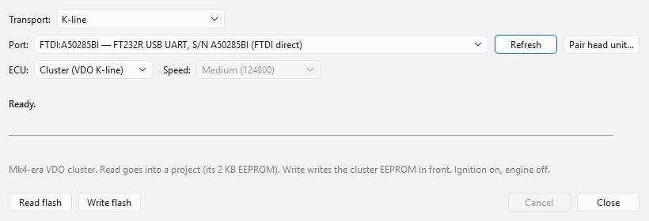

# Climatronic, clusters and ABS

## Climatronic

For the Audi A6 (4F) and Q7 (4L) Climatronic climate-control units
(4F/4L 910 043x). **CAN only** — choosing it switches **Transport** to CAN.
The [4F/4L HVAC module](../modules/hvac/index.md) adds the variables and the
checksum.

The Climatronic cannot be read over OBD, so with it selected the dialog
offers **Write flash** only. Its grey note says: *Write flashes an .hvac or
.sgo file (this module can't be read over OBD). Do not disconnect during a
write.* To work on a Climatronic, import its factory `.sgo` into a project in
the main window (**File > Import**).

### Write

**Write flash** flashes a Climatronic flash file:

- If the active tab holds a Climatronic image, it is written **as it is in
  the tab**, unsaved changes included (you are offered to save first) — like
  every other unit. Otherwise you are asked to choose a `.sgo` or `.hvac`
  file.
- The file must carry the unit's **flash loader** — the original `.sgo`, or a
  `.hvac` saved by the app from one. A raw `.bin` does not, and is refused.
- With the 4F/4L HVAC module installed, the internal flash checksum is
  corrected first, as **Save** would (your file on disk is not changed). When
  it cannot be — the module is missing, or this firmware's checksum is not
  mapped — you are asked before the image is written as it is.

The confirmation, **Write Climatronic**, names the file and warns that an
interrupted or wrong write can brick the module; if a write stops part-way,
write the file again (it starts over from the first block). The status line
then shows *Writing block N/M ...* with a percentage.

**Write changed sectors only** (off by default; it only affects a `.hvac`) writes only
the sections you changed compared with the stock firmware the `.hvac` was
saved from; the loader and the first section (which holds the checksum) are
always written. This compares files, not the module: it assumes the module
still holds that stock firmware. A `.sgo` has no stock copy to compare with,
so it is always written in full.

If a write stops part-way, see
[Backups and recovery](backups-and-recovery.md#climatronic).

## Cluster (CAN)

**Cluster** is the C6 A6 instrument cluster over CAN. It is **experimental and
read-only**: the cluster's security key is not known, so the read is tried
without unlocking and the cluster may refuse it. A read that succeeds goes
into a project, like every read (see
[Reading](reading.md#where-the-read-goes)). **Write flash** is greyed out.

The **Advanced** section has two troubleshooting aids for it, **Log CAN
traffic to a file** and **Probe the bus instead of reading** — see
[Advanced and diagnostic tools](advanced.md#cluster-and-abs).

## Cluster (VDO K-line)

**Cluster (VDO K-line)** is the Mk4-era VDO instrument cluster (VWK501,
VWK503, VMMJ08, VQMJ07, K5MJ07), read and written over **K-line**. The
transport switches to K-line when you choose it; **Speed** is greyed out
(the cluster is always woken with the 5-baud init at 10400 baud). Ignition
on, engine off. The [VDO Cluster module](../modules/vdo/index.md) names the
EEPROM's fields and keeps its checksums.

**Read flash** unlocks the cluster and reads its 2 KB EEPROM into a project,
which also records what the cluster reported about itself. In the OVT
Flasher it is saved as an `.ovt` project by default, or as the raw image
(`.bin`).

**Write flash** writes the cluster EEPROM open in the active tab:

1. The confirmation lists what you changed since the tab was opened.
   Everything in the image replaces what the cluster holds, including its
   vehicle data (immobiliser, VIN, odometer).
2. The file must be a recognised VDO Mk4 cluster EEPROM; anything else is
   refused before the cluster is touched.
3. The app connects and unlocks the cluster, writes the whole 2 KB EEPROM,
   then reads every block back and compares it.

Nothing is read from the cluster before the write: there is **no automatic
backup**, and the file is not compared with the cluster's layout or vehicle
data. Use **Read flash** and save the read first if you want to keep what
the cluster holds. Writing a file from another car moves that car's immobiliser data,
VIN and odometer into this cluster — see
[Reading and writing the cluster](../modules/vdo/read-write.md#writing).

When it finishes, switch the ignition off and on so the cluster loads the new
EEPROM. The version written is marked in the project as last flashed.
**Force full write** does not apply and is hidden.

## ABS

**ABS** is the C6 A6 Bosch ESP8 ABS/ESP unit (4F0910517xx), over **CAN**
(address 0x03), **read-only**. **Read flash** unlocks the programming level
and reads the unit's flash, 0x000000–0x0BFFFF (768 KB, including the boot
block a factory `.sgo` does not carry), into a project like every read.
**Write flash** is greyed out:
the OBD flash-loader sequence is not confirmed yet.

**Log CAN traffic to a file** and **Probe the bus instead of reading** (in
the **Advanced** section) work for ABS as for the Cluster — see
[Advanced and diagnostic tools](advanced.md#cluster-and-abs).
