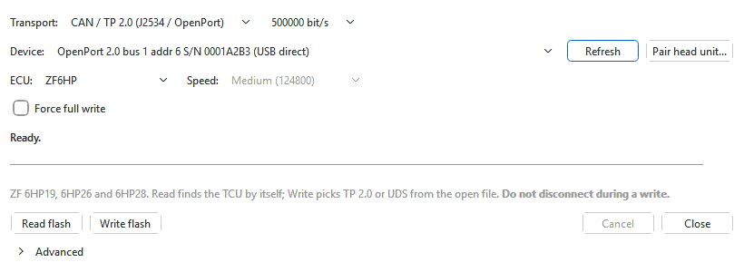
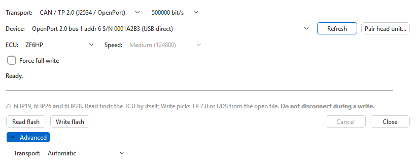
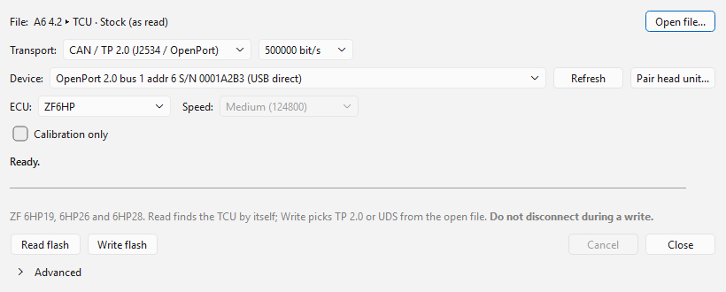

# Transmission control units

Two **ECU** entries cover transmission control units. Both are **CAN only**:
choosing one switches **Transport** to **CAN / TP 2.0 (J2534 / OpenPort)**.
Leave the CAN rate at **500000 bit/s**. Switching **Transport** back to
**K-line** afterwards selects **EDC16**, since neither works over K-line.

| Entry | Units | Talks | Read | Write |
|---|---|---|---|---|
| **ZF6HP** | ZF 6HP19 / 6HP26 | KWP2000 over TP 2.0 | Calibration window | Calibration |
| **ZF6HP** | ZF 6HP28 | UDS over ISO-TP | Calibration | Calibration, or program + calibration |
| **Aisin TRx** | Aisin TR-60SN (VW 09D) | KWP2000 over TP 2.0 | Whole flash | Not in this version |

The flasher has no entry for the ZF 8HP in this version.

## ZF6HP

One entry, **ZF6HP**, reads and writes every ZF 6HP the flasher supports. The
6HP19 and 6HP26 speak KWP2000 over TP 2.0; the 6HP28 speaks UDS. You do not
choose between them: the flasher does.

### Which transport

- **Read flash** tries **TP 2.0** first. Only if nothing answers there — the
  TP 2.0 channel cannot be set up, or the TCU never answers a single request
  — does it close TP 2.0 and read over **UDS** instead; the status line says
  *No answer over TP 2.0 (...). Trying UDS (6HP28)...*. A TCU that answers
  over TP 2.0, even with a refusal, is read over TP 2.0 and nothing else;
  a read you cancel is not retried over UDS. Both reads only read, so trying
  one and then the other changes nothing in the TCU. If neither answers, the
  error gives both reasons.
- **Write flash** picks the transport from the **open file**: **UDS** for a
  6HP28 image, **TP 2.0** for a 6HP19 or 6HP26 image. The file says which it
  is by its own identification: a 6HP28 read records it,
  and otherwise the matched calibration family or the controller the image
  was built for decides. Only a file with none of these is guessed from its
  size (2 MB or more is taken for a 6HP28); the confirmation then says which
  transport was guessed and why, so you can answer **No** and choose the
  right one under **Advanced**.

The options follow the transport the next write uses: **Force full write**
for TP 2.0, **Calibration only** for UDS. With no file open, **Force full
write** is shown.

**Advanced** has **Transport:** for when the automatic choice is wrong:
**Automatic** (the default), **TP 2.0 (6HP19 / 6HP26)** or **UDS (6HP28)**.
A forced transport is used for both Read and Write, with no fallback, and is
remembered. While it is not **Automatic** the **Advanced** section stays
open, so it is never forgotten out of sight.

### 6HP19 and 6HP26 (TP 2.0)

**Read flash** reads the TCU's calibration window (0x040000–0x07FFFF) and
gives it to you as a 1 MB image, with 0x00 everywhere outside that window —
the same layout other tools produce. The security unlock is done for you.

**Write flash** writes the calibration from the open file in two areas,
starting at 0x040000 and 0x050000 (together nearly the whole window the read
covers). For each area the TCU first checks its own checksum against the
file; an area that matches is skipped. The others are erased, written and
checked again; a failed check stops with an error. **Force full write**
skips that comparison and rewrites both areas.

- The image must be at least 1 MB — a read from this dialog, or a factory
  `.sgo` / `.frf` imported into a project.
- With the [ZF 6HP module](../modules/zf6hp/index.md) installed, the
  calibration checksum is corrected first. If the module cannot read the
  file's checksum layout, nothing is written silently: **Checksum cannot be
  corrected** explains that the calibration would be written as it is, and
  **No** (the default) cancels. **ZF 6HP: also correct the program-area
  checksums** (main window, **Tools > Options... > Projects and saving**)
  also corrects the program-area checksums; leave it off unless you edited
  program bytes.
- A write takes a few minutes. Do not cancel it: the 6HP19 / 6HP26 stops in
  the middle of an area when cancelled.

### 6HP28 (UDS)

The 6HP28 needs a J2534 device or an OpenPort **connected to this computer**
(not a head unit).

**Read flash** reads the calibration (0x180000–0x1FFFFF, 512 KB) in about a
minute and opens it as a **full 2 MB image**: the calibration at its real
address and 0xFF (erased) below it, so an exported `.bin` is placed
correctly by other tools. Like every read it goes into a
[project](../projects.md) — with a project tab in front the main window asks
**Add to <project>** or **New project**; the standalone **OVT Flasher** saves
it as an `.ovt` project by default, or as the raw image (`.bin`). The project
records that it is a 6HP28 read, so a later write knows to use UDS.

The TCU gives access only to the calibration over the diagnostic port. For a
complete image, combine it with the factory `.frf`.

**Write flash** writes the open file:

- A **512 KB calibration** file, or a **2 MB image**.
- From a 2 MB image the program blocks are written **only** when all three are
  present and valid; otherwise only the calibration is written.
- **Calibration only**: from a full 2 MB image, write only the calibration
  (the DB_4 block) and leave the program in the TCU as it is.
- Every block the write covers is erased, written and then checked by the
  TCU. Nothing is skipped: this TCU has no check that could tell beforehand
  whether it already holds a block, so **Force full write** is not offered.

The confirmation, **6HP28 write**, shows what was detected in the file
(*calibration only* or *program + calibration*), the candidate blocks, and
any warning — notably when the calibration's stored checksum does not match
(this check needs the ZF 6HP module). **The flasher does not correct the
6HP28 checksum: the file is sent exactly as it is.** With **Calibration
only** ticked, the detected list already shows just the calibration.

Do this with the engine **off** and a stable 12 V supply. The app warns that
an interrupted program write can leave the TCU needing bench recovery. At the
end a **6HP28 write** report lists what was written.

The status line says which way the flasher talks to the TCU (*ISO15765* or
*raw CAN*); it picks one by itself and falls back to the other.

## Aisin TRx

**Read flash** reads the whole 1 MB flash of a 09D TCU (no security unlock is
needed) into a project, like every read (see
[Reading](reading.md#where-the-read-goes)). **Write flash** is greyed out — *This module is read-only in this
version.* The 09D checksum is solved (the [Aisin module](../modules/aisin/index.md)
checks and corrects it) and the write sequence is reproduced from a captured
write, but it has only been run against the simulator, so writing stays off
until it is confirmed on a real TCU. The TR-80SD (0C8 / 09G) has no flasher
entry, and its checksum is not supported yet.

## See also

- [Backups and recovery](backups-and-recovery.md#transmissions)
- [Cables and interfaces](../cables.md) — J2534 devices and the OpenPort.
