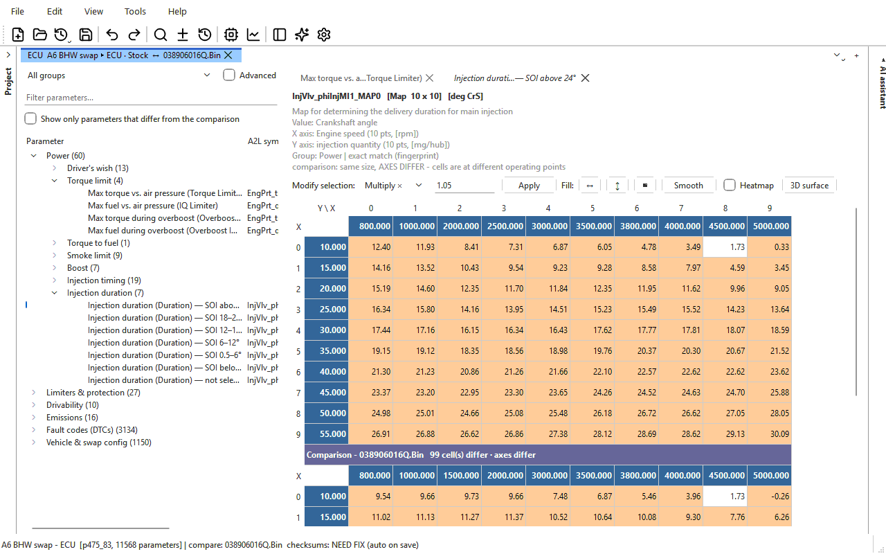

# Getting started

This page takes you from installing OVT-Suite to a first saved change. Each
step links to the page with the details.

## 1. Install

**Windows:** run the installer. The full installer lets you pick which
modules to install; the base installer installs the app alone, and you add
modules later.

**Linux:** install the `.deb` (or `.rpm`) package. It puts the app in
`/opt/ovtsuite`, adds a menu entry, and gives the logged-in user access to
OpenPort 2.0, FTDI and CH34x cables without root.

The standalone tools — **OVT Flasher**, **OVT Logger**, **OVT Sniffer** and
**OVT Simulator** — have their own shortcuts. The flasher, logger and
sniffer can also be installed on their own, without the main app (see
[Installing and updating](installing.md)).

## 2. Add the modules you need

The base app identifies every supported file and includes the hex editor, the
comparison view, patches, version history, the flasher, the logger and the
sniffer. The maps, their names and the checksum correction for each kind of
control unit come from its **module** — EDC16, EDC15, ZF 6HP, ZF 8HP, Aisin,
VDO cluster, Climatronic. **Tools > Modules...** shows which are installed.
See [Modules](modules.md).

## 3. Open a file

1. **File > Import > Into a new project...** (Ctrl+Shift+I) and pick the
   file: a plain binary (`.bin`), a factory file (`.sgo`, `.frf`), a
   Dimsport `.dim`, a WinOLS project (`.ols`), or a file of an earlier
   version (`.edc16`, `.6hp` ...) — or simply drop it on the window.
   The name and extension do not matter — the app identifies the file from
   its contents. It goes into a new project, which asks for a name on its
   first **Save**; see [Projects](projects.md). An OVT project (`.ovt`)
   opens with **File > Open project...** (Ctrl+O).
2. A progress window shows the file being identified and its parameters
   being placed; this takes a few seconds.
3. **File information** says what the file is: platform, part number,
   software version, the definition used, how many parameters were found,
   and the checksum state, with the project above it. Click **OK**. Untick
   **Show this when a file is opened** to stop it appearing; **File > File
   information...** (Ctrl+I) still shows it.

The parameter tree on the left fills, grouped by what the parameters are for
— **Power**, **Limiters & protection**, **Drivability** and so on.

If the file's module is not installed, a message says which module supports
it, and the file opens in the [hex editor](editor/hex-editor.md) instead.
See [Files and formats](editor/files-and-formats.md).

## 4. Find a table

- Open a group and a heading in the tree and click a parameter. Its table
  opens on the right.
- Or type in **Filter parameters...** above the tree, for example `smoke`.
- Or press Ctrl+F and search by name, value or address in the
  [Find panel](editor/search.md).

Hover over a parameter in the tree for a description of it. The notes above
the table say what it does, what its axes are, and how firmly it was located
in this file.

See [The main window](interface.md).

## 5. Change values

- Click a cell and type a new value, in the units shown, then press Enter.
- Or select a block of cells, choose **Multiply ×** (or **Add +**, **Set =**
  ...) on the **Modify selection** bar, type the number and click **Apply**.

Changed tabs show a `*`. **Edit > Undo** (Ctrl+Z) takes back
any change. See [Tables and editing values](editor/tables-and-editing.md).

## 6. Compare with the original

A project tab starts out compared with the original as imported or read;
to compare with another file, use **File > Import as comparison...**. The
comparison's copy of each table appears under yours, with every differing
cell in orange; tick **Show only parameters that differ from the
comparison** above the tree to see everything you have changed. See
[Comparing files](editor/comparison.md).

## 7. Save

**File > Save** (Ctrl+S). The first time, you are asked where to save the
**project** (`.ovt`) and what it is for (make, model, chassis, model year,
VIN... -- all optional): the file as you opened it becomes its original, and
your change the next version. The checksums are corrected as it is saved —
the status bar's `checksums: NEED FIX (auto on save)` turns to `valid` — and
every save is kept in the project's [version
history](editing.md#version-history). To get a plain `.bin` out again, use
**File > Export > Binary (.bin)...**. See [Projects](projects.md).

See [Editing and saving](editing.md).

## 8. Next steps

- Write the file to the car: [ECU read / write](flashing.md), and the
  [cables](cables.md) it works with.
- Log the engine or gearbox while you drive: [Data logging](logging.md).
- Carry your changes to another file: [Patches](editor/patches.md).
- Work on several projects at once: [Tabs and sessions](editor/tabs-and-sessions.md).
- Every key: [Keyboard shortcuts](editor/keyboard-shortcuts.md).
- Ask questions about the file, a map or a log in your own words, and let
  the AI propose changes for you to review: [AI assistant](ai.md). It is off
  until you turn it on, and a model on your own PC makes it free.
