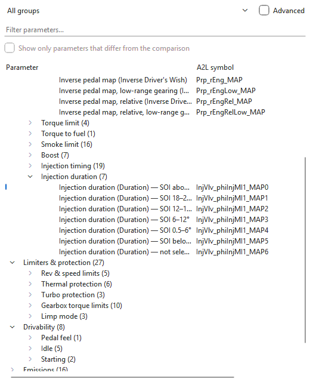

# The main window

The main window is where you open a project, find the parameter you want,
and change it. Each part of a project you open gets a **tab**; inside a tab,
the **parameter tree** on the left lists everything the app found in the
binary, and the **table area** on the right shows and edits the table you
picked.

From top to bottom:

| Part | What it is |
|---|---|
| Menu bar | **File**, **Edit**, **View**, **Tools** and **Help** — see [the menus](#the-menus) below. |
| Toolbar | Buttons for the menu items used most. Pick which in **Tools > Options... > Toolbar** (or right-click the toolbar); **View > Toolbar** shows or hides it. See [Options](options.md#toolbar). |
| Tabs | One tab per open set and branch of a project, labelled *project ▸ set · branch* and tinted by kind. At the right, **▾** lists every open tab and **+** opens the **File > Import** menu. With nothing open, the tab shows the **Start** page: **New project...**, **Open project...**, **Import...**, **Reopen last closed** and the recent projects. See [Tabs and sessions](editor/tabs-and-sessions.md). |
| Parameter tree (left) | Every parameter of the file, grouped by what a tuner uses it for. See [the parameter tree](#the-parameter-tree). |
| Table tabs (right, top) | The tables you have open in this file. See [table tabs](#table-tabs). |
| Title and notes | The name, kind, size and units of the table on screen, and what it is. |
| Edit bar | **Modify selection**, **Fill**, **Smooth**, **Heatmap**, **3D surface** (shows or hides the surface above the grid) and **Dyno** (Ctrl+4, the calculated power and torque of the file above that) -- plus, on the tables that need them, **Show Z as** and **Vehicle…** (ZF 6HP speed maps) and **Copy to other bank**. |
| 3D surface | Above the grid when **3D surface** (Ctrl+3) is on: the map as a surface you can turn and edit, with a splitter to share the room with the grid. See [3D surface](editor/3d-surface.md). |
| Grid | The table itself, with its axes, and the comparison file's copy underneath when one is open. |
| Status bar | The file, its definition, the comparison and the checksum state. See [the status bar](#the-status-bar). |
| Find panel | Opens along the bottom with **Edit > Find...** (Ctrl+F). See [The Find panel](editor/search.md). |
| AI assistant (right edge) | A slim **AI assistant** strip; click it or press **Ctrl+Shift+A** to open the panel and ask about what is on screen. See [The assistant panel](ai/assistant.md). |
| Project panel (left edge) | The open projects, their versions, logs and patches. See [Projects](projects.md). |

The split between the tree and the table area can be dragged.

## Primary and comparison

Each tab holds one **primary** binary — a branch of a project's set, the one
you edit and save — and, optionally, one **comparison** shown beside it,
read-only. The
comparison is paired with the primary parameter by parameter (not byte by
byte), so the same table is shown for both even when the two files are
different software versions with their tables at different addresses.
Cells that differ are highlighted, and the tree can be narrowed to only the
parameters that differ. See [Comparing files](editor/comparison.md).

## The parameter tree

The tree holds every parameter the file's module identified, in three
levels:

1. **Groups**, named for the job: **Power**, **Limiters & protection**,
   **Drivability**, **Emissions**, **Fault codes (DTCs)**, **Vehicle & swap
   config** and so on for an engine; **Shift points**, **Shift feel**,
   **Lockup (TCC)** and others for a gearbox. Only the groups the open file
   actually has are listed.
2. **Headings** inside each group (for example **Driver's wish**, **Smoke
   limit**, **Boost** under **Power**).
3. **Parameters** — the tables, curves and single values themselves.

Every group and heading shows in brackets how many parameters are under it
with the current filters, so **Power (60)** means sixty parameters are
showing there. A heading with none showing is hidden.

The columns are **Parameter** (a plain-English name), **A2L symbol** (the
manufacturer's symbol name, where the definition has one) and
**Description**. Drag a column edge to resize it.

Hold the pointer over a group to read what it is for. Hold it over a
parameter to see its description, symbol, kind and size, units, the axes
(with their point counts and units), its address in the file, its group and
how it was located in this file.

### Clicking in the tree

| Action | Result |
|---|---|
| Click a parameter | Opens it in the **preview** table tab (the italic one), replacing what the preview showed. |
| Double-click a parameter | Opens it in a table tab that stays open. |
| Middle-click a parameter | Opens it in a new table tab beside the one showing, and leaves the preview alone. |
| Right-click a parameter or a heading | The parameter menu: open, show in the hex editor, copy, **Properties...**, **Add parameter...** and more. See [The parameter menu and Properties](editor/parameter-menu.md). |

### Narrowing the tree

| Control | What it does |
|---|---|
| Group list (**All groups**) | Shows one group only. Hover over a group in the list to read what it holds. |
| **Advanced** | Also shows the supporting groups that a tune does not normally touch: **Other engine maps**, **Other gearbox maps**, **Sensors & models**, **Internals / OBD**, **Adaptation**, **Unverified placement** and the cluster's **Firmware patch module**. They are hidden otherwise to keep the tree short. Picking one of them in the group list shows it whether **Advanced** is ticked or not. The setting is remembered. |
| **Filter parameters...** | Type to keep only the parameters whose name, symbol, description or coding matches. Matching rows are expanded; clear the box to collapse the tree again. Typing a coding, such as `coding 158031`, finds the tables that coding selects. `*` stands for any run of characters and `?` for any one character: `accped*map` finds every accelerator-pedal map, `n?_max` finds `n1_max` and `n2_max`. |
| **Show only parameters that differ from the comparison** | Available when a comparison is open. Keeps only the parameters whose data differs between the two files — including the ones in the supporting groups, even when **Advanced** is off, so no difference is hidden. |

The three work together: for example **Power** in the group list, `boost` in
the filter and **Show only parameters that differ** ticked shows the boost
maps in **Power** that differ from the comparison.

> **Tip:** to find a parameter by value, by address, or across every open
> file, use the Find panel (Ctrl+F) instead — see [The Find panel](editor/search.md).

If a dialog or a Find result asks to show a parameter the filters are
hiding, the filters are cleared (and **Advanced** ticked if needed) so that
it can be shown.

## Table tabs

Every table you open gets a tab above the grid. The tab showing in
*italics* is the **preview**: the next parameter you click in the tree
replaces it. A tab stays open when you:

- double-click the parameter in the tree, or double-click the tab;
- use **View > Keep table open**, or **Keep open** from the tab's right-click menu;
- change a value in its grid.

Middle-click a parameter in the tree to open it straight into a tab of its
own.

Right-click a table tab for:

| Item | What it does |
|---|---|
| **Keep open** | Turns the preview tab into one that stays (only shown on the preview). |
| **Close** | Closes this tab (Ctrl+F4 closes the one showing). |
| **Close other tables** | Closes every table tab but this one. |
| **Close tables to the right** | Closes the tabs to the right of this one. |
| **Close all tables** | Closes them all. |
| **Copy symbol name** | Copies the parameter's symbol to the clipboard (when it has one). |

Middle-click a table tab to close it, or click its **×**. Drag tabs to
reorder them. **View > Next table** (Ctrl+PgDown) and **View > Previous
table** (Ctrl+PgUp) step through them.

Each table tab remembers its own scroll position, selection and **Heatmap**
setting, so switching back finds it as you left it. The open tables are also
remembered with the tab when its project is closed or the app quits (see
[Tabs and sessions](editor/tabs-and-sessions.md)).

For the grid itself — the axes, editing values, the edit bar, copy and paste
— see [Tables and editing values](editor/tables-and-editing.md).

## The status bar

The status bar describes the file in the active tab, for example:

`03G906016LQ.bin*  [p475_83, 11568 parameters] | compare: 038906016Q.Bin  checksums: NEED FIX (auto on save)`

| Part | Meaning |
|---|---|
| Name, with `*` | The tab's binary. A `*` means it has unsaved changes. |
| `[...]` | The definition (family) the module identified, and how many parameters it found. An EDC15 file also shows how many datasets it has. |
| `compare: ...` | The comparison file. `(live from tab)` means it is another tab's file and follows that tab's edits; `(tab closed)` means that tab has since been closed and the comparison is frozen as it last was. |
| `EEPROM loaded` | The set holds an EEPROM with the flash (an EDC15 full backup, or an imported `.edc15bak`); `*` when it has unsaved changes. **Save** keeps it in the project. |
| `checksums: valid` | The file's checksums are correct. |
| `checksums: NEED FIX (auto on save)` | The checksums do not match the data — normal after an edit, and also common in files read with other tools. Saving corrects them; nothing needs doing by hand. |
| `checksums: CANNOT VERIFY` | The checksum layout of this image could not be worked out, so the app cannot say whether they are right and will not write them. |
| `0x1A2B3C` (right) | Where the selected cell is stored in the binary: a value, an axis point, or a cell of the comparison block (in the comparison's binary). Several cells show the lowest and highest address and how many cells, `0x1A2B3C–0x1A2B5A (16 cells)`. Blank for the corner, the comparison banner, an axis the definition gives as numbers, and comparison values resampled onto this table's axes (they are stored nowhere). While a byte is picked in the [Hex editor](editor/hex-editor.md) it shows that byte's offset instead. |
| **AI: 1 proposal** (right) | An AI has proposed a change to an open tab. Click it to review it. See [Proposals and plans](ai/proposals.md). |

No checksum part at all means no installed module can check this kind of
file. Longer messages (what was saved, how many cells changed) appear in the
status bar for a few seconds after each action. Hover over the status bar to
read all of a line that is cut off.

See [Editing and saving](editing.md#checksums) for what is corrected on save.

## The menus

### File

| Item | Shortcut | What it does |
|---|---|---|
| **New project...** | Ctrl+N | Start a project: describe the vehicle, then pick the files it begins with. See [Projects](projects.md). |
| **Open project...** | Ctrl+O | Open a project (`.ovt`). |
| **Open Recent** | | Projects opened before. **Clear list** empties it. |
| **Open from project** | | Every set and branch of the open projects; one that already has a tab is marked *(open)*. |
| **Restore project from history** | | Recently closed projects, with the tabs they had. **Clear history** empties it. See [Tabs and sessions](editor/tabs-and-sessions.md#bringing-projects-back). |
| **Reopen last closed project** | Ctrl+Shift+T | Brings back the project closed last. |
| **Import > Into a new project...** | Ctrl+Shift+I | Binaries, factory files (`.sgo`, `.frf`, `.dim` ...), files of earlier versions and WinOLS projects: each binary goes into a new project and opens in a new tab. See [Files and formats](editor/files-and-formats.md#importing). |
| **Import > Into this project...** | | The same, as new sets of the active tab's project. Needs a project tab. |
| **Import > Into a new project, in this tab...** / **Into this project, in this tab...** | | As above, but the import replaces the active tab (closed first, asking about unsaved changes). |
| **Import > Definition file for this binary (XDF, A2L, KP, OLS, DAM)...** | | Attach a definition to the binary in the active tab. See [Projects](projects.md#winols-projects-and-definitions). |
| **Import as comparison...** | | Compare against a binary, or a set, branch and version of a project. Needs an open tab, as do the next three. |
| **Import recent as comparison** | | Binaries and project versions compared against lately. **Clear comparison history** empties it. |
| **Compare with open tab** | | Compare against another tab of the same platform, following its edits. |
| **Compare with saved version** | | Compare against an earlier version of this branch. |
| **File information...** | Ctrl+I | What the tab's binary was identified as, with a **Project** section. See [Files and formats](editor/files-and-formats.md#file-information). |
| **Project information...** | | The project's vehicle details. See [Projects](projects.md#project-information). |
| **Comparison information...** | | What the comparison was identified as. Needs a comparison. |
| **Close tab** | Ctrl+W | Close the active tab. Closing a project's last tab closes the project. |
| **Close comparison** | | Drop the comparison and keep the tab. Needs a comparison. |
| **Save** | Ctrl+S | Save the project (every edited tab of it), correcting checksums. See [Editing and saving](editing.md) and [Projects](projects.md). |
| **Save this branch only** | Ctrl+Alt+S | Save just this tab's changes into the project. |
| **Save As...** | | Save the project under a new name. |
| **Close project** | | Close every tab of the active tab's project. |
| **Export > Binary (.bin)...** | | One part of the set -- flash, MPC or EEPROM -- as a plain image. See [Exporting](editor/export.md). |
| **Export > Original file (.sgo / .dim / .frf)...** | | The file the set was imported from, with the saved version in it. Only for a set imported from such a file. |
| **Export > Definition as XDF...** | | The tab's parameters as a TunerPro definition. Needs the file's module. |
| **Export > Definition as A2L...** | | The tab's parameters as an ASAP2 description, for WinOLS and other tools. See [Exporting](editor/export.md#definition-as-a2l). |
| **Export > Map pack for WinOLS (.kp, experimental)...** | | The tab's parameters as a WinOLS map pack (experimental). See [Exporting](editor/export.md#map-pack-for-winols-experimental). |
| **Export > Data log...** / **Patch...** / **Attachment...** | | One of the logs, patches or attachments kept in the project. Greyed out when it has none. |
| **New window** | | Start another, separate window. See [Tabs and sessions](editor/tabs-and-sessions.md#one-window). |
| **Exit** | | Close the app (asks about unsaved changes). |

Files of earlier versions (`.6hp`, `.edc16`, `.edc15` ...) can only be
imported; there is no export to them. **Binary** and **Original file** are
made from the branch's last saved version (with unsaved edits you are
offered to save first). The comparison items are explained in [Comparing
files](editor/comparison.md).

### Edit

| Item | Shortcut | What it does |
|---|---|---|
| **Undo** / **Redo** | Ctrl+Z / Ctrl+Y | Step back or forward through your changes. |
| **Find...** | Ctrl+F | Open the Find panel. |
| **Find in definition...** | Ctrl+Shift+F | The Find panel, searching only the maps of the tab's definition file (an imported WinOLS project, an attached XDF / A2L / DAMOS). Greyed out when the binary has none. |
| **Find next result** / **Find previous result** | F3 / Shift+F3 | Step through the Find results. |
| **Scale selection...** | | Multiply the selected cells by a factor. |
| **Copy cells** / **Paste cells** | Ctrl+C / Ctrl+V | Copy and paste table cells as text. |
| **Copy values from tab** | | Copy the table on screen from the same table in another tab. |
| **Show differences...** | | List every parameter that differs from the comparison. Needs a comparison. |
| **Generate patch...** | | Make a patch of the differences from the comparison, kept in the project or saved as a file. Needs a comparison. |
| **Apply patch...** | | Apply one of the project's patches, or a patch file. |
| **Remove patch...** | | Undo a patch applied earlier. |
| **Version history...** | | Every save of this branch: name, merge, compare with or go back to one. |
| **Generate patch from history...** | | A patch between two saves of this branch. |

See [Tables and editing values](editor/tables-and-editing.md), [Comparing
files](editor/comparison.md), [Patches](editor/patches.md) and [Editing and
saving](editing.md#version-history).

### View

| Item | Shortcut | What it does |
|---|---|---|
| **Toolbar** | | Show or hide the toolbar. |
| **Swap X and Y axes** | Ctrl+T | Turn every table the other way round (display only). A switch; remembered. |
| **Keep table open** | | Turn the italic preview tab into one that stays open. |
| **Close table** | Ctrl+F4 | Close the table tab showing. |
| **Next table** / **Previous table** | Ctrl+PgDown / Ctrl+PgUp | Move between the table tabs. |
| **Project panel** | Ctrl+Shift+P | Show the open projects: sets, branches, history, logs, patches and attachments. The panel opens expanded, to stay; used again, it collapses the panel to its strip at the edge. See [Projects](projects.md). |
| **Next tab** / **Previous tab** | Ctrl+Tab / Ctrl+Shift+Tab | Move between the tabs. |

### Tools

The menu lists only the tools the tab in front can use: another platform's
editors, tools that need the module's maps, and (with no file open) every
tool that works on a file are left out, as is a module's sub-menu with
nothing in it for this tab. Switch tabs and the menu follows. Window-wide
tools -- ECU read / write, Data logging, the bus sniffer, Modules... -- are
always there, and so is a sub-menu for a module that is not installed.

| Item | Shortcut | Where it is described |
|---|---|---|
| **DTC / Fault-Path editor...** | Ctrl+D | [Parameter tools](tools.md); the engine module's pages, e.g. [EDC16](modules/edc16/index.md); ZF 6HP fault codes in [ZF 6HP](modules/zf6hp/index.md). |
| **Measuring blocks...** | Ctrl+M | [Parameter tools](tools.md) |
| **End of injection...** | | [End of injection](tools/end-of-injection.md) (EDC15P / EDC16 unit-injector engines) |
| **Dyno chart...** | | [Dyno chart](tools/dyno.md) (EDC15 / EDC16) |
| **Gear ratios...** | Ctrl+G | [Parameter tools](tools.md) |
| **VSS pulse settings...** | Ctrl+U | [Parameter tools](tools.md) |
| **Hex editor...** | Ctrl+H | [Hex editor](editor/hex-editor.md) |
| **Verify checksums...** | | [Editing and saving](editing.md#checksums) |
| **EEPROM editor...** | | [EEPROM editor](tools/eeprom.md) -- one editor for EDC15 and EDC16 EEPROMs. Needs the Bosch EDC15 or EDC16 module, but no open tab. |
| **ECU read / write...** | Ctrl+E | [ECU read / write](flashing.md) |
| **Data logging...** | Ctrl+L | [Data logging](logging.md) |
| **Tune from logs...** | | [Tune from logs](modules/edc16/logtune.md) (EDC16; the shift torque report on a ZF 6HP) |
| **Bus sniffer (J2534)...** | | [Bus sniffer](sniffer.md) |
| **ECU simulator (bench)...** | | [ECU simulator](simulator.md) |
| **Bosch EDC16 > Block builder...** | | One complete EDC16U31/U34 put together from blocks of different files. See [Block builder](modules/edc16/block-builder.md). |
| **ZF 6HP > Correct program-area checksums** | | A switch, off by default, for a ZF 6HP tab. See [Editing and saving](editing.md#zf-6hp-program-area-checksums). |
| **VDO Cluster > Needle sweep...** | | For a VDO cluster tab. See [VDO cluster](modules/vdo/needle-sweep.md). |
| **AI > Assistant** | Ctrl+Shift+A | Opens, folds or brings back the assistant panel on the right. See [The assistant panel](ai/assistant.md). |
| **AI > Proposals...** | | Changes an AI has proposed: preview, accept or reject. See [Proposals and plans](ai/proposals.md). |
| **AI > Settings...** | | The AI service the app uses, its key and model, privacy and usage. See [AI settings and privacy](ai/settings.md). |
| **AI > What was sent...** | | Every request sent to an AI service this session, exactly as sent. See [Privacy](ai/settings.md#privacy). |
| **AI > Share open tabs with AI apps** | | A switch, off by default: lets a connected AI app see the open tabs. See [Sharing open tabs](ai/ai-apps.md#sharing-open-tabs). |
| **AI > Connect an AI app...** | | The entry that connects Claude, ChatGPT, Cursor, VS Code or another MCP app to OVT-Suite. See [Connecting an AI app](ai/ai-apps.md). |
| **Modules...** | | [Modules](modules.md) |
| **Options...** | Ctrl+, | [Options](options.md): start-up, saving, theme, the toolbar and the keyboard shortcuts. |

**ZF 6HP** and **VDO Cluster** are sub-menus of the tools of one module
each; a sub-menu is greyed out when its module is not installed. The first
four items and **Tune from logs** need the file's module (its definitions),
and are greyed out when it is not installed or when they do not apply to
the open file. The hex editor, checksums,
flasher, logger, sniffer and simulator never need a module.

The tool windows a tab opens — the fault-code editor, measuring blocks, gear
ratios, VSS settings, the needle sweep, the hex editor, tune from logs and
the differences list — belong to that tab. They stay open beside the main window while you
work, hide when you switch to another tab, come back when you return, and
close with the tab.

### Help

| Item | Shortcut | What it does |
|---|---|---|
| **Help contents** | F1 | Opens this help, with the pages of every installed module. |
| **Check for Updates...** | | Looks for a newer version of the app and of your modules. See [Checking for updates](updates.md). |
| **Ask the AI about the app...** | | Opens the [assistant panel](ai/assistant.md) for a question about using the app, answered from these help pages. |
| **About OVT-Suite...** | | The version and the installed modules. See [About and credits](about.md). |
| **Credits & licences...** | | The licences of the parts the app is built from. |
| **About Qt...** | | Qt's own about box. |

F1 in any window opens the page about that window, where there is one; F1 in
a panel that has its own page (such as the Find panel) opens that page.

A complete list of keys is on the [Keyboard shortcuts](editor/keyboard-shortcuts.md) page.
