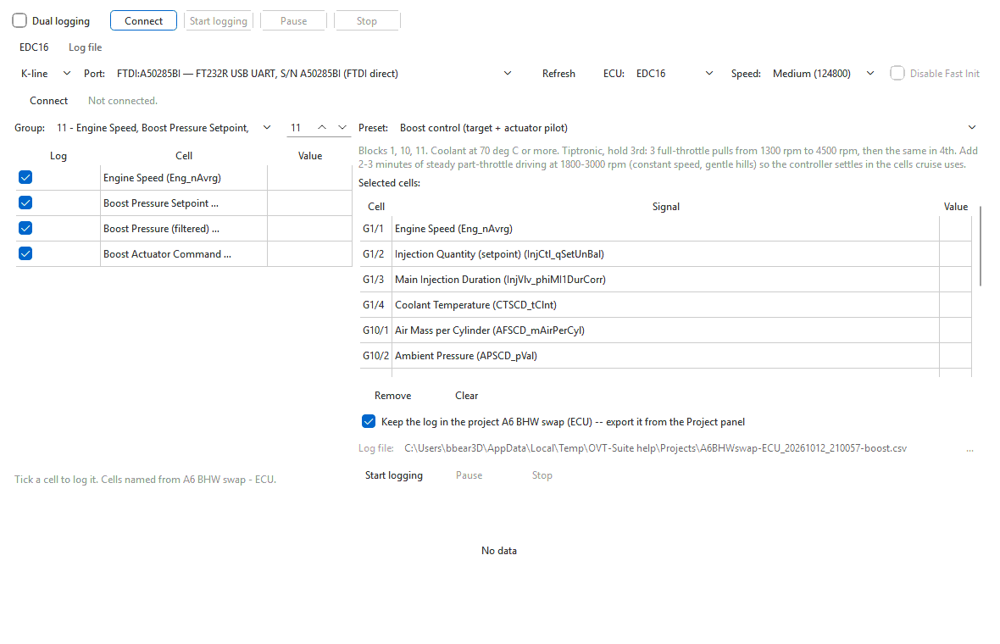

# Data logging

The data logger records live values — measuring blocks — from a control unit
while you drive, keeps them in the car's project (or writes them to a CSV
log file), and charts them as they arrive.
It can log one control unit, or the engine and the transmission at the same
time, and it reads logs back for review and for **Tools > Tune from logs...**.

Open it with **Tools > Data logging...** (Ctrl+L) in the main window, or on its
own with the **OVT Logger** shortcut.

## What it can log

| ECU (in the **ECU** box) | Control unit | Transport | Cells are named from |
|---|---|---|---|
| **EDC16** | Bosch EDC16 diesel engine ECU | K-line or CAN | the car's own EDC16 file, open in a tab |
| **EDC15** | Bosch EDC15 diesel engine ECU | K-line only | the car's own EDC15 file, open in a tab |
| **ZF6HP** | ZF 6HP19 transmission (measuring blocks 1–17) | CAN only | a built-in 6HP19 block list — no file needed |
| **ZF6HP-UDS** | ZF 6HP28 transmission (one live-data block) | CAN only | built in; values are raw counts |
| **Aisin TRx** | Aisin 09D transmission | CAN only | not named yet ("Group N / Cell M") |

## Log a drive in five steps

1. **Open the car's project** in the main window, with the engine's (or
   gearbox's) set in a tab — in OVT Logger, use **Open project or
   binary...**. The logger names every cell from that binary, and the presets
   are worked out from it. See [Choosing what to log](logging/choosing-cells.md).
2. In the logger, pick the transport (**K-line** or **CAN**), the **Port** or
   **Device**, and the **ECU**, then press **Connect**. The identification
   line next to the button shows the control unit's part number when the
   session is open. See [Connecting](logging/connecting.md).
3. Pick a **Preset** for what you want to look at, or tick cells by hand in
   the **Group** list. The ticked cells appear under **Selected cells**.
4. Check where the log goes — the project, or the **Log file** name (see
   [Logs in the project](#logs-in-the-project)) — then press **Start
   logging**. Values update
   in the **Value** column and on the strip chart below. **Pause** keeps the
   session alive without writing rows; **Stop** ends the log.
5. The finished log opens in the **Log file** tab. See
   [Log files](logging/log-files.md).

## The window

| Part | What it does |
|---|---|
| **Dual logging** and the row of buttons beside it | The master controls. With dual logging on they connect, start, pause and stop both connections together. See [Dual logging](logging/dual-logging.md). |
| One tab per connection (named after its ECU) | The connection row, the **Group** browser on the left, the preset, the selected cells and the log file on the right, and the live strip chart along the bottom. |
| **Log file** tab | Opens a log, charts it, shows its rows, and exports it. |
| Status line (bottom) | What the connection is doing, errors, and where the log was saved. |

The computer is kept awake for as long as a connection is open, so a long
drive is not cut short by the screen saver or sleep.

## Logs in the project

When the controller's binary is open in a project tab, the log goes **into
the project** by default: **Keep the log in the project <name> (<set>) --
export it from the Project panel**, above the log file row, is ticked (the
**Log file** row is greyed out meanwhile). Untick it to write a CSV file
instead.

While logging, the rows go to a working copy; on **Stop** (or when the
session ends) the log is added to the project, kept for the set it was
recorded against. It is written into the `.ovt` with the project's next
**Save** — closing the project asks, as for any unsaved change. In the OVT
Logger the log is written into the `.ovt` straight away, unless the project
is open in the main window (see [Connecting](logging/connecting.md#ovt-logger-on-its-own)).

Kept logs are listed under **Logs** in the Project panel. Double-click one
to view it in the logger's **Log file** tab, or right-click it for:

- **Open in Data logging** — the same;
- **Export...** — save it as a CSV file (also **File > Export > Data
  log...**);
- **Pin (never auto-deleted)** / **Unpin** — see the limit below;
- **Remove** — take it out of the project;
- **Summarise with AI...** — the [AI assistant](ai/assistant.md) reads the
  log (through a summary of each channel, then short windows around the
  events it finds) and says what was driven, the ranges of the key signals
  and anything abnormal. Ask follow-up questions in the panel: *"show me the
  boost at the second pull"*, *"is the smoke limiter cutting in?"*.

A project keeps every log unless you set a limit: right-click **Logs** >
**Keep at most ... logs** (0 = no limit). Over the limit the oldest unpinned
logs are deleted first; pinned logs are always kept. **Add log...** on the
same menu puts log files from disk into the project.

**Tools > Tune from logs...** offers the project's logs first when you add
logs to analyse. See [Projects](projects.md).

## More

The detail pages:

- [Connecting](logging/connecting.md) — transports, cables, the ECU choices
  and link speed.
- [Choosing what to log](logging/choosing-cells.md) — groups, cells and how
  they get their names.
- [Presets and how to drive them](logging/presets.md) — every preset, and the
  driving each one needs.
- [Recording and the live chart](logging/recording.md)
- [Dual logging](logging/dual-logging.md) — engine and transmission at once.
- [Log files](logging/log-files.md) — the CSV layouts, VCDS CSV export and
  reviewing a log.
- [Reading fault codes](logging/fault-codes.md)
- [Troubleshooting](logging/troubleshooting.md)
- [Cables and interfaces](cables.md)
