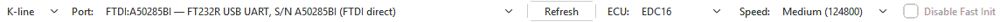
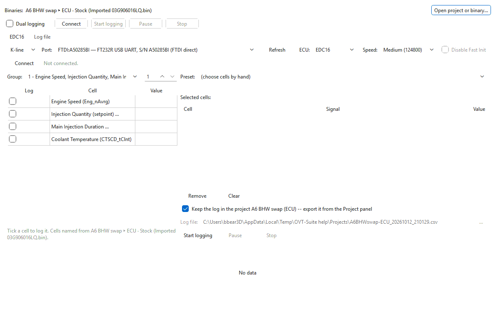

# Connecting the logger

Each connection tab starts with a connection row: transport, cable, ECU and —
on K-line — link speed. Set it, then press **Connect**.

## Step by step

1. Plug the cable into the car and switch the ignition on.
2. Choose the transport in the first box: **K-line** or **CAN**.
3. Choose the cable in **Port:** (K-line) or **Device:** (CAN). Press
   **Refresh** if you plugged it in after opening the logger.
4. Choose the control unit in **ECU:**.
5. On K-line to an EDC16, choose the **Speed:**.
6. Press **Connect**. The button reads **Connecting...**, then **Disconnect**
   once the session is open, and the line beside it shows the control unit's
   identification and the link speed.

While connected, the connection row is locked; press **Disconnect** to change
it. Disconnecting takes a second or two (the button reads
**Disconnecting...** meanwhile). If the cable's driver has not let go after
about 8 seconds, the logger closes the J2534 bridge, or cancels the K-line
cable's read, itself. **Disconnect** while connecting stops the attempt
without an error.

## Transport and cable

| Transport | The cable box lists | Use it for |
|---|---|---|
| **K-line** | Serial / FTDI K-line (KKL) cables first, then J2534 devices marked "(J2534)" | EDC15 (always), and EDC16 on cars where the engine answers on K-line |
| **CAN** | J2534 devices and an OpenPort 2.0 on USB | EDC16 over CAN, and every transmission (ZF6HP, ZF6HP-UDS, Aisin TRx) |

On **CAN** a bit-rate box appears next to **Refresh**: **500000** (the
drivetrain CAN on these cars), **250000** or **125000**.

When no cable is found the box says so — for example "(no serial ports or
J2534 devices found)" — and, for an OpenPort, why it is not listed. See
[Cables and interfaces](../cables.md).

## The ECU box

Which controllers you can pick depends on the transport:

- **K-line:** **EDC16**, **EDC15**.
- **CAN:** **EDC16**, **ZF6HP**, **ZF6HP-UDS**, **Aisin TRx**.

When the logger is opened from the main window, the **ECU** box follows the
file in the active tab: an EDC16, EDC15 or ZF 6HP file selects **EDC16**,
**EDC15** or **ZF6HP**. Otherwise it comes back with the last controller you
used.

| ECU | How the session is opened |
|---|---|
| **EDC16** | K-line: wake-up at 10400 baud, diagnostic session, identification, then the link-speed raise you chose. CAN: a TP 2.0 channel to the engine, then the same session (no speed raise). |
| **EDC15** | KW1281 slow init; no speed choice. |
| **ZF6HP** | TP 2.0 channel to the transmission, diagnostic session, identification. Reads measuring blocks 1–17 of the 6HP19. |
| **ZF6HP-UDS** | TP 2.0 channel to the transmission, then polls its single live-data block. The 6HP28 does not serve the 6HP19's measuring blocks. |
| **Aisin TRx** | TP 2.0 channel to the transmission, the same session as **ZF6HP**. |

## Speed (EDC16 on K-line)

The session always starts at 10400 baud; **Speed:** then asks the ECU for a
faster link:

| Choice | Baud |
|---|---|
| **Low (10400)** | stays at 10400 |
| **Medium (124800)** | 124800 — the usual choice |
| **High (244898)** | 244898 — only offered for an FTDI serial cable |

High is not listed for CH340/CH341 serial cables or J2534 devices; they
cannot hold it. If the ECU refuses the faster rate, or stops answering at it,
the logger stays at (or drops back to) 10400 and says so in the status line.
More speed means more rows per second.

## Disable Fast Init (K-line)

K-line connections normally use ISO 14230 fast init, which the later EDC16s
need. Tick **Disable Fast Init** to use the 5-baud slow init instead.

- Choosing **EDC15** ticks it for you (EDC15 uses slow init); you can untick it.
- On a J2534 device fast init is done by the device itself, so the box is
  unticked and greyed out.

## What is remembered

Each connection tab remembers its own transport, controller, bit rate and
speed -- and **each controller its own**: the transport it was last used on,
its CAN bit rate and K-line speed. Opening the logger from a gearbox tab
selects the gearbox on the transport it was last logged over (CAN for a ZF
6HP, which K-line cannot reach), and going back to the engine brings back
the engine's. The cable is remembered per controller and transport —
switching from K-line to CAN brings back the device you last used on CAN.
The two tabs of [dual logging](dual-logging.md) keep separate settings.

## If the link drops

If the control unit stops answering during a session, the logger tries to
reconnect for up to 10 seconds ("Lost the ECU ... - reconnecting for up to
10 s..."), then carries on logging into the same file. If it cannot, it says
"Could not reconnect within 10 seconds." and the session ends; the rows
written so far are kept. Pressing **Disconnect** during those 10 seconds ends
the session at once, without the message.

## OVT Logger on its own

The **OVT Logger** shortcut opens the same window without the main window. A
**Binaries:** row at the top lists the files that name the cells, with
**Open project or binary...** to add one. Open one file per controller — an
engine file and a transmission file can both be open for dual logging;
opening a second file for the same controller replaces the first. Opening a
file also points the front tab at that file's controller, unless a tab is
already on it or the front tab is connected.

A **project** (`.ovt`) opens too. When it holds more than one binary or
branch, pick the one that names the cells. A log recorded against it goes
into that project when you stop logging, the same as in the main window.
If the project is open in the main window at the time, the log cannot be
written into it there (the main window's next save would lose it): you are
told, and the log is saved as a file next to the project instead.

The standalone window also has **Help** and **About...** buttons.

Next: [Choosing what to log](choosing-cells.md).
