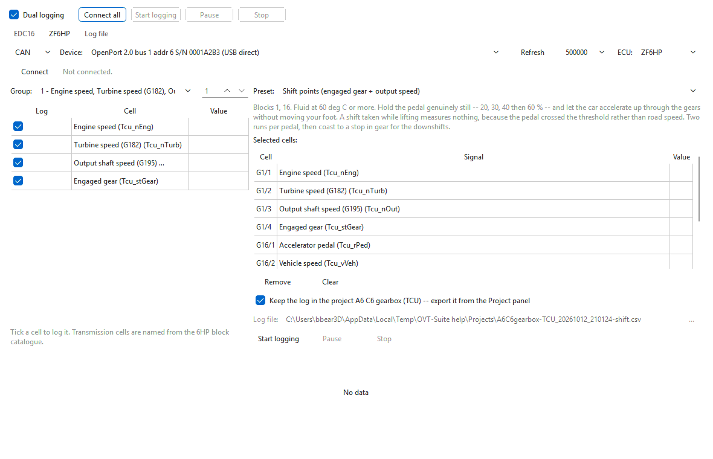

# Dual logging

Dual logging records two control units at once — typically the engine and the
transmission — each into its own log, stamped from the same clock so the two
logs line up afterwards. It answers questions that span both boxes: the
transmission asks for a shift, and the engine responds within the same
fraction of a second.

The engine on K-line and the transmission on CAN use different pins, so
neither slows the other: each connection keeps its own sample rate.

## Set it up

1. Open the engine's file and the transmission's file in two tabs of the main
   window (in OVT Logger: **Open project or binary...** twice).
2. Tick **Dual logging**. A second connection tab appears and comes to the
   front. It starts on the other side of the pair: **ZF6HP** when the first
   tab is an engine, **EDC16** when the first is the transmission. The box
   is remembered: the logger opens with both tabs next time, until you
   untick it.
3. Set up each tab as for a single connection: transport, cable, ECU and
   cells. Each tab names its cells from the open file that matches its own
   controller, whichever tab of the main window is in front.
4. Press **Connect all** in the master row. Both tabs connect.
5. Press **Start logging** in the master row. Both start; each writes its own
   log — kept in the project its binary is open in (see [Logs in the
   project](../logging.md#logs-in-the-project)), or a file named after its
   own binary (or its controller when none is open).
6. **Pause** and **Stop** in the master row act on both.

The buttons inside each tab still work for that tab alone.

## Good to know

- The tab names show each tab's controller, and with two connections every
  status message is prefixed with it ("ZF6HP: Logging to ...").
- With two connections, the master buttons report a tab with no cable chosen
  or no cells ticked in the status line, instead of a pop-up per tab.
- If one tab has no cells ticked, **Start logging** starts the other and says
  "Logging ... only -- the other connection had nothing to log."
- When both stop, the second tab's log opens in the **Log file** tab; open
  the other with **Open log...** (or from the Project panel, for a log kept
  in a project).
- Unticking **Dual logging** disconnects and removes the second tab.
- Each tab remembers its own cable, transport and controller separately.
- If no file for a tab's controller is open, that tab names its cells from the
  active tab of the main window, but its log file is named after its own
  controller (for example `zf6hp_20261010_213250.csv`), never after the other
  controller's file. Two default names never collide: if one is already taken
  (or the file exists), `-2` is added.

## Tips

- Give the transmission its own fast preset (two blocks) — its block rate is
  the limit on how sharply a shift is seen.
- Leave the engine side to the cells the question needs; with dual logging the
  transmission side already supplies pedal and road speed at full rate.

Next: [Log files](log-files.md).
