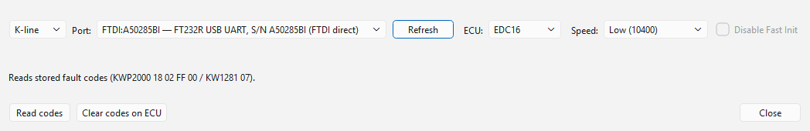

# Reading fault codes from the ECU

The **Fault codes from ECU** window reads the fault codes stored in an engine
ECU, and can clear them. It is opened from the fault-path editor of an engine
file, so the codes the car has stored can be found among the file's fault
paths.

## Read the stored codes

1. Open the car's EDC16 or EDC15 file and choose
   **Tools > DTC / Fault-Path editor...** (Ctrl+D).
2. Press **Read codes from ECU...**. The **Fault codes from ECU** window opens.
3. Set the connection row as for [logging](connecting.md): **K-line** with a
   K-line cable or J2534 device, or **CAN** with a J2534 device, and the
   **ECU** (**EDC16** or **EDC15**; EDC15 is K-line only).
4. Press **Read codes**. The window connects, reads the codes, disconnects
   and closes.
5. Back in the fault-path editor, the codes the ECU reported are highlighted
   in the list, and the note above the buttons says how many there were — for
   example "ECU: 2 code(s) stored - highlighted below." Codes that match none
   of the file's fault paths are listed in that note by number.

## Clear the stored codes

1. Open the window as above and set the connection.
2. Press **Clear codes on ECU** and answer **Yes** to "Clear all stored fault
   codes on the ECU?".
3. The codes are cleared, then read back, so the editor shows what is still
   stored afterwards — a fault that is still present comes straight back.

Clearing codes only empties the ECU's fault memory. It does not change the
file, and it does not switch a fault path off; that is done in the editor
itself.

## Good to know

- Fault codes are read over the transport you choose: on **K-line** with a
  KWP2000 or KW1281 session, on **CAN** with KWP2000 over TP 2.0 — the same
  connection the logger opens.
- On K-line the session runs at the basic 10400 baud — no speed raise is
  needed for a code read.
- **ZF6HP-UDS** (the 6HP28) speaks UDS, which this window does not; it says so
  instead of connecting.
- The window remembers its own cable and settings, separately from the
  logger's.
- If the read fails, an error box says why and the window stays open, so you
  can change the connection and try again. **Close** leaves without reading.

See also: [Connecting](connecting.md),
[EDC16 module](../modules/edc16/index.md),
[EDC15 module](../modules/edc15/index.md).
