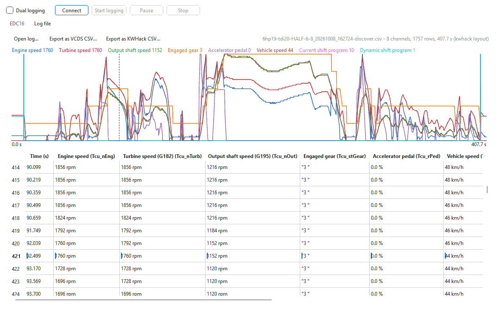

# Log files

Logs are CSV — kept in the car's project, or as files. The logger writes its
own layout (the same one the KWHack tool uses, so logs move between the two
unchanged), reads that layout and the VCDS CSV layouts, and exports to them.
The **Log file** tab opens a log, charts it and shows its rows.



## Review a log

1. Open the **Log file** tab. A log you have just stopped is already there.
2. To open another, press **Open log...**. It lists the logs kept in the
   open projects — under each project, newest first, with the set they were
   recorded against — and **From a file...** for a `.csv` on disk (with no
   kept logs, the file picker opens straight away). In the OVT Logger it
   lists the logs of the project it has open. A kept log also opens from
   the Project panel: double-click it. The layout — native or VCDS — is
   recognised by itself.
3. The line at the top right gives the file name, the number of channels and
   rows, the length in seconds and the layout, for example
   "... - 8 channels, 1757 rows, 407.7 s (kwhack layout)".
4. **Click the chart** to put a cursor there: the matching row is selected in
   the table, and the legend shows every channel's value at that moment.
   Selecting a row in the table moves the cursor to it.

## The chart and the table

- The chart shows the whole log. As in the live chart, each channel is scaled
  to its own range, so it shows when things happen and how they move together.
- The time base is seconds from the first row; the table's first column,
  **Time (s)**, is the same.
- A column whose cells are not plain numbers is not drawn.
- The table shows every row of the log, however long. A long log is read in
  the background ("Reading ..." at the top right meanwhile), so the window
  stays usable while it loads.

## Names in old or foreign logs

When a log only has generic column names ("Group 11 / Cell 3", or a VCDS
"Group 11 - Field 3" column), the viewer names those columns from an open
file whose measuring-block map covers the log's groups — with dual logging,
from whichever connection's map matches. Open the car's own file first to get
names in an old log.

## Export

**Export As...** writes the log that is open in the tab, every row, in the layout
you pick from a list:

| Format | Writes |
|---|---|
| **OVT-Suite log (CSV)** | the log's own layout (below), which KWHack also reads. A log opened from this layout is copied as it is. |
| **VCDS CSV - advanced measuring blocks (ADVMB)** | the layout recent VCDS writes for advanced measuring blocks, any number of cells |
| **VCDS CSV - classic (groups A, B and C)** | the layout VCDS wrote for KW1281 measuring blocks, which simple log viewers read: at most three groups of four cells to a log |

The suggested file name is the log's name plus `_ovt`, `_vcds` or `_vcds_classic`.
What you chose is offered again next time. A log kept in a project is exported the
same way with **File > Export > Data log...**, or **Export...** on its right-click
menu in the Project panel.

The classic layout has one option, which the window shows when you pick it:

- **More than three groups.** A classic log holds three groups, so a log of four or
  more becomes several: by default **one file, one log after another**, from which a
  viewer that reads one log at a time asks which to open; or **several files** (one for
  each three groups, named `..._part1_groups_1-4-10.csv`, `..._part2_groups_11.csv`).

## The native layout

```
# Cells: 1.1,1.2,1.3,1.4,16.1,16.2,16.3,16.4
Timestamp,Engine speed (Tcu_nEng),Turbine speed (G182) (Tcu_nTurb),...
2026-10-08 16:27:59.498,864 rpm,864 rpm,...
```

- The first line lists the logged cells as group.cell (cell numbers start
  at 1).
- The header names each column: the cell's description and, where known, its
  signal name in brackets. **Tune from logs** uses that signal name to tell
  which column is which.
- Each row starts with the date and wall-clock time to the millisecond, then
  every cell as the control unit's display text — value and unit, for example
  `864 rpm`, or `N/A` when its group did not answer.
- Dual-logging files are stamped from the same clock, so their times can be
  matched row by row.

A cell the logger had no formula for is written as its three raw bytes in
brackets, for example `(177 128 12)`. When the log is opened again, those are
decoded with whatever formulas the app knows by then, so updating the app can
recover such a column.

## The VCDS CSV layouts

**Advanced measuring blocks (ADVMB).** The file gets a short header (date, the app's
version, the control unit's identification when known), a row of group/field markers,
the column titles and a row of units, then one row per sample. Each cell has its own
time column in seconds from the start; values are written as plain numbers, since the
units are on their own row, with the digits the logger showed (`0.0` stays `0.0`).
Lines end in CRLF and the column titles are plain, as VCDS writes them (the `(G1/1)`
tag the logger adds to a name used twice is left off; the marker row says which group
and field a column is). A switch's bytes in binary (`00101011`, or `01001001 00001000`
for two) and `N/A` are written as they are, as VCDS writes them, and are read back as
text, not as the number 101011.

**Classic.** The file has the date, the part number and description (the log's
identity, split at its double space; a description cell that starts with a space
is how this app reads that double space back), a row naming
the groups (`Group A:` `'115`, `Group B:`, `Group C:`; an unused one says `Not
Running`), the field names, a `TIME` row and a row of units that starts with
`Marker`, then one row per sample: a time and four values for each group. Text is
Windows ANSI (a degree sign is one byte), lines end in CRLF, and rpm is `/min`. A cell
is a number, `N/A`, a switch's bytes in binary (`01001001 00001000`, written as they are, as
VCDS does -- a viewer that reads only numbers cannot take them) or empty; any other text
(a state such as "idle") is written as `N/A`.

In both, an injection angle is one signed column: after TDC is negative, and the unit
row says `°BTDC`.

When a VCDS log is opened -- either layout, UTF-8 or ANSI, in any of VCDS's languages
(the date line is read in English, German, French, Spanish, Italian or Dutch, and
with the extra fields recent VCDS puts after the seconds) -- the groups, labels,
units and start time are read from those header rows; a name that VCDS wraps over two
header lines is joined. A log added to a project with **Add log...** is listed with
"(VCDS)" after its name when it is one, and opens in the Log file tab like any other. A classic file
that holds several logs one after another, as this app writes them when asked, opens
as one log with the cells side by side again. A log taken from a plain CSV has no
control unit identification, so that part of the header stays empty.

Next: [Reading fault codes](fault-codes.md).
