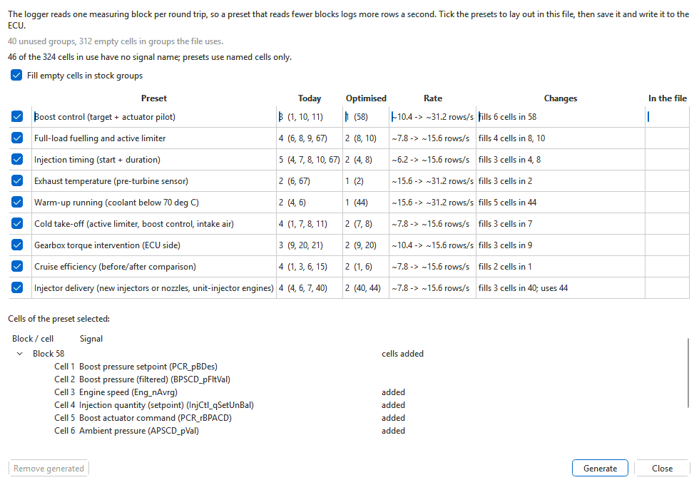

# Optimised logging blocks

The logger reads one measuring block per round trip to the control unit, and
each round trip takes about the same time whatever is in the block: about
30 ms on an EDC16 over CAN, about a third of a second on an EDC15 over
K-line. So a preset that reads three blocks logs a third as many rows a
second as one that reads one block.

The shipped presets, and yours, read the blocks the calibration came with,
and those spread what a preset needs over several blocks. **Tools > Build
logging blocks...** lays the file's blocks out so each preset reads as few as
possible. You write the file to the ECU as usual, and from then on the presets
read the new layout.

## Building them

Open the file in a tab, then **Tools > Build logging blocks...** (or
**Optimise...** under **Preset:** in the data logger). The window lists every
preset for the file's controller, with **Your presets** under them:

| Column | What it shows |
|---|---|
| **Today** | how many blocks the preset reads with the file as it is, and which |
| **Optimised** | how many it would read once laid out, and which |
| **Rate** | roughly how many rows a second each gives |
| **Changes** | what would be written: cells filled in blocks the file already uses, new blocks, or only a better choice of existing blocks |
| **In the file** | **Built**, or **Out of date** (you changed the preset since) or **Changed since** (undone, or a cell edited by hand) |

A preset that cannot be read in fewer blocks than today is listed in grey
with the reason, and cannot be ticked: nothing is ever changed for no gain.

When something about the file limits what the window can do, it says so above
the table:

- **Tables found by structure.** Some definitions (the P475 03G906016GC, HQ
  and MF families among them) leave out the tables that say how each cell is
  scaled and which blocks the ECU keeps for itself. The window finds them in
  the file and names them; nothing else changes.
- **Blocks the ECU keeps for itself unknown.** If those tables are neither in
  the definition nor found, no block is filled or created: a preset can only
  gain by reading the file's blocks as they are, and the reason says so.
- **Not analysed.** If none of the file's cells has a signal name (there is no
  signal list for that software yet), the presets cannot be matched to its
  blocks. Each row then reads **Not analysed** with the reason, not "no gain".
- A definition without the measuring-block table itself cannot open the
  window; the message says that is why.

Tick the presets to build and press **Generate**. Every cell is written as one
step, so **Edit > Undo** takes it all back. Then save the file and write it to
the ECU.

- **Fill empty cells in stock groups** (on by default) puts a preset's values
  into the empty cells of blocks the file already uses before it uses blocks
  the file leaves empty. Fewer blocks always wins first; with the same count,
  filling wins. The file's own cells are never overwritten either way.
- Presets share what is built: engine speed and injected quantity laid out for
  one preset are used by the next instead of being written twice.
- A value is only ever taken from a cell the file already shows somewhere, so
  it reads exactly as it did before.
- **Remove generated** empties the cells built for the ticked presets again,
  where the file still holds what was built.
- Blocks built for one of your presets that you have since deleted are listed
  under **Presets no longer there**. Tick one and press **Remove generated**
  to empty its cells.
- Select a preset to see its blocks under the table, with the cells that would
  be added marked.

The layout is kept in the project with the file, and in your settings under
the file's part number and software version. That way the logger finds it
with no file open, from what the ECU reports when you connect.

## In the logger

A preset with a layout built for it is listed as, for example, **Boost control
(optimised: 1 block)**. When you pick it, the logger reads those blocks once
from the ECU before it uses them. **Start logging** waits for that check, which
takes a fraction of a second. The hint under **Preset:** says what happened:

- "Optimised blocks 58 (instead of 1, 10, 11): the ECU has them." The preset
  logs from the optimised blocks.
- "The ECU does not have this preset's optimised blocks (...)": the ECU answered
  a built cell as empty, or not at all, because it still has the software from
  before. The preset falls back to its usual blocks until the file is written
  to the ECU and you connect again.

Untick **Use optimised blocks when the ECU has them** to log every preset from
its usual blocks.

## Which blocks are used

- **EDC16:** blocks 1 to 127, eight cells each. Blocks the ECU itself uses
  (named by its basic-setting and tester-routine tables, such as 3, 6, 11 and
  19 on a P475) are never built in or filled.
- **EDC15:** the file's blocks (1 to 40, then 80 and up), four cells each. The
  ECU runs whichever dataset it is coded to, so a cell is only built where it
  is empty in every dataset, and is written to every dataset.
- New blocks are taken from the highest free numbers down.

In **Tools > Measuring blocks...** a cell built for logging is shown in italics,
and its tooltip names the presets that read it. Changing it there takes it out
of those presets' optimised blocks; build them again to put them back.

See also [Presets and how to drive them](presets.md) and
[Choosing what to log](choosing-cells.md).
