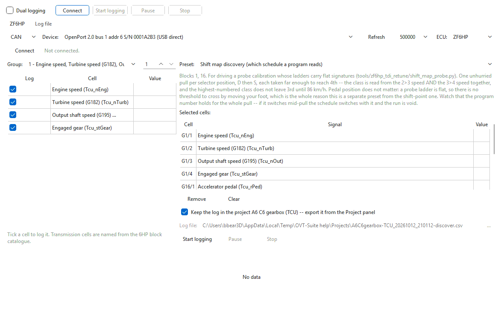

# Presets and how to drive them

A preset answers one question. It ticks the fewest measuring blocks of the
open calibration that carry the values the question needs, adds the values
that sharpen the answer when they fit, and shows how to drive for it in the
hint under **Preset:**. The engine presets are the logs that
**Tools > Tune from logs...** analyses; the transmission presets are for
questions about shifting, lockup and pressure.

The list in **Preset:** depends on the **ECU**:

| ECU | Presets offered |
|---|---|
| **EDC16** | the engine presets below |
| **ZF6HP** | the transmission presets below |
| **ZF6HP-UDS**, **EDC15**, **Aisin TRx** | none — the **Preset:** box is greyed out and the hint says why; tick the cells by hand. (The engine presets are worked out from EDC16 signal names, which these controllers do not carry.) |

## How a preset picks blocks

1. It looks up, in the calibration that names the cells, which blocks carry
   each value it needs.
2. It picks the fewest blocks that cover all of them, then — if they still fit
   — blocks for the wanted extras. Each preset has a block limit (six for most
   engine presets, two or three for the others), because every extra block
   costs sample rate.
3. On an EDC16 it never uses block 100 or higher. Those blocks are listed in
   the calibration, but on the cars tested the ECU answered "N/A" for them on
   every sample. A value only found there is reported as missing up front
   rather than logging an empty column.

The hint starts with the blocks chosen ("Blocks 1, 10, 11."). When a needed
value is in no usable block it starts with "Not in any block this ECU
serves:" followed by the names of the missing values (for example "Boost
(specified)").

> Presets follow the calibration's own block layout, so open the car's own
> file before choosing one. The same preset can pick different blocks on two
> software versions.

## Engine presets (EDC16)

| Preset | Needs | Drive like this |
|---|---|---|
| **Boost control (target + actuator pilot)** | engine speed, injected quantity, boost actual and specified, boost actuator duty | Coolant at 70 °C or more. Tiptronic, hold 3rd: three full-throttle pulls from 1300 to 4500 rpm, then the same in 4th. Add 2–3 minutes of steady part throttle at 1800–3000 rpm. |
| **Full-load fuelling and active limiter** | engine speed, injected quantity, air mass, pedal | Coolant at 70 °C or more. Hold 3rd: full throttle from 1300 rpm to the limiter, twice; repeat in 4th. Let the intercooler cool between runs. |
| **Injection timing (start + duration)** | engine speed, injected quantity, start of injection, injection duration | The same pulls as the fuelling log, plus a few seconds at steady 2000, 2500 and 3000 rpm part throttle. |
| **Exhaust temperature (pre-turbine sensor)** | engine speed, injected quantity, pre-turbine temperature | Coolant at 70 °C or more, 4th gear: a full-throttle pull from 1500 rpm to the limiter, then full throttle up a long grade if you have one. |
| **Warm-up running (coolant below 70 deg C)** | engine speed, injected quantity, coolant, start of injection, duration | Start from cold and log without stopping until coolant passes 75 °C: normal driving, steady part throttle at 1500–2500 rpm and a few firm accelerations in 3rd in each coolant band. |
| **Cold take-off (active limiter, boost control, intake air)** | engine speed, injected quantity, coolant, driver's-wish / protection / smoke-limit torque, boost actual and specified, boost actuator duty, intake air temperature | Log from a cold start (coolant under 40 °C) until it passes 70. In D, several take-offs from a full stop, some at half pedal and some firm, with a few seconds at idle in gear before each; then the same take-offs once warm for comparison. Four blocks (1, 7, 8 and 11 on the LQ). |
| **Gearbox torque intervention (ECU side)** | gearbox torque reduction, torque increase (MSR), the gearbox-intervention and drag-torque status flags | Coolant at 70 °C or more. A dozen closed-throttle coast-downs through every gear with the foot fully off, then half a dozen kickdowns from steady cruise in 4th and 5th, with a few seconds of steady driving between events. Limited to three blocks. |
| **Cruise efficiency (before/after comparison)** | engine speed, injected quantity, vehicle speed | Coolant at 70 °C or more, flat road: hold 60, 80, 100 and 120 km/h for at least 30 s each. Use the same route and direction for the before and after logs. |

## Transmission presets (ZF6HP — 6HP19)

The transmission answers only a few blocks a second, so these presets use two
or three blocks at most. Unless the hint says otherwise, log with the fluid at
60 °C or more.

| Preset | Needs | Drive like this |
|---|---|---|
| **Shift points (engaged gear + output speed)** | engaged gear, output shaft speed, pedal | Hold the pedal genuinely still — 20, 30, 40, then 60 % — and let the car accelerate up through the gears. Two runs per pedal position, then coast to a stop in gear for the downshifts. A shift taken while lifting measures nothing. |
| **Shift map discovery (which schedule a program reads)** | turbine speed, output shaft speed, shift program | For probe calibrations with flat shift lines: one unhurried pull per selector position, D then S, each far enough to reach 4th. Pedal position does not matter. If the program number changes mid-pull, the run is void. |
| **Driver-type downshift offset (pedal-triggered downshifts)** | turbine speed, output shaft speed, brake, driving mode | For downshift-offset probes. Stay in D, no paddles, never touch the brake during an event. From a steady 55–75 km/h in 5th, squeeze to about a third pedal and hold, a dozen times; then drive briskly for a minute and repeat in 4th at 45–55 km/h. Three blocks. |
| **Torque intervention during shifts (asked vs delivered)** | engine torque, turbine speed, output shaft speed | A dozen part-throttle upshifts at 25, 35 and 50 % pedal, a dozen closed-throttle coast-downs, then half a dozen kickdowns from steady 4th and 5th, with steady driving between events. |
| **Pull-away gear (which gear it actually starts in)** | engaged gear, turbine speed, output shaft speed | From cold, in D: half a dozen standing starts at different pedal openings, including two gentle ones, with a full stop between each. |
| **Shift program selection (which schedule is live)** | shift program, dynamic shift program, pedal | Start cold and log for at least fifteen minutes without stopping: gentle town driving for five, then normal, then a few firm accelerations. |
| **Converter lockup and slip** | converter clutch status, converter slip, pedal | In each of 3rd, 4th and 5th, hold a speed just under lockup, ease on until it locks, then back off until it releases; then a few part-throttle accelerations. |
| **Shift pressure and solenoid currents** | pressure control valve 1 and 2 currents, engaged gear | Moderate accelerations through every upshift, then kickdowns from steady cruise. Watch the valve currents across each shift. |

The hint in the logger has the full driving notes for each preset; the table
above is a summary.

## Tips

- Leave a few seconds of steady driving between events, so each one has a
  baseline before it.
- Use **Pause** while you turn round or wait at lights rather than stopping:
  the session stays open and no rows are written.
- Log before and after a change with the same preset, on the same road.

Next: [Recording and the live chart](recording.md).
