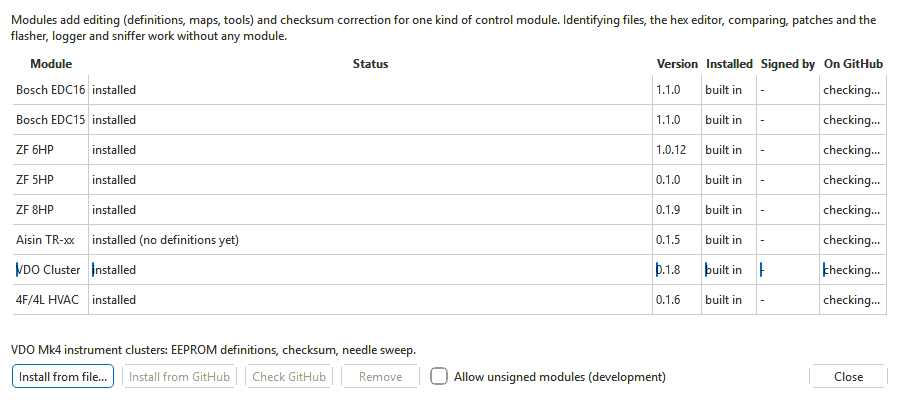

# Modules

OVT-Suite is a **base app** plus one optional **module** per kind of control
unit. The base app identifies every supported file and has everything that
does not depend on knowing the file's contents: the hex editor, comparison,
patches and saved versions, and the flasher, logger, sniffer and simulator,
which read and write every supported control unit. What is specific to one
kind of unit comes in its module:

- its **definitions** — the names, descriptions and layout of its maps, and
  the parameter tree;
- its **checksum correction**;
- its special editors and tools.

| Module | For |
|---|---|
| [Bosch EDC16](modules/edc16/index.md) | EDC16 engine ECUs: definitions, maps, checksum, the EDC16 EEPROM's fields. |
| [Bosch EDC15](modules/edc15/index.md) | EDC15 engine ECUs: definitions, maps, checksum, the EDC15 EEPROM's fields. |
| [ZF 6HP](modules/zf6hp/index.md) | ZF 6HP19/26/28 TCUs: definitions, shift/TCC tools, checksum. |
| [ZF 8HP](modules/zf8hp/index.md) | ZF 8HP Gen1/Gen2 TCUs: definitions and checksum. |
| [Aisin TR-xx](modules/aisin/index.md) | Aisin TR-60SN (09D) and TR-80SD TCUs: identification, and the 09D checksum. |
| [VDO Cluster](modules/vdo/index.md) | VDO Mk4 instrument clusters: EEPROM definitions, checksum, needle sweep. |
| [4F/4L HVAC](modules/hvac/index.md) | Audi Climatronic 4F/4L HVAC: firmware variables and checksum. |

Each module has its own version number, independent of the app's, and
brings its own help pages: they appear under **Modules** in the help
contents when it is installed. A link to a page of a module you have not
installed says which module to install.

## The Module Manager

**Tools > Modules...** lists every module the app knows, installed or not.

| Column | Shows |
|---|---|
| **Module** | The module's name. Hover over it for what it covers; the line under the table shows the same for the selected row. |
| **Status** | **installed**; **installed (checksum only)** — the checksum-only variant (below); **installed (no definitions yet)** — a full module that has no definitions for its files yet; **not installed**; **refused: ...** — a copy is installed but cannot be used, with the reason (see [When a module is refused](#when-a-module-is-refused)); **hidden (OVT_DISABLE_MODULES)** — hidden by that environment variable, a developer setting. |
| **Version** | The installed module's version. |
| **Installed** | Where it is installed: **for you** (your own modules folder), **for all users** (the app's own `modules` folder, where the installers put modules, when the app is installed for all users), **for you (with the app)** (the app's own `modules` folder when the app itself is installed for you only, for example under `%LOCALAPPDATA%\Programs`), or **built in** (part of the program itself, as when running from source). |
| **Signed by** | The key that signed the module, **unsigned** for an unsigned development build, or **-** for a built-in one. |
| **On GitHub** | The newest version published in the app's GitHub releases, marked **(newer)** when it is newer than the installed one; **not published** when no release carries the module. It is looked up when the window opens if the app may check for updates by itself (**Tools > Options...**); otherwise click **Check GitHub**. |

| Control | Does |
|---|---|
| **Install from file...** | Installs a module package (`.ovtmod`) for you. |
| **Install from GitHub** | Downloads the selected module's newest published version and installs it for you, as **Install from file...** does. Available when GitHub has a version you do not have. |
| **Check GitHub** | Looks up the modules published on GitHub again. |
| **Remove** | Removes the selected module. Available for a module installed from a package, not for a built-in one. |
| **Allow unsigned modules (development)** | Accepts modules that are not signed by a trusted key. For development builds only; leave it off. |
| **Close** | Closes the window. |

## Installing a module

There are five ways, all ending in the same place:

**From GitHub, inside the app** — no administrator rights needed:

1. **Tools > Modules...**, select the module and click **Install from
   GitHub**; or open a file whose module you do not have, and click
   **Download and install** in the *Limited support* box that says so (when
   the app may not check for updates by itself, the button reads **Get the
   module from GitHub...** and looks it up when clicked).
2. The module's `.ovtmod` package is downloaded from the newest release that
   has it and checked against the release's signed checksum list. If the
   newest version is built for a later version of the app, the next older
   one is used.
3. Then it is installed exactly as from a file (below): the same question,
   the licence agreement of a closed-source module, your own modules folder.
   A file you opened is opened again with the module.

The same package works on Windows, Linux and macOS, so this needs no
installer program.

**From a file, inside the app** — no administrator rights needed:

1. **Tools > Modules...**, then **Install from file...**, and pick the
   `.ovtmod` file.
2. The app checks the package and asks: *Install the \<name\> module
   \<version\>?*, with what it covers and who signed it.
3. **Yes**. A closed-source module then shows its licence agreement: tick
   **I accept the agreement** and click **Install** (see
   [Licences and legal use](legal.md)).
4. The module is installed for you, in your own modules folder.

**By opening the `.ovtmod`** — on Windows, double-click it (the installer
associates `.ovtmod` files with OVT-Suite). The Module Manager opens on its
own, without the main window, and asks the same question; the module is
installed for you.

**With a module installer** (Windows, `OVTSuite-<Module>-<version>-setup.exe`)
— see [Installing](installing.md#module-installers). It refuses to run
unless OVT-Suite (or OVT Tools / OVT Flasher) is installed. For a
closed-source module it first asks you to accept the module's licence
agreement. It installs for you by default, or for all users into the app's
own folder.

**With the full installer** (Windows), which lists every module on its
**Components** page, or a module package on Linux (`ovtsuite-module-<id>`
`.deb`) — see [Installing](installing.md). The Windows installer asks you to accept the
modules' licence agreement; a Linux package asks the first time the app
starts — see [Licences and legal use](legal.md#accepting-a-modules-licence).

### When a new module takes effect

- **A module that was not loaded before** is usable at once: *The \<name\>
  module \<version\> is installed and ready.* Reopen any project with a
  file of that kind to get its definitions — or use **Install module...** in the limited
  support message (below), which reopens the file for you.
- **A module that replaces one already in use** (an update, or the full
  variant over the checksum-only one) needs a restart: *Restart OVT-Suite to
  use it -- the version already loaded stays in use until then.*

### Before anything is installed

The package is checked completely before a single file is written: that it
is for OVT-Suite, that this version of the app knows that module and its
module interface level, its signature, and every file's checksum. A package
that fails any of these is not installed, and the message says why. A
failed install never leaves a half-installed module behind.

## Removing a module

1. **Tools > Modules...**, select the module, **Remove**, and confirm:
   *Files of this kind will then open in the hex editor only, and their
   checksums will not be corrected.*
2. Restart OVT-Suite to finish — the module stays in use until then.

A module installed **for all users** usually cannot be removed from here
(the app's folder needs administrator rights): the app says *A module
installed for all users is removed with its installer, from the system's app
list.* On Windows that is **Settings > Apps**, where it is listed as
*OVT-Suite \<Module\> module*; on Linux remove its package (`sudo apt remove
ovtsuite-module-<id>`).

## Checksum-only modules

Every module also comes in a small **checksum-only** variant: only its
checksum correction, without definitions or editors. It is what the
standalone tools need — the flasher corrects a file's checksum before it
writes it — so the **OVT Tools** and **OVT Flasher** installers offer the
checksum-only variants (see [Installing](installing.md)).

In the Module Manager it shows as **installed (checksum only)**. A file of
that kind opens with checksum verify and correct available, but in the hex
editor: install the full module to edit it. The full and checksum-only
variants replace each other.

## When a file's module is missing

If you import or open a binary whose module is not installed, the app says
what it is and which module supports it, in a **Limited support** message
(once per set while the project is open; not when projects come back at
start-up):

> \<what the file is\>. Install the \<name\> module for full support.

…followed by what still works: the file opens in the hex editor, and
comparing, patches, version history and the flasher work as usual. If the checksum-only
variant is installed, it adds that checksum verify / correct is available.

- **Install module...** in that message installs a `.ovtmod` and, if that
  succeeds, opens the file again with the module.
- Tools that need the parameter tree (**DTC / Fault-Path editor**,
  **Measuring blocks**, **Gear ratios**, **VSS pulse settings**, **Tune from
  logs**, **VDO Cluster > Needle sweep** ...) are greyed out for that file,
  as is a module's own sub-menu of **Tools** when the module is not
  installed.
- **Tools > Verify checksums...** says which module to install for checksum
  support.
- **Saving** keeps the version in the project without correcting its
  checksum (unless the checksum-only variant is installed).
- **Writing it to a control unit**: the flasher asks first — *Checksum will
  not be corrected* — because an image edited since its checksum was last
  corrected can be rejected by the module, or leave it in boot mode until a
  correct image is written. Answer **No** unless you know the checksum is
  already right (for example a file you have not changed).

A file that no module supports says *No OVT-Suite module supports this
binary.*

## When a module is refused

Every installed module is checked again each time the app starts — its
signature and every file. A module that fails is not loaded, and the Module
Manager shows **refused:** with the reason:

| Reason | What to do |
|---|---|
| *damaged: ... -- reinstall it* | A file of the module was changed or lost. Install the module again. |
| *unsigned (unsigned modules are not allowed)*, *not signed by a trusted key (unsigned modules are not allowed)* | The module is not signed by a key this app trusts. Use the official module package. |
| *built for module API N; this OVT-Suite supports ...* | The module is too old or too new for this app. Install the module version made for your app. |
| *unknown to this OVT-Suite (needs a newer version)* | Update OVT-Suite. |

## Where modules are installed

The app looks in these places, and if one module is in several, the newest
version that passes its checks is used:

| Place | Who puts modules there | Shown as |
|---|---|---|
| Your own modules folder: `%LOCALAPPDATA%\OVT-Suite\modules` on Windows, `~/.local/share/ovtsuite/modules` on Linux, `~/Library/Application Support/OVT-Suite/modules` on macOS | **Install from file...**, opening a `.ovtmod`, and module installers run for you | for you |
| The app's own `modules` folder, beside the program (`/opt/ovtsuite/modules` on Linux) | The full installer, module installers run for all users, Linux module packages | for all users — or **for you (with the app)** when the app itself is installed for you only (its folder is inside your user folder) |

Your own modules folder is shared by OVT-Suite and the standalone tools.

## From the command line

| Command | Does |
|---|---|
| `ovtsuite modules` | Lists the modules and their state. |
| `ovtsuite install-module <file.ovtmod>` | Installs for you. `--system` installs into the app's own folder (all users); `--gui` asks and reports in a window, as opening the file does. |
| `ovtsuite remove-module <id>` | Removes a module installed for you (`--system`: from the app's folder). |
