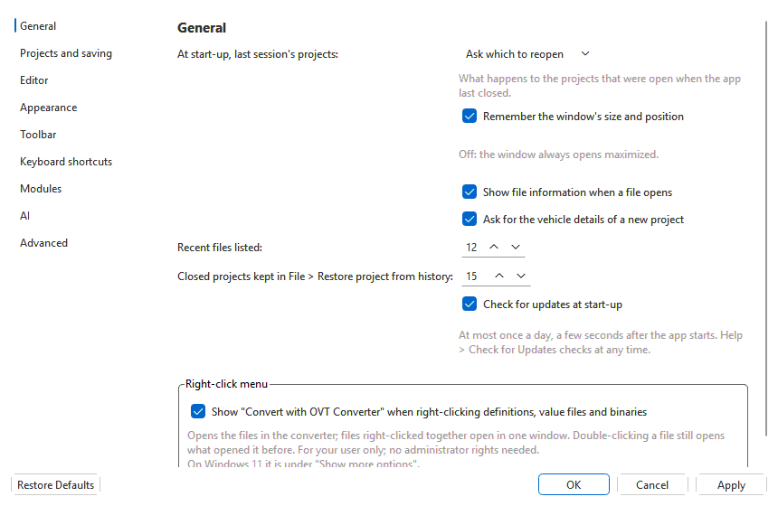
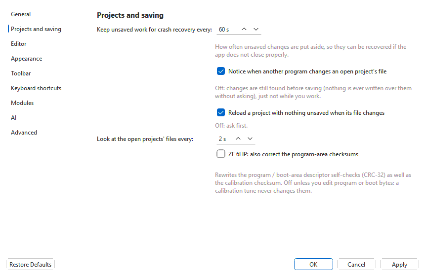
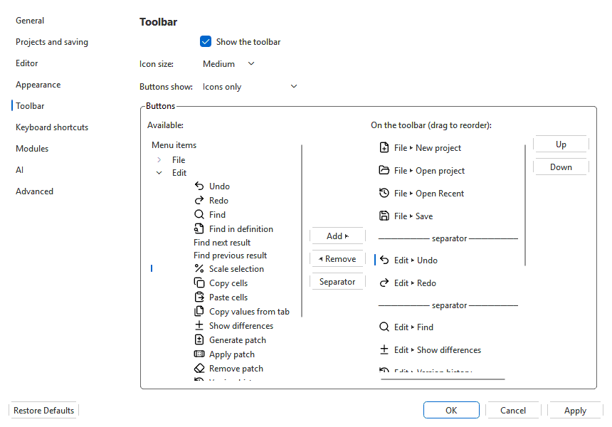
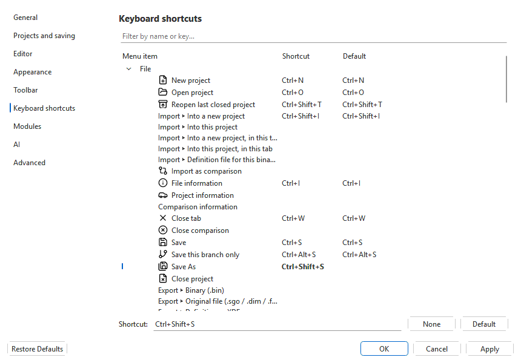

# Options

**Tools > Options...** (Ctrl+,) holds the settings for the whole app: how it
starts, how projects are kept safe, the theme, the toolbar's buttons and the
keyboard shortcuts. Changes take effect when you click **OK** or **Apply**,
in every open window at once; **Cancel** leaves everything as it was.
**Restore Defaults** puts the page on screen back as it was when the app was
installed.

The settings are kept for your Windows user. The standalone flasher, logger
and sniffer use them too (the theme, for example).

## General

| Setting | What it does |
|---|---|
| **At start-up, last session's projects** | **Ask which to reopen** (the default) lists the projects that were open when the app last closed. **Reopen them all** opens them without asking. **Start empty** opens none. |
| **Remember the window's size and position** | Reopen the window at the size and place it had. When this is off, the window always opens maximized. |
| **Show file information when a file opens** | The **File information** window after an import. The same switch is in that window. |
| **Ask for the vehicle details of a new project** | The **Project information** prompt for a new project. |
| **Recent files listed** | How many projects **File > Open Recent** keeps. |
| **Closed projects kept** | How many projects **File > Restore project from history** keeps. |
| **Check for updates at start-up** | Look for a newer version a few seconds after the app starts, at most once a day. See [Checking for updates](updates.md). |
| **Right-click menu** | Adds or removes **Convert with OVT Converter** in the right-click menu of definitions, value files and binaries (Windows Explorer; on Linux the file manager's menu), for your user only. The installer offers it too; this is where to change your mind later. See [Converter](converter.md). |

## Projects and saving

| Setting | What it does |
|---|---|
| **Keep unsaved work for crash recovery every** | How often unsaved changes are put aside (see [Recovering after a crash](projects.md#recovering-after-a-crash)). |
| **Notice when another program changes an open project's file** | Watches the open projects' files while you work (see [When another program changes the project file](projects.md#when-another-program-changes-the-project-file)). When it is off, the app still checks before every save and never writes over another program's changes without asking. |
| **Reload a project with nothing unsaved when its file changes** | On: such a project reloads by itself. Off: the app asks first. |
| **Look at the open projects' files every** | How often the watch looks. |
| **Opening a WinOLS project (.ols)** | What **File > Open** does with one: **As stored** (default) takes every binary it holds, as the versions it lists, and shows only the project's own maps (the module builds no tree of its own; **right-click > Load the module's built-in maps** adds it); **Ask which versions to take**; or **The original only**, with the module's maps beside the project's. Adding files and New project always ask. It is saved as an `.ovt` project either way. See [WinOLS projects](projects.md#winols-projects-and-definitions). |
| **Versions of a WinOLS project in the history** | **Each version a branch of its own, from the original** (default), or **one chain**, each version following the one before it. |
| **ZF 6HP: also correct the program-area checksums** | Shown while the ZF 6HP module is installed; off unless you change it. On: a save or flash of a ZF 6HP file also rewrites the program and boot area's self-checks, not just the calibration checksum. A calibration tune never changes those areas; turn it on only when you edit program or boot bytes. Every open tab follows at once. See [ZF 6HP program-area checksums](editing.md#zf-6hp-program-area-checksums). |

## Editor

| Setting | What it does |
|---|---|
| **Versions listed in Compare with saved version** | How many saves the menu lists before **Version history...**. |
| **3D surface and dyno chart** | Where the two panels go around the table: stacked above it, side by side above it, or beside it on the right. Also in **View > Table panels**. See [3D surface](editor/3d-surface.md). |
| **Comparison table** | Where a loaded comparison's copy of the table goes. **In the same grid, under the table** (the default): below a banner, in the table's own grid. **Below the table** or **Beside the table**: in a read-only grid of its own, which scrolls, sizes its columns and selects together with the table, from either grid. **In the same grid, matching cells marked**: the default layout, with the cells matching the selection framed in the other copy. **Ctrl+J** jumps to the matching cells and back (not in the default). Takes effect at once. See [Comparing files](editor/comparison.md#scrolled-together). |
| **Comparison values** | How a comparison's table is shown: **Resampled onto the primary's axes** (default) or **Original size**, in a grid of its own that is linked to yours only when the two have the same size (when they differ, every cell is outlined). This is the default; each table can have its own (the **Comparison** button on the edit bar, right-click, **View > Comparison size**). See [Comparison size](editor/comparison.md#comparison-size-resampled-or-original). |
| **Difference view: show as** | While a comparison is loaded: the cells as **Values** (default) or as the difference between the primary and the comparison (either way round), a percentage or a ratio. Also in the **Difference view** button on the edit bar, View > Difference view, and the toolbar. See [Showing the difference](editor/comparison.md#showing-the-difference). |
| **Difference view: show it in** | Which table shows it: **the comparison block** (default), **the primary table** (read only while it shows differences) or **both**. |
| **Blank the cells that do not differ in a difference view** | Leaves only the changes on screen. |
| **Tint a difference by direction** | Red where the primary is higher than the comparison, blue where it is lower, whether the table shows values or a difference; the same light colour with dark text in both themes. Not shown while a table's heat map is on. The orange outline of a differing cell stays either way. |

## Appearance

| Setting | What it does |
|---|---|
| **Theme** | **System** follows Windows' light or dark app mode. **Light** and **Dark** stay light or dark whatever Windows is set to. The change applies at once. |
| **Show icons in menus** | Whether the menus show the toolbar's icons beside their items. |
| **Scroll bars** | **As Windows is set** follows Windows 11's *Always show scrollbars* setting. **Always show** shows them in the app whatever that setting is. Takes effect the next time the app starts. |

## Toolbar

The toolbar under the menus holds buttons for menu items. Each button is
the menu item itself: it is greyed out, ticked and triggered exactly as the
menu item is, and its tooltip names its shortcut. A button for a sub-menu,
such as **Open Recent** or **Export**, drops that menu down. One button is
not a menu item: **Find panel** (under Edit) shows and hides the Find panel,
where **Edit > Find...** only opens it.

- **Show the toolbar**, **Icon size** (small, medium, large) and **Buttons
  show** (icons only, or text beside or under the icon).
- **Buttons:** every menu item is listed on the left, by menu. Pick one and
  click **Add ▶** (or double-click it) to put it after the selected button on
  the right. **◀ Remove** (or a double-click on the right) takes a button
  off. **Separator** adds a divider. Drag the buttons, or use **Up** and
  **Down**, to reorder them.

Right-click the toolbar for **Customize toolbar...** (this page) and **Hide
toolbar**. **View > Toolbar** shows or hides it too.

## Keyboard shortcuts

Every menu item is listed by menu with its shortcut and its default. A
changed shortcut is shown in **bold**.

1. Pick a menu item. Type in **Filter** to find it by name or key.
2. Click in **Shortcut** and press the keys you want.
3. **None** removes the item's shortcut. **Default** puts the app's own
   back.

Two items can't share a key: both are shown in red, with a note saying
which, and **OK** / **Apply** wait until one of them changes. The new
shortcuts work as soon as you click **OK**, and the menus and toolbar
tooltips show them. The [Keyboard shortcuts](editor/keyboard-shortcuts.md)
page lists the app's defaults.

## Modules and AI

**Allow unsigned modules** is the same switch as in **Tools > Modules...**
(see [Modules](modules.md)). It is only for modules you build yourself.
**Module manager...** opens that window. The AI assistant's settings have a
window of their own: **AI settings...** opens it (see [AI settings and
privacy](ai/settings.md)). **Maximum saved chat history** (50 MB unless you
change it) is how much room the assistant's saved chats may take; above it
the chats used longest ago are deleted, never the one open in the panel (see
[Chat history](ai/assistant.md#chat-history)).

## Advanced

- **Export...** writes your options, toolbar and shortcuts to a file.
  **Import...** reads them back, for a backup or another computer.
- **Reset all options...** puts every option, the toolbar and the shortcuts
  back to their defaults. Recent files, open tabs and saved connections are
  kept.
