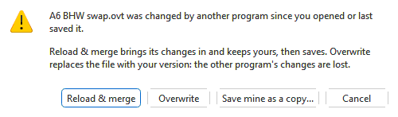
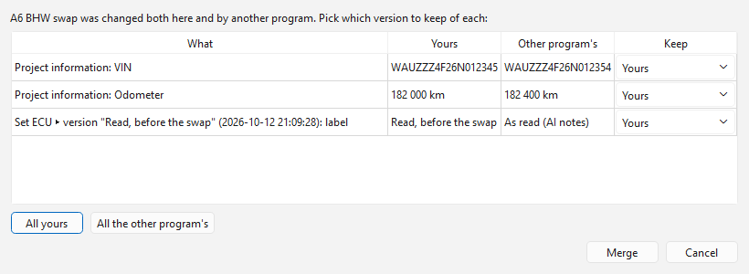
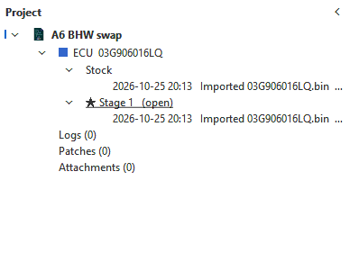

# Projects (.ovt)

A project keeps everything about one car (or one bench job) in a single
`.ovt` file: its control units, every version you saved, the original you
read, different tunes side by side, datalogs, patches and other attachments.
Everything you work on is a project: there are no plain file tabs.

| Part | What it is |
|---|---|
| **Set** | One control unit: ECU, TCU, cluster, HVAC. A set holds every memory region of that unit -- the flash, and the MPC internal flash or EEPROM where the unit has them. |
| **Branch** | A line of versions of a set: *Stock*, *Stage 1*, *Economy*... Saving a tab adds a version to its branch. |
| **History** | Every saved version of a branch. The first version of a read set is **the original as read**; it is never changed or deleted. |
| **Logs** | Datalogs kept with the project. It keeps every log unless you set a limit; over the limit the oldest are removed first, except **pinned** ones. |
| **Patches** | Patches kept with the project, to apply to any of its tabs. |
| **Attachments** | Anything else: dyno sheets, notes, pictures, an internal-ROM dump. |

## Starting a project

A project starts in one of these ways:

- **File > New project...** (Ctrl+N) -- describe the vehicle, then pick the
  files it begins with: a read, the gearbox's `.frf`, a WinOLS project...
  each becomes a set of its own.
- **File > Import > Into a new project...** (Ctrl+Shift+I), or dropping a
  binary on the window with no project open: the binary goes into a new,
  untitled project, which asks for a name and the vehicle details on its
  first **Save** (see [Importing](editor/files-and-formats.md#importing)).
- A read from a control unit, which goes into a project from the start.
- Importing a **WinOLS project** (`.ols`): see [WinOLS projects and
  definitions](#winols-projects-and-definitions).

## Project information

What the project is for: **make**, **model**, **chassis code**, **model
year**, **VIN**, **engine code**, **gearbox**, **stock power**, **odometer**,
the **control unit**, the **owner / customer** and free **notes**. Every field
is optional.

- **File > Project information...**, or double-click the project in the
  Project panel (or right-click it > **Project information...**), to see or
  change it.
- A new project asks for it when it is first saved (or, with **File > New
  project...**, before its files are picked). **Skip** leaves it empty;
  untick **Ask when a new project is created** to stop being asked.
- A VIN is checked as you type: 17 characters, never I, O or Q.
- The tab's tooltip and the Project panel show the vehicle, and an imported
  WinOLS project fills in what its own project properties say.
- **Fitted hardware** lists what is fitted to the car and from when — the
  injection pump head and nozzles, or the unit injectors — with the version
  whose calibration is set up for it. **Tools > Injector setup...** records
  the build it sets a file up for; **Add...**, **Edit...** and **Remove**
  change the list by hand. The dyno chart and the log tools use it to tell
  versions and logs for different hardware apart. See
  [Fitted hardware](#fitted-hardware).

### Fitted hardware

A record says what the car has (*PD150 injectors*, *11 mm pump head,
DSLA150P764 nozzles*), the day it was fitted, and the version whose
calibration is set up for it: **Calibrated in version** (that version has
it), **Set up after version** (the setup was in the edits after it, so the
next version has it) or **Not recorded** (the car has it, no version is set
up for it yet). The car and the file can differ -- new injectors fitted
before the file is set up for them, or an older version written back -- and
the app shows both where it matters:

- **Project panel** -- under each control unit, a line *🔧 Fitted: PD150
  injectors*; when the active branch's latest version (with its tab's unsaved
  changes) is set up for something else it goes on *— this version is set up
  for: ...* (or *is not set up for it*), in orange. Hover for every record
  with its date and version; double-click (or right-click) to edit them. The
  versions where the setup changes are marked *🔧 set up for ...*.
- **Version history** -- the same mark in **Status**, and every version's
  tooltip says what it is set up for.
- **The tab's tooltip** -- the *Fitted: ...* line.
- **Writing to the car** -- when the version being written is set up for
  other hardware than is recorded as fitted, the write asks first (see
  [Flashing](flashing.md)).
- **The AI assistant** -- *Project info* gives it the records and, per
  branch, the hardware its latest version is set up for.

## Opening a project

**File > Open project...** (Ctrl+O), **File > Open Recent**, or dropping a
`.ovt` on the window opens a project. The first time, every set opens in a
tab of its own; after that, the tabs you had open last time come back. Each
tab is labelled with the project's name, the set and the branch -- *A6 ▸ ECU
· Stage 1* -- and tinted like any ECU or TCU tab. The window title shows the
same with the project's file name added -- *A6 [A6-stage2.ovt] ▸ ECU · Stage
1* (just *A6.ovt ▸ ...* when the file is named after the project) -- so after
**Save As** it names the new file; `*` when the project has unsaved changes.

A set or branch that is not open is one click away: double-click it in the
**Project panel** (View > Project panel), or pick it from **File > Open from
project**. Close a tab as usual; the project stays open while any of its tabs
is, and closes with the last one. **File > Close project** closes all of them.

A project keeps each branch's parameter tree once it has been worked out, so
a binary opens without being identified and matched again. A tree that had
to be worked out afresh is written into the project file by itself a few
seconds after the tab opens (or when you close it) -- even when you have
other unsaved changes, which stay unsaved, or close without saving. It is
not written into a file another program changed meanwhile, nor into a signed
project (that would break its signature). A new branch
starts with the tree of the branch it came from, and a branch without one
borrows a sibling branch's when it still fits the binary. When a tree has to
be worked out for a modified version, it is worked out on the set's original
version -- where no edited map can mislead the search -- and used for the
modified one, unless a table's header (its size or an axis count) was changed
there; then the modified version is searched on its own. The status bar says
"parameters located on the original version" when that happened. A binary saved in
the project as *unknown* by an older version of the app is recognised again
when it opens, and the project records what it is the next time it is saved.

Several projects can be open at once. Copying values between tabs and
comparing against another tab work across projects too. A project open in
one window cannot be opened in another window (see [Tabs and
sessions](editor/tabs-and-sessions.md#one-window)).

To add a binary to the project in front, use **File > Import > Into this
project...**, or drop it on the window and pick **Import into <project>**.
A closed project comes back with **File > Restore project from history** or
**File > Reopen last closed project** (Ctrl+Shift+T), with the tabs it had.

## Comparing

A project tab opens with **the original as read** as its comparison, so the
differences shown are your changes. **File > Compare with saved version**
lists the branch's versions; double-clicking a version in the Project panel
makes it the comparison of its own branch's tab. **File > Import as
comparison...** compares against a binary, or any set, branch and version of
this project or another one. See
[Comparing files](editor/comparison.md).

## Saving

| Command | What it saves |
|---|---|
| **Save** (Ctrl+S) | The whole project: every edited tab of it becomes a new version on its branch. |
| **Save this branch only** (Ctrl+Alt+S) | Just this tab. The project's other tabs keep their unsaved changes. |
| **Save As...** | The whole project under a new name. |

A new, untitled project (an import into a new project, or a read) asks for
its name and the vehicle details on its first **Save**. An imported file as
it was on disk is the set's original, and your edits the next version. A
`.dim`, `.sgo` or `.frf` is kept in the project byte for byte.

Checksums are corrected when a version is saved, exactly as for any file.

The project file is written in the background: the window keeps drawing,
but takes no clicks or typing until the file is safely on disk. A save that
takes more than a moment (a big project, a slow or network drive) shows
**Saving...** meanwhile. Only what changed since the last save is packed
again, so saving a project with many logs stays quick.

Closing a tab with unsaved changes asks about that tab only; closing the
window asks about every project (see [Tabs and
sessions](editor/tabs-and-sessions.md#closing-the-app)).

## When another program changes the project file

Other programs can write to an open project's `.ovt` file: a script, an AI
assistant, or the standalone flasher or logger. The app notices, and never
silently writes over their changes.

- **Nothing unsaved in the project:** it reloads by itself within a few
  seconds, and the status bar says so.
- **Unsaved changes:** it asks whether to merge the other program's changes
  in now. If you choose **Later**, the next save asks again.
- **Saving**, from Save, the Project panel or the exit prompt, when the file
  has changed since you opened or last saved it:

| Choice | What happens |
|---|---|
| **Reload & merge** | The other program's changes come in, yours stay, then the project is saved with both. |
| **Overwrite** | The file is replaced with your version. The other program's changes are lost. |
| **Save mine as a copy...** | Your version goes into a new file, which the project uses from now on. The changed file is left alone. |
| **Cancel** | Nothing is saved. |

Closing the app without saving leaves the file exactly as the other program
wrote it.

### How merging works

Everything in a project (sets, branches, versions, originals, logs,
attachments, patches, information) is matched by its identity, not by its
position:

- Something added on either side is kept: new versions, branches, logs,
  attachments, information.
- Something changed on one side only is taken from that side.
- Something one side deleted and the other did not change is deleted. If the
  other side changed it, or you have it open with unsaved edits, it is kept.
- **Both sides saved to the same branch:** the other program's version stays
  on the branch, and yours goes on a new branch, *name (mine)*, which your tab
  then shows.
- **Unsaved edits in a tab** whose branch the other program changed are
  re-applied on top of its new version. If they touch the same bytes, they
  stay as they are on a new *name (mine)* branch instead. Undo starts again
  from the merge.
- **The same thing changed differently on both sides**, such as a version's
  name, an information field or a packaged definition: **Merge changes**
  lists each one, and you choose to keep yours or the other program's.

A merged project is unsaved until you save it. If the file now holds a
different project, or needs a newer version of the app, it can't be merged:
use **Overwrite** or **Save mine as a copy**.

## Logs, patches and flashing

- **Data logs** of a controller whose binary is open in a project tab are
  kept in the project by default (see [Data
  logging](logging.md#logs-in-the-project)).
- **Patches** made in a project tab can be kept in it (see
  [Patches](editor/patches.md#patches-kept-in-the-project)).
- **Reads** from a control unit go into a project: with a project tab in
  front you are asked **Add to <project>** or **New project**, and can
  **Export to file...** instead of opening it (see
  [Reading](flashing/reading.md#where-the-read-goes)).
- After a successful **write**, the version written is marked as last
  flashed: the Project panel puts a **⚡ bolt in front of it** (its tooltip says
  when), and the set's and tab's tooltips say *Last flashed <date> (<branch>, saved version |
  unsaved edits)*. A tab with unsaved changes is offered to be saved first
  (see [Writing](flashing/writing.md)).
- A change proposed by the **AI** and accepted on a project tab with no
  other unsaved edits is saved straight away as its own version, named
  **AI: <title>** (each step of a plan separately), so it can be compared
  against or reverted like any other (see [Proposals and
  plans](ai/proposals.md#accepting)).

## The Project panel

**View > Project panel** (Ctrl+Shift+P, or its toolbar button) shows it
expanded at the side of the window; used again, it collapses the panel to
its strip.

- **Hover** a version for its whole name and date (a long name is cut by a
  narrow panel); the same tooltip is in **Version history** and in the
  **Compare with saved version** menu.
- **Resize** it by dragging the edge between it and the rest of the window.
- **Collapse** it with the arrow in its title bar, or with **View > Project
  panel**: it shrinks to a narrow strip labelled *Project*, and the window
  gets the space back.
- While collapsed, **rest the mouse on the strip** and the panel opens over
  the window (nothing beside it moves); it closes again when the mouse
  leaves it. Drag its outer edge to make it wider.
- **Expand** it again with **View > Project panel**, by clicking the strip,
  or with **Keep open** at the top of the opened panel.

The panel appears when the first project opens and is never closed: it is
either expanded, collapsed to its strip, or open over the window from the
strip. Drag its title bar to the other side of the window to dock it on the
right (or back on the left). It remembers whether it was collapsed and how
wide it was.

Right-click an item for what can be done with it:

- **Project** -- project information, **Add files to the project** (each
  becomes a set), save, rename, set how many logs are kept, close.
- **Set** -- rename; **Attach a definition** (XDF, A2L, KP, OLS or DAM) to a
  binary no module recognises, so it opens with that definition's tables and
  values in the main view instead of only the hex editor; **Definition
  placement...** to see how its tables were placed, give the offset or the
  image it was made for ([Placing a definition
  file](editor/definitions.md)); **Hide the module's built-in maps** (when a
  module also defines the binary) to show only the definition's maps, or
  untick it to show them beside the module's again; remove it again.
  The set's tooltip names the definition it has. **Import a new original...**
  makes another file of the same software the binary's original (see
  [A new original](#a-new-original)). **Remove from the
  project...** takes the binary out with all its versions and branches
  (its open tab closes; logs, patches and attachments kept for it stay in
  the project). A project keeps at least one binary.
- **Branch** -- open it, make it the active branch (the one a first open
  shows), rename, **New branch from here**, delete (its history stays).
- **Branch** or **Version** -- **Compare with project**: a binary version
  from *another* project as this branch's comparison. Pick one of the other
  open projects, a recent one, or **Browse...**; the branch's tab opens if it
  is not open, and you are asked which binary and version of that project
  (only binaries of the same kind are offered). A branch of the other project
  that is open in a tab, at its latest version, is compared live.
- **Version** -- compare with it, **Revert the branch to this version** (adds
  a new version; nothing is lost), **New branch from this version**,
  **Rename...** (or select it and press **F2**; leave the name empty to give
  it back its automatic name). The new name shows in **Version history** too,
  and a name given or cleared there shows here.
  **Export this version...** saves that version as it was saved: one part
  of the set as a raw `.bin` (you pick which, for a set of several), or the
  set's original file (`.dim`, `.sgo` ...) rebuilt with that version's
  content. **Open this version (read-only)** opens it in a tab of its own,
  titled *<project> – <set> @ <version> (read-only)*: look at its tables,
  compare it, export it -- but nothing in it can be edited or saved, it is
  not added to Open Recent, and closing it asks nothing. To work on it, use
  **Revert the branch to this version** or **New branch from this version**.
- **Log** -- **Open in Data logging**, **Export...**, **Pin** / **Unpin**,
  **Remove**, **Summarise with AI...** (see [the assistant](ai/assistant.md#asking-from-where-you-are)).
- **Patch** -- **Apply to this tab...** (or double-click it), **Export...**,
  **Remove**.
- **Attachment** -- **Open externally** (or double-click it), **Open
  with...**, **Show copy in folder**, **Export...**, **Remove**. A kept
  fault-code read also has **View fault code report**.

Logs, patches and attachments all have the three *open* commands; see
[Opening a kept file in another program](#opening-a-kept-file-in-another-program).

**Save** always leaves correct checksums: a tab whose checksums are wrong
is saved even when nothing in it was edited (a file read or imported with
bad checksums), as a version named *checksums corrected*.

To remove several logs, patches or attachments at once (fault-code reads
among them), select them with Ctrl-click or Shift-click and choose **Remove
*n* items**, or press **Delete**; you are asked once for all of them.
- **Logs** / **Patches** / **Attachments** (the headings) -- add one.

Each project lists its **Logs**, **Patches** and **Attachments** under its
sets, newest first (as do **File > Export** and the pickers that offer
them); sets and branches stay in the order they were made.

### Opening a kept file in another program

**Open externally** opens a log, patch or attachment in the program your
system uses for that kind of file (a spreadsheet for a `.xlsx`, a PDF
viewer, a text editor), with no export and no place to choose. **Open
with...** asks for a program once and remembers it for that file type
(the menu then offers **Open with** *program* directly). **Show copy in
folder** opens the folder the temporary copy is in, for programs you start
yourself.

The program gets a **temporary copy**. You never name it or clean it up: it
is erased when the program you chose with **Open with...** closes, or --
for **Open externally**, where the app cannot tell when the other program
ends -- when the project or the app closes. Anything a crash left behind is
erased at the next start. While the copy is open the item shows
*(open externally)* in the panel.

When you save the file in the other program and come back to the app, you
are asked whether to **Update project copy**. That replaces what the
project keeps (its name, set, pin and note stay). **Not now** leaves it
alone until the file is saved again. Tick **Always update from now on for
this file** to stop being asked for that file in this session; the item
shows *(edited externally)* until the project has the change. If you close
the project, or the app, with a change the project does not have, you are
asked once: **Update project copy**, **Discard changes** or **Cancel**.
Removing the item erases its copy.

## A new original

The original of a binary is the first version of its history, the one **compare
with the original** shows. When the first file you imported turns out not to
have been the stock one (a read of a car that was already tuned), right-click
the binary in the Project panel > **Import a new original...** and pick the
stock file: a read, a `.bin`, an `.sgo`, `.frf`, `.dim` or a container.

The file becomes the original, and **the original the binary had becomes a
version based on it** (named *Previous original: ...*); every version and
branch after it stays exactly as it was, and the comparison of every version
is now the new original. You are shown how many bytes differ between the two
before you confirm, and the change is kept when you save the project. The file
has to be the same software -- the same parts and sizes -- as the original it
replaces; for another software, add it as a binary of its own.

An EDC16 **calibration-only file** (512 KB) is the 2 MB image it is a window of
once imported. As a new original it replaces only that window of the original's
image: the boot and program areas stay as the original has them, so the other
versions keep the bytes they share with it.

The other way round, an older project's original may still be a 512 KB
calibration-only file. A 2 MB EDC16 image can replace it: the 2 MB image
becomes the original, and the 512 KB original -- with every version and branch
after it -- becomes a version sitting in that image's calibration area (the
rest of each of them is the 2 MB image's). Every version keeps the bytes it
had. Save or discard the unsaved changes in the binary's open tabs first; a
history that changed the file's size cannot move.

## WinOLS projects and definitions

**A WinOLS project** (`.ols`) holds a binary *and* its map definitions.
**File > Open project...** lists `.ols` files beside `.ovt` ones and opens one as a
new, unsaved project (saved as an `.ovt`), the way Options > Projects and saving >
*Opening a WinOLS project* says;
importing one (**File > New project...**, or **Add files to the project**) makes
it a set of a project you already have:

- its binary becomes the set's original, named after the WinOLS version it
  holds (*WinOLS: Original*); an image WinOLS put together from an EDC16's
  flash and MPC is split into the two again;
- a project can hold **several versions of the binary** (the original and
  what was made from it in WinOLS). **File > Open** takes all of them, as
  the project lists them; importing asks what to take: **the original
  only**, **all versions**, or **the versions you tick** in the list (it shows
  the date WinOLS lists for each, and its comment as a tooltip). All of them
  go into the one set: the first is its original, each later one a saved
  version named *WinOLS: <name>*, dated as WinOLS dates it, with WinOLS's
  comment kept. WinOLS keeps its versions as a flat list of whole binaries, so
  by default **each is a branch of its own** off the original (named after the
  version; the one WinOLS had open is the branch the project opens on), and
  you can compare them and go back to any of them. **Tools > Options >
  Projects and saving > Versions of a WinOLS project in the history** can
  chain them instead: one branch, each version saved on top of the one before;
- its maps become the set's definition: when no module recognises the binary,
  it opens with WinOLS's maps -- names, descriptions, folders as categories,
  axes, units and conversions -- in the main view. **File > Open** shows
  *only* these maps, placed at the addresses WinOLS has them (nothing is
  searched for in the binary, the module's maps are left out, and the module
  still corrects the checksums; **Hide the module's built-in maps** on the set
  turns that on or off afterwards). Importing, or **Tools > Options >
  Projects and saving > Opening a WinOLS project** set to *Ask* or *The
  original only*, adds WinOLS's maps beside a module's tree, under **From
  <file>.ols**. German descriptions and categories are shown in English;
- the vehicle and control-unit details entered in WinOLS fill the project
  information.

The `.ols` itself is kept in the project. Projects of OLS 4 and 5 are read
(format versions 114 to 597); a map list that does not read completely is
reported rather than guessed at.

**A definition** describes a binary but holds none:

| File | What it is |
|---|---|
| `.xdf` | TunerPro definition |
| `.a2l` | ASAP2 description (the manufacturer's), with its record layouts, shared axes and conversions |
| `.kp` | WinOLS map pack |
| `.dam` | Bosch DAMOS description |

**File > Import > Definition file for this binary (XDF, A2L, KP, OLS, DAM)...**
attaches one to the binary in the tab in front. Picked in **File > Import**
together with one binary, it attaches to that binary; picked alone, it
attaches to the binary of the tab in front, or (into a new project) asks
which binary. A binary imported with a definition of the same name beside it
(`car.bin` + `car.a2l`) gets it automatically. Attach or change one later from
the Project panel. Addresses in an A2L are the control unit's: they are placed
on the binary from the file's memory segments. Where an A2L layout stores its
axis sizes in the binary, they are read from it. A DAMOS is placed with its
program base address and memory segments; its curves' and maps' sizes are
read from the binary, each axis is named after the measured value it uses,
and conversions such as a frequency stored as a period show (and edit) in
their physical units.

When a module knows the binary, its own map tree stays: the definition's
tables are added beside it, in a group of their own (or used instead, if
you choose so when attaching it). Each table is placed where evidence in
the binary confirms it -- see [Placing a definition
file](editor/definitions.md).

German in a definition is shown in English. A description the app knows --
every description of the Bosch EDC15 DAMOS it ships translations for -- gets
its checked English, with the German kept after **DE:**; any other is
translated word by word, German words left in a half-English text and
tree headings included. A word the app has no translation for stays in
German. Units
are always shown in English (*mg/Hub* reads *mg/stroke*, *Grad C* reads
*deg C*).

## Exporting

**File > Export** makes every file from the last saved version of the branch
(you are offered to save first):

- **Binary (.bin)...** -- one part of the set (flash, MPC or EEPROM) as a
  plain `.bin`;
- **Original file (.sgo / .dim / .frf)...** -- the file the set was imported
  from, with the saved version in it (byte for byte the original when
  nothing changed). An edited `.frf` cannot be rebuilt yet --
  export the `.bin` instead;
- **Definition as XDF...** -- the tab's parameters as a TunerPro
  definition;
- **Data log...**, **Patch...** and **Attachment...** -- each picks one of
  the project's.

Files of earlier versions (`.6hp`, `.edc16`, `.edc15` ...) are imported
only; there is no export to them.

See [Exporting](editor/export.md).

## Patches and version history

Applying a patch, **Remove patch**, **Version history** (name a version,
compare with one, go back to one) and **Generate patch from history** work on
the branch's own versions. A patch
applied and saved is listed by Remove patch whenever the project is opened
again. Adjacent versions can be merged (Version history, or select them in
the Project panel and right-click **Merge N versions into one...**); see
[Version history](editing.md#where-the-history-is-kept).

## Recovering after a crash

While a project is open, its unsaved changes are kept aside every minute
(**Tools > Options... > Projects and saving** changes how often), exactly as
edited (no checksum correction). If the app does not close
properly, the next start offers **Recover unsaved work**: recovered changes
open as unsaved edits, so nothing is written until you save. **Decide later**
keeps them for the next start; an unticked entry is discarded.

Closing the app normally removes that data, whether you saved or chose not
to.
