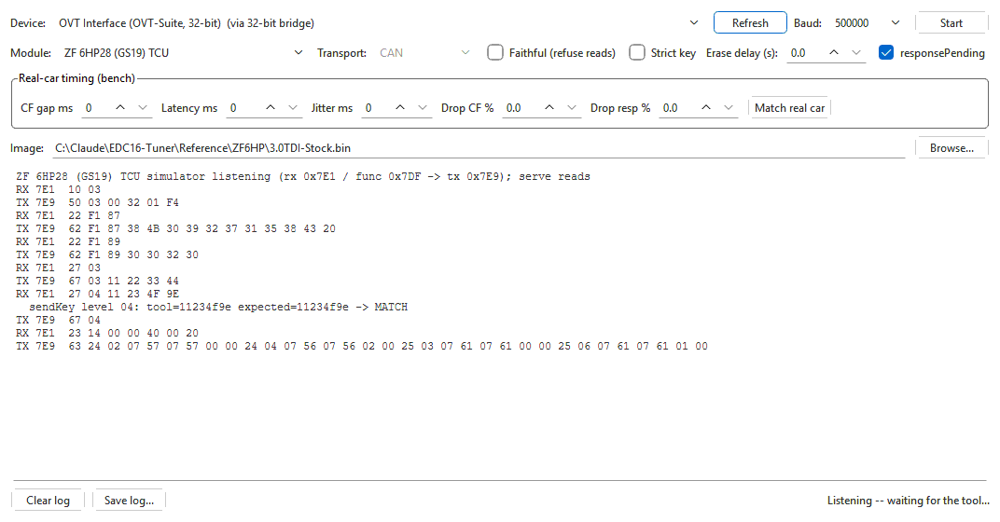
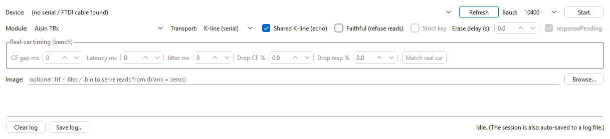

# ECU simulator

The bench ECU simulator makes a J2534 device (or a serial K-line cable)
**answer as a control unit**. Point another diagnostic or flash tool at it on
the bench and the tool walks through its whole sequence — identification,
security access, reads, even a complete write — while the simulator logs every
request and every answer. It is how you find out exactly what a tool does,
without the real module or a car.

It is a responder only: it never flashes anything and never talks to a real
control unit.

Open it with **Tools > ECU simulator (bench)...** in the main window, or on
its own with the **OVT Simulator** shortcut. It needs no file open.

## Why it is needed

On a bare bench a tool's first CAN frame is never even acknowledged, so the
tool gives up before it sends anything interesting. With the simulator on the
bus, the frames are acknowledged and answered the way the module would answer
them, and the tool carries on.

## Capture another tool's sequence

1. **Wire the bench.** Put the simulator's J2534 device and the other tool's
   interface on the same CAN pair (CAN-H to CAN-H, CAN-L to CAN-L) with a
   120 ohm terminating resistor at each end, and 12 V to both interfaces.
2. In **Device:** pick the simulator's J2534 device; **Baud:** **500000** for
   these modules.
3. In **Module:** pick what to pretend to be (see the table below).
4. Optionally choose an **Image** to serve reads from (**Browse...**).
5. Leave **Faithful (refuse reads)** and **Strict key** off for a first run,
   so nothing the simulator does stops the tool.
6. Press **Start** and confirm. The status line reads "Listening -- waiting for
   the tool...".
7. Run the other tool's read (or write) against the bench.
8. Watch the log: every request is an `RX` line, every answer a `TX` line,
   with notes on security keys, routines and transfers between them.
9. Press **Stop**. The status line gives the number of requests answered.

The whole session is also saved to a log file automatically (see
[The log files](#the-log-files)).

## The modules

| Module | Speaks | Notes |
|---|---|---|
| **ZF 6HP28 (GS19) TCU** | UDS on ISO-TP (CAN) | Identification, a few live-data identifiers, both security levels (read and write) checked against the 6HP28 key algorithms. |
| **ZF 8HP (Gen1 AL551) TCU** | UDS on ISO-TP | Identification is taken from the served image. Memory reads are refused until the tool has opened diagnostic session 0x4F and unlocked security level 03/04 — the simulator assumes the 8HP reads the way the 6HP28 does. Written blocks are decoded and checked by the verify routine. |
| **ZF 8HP Gen2 (ALX52) TCU** | UDS on ISO-TP | As the Gen1 profile, for the 3 MB Gen2 flash and its encrypted transfer format. |
| **Aisin 8-speed TR-80SD (AL991/AQ250) TCU** | UDS on ISO-TP | Write-level security checked against its key algorithm. |
| **Aisin 8-speed TR-80SD (AQ450) TCU** | UDS on ISO-TP | As above, for the AQ450. |
| **Generic UDS module (ISO-TP)** | UDS on ISO-TP | A plain module with placeholder identification and no key algorithm; every key is accepted and logged. |
| **Aisin TRx** | KWP2000 on VW TP 2.0 (CAN), or on K-line | The Aisin 09D. On CAN it answers a TP 2.0 channel setup for any logical address and logs which one the tool used. Its identification (part number) comes from the served image when it has one. |

The UDS modules listen on CAN id 0x7E1 (and the functional id 0x7DF) and
answer on 0x7E9.

## Options

| Control | What it does |
|---|---|
| **Device:** / **Refresh** | the J2534 device (or OpenPort 2.0) that answers; on K-line, the serial / FTDI cable |
| **Baud:** | CAN: 500000, 250000, 125000, 1000000, 100000 or 83333. K-line: the starting rate — 10400, 9600, 4800, 57600 or 115200 |
| **Transport:** | **CAN** or **K-line (serial)**. Only modules that can run on K-line offer the choice (the **Aisin TRx**); the others are CAN only and the box is greyed out |
| **Shared K-line (echo)** | K-line only. Ticked: the simulator's cable shares one K-line wire with the tester's, and the simulator ignores the echo of its own bytes. Unticked: for a crossed virtual COM-port pair, which has no echo |
| **Faithful (refuse reads)** | off: memory reads are answered from the image so the tool finishes its read. On: reads are refused, to see where a tool stalls when the module says no |
| **Strict key** | off: a security key is checked and logged as MATCH or MISMATCH, but access is granted anyway. On: a wrong key is refused, as a real module would |
| **Erase delay (s):** | hold the reply to an erase request this many seconds (0 = answer at once), to see how the tool copes with a slow erase |
| **responsePending** | during the erase delay, send "response pending" messages (ticked) or stay silent (unticked) — the two ways a module can make a tool wait |
| **Image:** | the file reads are served from (see below) |

Your selections are remembered for next time. They are read once, at
**Start**, so while the simulator runs they are greyed out — including the
real-car timing boxes below. On K-line, **Strict key**, the erase options and
the real-car timing stay greyed out: the K-line responder does not use them.

## Real-car timing (bench)

These reproduce the slow and occasionally lossy behaviour of a real
transmission behind the car's gateway, so a flashing tool can be tested
against it on the bench. All zero means ideal timing.

| Control | What it does |
|---|---|
| **CF gap ms** | the module's own minimum gap between the frames of a long answer, whatever the tester asks for |
| **Latency ms** | delay before each answer |
| **Jitter ms** | random plus-or-minus variation on the gap and the latency |
| **Drop CF %** | chance of dropping one frame in the middle of a long answer — the tester should time out |
| **Drop resp %** | chance of dropping a whole answer — the tester sees no reply to that request |
| **Match real car** | sets 10 ms per frame with 2 ms of jitter, the pacing measured on a real car |

## Serving an image

With **Image:** empty, every read returns zeros. To give the tool real data,
choose an image: `.frf`, `.6hp`, `.sgo`, `.09d` or `.bin`.

- An `.frf` flash container is unpacked to its flash image (ZF 6HP and Aisin
  8-speed containers); any other file is served as it is.
- For the **Aisin TRx**, an `.sgo` file is unpacked to its calibration; on
  K-line the image's size picks between the early 512 KiB and the later 1 MiB
  variant.
- If the image cannot be loaded, the log says "(could not load image, serving
  zeros: ...)" and the simulator runs anyway.

When a tool writes a block (UDS modules), the decoded block is put into the
served image, so a following verify or read sees what was just written.

## The log files

- **The session log.** Everything shown in the window is also written, as it
  happens, to `ecu-sim-<date>-<time>.log` in the folder you last saved a log
  to (or your home folder). Its path is the first line of the log.
- **Captured writes.** When a tool writes data, each transfer is saved beside
  the session log: for the UDS modules `xfer-blk0x<block>-raw.bin` (what came
  over the wire) and, when it could be decoded, `xfer-blk0x<block>-plain.bin`;
  for the Aisin TRx `trx-write-<n>-addr<address>.bin`. The log notes each file
  and the checksums.
- **Save log...** saves what is in the window to a `.txt` file of your
  choice; **Clear log** empties the window (not the session log file).

On CAN the log normally starts with a bus check: how many frames the device heard in
1.5 seconds. "0 frames" means the device is not on a live bus — check the
wiring and power before blaming the tool.

## Aisin TRx on K-line

1. **Module:** **Aisin TRx**, **Transport:** **K-line (serial)**. The device
   box now lists serial / FTDI cables (J2534 devices cannot act as the module
   on K-line).
2. Wire the simulator's K-line and ground to the tester's, with 12 V present —
   or use a crossed virtual COM-port pair and untick **Shared K-line (echo)**.
3. **Start**. The simulator answers the wake-up and follows OVT-Suite's own
   link-speed raise.

On K-line only **Faithful (refuse reads)** applies; the real-car timing,
**Strict key** and the erase options are used on CAN only, so they are greyed
out while **K-line (serial)** is selected.

## Tips

- Run the [bus sniffer](sniffer.md) on a third interface at the same time for
  a frame-level capture with timings beside the simulator's log.
- Compare two tools by running each against the same module and image and
  comparing the session logs.
- To test how a flasher survives a bad connection, start with **Match real
  car**, then add a small **Drop resp %**.

## Troubleshooting

| Problem | What to try |
|---|---|
| "Could not run the simulator" | The message gives the reason. If another program (or another OVT-Suite window) is using the device, close it and press **Start** again. |
| The log shows nothing after **Start** | Read the bus-check line: with 0 frames the device hears no CAN. Check CAN-H/CAN-L, both terminators and 12 V. |
| The tool still says "no response" | Is it asking for this module? The UDS modules answer on 0x7E1/0x7E9 only; the bus-check line says whether the tester's 0x7E1 requests were seen. |
| A read stops partway | Turn **Faithful (refuse reads)** off, and check **Drop resp %** is 0. |
