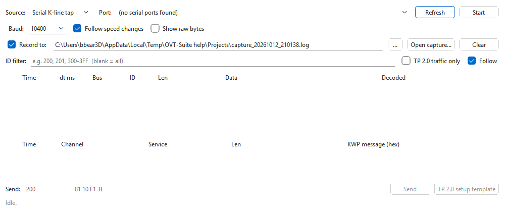

# Bus sniffer

The bus sniffer records the traffic between a scan or flash tool and a control
unit, and decodes it as it arrives: VW TP 2.0 channels on CAN, and the
KWP2000 messages inside them; KWP2000 and KW1281 on K-line. Use it to see
exactly what another tool sends, in what order and with what timing — and
save it to a capture file to study later.

Open it with **Tools > Bus sniffer (J2534)...** in the main window, or on its
own with the **OVT Sniffer** shortcut. It needs no file open.


## Capture a tool's session on CAN

1. Connect a J2534 device (or an OpenPort 2.0) to the same CAN as the tool
   and the control unit — at the OBD port, or on the bench.
2. **Source:** **J2534 device**. Pick it in **Device:** (press **Refresh** if
   you plugged it in after opening the sniffer).
3. **Mode:** **CAN**, **Bit rate:** **500000** for the drivetrain CAN on most
   cars of this era.
4. Leave **Record to:** ticked to save the capture; the file name is filled in
   for you.
5. Press **Start**. The status line shows the bus, the rate, the battery
   voltage the device measures and the device, for example
   "Listening: CAN at 500000, battery 12.4 V via ...".
6. Run the other tool. Frames appear in the upper table; complete KWP2000
   messages in the lower one.
7. Press **Stop**. The status line says how many frames were written and where.

## Capture on K-line

There are two ways to listen to a K-line:

- **Through a J2534 device** — **Source:** **J2534 device**, **Mode:**
  **K-line**, the **Baud:** and protocol (**ISO 14230** or **ISO 9141**). The
  device shares the wire with the other tester and sees both directions, but
  only as complete messages: the 5-baud wake-up and bytes that are not a valid
  message at the set baud are invisible. When the other tool raises the link
  speed, change **Baud:** to follow it; the change applies while running.
- **As a passive serial tap** — **Source:** **Serial K-line tap**, then the
  **Port:** of a second FTDI / KKL cable (a K+DCAN cable switched to K works)
  on the same K-line. The tap never transmits. It frames the bytes itself:
  KWP2000 messages (accepted only when their checksum is right), the wake-up
  answer, and KW1281 blocks with the echoed complement bytes removed.



For the serial tap:

| Option | What it does |
|---|---|
| **Baud:** | the rate the tap starts at — 10400 for most ECUs, 9600 for some KW1281 ones |
| **Follow speed changes** | when the ECU accepts a link-speed change, the tap switches to the new rate itself, and back to the start rate after 8 seconds of silence |
| **Show raw bytes** | also list the unframed bursts of bytes as they arrived ("k raw" rows) |

## The two tables

The upper table has one row per frame:

| Column | Shows |
|---|---|
| **Time** | seconds since the first frame |
| **dt ms** | milliseconds since the previous frame |
| **Bus** | `can`, `kline`, `k-line` (wake-up and framing notes) or `k raw`; `tx` is added to frames this device sent |
| **ID** | the CAN identifier (three hex digits, eight for 29-bit ids) |
| **Len**, **Data** | the payload length and bytes |
| **Decoded** | what the frame is: TP 2.0 channel setup and its answer, parameters, data and acknowledgement frames, or the KWP2000 service on K-line |

TP 2.0 rows are coloured by kind: channel setup in yellow, channel parameters
in blue, data in green and acknowledgements in grey. The decoder follows the
channel setup to learn which identifiers each side uses, and marks every
frame **T→E** (tester to ECU) or **E→T**.

The lower table lists each complete KWP2000 message, reassembled from its TP
2.0 frames: **Time**, **Channel** (direction), **Service** (for example
`readEcuIdentification`, or a negative response with its reason), **Len**
and the message in hex. Hover over a row to see the full decode.

The upper table keeps the latest 50000 frames; a capture file keeps them all.

## Filtering the view

| Control | What it does |
|---|---|
| **ID filter:** | show only these CAN identifiers, in hex: single ids and ranges, separated by commas — `200, 201, 300-3FF`. Blank shows all. Applies when you press Enter or leave the box. |
| **TP 2.0 traffic only** | hide CAN frames that are not part of a TP 2.0 channel (the cars' normal broadcast traffic) |
| **Follow** | keep scrolling to the newest row |
| **Clear** | empty both tables |

Filters only change what is shown: everything is still recorded, and changing
a filter re-decodes everything held so far.

## CAN options

| Option | What it does |
|---|---|
| **Bit rate:** | 500000, 250000, 125000, 100000, 83333, 50000 or 33333 — or type another |
| **29-bit ids** | also receive extended (29-bit) identifiers |
| **Show own frames** | list frames this device sends (from the **Send** row) as `tx` rows |

## Capture files

**Record to:** writes every frame to a text file as it arrives. The default
name is `capture_` plus the date and time, `.log`, in the folder you last
saved a log to; **...** picks another. Each line is one frame:

```
(1760000000.002000) can 200#01C00010000301
(1760000000.010000) kline 0#8110F13E
```

Lines starting with `#` are comments; the file starts with one naming the
device, bus and rate. The layout follows candump logs, so plain candump logs
open here too, as do the byte logs of KWHack's K-line sniffer.

**Open capture...** loads a `.log` or `.txt` capture and decodes it exactly as
if it were live, filters included. The status line gives the number of
records, rows shown and TP 2.0 messages decoded.

## Sending a frame

The **Send** row transmits one frame through the device while the sniffer is
running:

- On CAN: the identifier (hex) in the first box and the data bytes (hex) in the
  second.
- On K-line through a J2534 device: the whole message including its header,
  without the checksum (the device adds it). The identifier box is not used.
- The serial tap never transmits; its send boxes, **Send** and the template
  button are greyed out.

**TP 2.0 setup template** fills in a channel-setup request to the engine
(logical address 0x01), with the tester listening on 0x300.

> Sending puts real frames on the car's bus. Only send what you understand,
> and never while another tool is flashing a control unit.

## Troubleshooting

| Problem | What to try |
|---|---|
| A device is greyed out with "32-bit DLL" | Its driver is 32-bit only. Install a 32-bit Python (so `py -3-32` works) or the 32-bit bridge, then press **Refresh**. |
| No frames at all on CAN | Check the bit rate, that the device is on the same CAN pair, and that the bus is powered (the status line shows the battery voltage). |
| CAN frames appear but nothing decodes | The tool may not use TP 2.0 (for example UDS on ISO-TP); the frames are still recorded. |
| K-line through J2534 shows nothing after the other tool connects | It has raised the link speed: change **Baud:** to match. |
| The serial tap shows garbage | Wrong start **Baud:**; tick **Show raw bytes** to see what arrives. |

See also: [ECU simulator](simulator.md) — to make a tool walk its whole
sequence on the bench — and [Cables and interfaces](cables.md).
