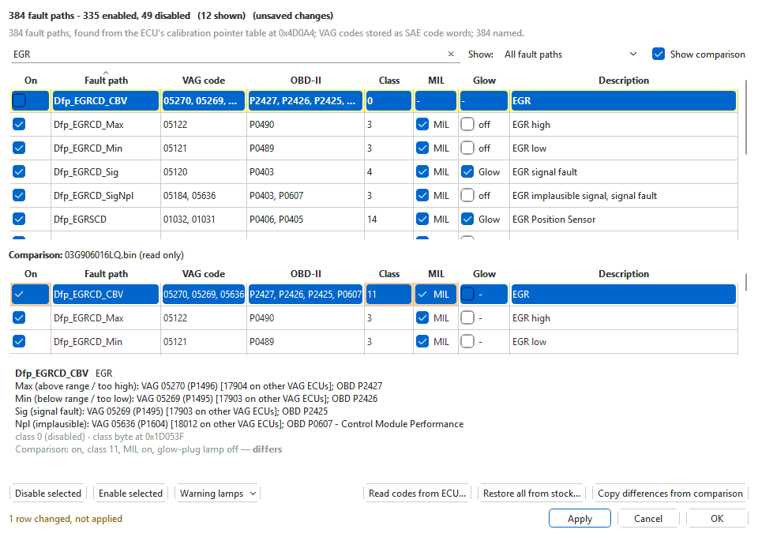
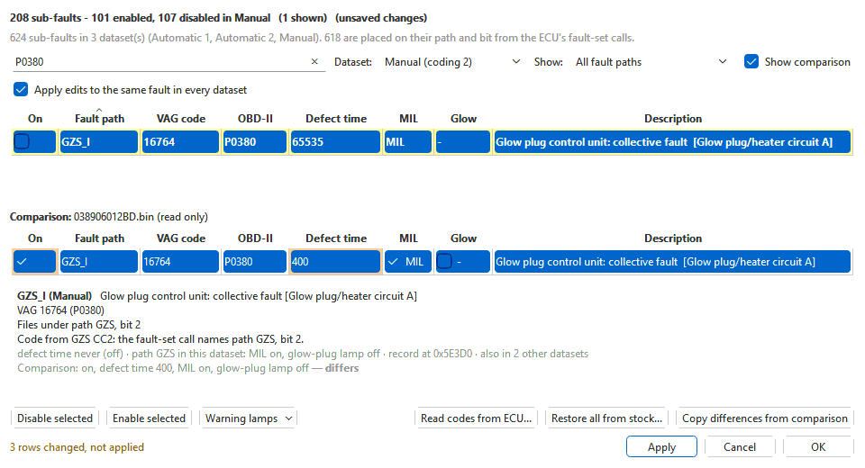

# DTC / Fault-Path editor

**Tools > DTC / Fault-Path editor...** (Ctrl+D) lists every trouble code the
open engine calibration can set, and lets you switch each one off or back on.
Use it when a fault is set by something the car genuinely does not have — a
part that was never fitted, or a system that changed in an engine or gearbox
swap — or to put a calibration's codes back the way the factory had them.

It works on **Bosch EDC16** and **Bosch EDC15** files (it needs the matching
module). On a **ZF 6HP** or **ZF 8HP** gearbox file the same menu item opens
the gearbox fault-code window instead, which works differently — see
[ZF 6HP fault codes](../modules/zf6hp/fault-codes.md) and
[ZF 8HP fault codes](../modules/zf8hp/fault-codes.md).

> Switching a code off stops the ECU storing it and reacting to it. It does
> not fix whatever made the code appear. Only switch off a code when you know
> why it is set.

## Find a code

Type into the search box at the top. You can search for:

- a fault number **as your scan tool shows it** — `00257`, `257`, `16485`,
  `05719`;
- an **OBD-II code** — `P0101`, `P0380`;
- a **name or a word** from the description — `EGR`, `glow`, `boost`,
  `A/C`.

Several words narrow the list (every word must match). Every code a fault
can set is searched, not just the first one — on EDC16 one fault path can
carry up to four OBD-II codes and four VAG codes.

VW ECUs report the same fault under two numbering schemes: older ones as a
five-digit VAG number (`19456` for P3000, `16485` for P0101), later ones as
the OBD word itself (`12288` for P3000, `00257` for P0101). The search
finds a fault by either number, whichever one this ECU stores, and the
panel under the table shows the other one in brackets.

**Show** narrows the list further: **Enabled**, **Disabled**, **With a fault
code**, **Lights the MIL**, **Lights the glow-plug lamp**, and, with a
comparison open, **Differs from comparison**. After **Read codes from ECU...** it also offers **Stored on the
ECU**.

Click a column heading to sort by it.

## One dataset (or coding copy) at a time

On an **EDC15** file every dataset — Manual, Automatic 1, Automatic 2 … —
holds its own copy of every sub-fault, and the ECU runs the one its coding
selects (see [EDC15 datasets](../modules/edc15/datasets.md)). The
**Dataset** box at the top shows one of them at a time, named with the coding
that selects it (**Manual (coding 2)**); it starts on the first. Choose
**All datasets** to list every copy, the dataset in brackets after each name.

**Apply edits to the same fault in every dataset** (ticked to start with)
makes switching a code, or its lamp, do the same in every other dataset that
has that fault with the same code — so the change holds
whichever dataset the car's coding picks. Untick it to change only the
dataset shown.

Most **EDC16** files keep one set of fault-path tables. A few let a coding
read its own copy of some of them from the secondary calibration block — on
03G906021MP (P447) two of the codings read their own fault classes and
class definitions, which light the MIL for faults the other codings keep
quiet; on 070906016DP (R50) the coding state reads its own codes and
classes. There the box is **Coding copy**: **Main block** (what the
definition places) and each copy, named with the codings that read it. The
same **Apply edits to every coding copy** box switches a code in every copy at
once; warning lamps are switched per copy, because a copy can define its
classes differently.

## Switch a code off or on

1. Find the code (above).
2. Untick the box in the **On** column to switch it off; tick it to switch it
   back on. The row turns grey when it is off.
3. To switch several at once, select the rows (Shift- or Ctrl-click, or
   Ctrl+A for everything the search shows) and press **Disable selected** or
   **Enable selected**, or right-click them.
4. Press **Apply** to keep the changes and carry on, or **OK** to keep them
   and close the window. **Cancel** takes back every change made since the
   last **Apply** (or since the window opened) and closes.
5. Save (**File > Save**, Ctrl+S): the edits become a new version of the
   tab's branch in the project, and the checksums are corrected as it is
   saved.

## Apply, Cancel and OK

A change made here reaches the file at once, so the main window and the
comparison shading show it straight away; the rows changed since the window
opened or since the last **Apply** are shaded pale yellow, in bold, and the
count is shown beside the buttons (while a row is yellow, its difference from
the comparison is shaded orange in the comparison's table only). See
[Table colours](#table-colours).

- **Apply** keeps those changes as **one** undo step — however many rows,
  lamps and datasets they touched — and clears the shading. Switching a row
  off and back on again leaves no undo step at all.
- **Cancel** takes back every change made since the last **Apply** (or since
  the window opened) — the bytes go back exactly as they were — and closes the
  window. Changes applied earlier, and your other undo history, stay. If you
  edited the file in the main window in between, those edits stay too, and
  the take-back is an undo step of its own.
- **OK** applies, as **Apply** does, and closes the window.
- The title bar's X and Esc work as **Cancel**, but ask first when there are
  changes not applied: **Apply** keeps them, **Discard** takes them back,
  **Cancel** keeps the window open.

What has been applied is an ordinary edit: **Edit > Undo** (Ctrl+Z) takes
each **Apply** back in one step. The window can stay open while you work in
the main window, and it follows edits made there (undo, a patch, the table
grid).

## Keep a code but switch a warning lamp off

A fault can light two lamps: the engine warning lamp (**MIL**) and the
**glow-plug lamp**, which these diesels also flash or light for engine
faults. Each has its own tick box column, **MIL** and **Glow**.

Untick a box to keep the fault — it is still detected and stored, and a scan
tool still reads it — without that lamp. Tick it again to bring the lamp back.
For several rows, select them and use **Warning lamps** (under the table) or
right-click: **MIL off, keep the fault**, **MIL on**, **Glow-plug lamp off,
keep the fault**, **Glow-plug lamp on**.

A lamp box can only be switched on a row that is on; a row without a tick box
says why when you hover over it.

How a lamp is switched depends on the platform:

- **EDC16**: each fault class says how it drives the MIL and the system lamp
  (off, on or flashing). The system lamp is the glow-plug lamp: the ECU's
  fault-lamp handler hands system-lamp faults to the glow control, which lights
  the glow-plug lamp. A lamp is switched for one fault path by moving it to the
  class closest to its own that differs only in that lamp — the other lamp
  exactly as it was, and as many of the class's other settings (how many
  detections enter the fault, how long it stays stored, OBD readiness) as
  possible. On P475 and P350 software the classes come in pairs that differ
  only in the glow-plug lamp (11 and 12, 13 and 14...), so switching the glow
  lamp moves between the two of a pair; switching the MIL off goes to class 1
  (no lamp) or 2 (glow-plug lamp only) on P475. Hover over a box, or look at the
  panel under the table, to see which class it will be. Switching the lamp back
  puts back the class the path had. To pick the class yourself, right-click
  and choose **Set fault class**: every class is listed with the lamps it
  lights.
- **EDC15**: the lamps are bits of the fault path's class byte
  (`fbwS<PATH>PRI`): bit 1 is the MIL and bit 2 the diagnosis lamp ("DIA"),
  which the ECU shows on the glow-plug lamp. They switch for the whole fault
  path in that dataset — every sub-fault filed under it. The tooltip says which
  path and how many sub-faults.

## Every code a row can set

Select a row and the panel under the table lists what it can set.

On **EDC16** a fault path watches for four kinds of error, and each can have
its own codes:

| Error type | Meaning |
|---|---|
| **Max** | above range / too high (for a circuit: short to plus) |
| **Min** | below range / too low (short to ground) |
| **Sig** | signal fault (no signal, open circuit) |
| **Npl** | implausible |

For each type the panel shows the **VAG** number and the **OBD-II** code. A
VAG number on software that stores it as an SAE code also shows the P-code it
stands for, e.g. `VAG 05719 (P1657)`. A type with no VAG code of its own is
not listed as one; reading the ECU still finds the fault if it reports it.

On **EDC15** each row is one sub-fault; the panel shows its code and which
fault path and bit the ECU files it under.

## What "off" means

The two engine platforms store a fault differently, so the editor changes a
different value on each.

| | EDC16 | EDC15 |
|---|---|---|
| A row is | one fault path (`Dfp_...`) | one sub-fault of a fault path in the dataset shown; with **All datasets**, once per dataset, the dataset in brackets, e.g. **GZS_I (Manual)** |
| **Class** / **Defect time** shows | the path's fault class: which lamp the fault lights and how it is stored | the time until the fault is finally set, in the ECU's raw units (10 ms steps) |
| Switching off | sets the class to 0 (no class: the path does nothing — the factory calibration itself uses it for paths that are not used) | sets that time to "never" (the value the factory calibration itself uses for faults that are not fitted) |
| Switching back on | restores the class it had before; if none is known, a class that lights the MIL | restores the time it had before; if none is known, 1.0 s |

Every EDC16 class other than 0 stores the fault. Many — class 1 is the
commonest — light no lamp at all, so a code can be **on** without ever
showing on the dash; a scan tool still reads it. The **MIL** column shows
which ones light the engine warning lamp.

The value a code had before you switched it off is remembered while the file
is open. For a file that was already modified before you opened it, use
**Restore all from stock...** (below) to get the factory values back.

On an EDC15 file, each dataset has its own copy of every fault path. Change
the dataset your car uses — or all of them if you are not sure (the
**Apply edits to the same fault in every dataset** box, above). See
[EDC15 datasets](../modules/edc15/datasets.md).

## The columns

| Column | What it shows |
|---|---|
| **On** | Ticked when the fault is active (it is detected and stored). |
| **Fault path** | The calibration's own name for the fault. A path no definition names shows as **fault path _n_**; it can still be switched. |
| **VAG code** | Every VW fault number the row can set, as a scan tool shows it (at least five digits). On EDC15, **(path: ...)** lists the path's numbers when which one the sub-fault sets is not known. **-** means none. |
| **OBD-II** | Every standard P-code the row can set. |
| **Class** (EDC16) / **Defect time** (EDC15) | See the table above. |
| **MIL** | Ticked (**MIL**) when the code lights the engine warning lamp. Untick it to keep the fault without the lamp (above). |
| **Glow** | Ticked (**Glow**) when the code lights (or flashes) the glow-plug lamp. Untick it to keep the fault without the lamp (above). |
| **Description** | A plain description of the fault path, else the standard OBD-II text for its code; empty when there is neither. |

The **MIL** and **Glow** columns are left out when the file's definition does
not say which lamps a fault lights — an EDC15 definition that places no
fault-path class bytes (`fbwS<PATH>PRI`), or an EDC16 one without the class
definitions.

## Comparing with another file

With a comparison file open (the tab's comparison — in a project, the
original as read once the tab is saved) its fault codes are shown in a
read-only table of their own under the primary's, row for row: the same
fault on the same row, sorted, scrolled and selected with the primary's.
Every cell that differs is shaded orange in both tables, as in the table
editor, and a shaded primary cell's tooltip gives the comparison's value; the panel under the table says what the
comparison has for the selected row. **Show comparison** hides or shows the
lower table (the shading stays), and **Show > Differs from comparison** lists
just the rows whose state — on/off, class or time, lamps — differs. A fault
the comparison does not have shows **—**.

## Table colours

The tables use the colours of the rest of the app:

| Colour | Meaning |
|---|---|
| Pale yellow, bold | Changed here, not applied yet: **Apply** or **OK** keeps it, **Cancel** takes it back. The whole row, in the table above only; it takes the place of orange and violet there. |
| Orange | This cell differs from the comparison (in both tables; the comparison's copy stays orange while the row above is yellow). |
| Light violet | The car's ECU has this fault stored (after **Read codes from ECU...**). The whole row, under any orange cell. |
| Grey text | The fault is switched off (or, in the comparison, not in that file). |
| Accent colour (blue) | Selected rows; the comparison selects the same row. |

Every other row is shaded lightly, as in the table editor, to help follow a
row across.

The line under the title says where the fault tables were found and how many
paths have names.

## Where the codes come from

Nothing in this window is guessed from another file.

- **EDC16**: the fault-path tables are found from the ECU's own table of
  calibration pointers, so every path in the file is listed even where the
  matched definition does not cover it. The codes are read exactly as
  stored. Path names come from the matched definition, checked against each
  path's own number; where the definition does not fit the file, names come
  from a catalogue built from reference files whose definitions name every
  path, and the window says so.
- **EDC15**: which path and bit a sub-fault files under comes from the code
  that raises it, not from its name — the names in the factory data do not
  always match (the boost-control deviation faults are named after the boost
  valve but filed under the boost-pressure path). On MSA15 / EDC15V files the
  definition's grouping is used.

## Buttons

| Button | What it does |
|---|---|
| **Disable selected** / **Enable selected** | Switches every selected row off or on. |
| **Warning lamps** | For the selected rows: MIL off / on, glow-plug lamp off / on, keeping the faults. |
| **Read codes from ECU...** | Opens the **Fault codes from ECU** window, which reads the codes stored in the car's ECU (see [Reading fault codes](../logging/fault-codes.md)). Every row that can set one of the codes read is then shaded light violet (one code can belong to several rows) and **Show** switches to **Stored on the ECU** — pick **All fault paths** to see them among the rest; codes the ECU has stored that are not in this file are listed under the table. |
| **Restore all from stock...** | Copies every fault path's class (EDC16) or time (EDC15) from a stock binary of the same software — a quick way to undo all fault-code changes in a tune. In a project you are offered the set's original (as read): **Use the original**, or **Another file...** to pick a stock file. |
| **Copy differences from comparison** | Only with a comparison open. Sets every row of the dataset shown (or every dataset) whose state differs to the comparison's value. |
| **Apply** | Keeps the changes made since the window opened or the last **Apply** (rows shaded pale yellow) as one undo step; the window stays open. |
| **Cancel** | Takes back the changes made since the last **Apply** (or since the window opened) and closes the window. |
| **OK** | Applies, as **Apply** does, and closes the window. Applied changes stay in the tab until you save or undo them. |

Every change made by these buttons, the tick boxes and the right-click menu
counts towards the next **Apply** — or is taken back by **Cancel**.

Right-click selected rows for **Disable**, **Enable**, the lamp switches,
**Set fault class** (EDC16), **Copy codes to clipboard** and, with a
comparison open, **Copy comparison state to primary**.

## Tips

- An EDC16 class number is not a simple on/off: different classes light
  different lamps and store the fault differently. Prefer the **On**, **MIL**
  and **Glow** boxes, **Set fault class**, or copying from a stock file over
  typing class numbers into the fault-code tables in the main window.
- The fault-path settings are also in the main window's tree under
  **Fault codes (DTCs)**, grouped by system, if you need to see the other
  values a fault path carries.

