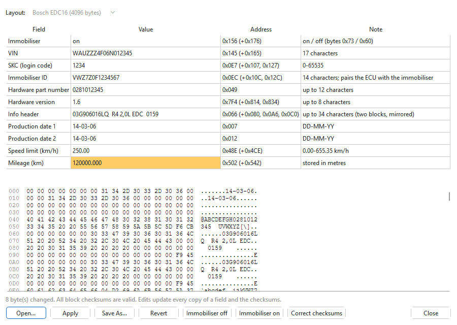

# EEPROM editor

**Tools > EEPROM editor...** edits an engine ECU's EEPROM -- the small
memory where it keeps the VIN, the immobiliser pairing, the login code
(SKC), the odometer and the values it learns. One editor handles every
EEPROM a module knows:

| EEPROM | Size | Module | Fields |
|---|---|---|---|
| Bosch EDC15 | 512 bytes | Bosch EDC15 | [The EDC15 EEPROM](../modules/edc15/eeprom.md) |
| Bosch EDC16 | 4 KB | Bosch EDC16 | [The EDC16 EEPROM](../modules/edc16/eeprom.md) |

> The EEPROM pairs the ECU with the car's immobiliser. A wrong value can stop
> the engine starting. Keep the original EEPROM before you change anything,
> and check every value before you write.

## Opening an EEPROM

- **From the project.** A set that holds an EEPROM -- an EDC15 full backup
  or EEPROM read from the flasher, or an imported `.dim`, `.edc15`, `.edc16`
  or KWHack `.edc15bak` that carries one -- has it in its tab, and the menu
  item opens it, titled *... [EEPROM]*.
- **From a file.** With no EEPROM in the tab, the menu item asks for an
  EEPROM image (`.bin`, `.eep`, `.rom`). **Open...** in the editor opens
  another one.
- **From the car.** **Read EEPROM** in the flasher (EDC15) reads it into a
  project -- a new one, or a new branch (*EEPROM read <date>*) of the EDC15
  project in front -- and opens it here at once. See
  [Reading](../flashing/reading.md).

**Layout** at the top says which control unit's EEPROM it is. It is chosen
from the image's size, and -- when two layouts could fit -- from which one's
own checksums agree; pick the other one there if it guessed wrong. An image
of a size no installed module knows is refused, naming the sizes it knows.
The menu item is greyed out when neither the EDC15 nor the EDC16 module is
installed.

## Editing

1. Double-click a value in the **Value** column and type the new one.
2. Press Enter. The value is written to the field **and to every copy of
   it**, and the checksums that cover it are corrected.
3. The changed value turns orange, and the changed bytes are highlighted in
   the hex view below. The line under the hex view counts the changed bytes
   and gives the checksum state.

An invalid entry (wrong length, out of range) is refused with a message and
the field keeps its value. The window title gets a **\*** while there are
unsaved changes.

| Column | What it shows |
|---|---|
| **Field** | The field's name. |
| **Value** | The decoded value; editable. |
| **Address** | Where the field is, with its copies in brackets, e.g. **0x145 (+0x165)**. **copies differ** in red means the copies do not agree -- something other than this editor wrote one of them. |
| **Note** | What the value means and how to enter it. |

## Buttons

| Button | What it does |
|---|---|
| **Open...** | Opens another EEPROM image from disk; from then on the editor works on that file, not the project. |
| **Apply** | For the EEPROM of a project's set: puts the edits into the tab as one undoable edit (**Edit > Undo** takes them out). **File > Save** keeps them in the project, flash and EEPROM together, as a new version. |
| **Save** | Instead of **Apply**, for an EEPROM image opened from disk: writes that file. |
| **Save As...** | Writes the EEPROM alone as a `.bin`. A project is not changed by it. |
| **Revert** | Goes back to the EEPROM as it was opened or last applied or saved. |
| The layout's own | EDC15: **Virginize...**. EDC16: **Immobiliser off**, **Immobiliser on**, **Correct checksums**. See each module's page. |
| **Write to ECU...** | Opens the flasher with this EEPROM ready to write (EDC15; the flasher does not write an EDC16 EEPROM). |
| **Close** | Closes the editor. Changes to a project's EEPROM go into its tab even without **Apply**. |
