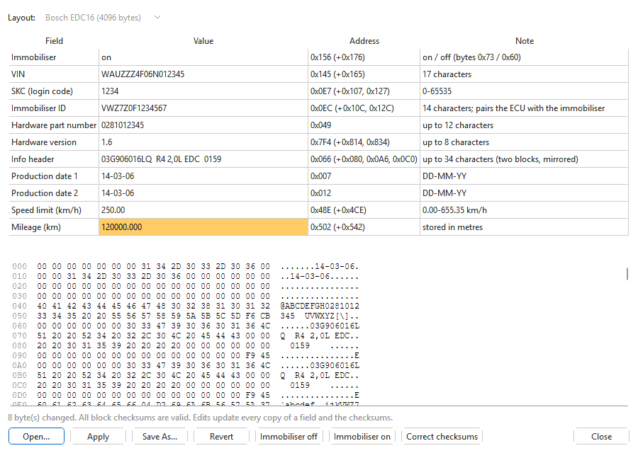

# EEPROM editor

**Tools > EEPROM editor...** edits an engine ECU's EEPROM -- the small
memory where it keeps the VIN, the immobiliser pairing, the login code
(SKC), the odometer and the values it learns. One editor handles every
EEPROM a module knows:

| EEPROM | Size | Module | Fields |
|---|---|---|---|
| Bosch EDC15 | 512 bytes | Bosch EDC15 | [The EDC15 EEPROM](../modules/edc15/eeprom.md) |
| Bosch EDC16 | 4 KB | Bosch EDC16 | [The EDC16 EEPROM](../modules/edc16/eeprom.md) |

> The EEPROM pairs the ECU with the car's immobiliser. A wrong value can stop
> the engine starting. Keep the original EEPROM before you change anything,
> and check every value before you write.

## Opening an EEPROM

**Tools > EEPROM editor...** is there only when the tab in front **is** an
EEPROM or **stores** one; otherwise it is hidden. The editor opens no files.

- **An EEPROM tab.** An EEPROM imported on its own (File > Import, or a file
  opened or dropped) is recognised by its structure -- the module's layout --
  not only by correct checksums, so an EEPROM edited elsewhere, with wrong
  checksums, still loads (the editor then offers to correct them). It **opens in this
  editor by itself**, instead of the hex editor; the menu item brings it back.
- **A paired EEPROM.** An EEPROM paired with a flash in the project (asked when
  you import it into a project that holds the flash; automatic when both are
  imported together) is that flash's EEPROM: with the flash in the tab, the
  menu item opens it. See [An ECU's EEPROM in a
  project](../projects.md#an-ecus-eeprom-in-a-project).
- **Stored in the file.** The EEPROM a `.dim`, `.edc15` or `.edc16` carries, a
  full backup's, or an EEPROM read from the car in the flasher (EDC15: **Read
  EEPROM**, into a project -- see [Reading](../flashing/reading.md)).

**File > Export > EEPROM (.bin)...** writes the tab's stored EEPROM out as a
plain image; the item is there only when the tab stores one.

**Layout** at the top says which control unit's EEPROM it is. It is chosen
from the image's size, and -- when two layouts could fit -- from which one's
own checksums agree; pick the other one there if it guessed wrong. An image
of a size no installed module knows is refused, naming the sizes it knows.
The menu item is greyed out when neither the EDC15 nor the EDC16 module is
installed.

## Editing

1. Double-click a value in the **Value** column and type the new one.
2. Press Enter. The value is written to the field **and to every copy of
   it**, and the checksums that cover it are corrected.
3. The changed value turns orange, and the changed bytes are highlighted in
   the hex view below. The line under the hex view counts the changed bytes
   and gives the checksum state.

An invalid entry (wrong length, out of range) is refused with a message and
the field keeps its value. The window title gets a **\*** while there are
unsaved changes.

| Column | What it shows |
|---|---|
| **Field** | The field's name. |
| **Value** | The decoded value; editable. |
| **Address** | Where the field is, with its copies in brackets, e.g. **0x145 (+0x165)**. **copies differ** in red means the copies do not agree -- something other than this editor wrote one of them. |
| **Note** | What the value means and how to enter it. |

## Immobiliser On / Off

Both layouts show an **Immobiliser** box above the fields with **On** and **Off** radio buttons. Clicking one writes the state into every copy and corrects the checksums, the same as editing the immobiliser field (clicking the one already ticked changes nothing); the box turns amber while it differs from the opened image. If the image holds a state that is neither (EDC15: record invalid, or an unknown byte), neither button is ticked and the status field shows the byte.

## Buttons

| Button | What it does |
|---|---|
| **Apply** | Puts the edits into the tab as one undoable edit (**Edit > Undo** takes them out). **File > Save** keeps them in the project as a new version of its own, named for what changed (*EEPROM edit: VIN, Odometer*); with a paired flash it is a version of the flash's branch that changes only the EEPROM. |
| **Export...** | Writes the EEPROM alone as a `.bin`. The tab and the project are not changed by it. |
| **Revert** | Goes back to the EEPROM as it was opened or last applied or saved. |
| The layout's own | EDC15: **Virginize...**. EDC16: **Correct checksums**. See each module's page. |
| **Write to ECU...** | Opens the flasher with this EEPROM ready to write (EDC15; the flasher does not write an EDC16 EEPROM). |
| **Close** | Closes the editor. Changes to a project's EEPROM go into its tab even without **Apply**. |
