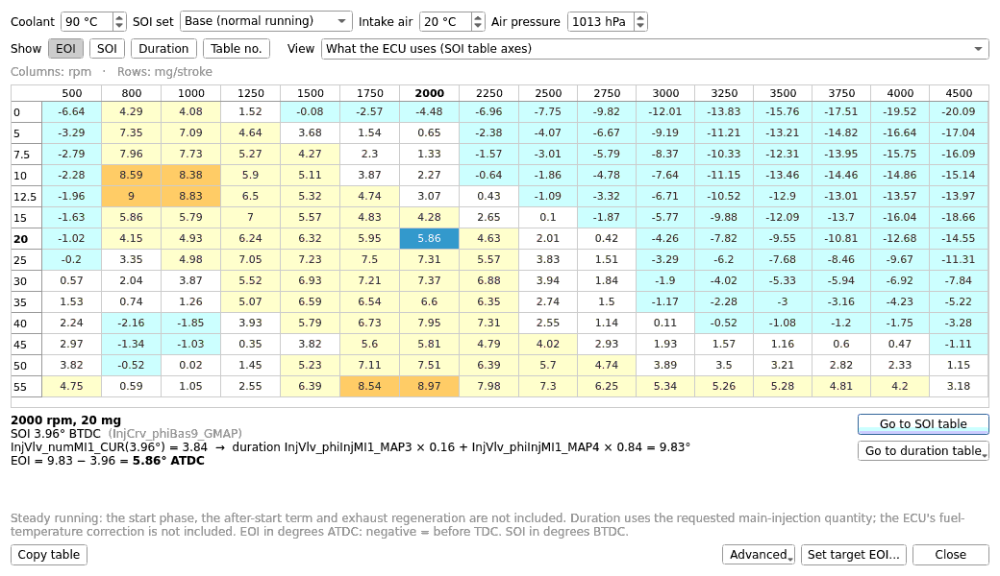

# End of injection

**Tools > End of injection...** shows when the injection ends on a
unit-injector (PD) engine with a Bosch EDC15P or EDC16 ECU, and lets you set
it. **End of injection...** is also in the right-click menu of the
start-of-injection and injection-duration tables. The window belongs to the
tab: it stays open beside the grid and follows every edit and undo.

It needs the Bosch EDC15 or EDC16 module. Distributor-pump (VP37) software is
not supported: that pump meters fuel with a spill collar, and the ECU never
calculates an injection duration.

## How the ECU gets there

The ECU stores no end of injection. It works one out from two sets of tables:

- the **start of injection (SOI)**: one of several tables, or a blend of two,
  picked by coolant temperature;
- the **duration** (crank degrees): one of several tables, or a blend of two,
  picked by the SOI itself, because the cam pushes the injector plunger at a
  different speed depending on where the delivery starts.

A selector curve gives a table number with a fraction: 3.84 means 16 % of
table 3 and 84 % of table 4. The fraction counts: the selector is stored with
a fraction byte, the curve is interpolated between its breakpoints, and the
ECU's code blends the two tables by that fraction, not half and half. (Checked
in the code of an EDC15P, 038906019GQ, and an EDC16, 03G906016KN; every table
set on both is read this way.) At full warm-up most files use the last SOI
table alone; the fraction matters most for the duration, whose selector input,
the SOI itself, nearly always falls between two breakpoints.

On top of that SOI the ECU adds a correction for **altitude** (atmospheric
pressure) and one for **intake-air temperature**, each its own set of tables,
and then caps the result with the **SOI limiter** (EDC15 `fnwSWMX_KF`, EDC16
`InjCrv_phiMIMax_MAP`, by engine speed and coolant).

On EDC16 the base SOI tables are not the only set: while the smoke limit is
the torque limit that applies, usually at full throttle, most PD software uses
the **dynamic SOI** set (`InjCrv_phiDyn0..4_GMAP`) *instead*, often several
degrees earlier. Some software (03G906016KN, 03G906021NK) also switches to
per-gear SOI maps once warm. The end of injection is then

**EOI = duration − SOI**, in degrees **after** TDC. A negative EOI is before
TDC. Tune from logs uses the same convention.

The window does exactly this with the tables in your file.

## The window

- **Coolant**: which SOI tables the ECU uses (warm by default).
- **SOI set**: **Base (normal running)**, **Start (cranking)**, and on
  EDC16 **Dynamic (smoke-limited)** for full-load running or a **Gear** set
  where the software has them. (EDC15 has a dynamic set too, but every
  reference file switches it off; it is offered when a file switches it on.) The line under it says when the
  ECU uses that set. Editing in a set changes that set's tables only.
  The start tables run over engine speed and *coolant*, so with **Start** the
  grid's rows are coolant temperatures, the **Coolant** box is greyed out, and
  the duration is read at the **Start quantity** you enter (the ECU asks for
  a start torque, not a quantity, so take it from a log of a start).
- **Intake air** and **Air pressure**: the conditions for the air-temperature
  and altitude corrections (20 °C and 1013 hPa to start with; on most stock
  files both corrections are zero there, on some the air correction is not).
- **Fuel temperature**: the duration maps were measured at a reference fuel
  temperature (about 68 °C at part load on GQ and LQ); away from it the ECU
  corrects the quantity the maps read, so cold fuel gives a shorter duration
  and an earlier end of injection. **Reference** (the default) leaves the
  quantity as it is. Click a cell to see the corrected quantity. While
  starting, most files use the coolant temperature here instead.
- **Dataset** (EDC15): the dataset to show.
- **Show**: **EOI**, **SOI** (degrees before TDC), **Duration**, or
  **Table no.** (which duration tables are read, with the fraction).
- **View**: *What the ECU uses* is the grid over the SOI table's own
  breakpoints. A **Duration table** entry shows that table on its own axes:
  white cells are used alone at this coolant temperature, shaded ones are
  blended with a neighbouring table, grey ones are not used at all.

EOI cells are coloured from before TDC (green) to late (red). An *italic*
value is one where the SOI limiter (EDC16 `InjCrv_phiMIMax_MAP`) caps the SOI.

Click a cell to see how it was worked out: which SOI tables were blended, the
selector value, the two duration tables and their weights, and the result.
**Go to SOI table** opens, in the main window, the SOI table the ECU reads
most at this coolant temperature, with the selected cells marked (with nothing
selected, just the table). **Go to duration table** lists the duration tables
the clicked cell reads and opens one with the cells it uses marked. The line
under the buttons says what was opened.

**SOI** and **Duration** cells are shaded from light (low) to darker blue
(high) across the grid.

The grid follows the app's table conventions: rows alternate, and a selected
cell shows in the solid accent colour (the band or shade comes back when you
select elsewhere). **Right-click** a cell for **Copy** (the selected cells as
shown, tab-separated; **Ctrl+C**), **Paste** (**Ctrl+V**: typed values from the
clipboard, from the top-left selected cell, or one value over the whole
selection -- as typing them, so it is one undo step; a copy made with **Copy
table** pastes without its headers), **Set target EOI for the selection...**,
**Go to SOI table** and **Go to duration table**.

### Comparing

With a comparison loaded, **Show comparison** (on by default) adds a second,
read-only grid **below** the first, headed with the two files' names. It holds
the comparison file's own values, worked out at the same engine speeds and
quantities as the primary's grid, so the two grids always line up even when
the comparison's SOI table has other breakpoints. They scroll together, and a
cell or range selected in one is selected in the other. A cell that differs
from the comparison has an **orange outline** in both, over the EOI band or
the shade it keeps. The window opens large enough for both grids on a
laptop-size screen, and the bar between them shares out the height.

Right-click either grid for **Copy comparison → primary** (the selected
cells: the primary is changed as if you had typed the comparison's values,
in the view shown, as one undo step) and **Copy primary − comparison** (the
difference of the selected cells, as text).

## Changing it

Type a value into a cell. What changes depends on what is shown:

| Show | Typing a value | Fuelling |
|---|---|---|
| **EOI** | Moves the SOI until the EOI is what you typed, keeping the ECU's own choice of duration table | Unchanged |
| **SOI** | Moves the SOI tables the coolant picks | Unchanged |
| **Duration** | Changes every duration-table cell the ECU reads there, so its duration moves by exactly that much | **Changed**: on a PD engine the duration is the fuel quantity. The window asks first. |

In a **Duration table** view, a value is written into that table only.

**Set target EOI...** does the first row for many cells at once: one target,
optionally only where the injection ends later than it, for the selected cells
or the whole grid, and for the SOI tables you tick. Each change is one undo
step.

**Advanced > Collapse to one duration table...** writes the duration the
ECU uses today, at a reference coolant temperature, into one table and points
the selector at it. It is optional, and it is not needed to edit the
duration. It gives up what the other tables do (the quantity at other start
angles), and the dialog shows how far the duration would move at other
coolant temperatures before you confirm.

## What is not included

The numbers are for steady running, at the conditions you set. Not included:
the term that fades out after the start, exhaust-treatment regeneration
(EDC16), and the share of the fuel-temperature correction that an EDC16 file
with an electronic pilot injection gives the pilot (PD injectors pre-inject
hydraulically, so almost every file has none; the notes say when one does). EDC15 can also add a timing trim stored in the ECU's EEPROM
(adaptation channel 4); the file limits it with `fnwFNmiAG` / `fnwFNmxAG`,
which are 0 on stock files, so it is 0 there. The notes say when a file allows
one. A correction set the file's definition does not
place is named in the notes at the bottom of the window. To see the
real values while driving, log them: the **Injection timing** preset in
[Data logging](../logging.md) records start and duration, and adds a calculated
end-of-injection column.

If the definition for your file does not place every table the calculation
needs, the window lists the missing ones instead of guessing.
