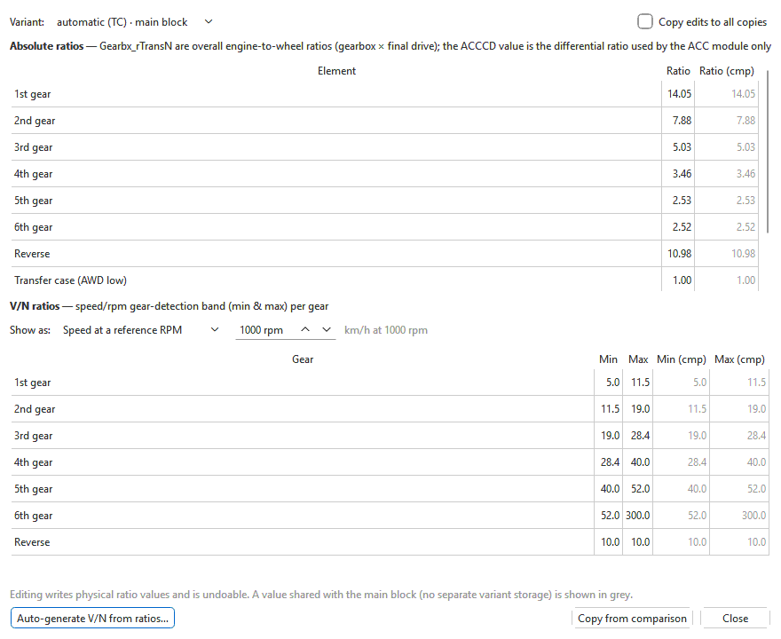
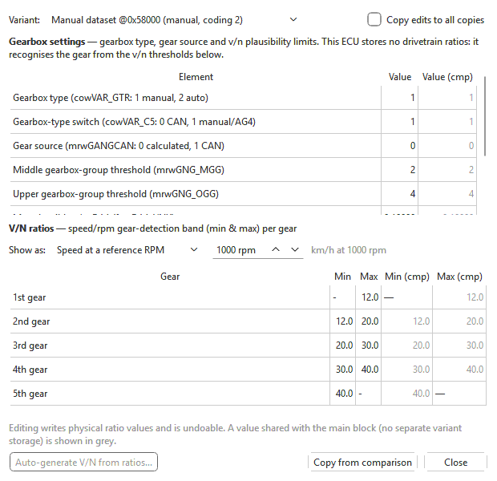

# Gear ratios

**Tools > Gear ratios...** (Ctrl+G) gathers the engine ECU's drivetrain
settings into two small tables, so you can change them together after a
gearbox, final-drive or tyre-size change.

Why the engine ECU cares: it works out which gear is engaged by comparing
road speed with engine speed (the *v/n ratio*). Everything the ECU does per
gear — per-gear torque limits, per-gear timing and EGR maps, cruise control —
depends on that recognition. If the ratios no longer match the car, the ECU
can recognise the wrong gear, or none.

It works on **Bosch EDC16** and **Bosch EDC15** files. If the file has none of
these settings, the menu item says *This binary has no recognised
drivetrain-ratio parameters.*

## The window

| Control | What it does |
|---|---|
| **Variant** | Which copy of the settings to show and edit. A file whose software serves several gearboxes holds one copy per gearbox, chosen by the car's coding — e.g. **automatic (TC) · main block** and **5-speed manual**. On EDC15 the copies are the datasets. The drop-down is greyed out when there is only one copy. |
| **Copy edits to all copies** | When ticked, every value you type is written into the same setting of every copy. |
| **Absolute ratios** | One value per drivetrain element (see below). Double-click a value to change it. On EDC15 files this table is headed **Gearbox settings** instead (see below). |
| **V/N ratios** | The lower (**Min**) and upper (**Max**) edge of the band in which each gear is recognised. Double-click to change. |
| **Show as** | How the v/n bands are shown and typed: **Speed at a reference RPM** (km/h at the rpm you set beside it), **RPM at a reference speed** (engine rpm at the km/h you set), or **Raw v/n ratio [(km/h)/rpm]**. Only the display changes; the stored values are the same. |
| **Auto-generate V/N from ratios…** | Recomputes the v/n bands from the absolute ratios and a tyre size (EDC16 only — see below; greyed out on EDC15 files, which store no ratios). |
| **Copy from comparison** | Only with a comparison file open: copies every ratio and band from the comparison into the selected variant, as one undoable step. |

A value shown in grey belongs to the main block: that copy has no storage of
its own for it, so the ECU reads the main block's value for it. Changing a
grey value changes the main block's value — and with it every copy that
shares it.

With a comparison open, **Ratio (cmp)**, **Min (cmp)** and **Max (cmp)**
show the comparison's values; those that differ are highlighted.

Every change is an ordinary edit: **Edit > Undo** (Ctrl+Z) takes it back.

## EDC16

**Absolute ratios** lists 1st to 6th (or 7th) gear, **Reverse**,
**Transfer case (AWD low)** and **ACC differential ratio (ACCCD)**. The gear
values are *overall* ratios — gearbox ratio × final drive — not the
gearbox's own ratios. The ACC differential ratio is used only by adaptive
cruise control; on cars without it, it holds a placeholder.

### After a gearbox, final-drive or tyre change

1. Choose the copy your car's coding uses in **Variant** (or tick
   **Copy edits to all copies**).
2. Enter the new overall ratios in **Absolute ratios** (gearbox ratio × final
   drive for each gear).
3. Click **Auto-generate V/N from ratios…**. Enter the tyre's **Width**,
   **Aspect ratio** and **Rim diameter**; the window shows the resulting
   rolling circumference and, for reference, the circumference it infers
   from the current bands.
4. Check the summary — how many values will change, the circumference, and
   whether the speed source is the hardware sensor or CAN — and answer
   **Yes**.
5. Check the new bands in **Show as: Speed at a reference RPM**: each gear's
   band should follow on from the one below it.

The generator keeps the 1st-gear lower edge and the top gear's upper edge as
they were, and leaves gears that are only placeholders (for example a 6th
gear on a 5-speed calibration, whose ratio repeats 5th) untouched. When the
car takes its road speed from CAN, the transfer-case ratio is folded in. The
speed-sensor pulse count is not used — set that separately in
[VSS pulse settings](vss.md). The whole change is one undoable step.

## EDC15

EDC15 stores no gear ratios. **Variant** chooses the dataset, and the window
shows:

- **Gearbox settings** (in place of **Absolute ratios**, with a **Value**
  column): the gearbox switches of that dataset — gearbox type
  (manual or automatic), the gearbox-type switch, whether the gear is
  calculated or taken from CAN, the gearbox-group thresholds and the highest
  plausible v/n values. The row names include the calibration's own symbol
  and what its values mean.
- **V/N ratios**: each gear's band, made from the thresholds between
  neighbouring gears — so the **Max** of one gear and the **Min** of the next
  are the same stored value.

After fitting taller or shorter gearing, move the thresholds with the new
ratios so the gear is still recognised. **Auto-generate V/N from ratios…**
is greyed out on EDC15 files, because there are no ratios to generate from
(its tooltip says so); type the thresholds in instead —
**Show as: Speed at a reference RPM** makes that easy.

## Tips

- Enter speeds in **Show as: Speed at a reference RPM** — "40 km/h at
  1000 rpm" is easier to check against the car than a raw ratio.
- The gear ratios of an EDC16 file with coding copies are in the main
  window too: the second copies are under **Coding variants** (see
  [How maps are found and named](../modules/edc16/maps.md)).
