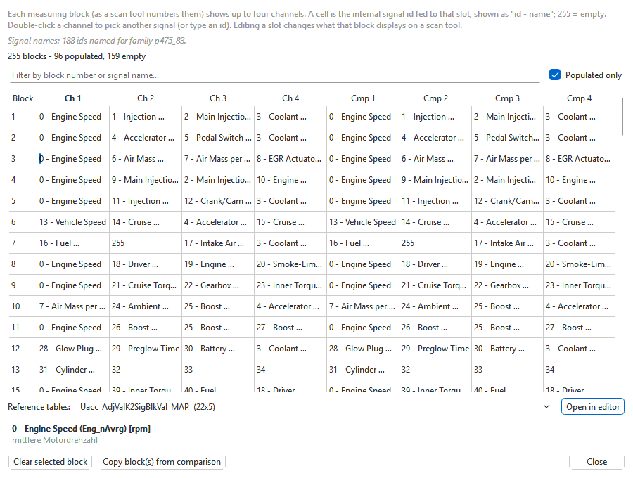

# Measuring blocks

**Tools > Measuring blocks...** (Ctrl+M) shows, and lets you change, which
signals each *measuring block* of the engine ECU reports. A measuring block is
the numbered group of (up to) four live values a scan tool or the
[data logger](../logging.md) reads in one request — block 1 might be engine
speed, injected quantity, injection duration and coolant temperature.

Changing a block changes what the car's ECU sends for that block number once
the file is written to it. The usual reason is logging: putting the signals
you want side by side into one block means fewer blocks per log, and fewer
blocks per log means more samples per second.

It works on **Bosch EDC16** and **Bosch EDC15** files. The window title is
**Measuring blocks / signal-block structure**.

## Change a channel

1. Open the file and choose **Tools > Measuring blocks...**.
2. Find the block: type its number, or part of a signal name, into
   **Filter by block number or signal name...**. Tick **Populated only** to
   hide empty blocks.
3. Double-click the channel (**Ch 1** to **Ch 4**) and pick another signal
   from the list, or type a signal id.
4. Select a channel to see its full name and notes in the panel under the
   table.
5. Save (**File > Save**: a new version in the project) and write it to the
   car (see [ECU read / write](../flashing.md)).

Each cell shows *id - name*. **255** is an empty slot. On EDC16 the id **0**
is a real signal (engine speed), not an empty one.

Every change is an ordinary edit (**Edit > Undo**, Ctrl+Z, takes it back),
and the line above the table counts the populated and empty blocks.

## EDC16 and EDC15 differ

| | EDC16 | EDC15 |
|---|---|---|
| Blocks | 255 numbered blocks, four channels each, from the calibration's measuring-block table | numbered blocks per dataset: the **Block** column shows the dataset and the number, e.g. **Manual 01** |
| A channel holds | an internal signal id | the number of a value descriptor in the same dataset |
| Signal names | from the app's signal list for the software family, where it has one; otherwise the cells show the signal id numbers and the note above the table says names are not available | from the file's own descriptors and message table |
| **Reference tables** | the calibration's related signal-block tables (adjustment, test and basic-setting displays); **Open in editor** shows the selected one in the main window | not used |

Some EDC16 software builds share their signal numbering with a closely
related build: the 038906016Q, for example, uses the same signal-number table
as the P350 family. When the file's own table is byte-for-byte the same as
that family's, its signal names are used, and the note above the table says
which family they came from. When the table differs, no names are borrowed.

On an EDC15 file, change the block in the dataset your car runs (see
[EDC15 datasets](../modules/edc15/datasets.md)).

## Buttons

| Button | What it does |
|---|---|
| **Clear selected block** | Empties the selected blocks' four channels: each becomes 255 (empty), as one undoable step. |
| **Copy block(s) from comparison** | Only with a comparison file open: sets the selected blocks' channels to the comparison's channels for the same block numbers, as one undoable step. Also on the right-click menu. |
| **Open in editor** | (EDC16) Shows the table chosen in **Reference tables** in the main window, and closes this window. |
| **Close** | Closes the window; changes stay in the tab until you save or undo them. |

With a comparison open, **Cmp 1** to **Cmp 4** show the comparison file's
channels; those that differ from the primary are highlighted.

## Tips

- Change blocks the factory left empty, or ones you never read, rather than
  the low-numbered blocks a workshop or another tool relies on.
- The logging presets (and **What to log...** in
  [Tune from logs](../modules/edc16/logtune.md)) work out which blocks to read
  from the calibration that is open in the app. After rearranging blocks,
  log with the version you actually wrote to the car open in a tab (the
  Project panel marks it *⚡ flashed*).
