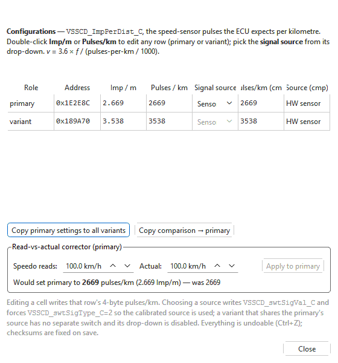
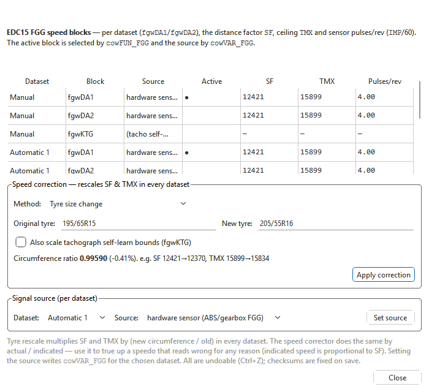

# VSS pulse settings

**Tools > VSS pulse settings...** (Ctrl+U) sets how the engine ECU turns the
vehicle-speed signal into road speed. Change it when the ECU's idea of road
speed is wrong — after a tyre-size change, a different gearbox or speed
sender, or an engine swap into a car whose speed signal comes from somewhere
else. Cruise control and the ECU's gear recognition both work from this road
speed.

It works on **Bosch EDC16** and **Bosch EDC15** files, which store the
setting differently, so the window has a different layout for each. On a
**VDO instrument cluster** file the same menu item opens the cluster's
**Speed & distance** window (K-value and speedometer needle) — see
[VDO clusters](../modules/vdo/index.md).

Every change is an ordinary edit: **Edit > Undo** (Ctrl+Z) takes it back, and
the checksums are corrected when you save.

## EDC16

The setting is the number of speed-sensor pulses the ECU expects per
kilometre. If the file has none, the menu item says *No vehicle-speed
(VSSCD_ImpPerDist_C) calibration was found in this binary.*

### The table

| Column | What it shows |
|---|---|
| **Role** | **primary** — the setting the main calibration uses — or **variant**, a second copy chosen by the car's coding (some software carries one per gearbox). |
| **Address** | Where the value is stored in the file. |
| **Imp / m**, **Pulses / km** | The same value in two units. Double-click either to type a new one. |
| **Signal source** | **Sensor** (the hardware speed sender) or **CAN** (speed over the CAN bus, from the ABS or gateway). A variant that follows the primary's source has no switch of its own; its drop-down is greyed out. |

Select cells and press Ctrl+C, or right-click for **Copy**, **Paste** and
**Select all** (the right-click menu also has **Copy comparison → primary**
with a comparison open). A paste lands with its top-left cell on the first
selected cell and sets the **Imp / m**, **Pulses / km** and **Signal source**
cells it covers (the other columns are skipped) as one undo step. Cells that
differ from the comparison are orange, in the comparison's columns and in
yours. On EDC15 Paste sets **SF**, **TMX** and **Pulses/rev** the same way.

When the source is **CAN**, the ECU takes road speed from the bus and the
pulse count is not used.

Choosing a source also sets the calibration so that the source it names is
the one used. Both changes are one undoable step.

**Copy primary settings to all variants** writes the primary's pulse count
(and source) into every variant row.

### Correct a speed that reads wrong

The **Read-vs-actual corrector (primary)** works from one measurement:

1. Drive at a steady speed and note what the ECU-derived speed reads (for
   example on a logged road-speed channel) and the true speed from GPS.
2. Enter them in **Speedo reads** and **Actual**.
3. The line below shows the pulse count it would set — *Would set primary to
   ... pulses/km* — and the old value.
4. Click **Apply to primary**.

It changes only the primary row; use **Copy primary settings to all
variants** afterwards if the variants should follow.

With a comparison file open, **Pulses/km (cmp)** and **Source (cmp)** show
its values (highlighted where they differ), **Copy comparison → primary**
copies them over, and the right-click menu copies just the selected rows.

## EDC15

EDC15 calculates road speed from a *speed block* in every dataset: a
distance factor (**SF**), a ceiling (**TMX**) and the sender's pulses per
revolution. If the file has none, the menu item says *No EDC15 FGG speed
blocks were found in this binary.*

### The table

| Column | What it shows |
|---|---|
| **Dataset** | Which dataset the row belongs to. |
| **Block** | The speed block. Each dataset has two (`fgwDA1`, `fgwDA2`); a `fgwKTG` row is the tachograph self-learn data. |
| **Source** | The dataset's speed source. |
| **Active** | ● on the block the dataset actually uses. |
| **SF**, **TMX** | The distance factor and the ceiling. Indicated speed is proportional to SF. |
| **Pulses/rev** | Sender pulses per revolution. |

Double-click **SF**, **TMX** or **Pulses/rev** of a speed block to type a value (undoable), or use the two boxes below the table to rescale every dataset at once.

### Rescale after a tyre change, or true up the speedo

1. In **Speed correction**, pick a **Method**:
   - **Tyre size change** — enter **Original tyre** and **New tyre** as
     sizes like `195/65R15`.
   - **Measured speed (actual vs indicated)** — enter what the speedo
     **indicates** and the **Actual (GPS)** speed, in the same units.
2. Tick **Also scale tachograph self-learn bounds (fgwKTG)** if the car has a
   tachograph.
3. The line below shows the ratio and an example of the new SF and TMX.
   Click **Apply correction**.

The correction multiplies SF and TMX by that ratio in **every** dataset. It
does not change the pulses per revolution.

### Change the speed source

In **Signal source (per dataset)**, choose the **Dataset** and the
**Source** — **hardware sensor (ABS/gearbox FGG)**, **Kienzle tachograph**,
**CAN ABS (Bremse1)** or **CAN instrument cluster (Kombi1)** — and click
**Set source**. Only that dataset changes.

## Tips

- Correct the speed at a steady, moderate speed on a level road and check it
  again afterwards: the correction is proportional, so one good measurement
  is enough.
- Road speed and gear recognition are linked: after changing tyres or gearing
  also check [Gear ratios](gear-ratios.md).
